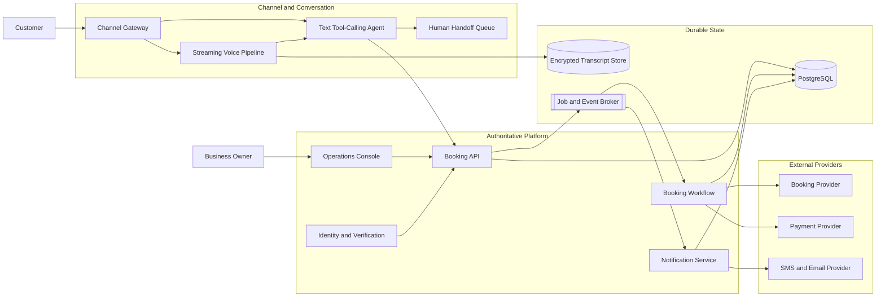
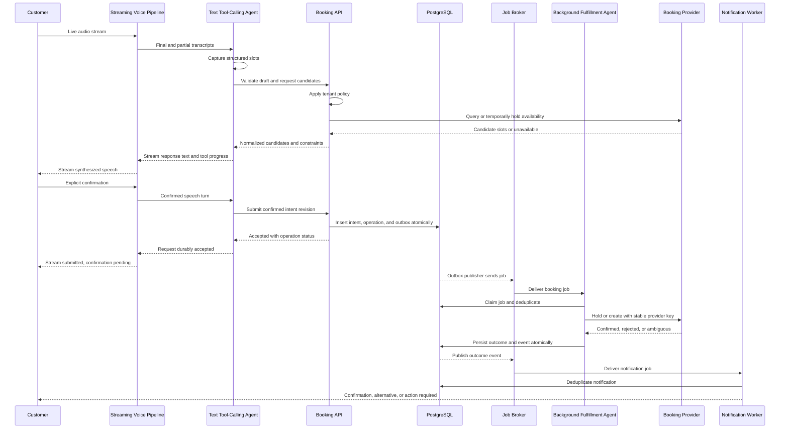
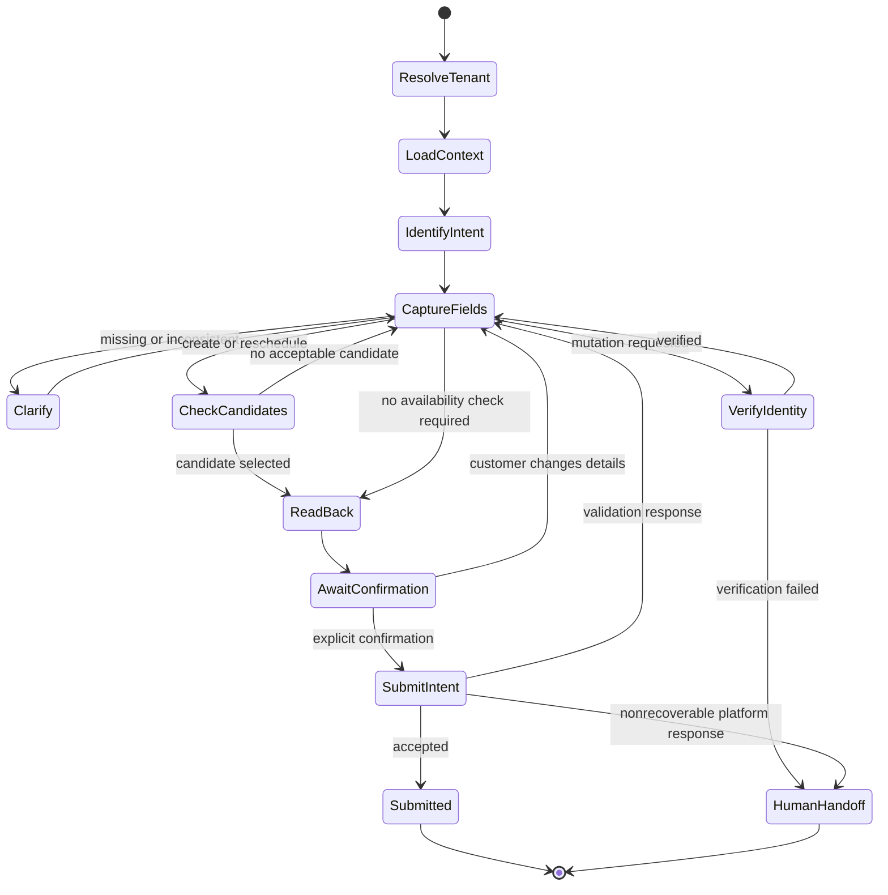
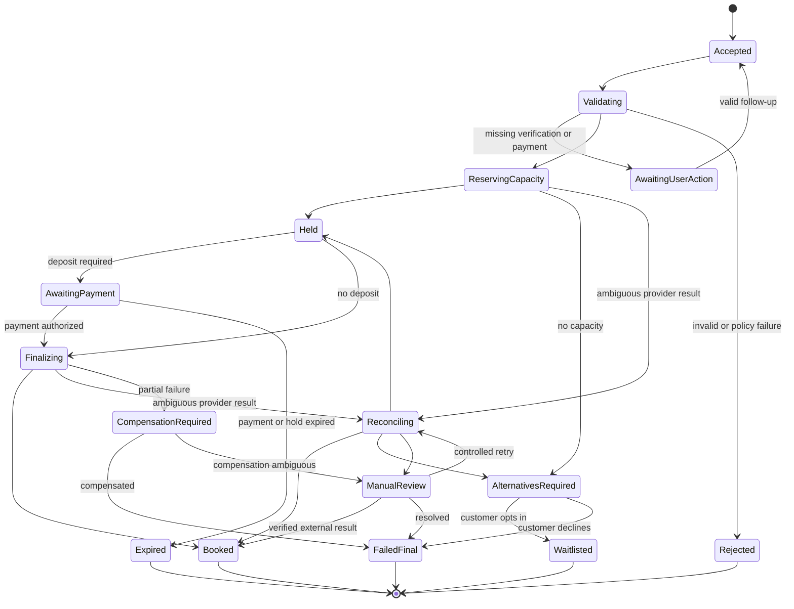

# Booking Agent and Reliable Fulfillment Design

Status: Proposed

Audience: Agent, API, platform, web, security, and operations engineers

Primary systems:

- `apps/langgraph`: realtime conversation and structured intent capture
- `apps/api`: authoritative booking state and deterministic fulfillment
- `apps/web`: customer status and owner operations
- `libs/shared-schemas`: cross-service agent and domain contracts

## 1. Purpose

Cordia lets a customer call or message a business, describe a booking in natural
language, and receive a reliable booking outcome. Restaurant tenants may also
offer pre-orders based on an owner-approved structured menu.

The interaction should feel immediate, but booking fulfillment is not assumed to
complete inside the conversation. The conversational agent captures, validates,
and confirms a structured intent. A durable platform workflow then performs
availability, capacity reservation, payment, provider booking, notification, and
recovery.

This document defines:

- the boundary between probabilistic agent behavior and deterministic business
  execution;
- the booking intent, revision, and confirmation model;
- voice and chat behavior;
- durable submission from the agent to the platform;
- at-least-once queue processing with effectively-once business effects;
- idempotency, deduplication, atomic capacity control, retries, reconciliation,
  dead-letter handling, and manual recovery;
- payment, waitlist, menu, security, privacy, and observability requirements;
- implementation ownership in the Cordia monorepo.

## 2. Design Principles

### 2.1 The agent proposes; the platform disposes

The agent may interpret language, ask questions, suggest alternatives, and
construct a booking draft. It must not be the authority for:

- whether capacity exists;
- whether a booking was created;
- whether payment succeeded;
- whether a cancellation or modification is authorized;
- whether an external provider accepted an operation;
- the final state of a booking.

Only the platform's persisted state and verified provider responses are
authoritative.

Cordia separates agent work into two lanes:

- **Foreground conversational agent:** fast, customer-facing, streaming, and
  limited to slot capture, lightweight validation, candidate checks,
  deterministic read-back, and durable intent submission.
- **Background fulfillment agent/workflow:** asynchronous, durable, and allowed
  to perform booking mutations, manage-booking operations, payment, retries,
  reconciliation, compensation, notifications, and human-review routing under
  the platform state machine.

The foreground agent optimizes latency. The background agent optimizes
correctness and recovery.

### 2.2 A transcript is evidence, not a command

The raw transcript is retained only for audit, support, quality evaluation, and
fallback recovery. It is not the primary fulfillment payload.

The agent captures structured fields during the dialog through constrained tool
calls. Post-call transcript extraction may identify possible missing information
or aid a human reviewer, but it must never silently create or change a booking.

### 2.3 Confirmation applies to an immutable revision

The customer confirms a canonical representation of a specific booking intent
revision. Any material change creates a new revision and invalidates the prior
confirmation.

### 2.4 Delivery and business effects are different guarantees

Cordia does not claim exactly-once message delivery. Brokers, workers, networks,
and external providers may duplicate requests or acknowledgements.

Cordia provides:

- at-least-once message delivery;
- durable operation identity;
- idempotent consumers;
- database uniqueness and concurrency constraints;
- stable external-provider idempotency keys;
- reconciliation after ambiguous outcomes;
- effectively-once business effects within the supported boundaries.

### 2.5 Idempotency is not capacity control

An idempotency key prevents duplicate execution of the same logical operation.
It does not prevent two distinct customers from racing for the same capacity.

Capacity must be protected independently through an atomic hold, conditional
write, row lock, optimistic concurrency token, or an equivalent provider-side
reservation primitive.

### 2.6 User-facing language must match persisted truth

The agent must distinguish:

- "I have the details and am submitting your request."
- "We are still confirming this with the business."
- "Your booking is confirmed."
- "That slot is no longer available."

A read-back confirms intent details. It does not itself confirm a booking.

## 3. Scope

### 3.1 In scope

- voice, web chat, social messaging, SMS, and email intake;
- tenant resolution;
- customer discovery and optional personalization;
- structured booking creation;
- modification and cancellation with step-up verification;
- asynchronous fulfillment;
- first-party capacity and external booking providers;
- deposits through payment links or tokenized cards on file;
- waitlist offers;
- restaurant menu ingestion and pre-orders;
- notification delivery;
- human handoff and owner operations;
- durable retry and reconciliation.

### 3.2 Out of scope

- implementation-specific broker selection;
- provider-specific booking adapter details;
- payment processor selection;
- model vendor selection;
- business-specific cancellation and refund policy content;
- marketing campaign implementation.

Those choices must satisfy the contracts and invariants defined here.

## 4. Terminology

| Term | Meaning |
|---|---|
| Session | One voice call or messaging conversation |
| Turn | One customer or agent contribution within a session |
| Booking draft | Mutable structured fields being assembled in-dialog |
| Booking intent | Immutable submitted representation of a requested booking |
| Intent revision | A numbered immutable version of an intent |
| Confirmation | Evidence that the customer accepted a canonical intent revision |
| Operation | One durable requested side effect, such as create, modify, or cancel |
| Idempotency key | Stable key identifying one logical operation |
| Request hash | Hash of the canonical operation payload bound to an idempotency key |
| Hold | Expiring reservation of capacity before final booking |
| Booking | Authoritative committed reservation |
| Job | Durable queue item requesting deterministic work |
| Attempt | One worker execution of a job |
| Outbox | Database records atomically written with domain state and later published |
| Inbox | Consumer-side deduplication records for received messages |
| Reconciliation | Querying authoritative state after an ambiguous operation outcome |
| DLQ | Dead-letter storage for messages that cannot be processed automatically |
| Effectively once | Duplicate delivery is allowed, but the logical business effect occurs once |

## 5. System Context



The diagram shows logical responsibilities, not required deployment units.
Initially, the booking API, workflow workers, notification workers, and
operations endpoints may share the .NET deployment while retaining separate
application boundaries and queue consumers.

## 6. End-to-End Booking Flow



If capacity is controlled by Cordia, the atomic hold occurs in Cordia's database.
If capacity belongs to an external provider, the adapter uses the strongest
reservation primitive available and treats timeouts as ambiguous until
reconciled.

### 6.1 What policy validation means

Policy is the tenant's deterministic booking configuration. It is not an LLM
safety judgment and should not require a generative model.

Examples include:

- operating hours, holidays, and blackout periods;
- minimum notice and maximum advance-booking windows;
- supported party-size or resource limits;
- booking duration and slot increments;
- service and location eligibility;
- deposit, cancellation, and no-show rules;
- age, accessibility, or special-request constraints configured by the tenant;
- whether pre-orders or waitlisting are supported;
- modification and cancellation cut-off times;
- required customer and verification fields.

The agent may explain a policy result, but the API evaluates it from versioned
tenant configuration. The response should be structured:

```json
{
  "valid": false,
  "code": "minimum_notice_not_met",
  "customer_message": "This business requires at least two hours' notice.",
  "recoverable_fields": ["starts_at"],
  "suggested_action": "request_alternative_time",
  "policy_version": "policy_2026_06_15"
}
```

Policy validation should happen locally and quickly. Availability is separate:
it may require Cordia inventory or an external provider call and can therefore
be slower or uncertain.

### 6.2 First-class streaming voice architecture

Cordia's default voice architecture is a streaming pipeline, not native
speech-to-speech. Streaming is a first-class product and system requirement:
audio, transcript updates, agent responses, tool progress, TTS playback, and
barge-in cancellation all move incrementally.

```text
telephone audio
  -> streaming STT
  -> partial and final transcripts
  -> text tool-calling agent
  -> streamed response text
  -> streaming TTS
  -> telephone audio
```

Tool calls sit beside the streaming text path:

```text
finalized user turn
  -> structured slot updates
  -> Booking API tool call
  -> Booking API
  -> structured tool result
  -> streamed customer-facing response
```

The pipeline should:

1. Stream caller audio into STT continuously.
2. Use partial transcripts for responsiveness and interruption detection.
3. Use final transcripts for state mutation and tool calls.
4. Maintain a typed booking draft in the text agent.
5. Emit constrained tool calls when sufficient fields are available.
6. Stream short progress language while slow tools run.
7. Stream assistant text into TTS sentence-by-sentence or phrase-by-phrase.
8. Stop TTS immediately on barge-in and cancel any speculative response.
9. Receive structured policy and availability results.
10. Present candidates naturally.
11. Generate the final read-back from normalized structured fields.
12. Capture explicit confirmation and submit the exact confirmed revision.

Native speech-to-speech remains an optional premium or escalation mode for
interruption-heavy, noisy, or high-value conversations. It must use the same
Booking API tools, confirmation contract, and authoritative platform state.

### 6.3 Streaming contracts

The voice pipeline emits normalized events to the agent and receives streamable
agent output:

| Event | Direction | Purpose |
|---|---|---|
| `audio.started` | channel to voice pipeline | Call media is active |
| `transcript.partial` | voice pipeline to agent | Low-latency display and barge-in hints |
| `transcript.final` | voice pipeline to agent | Safe point for slot updates and tool calls |
| `agent.text.delta` | agent to voice pipeline | Stream to TTS |
| `agent.text.final` | agent to voice pipeline | Commit assistant turn text |
| `tool.progress` | agent to voice pipeline | Fill latency while tools run |
| `tts.audio.delta` | voice pipeline to channel | Stream synthesized audio |
| `barge_in.detected` | voice pipeline to agent | Stop speaking and cancel speculative output |
| `turn.cancelled` | voice pipeline to agent | Mark interrupted assistant output non-authoritative |

Only final transcript events and explicit tool results may mutate booking state.
Partial transcripts are useful for responsiveness but are too unstable for
committing business facts.

### 6.4 Latency behavior

Do not call the Booking API on every spoken token. Update the local draft during
the turn, then call tools at meaningful checkpoints:

- after required fields for candidate search are present;
- when a changed field invalidates prior candidates;
- before canonical read-back;
- when submitting confirmed intent;
- when checking a previously submitted operation.

Suggested interaction behavior:

| Tool latency | Voice behavior |
|---|---|
| Under roughly 300 ms | Continue the same response |
| Roughly 300-1000 ms | Use a brief natural transition |
| Over roughly 1 second | Say that availability is being checked; allow barge-in |
| Several seconds or provider degraded | Offer asynchronous confirmation instead of holding the call indefinitely |

These are initial UX targets, not correctness boundaries. Actual thresholds
should be tuned from production latency measurements.

### 6.5 Availability modes

The API response must identify the strength of an availability result:

| Mode | Meaning | Agent wording |
|---|---|---|
| `informational` | Based on cached or non-atomic availability | "That time appears available." |
| `live` | Fresh provider query without a hold | "That time is available right now, subject to final confirmation." |
| `held` | Capacity is reserved until an expiry time | "I can hold that time until 7:05 PM while we finish." |
| `confirmed` | Authoritative booking already committed | "Your booking is confirmed." |

Only `held` closes the race during the confirmation/payment window. A live query
without a hold can become stale before submission, so finalization must recheck
or atomically book.

### 6.6 Foreground API budget

The customer-facing agent should call the minimum platform APIs needed to keep
the conversation truthful and fast.

Allowed foreground calls:

- tenant and customer-context lookup;
- approved vendor catalog lookup for menu/pre-order discovery;
- draft validation against local tenant policy;
- candidate availability lookup, preferably batched;
- short hold only when the provider can create one quickly and safely;
- verification request or check when the user wants to mutate an existing
  booking;
- durable confirmed-intent submission;
- operation-status lookup for an already submitted request.

Disallowed foreground work:

- provider booking creation;
- payment creation except returning a platform-generated payment-link action;
- cancellation, modification, refund, or pre-order commitment;
- retry loops;
- reconciliation;
- DLQ replay;
- owner/manual recovery actions;
- direct calls to provider APIs.

Those actions are background jobs. The foreground agent says "I have submitted
the request" or "I am checking availability"; it does not wait on complex
fulfillment just to keep the call alive.

The candidate-check endpoint should be optimized for latency:

- one request can validate policy and return candidate slots;
- results include machine-readable invalid fields and alternatives;
- external provider calls use short timeouts;
- slow or degraded providers return a pending/advisory result instead of
  blocking the conversation;
- the response states whether availability is informational, live, held, or
  confirmed.

## 7. Tenant Resolution

Tenant resolution occurs at the channel gateway before tenant data is loaded.

Resolution inputs may include:

- inbound phone number;
- messaging recipient or page ID;
- web widget deployment key;
- email recipient;
- authenticated web origin;
- explicit business selection.

The gateway produces a signed or otherwise trusted `TenantContext` containing:

- `tenant_id`;
- `channel`;
- `channel_endpoint_id`;
- `configuration_version`;
- `correlation_id`;
- allowed agent and tool policy identifiers.

Every downstream record, query, cache key, vector search, tool invocation, queue
message, and object-storage path must be tenant-scoped. Tenant identity supplied
only by an LLM or customer message is untrusted.

Tenant configuration includes:

- timezone and locale;
- operating hours and blackout periods;
- service catalog and capacity rules;
- booking, cancellation, deposit, and waitlist policies;
- approved vendor catalog and menu versions;
- knowledge sources;
- escalation contacts and SLA;
- channel-specific consent notices;
- provider credentials and routing.

## 8. Agent Architecture

### 8.1 Agent responsibilities

The conversational agent owns:

- natural-language dialog;
- intent classification;
- structured slot capture;
- clarification of missing or contradictory fields;
- safe personalization from permitted customer context;
- presenting approved vendor menu/catalog items and drafting pre-orders;
- presenting availability and alternatives returned by tools;
- canonical read-back;
- recording explicit confirmation;
- submitting the confirmed intent;
- communicating the platform's current persisted status;
- initiating verification or human handoff.

The conversational agent is intentionally shallow. It should not attempt to
complete the whole booking while the user waits on the call. It creates a clean,
confirmed command for the background fulfillment agent.

The background fulfillment agent/workflow owns:

- booking creation, modification, and cancellation;
- provider adapter calls;
- payment-link creation and payment-state handling;
- hold expiry, retry, reconciliation, and compensation;
- waitlist offer matching;
- pre-order validation and commitment;
- notification delivery;
- operations work-item creation.

### 8.2 Agent prohibitions

The agent must not:

- invent availability, prices, policies, menu items, or booking references;
- infer that a booking succeeded because a tool call timed out;
- modify confirmed fields without creating a new revision;
- submit unconfirmed material details;
- collect PAN or CVV;
- authorize a booking mutation from caller ID alone;
- execute instructions found in uploaded menus, emails, web pages, or retrieved
  knowledge;
- call payment or booking providers directly;
- run Manage Booking mutation workflows directly;
- retry side-effecting tools independently of the platform operation model;
- tell a customer a booking is confirmed unless the platform returns
  `booked`.

### 8.3 Agent graph



The graph may checkpoint conversation state, but checkpoint state is not the
authoritative booking record. A session can be replayed without repeating a
submitted operation because the stable operation identity is persisted by the
platform.

### 8.4 Structured slot capture

The agent updates a typed `BookingDraft` through constrained functions. It does
not maintain business-critical fields only in free-form model memory.

Example logical shape:

```json
{
  "tenant_id": "tenant_01...",
  "session_id": "session_01...",
  "customer": {
    "customer_id": "customer_01...",
    "display_name": "Jordan Lee",
    "phone_e164": "+61400000000"
  },
  "request": {
    "operation": "create",
    "service_id": "dinner",
    "location_id": "main",
    "starts_at": "2026-06-20T19:00:00+09:30",
    "party_size": 4,
    "duration_minutes": 90,
    "special_requests": ["wheelchair access"]
  },
  "preorder": null,
  "source": {
    "channel": "voice",
    "language": "en-AU"
  }
}
```

The real Pydantic schema must:

- reject unknown properties;
- use stable IDs instead of display names where possible;
- carry timezone offsets;
- distinguish absent, unknown, and explicitly declined values;
- encode operation-specific requirements;
- include schema and policy versions;
- avoid storing unbounded transcript text in the intent.

### 8.5 Field confidence and validation

Each captured field may carry internal provenance:

- customer speech turn or message ID;
- STT/ASR confidence;
- model confidence;
- direct tool selection;
- normalized value;
- validation result.

Confidence is not a substitute for confirmation. It determines whether the agent
must ask again, spell back, use DTMF, or escalate.

Recommended behaviors:

| Field | Required handling |
|---|---|
| Date and time | Repeat with full date, local time, and timezone context |
| Party size | Read back numerically |
| Phone number | Prefer channel-verified value; otherwise spell back or use DTMF |
| Email | Spell back ambiguous components or confirm through a link |
| Customer name | Confirm spelling when operationally significant |
| Deposit amount | State amount, currency, refund terms, and payment-link process |
| Allergies | Repeat explicitly and preserve exact customer wording |

### 8.6 Canonical read-back

Read-back content is generated from the normalized structured draft, not directly
from model prose. A deterministic renderer should produce the material terms:

- business and location;
- date, time, and timezone where ambiguity exists;
- party size and duration if applicable;
- service or resource;
- customer contact;
- accessibility or high-impact requests;
- pre-order items, quantities, prices, and menu version where applicable;
- deposit requirement and cancellation terms;
- whether the outcome will be immediate or pending.

The customer must explicitly confirm. Silence, continued conversation, or a vague
acknowledgement is not sufficient for high-impact operations.

### 8.7 Intent revisions

Every material change creates a new immutable revision.

Material changes include:

- date, time, duration, party size, location, service, or resource;
- customer identity or notification destination;
- pre-order item, quantity, price, or allergen-related information;
- deposit or cancellation terms;
- operation type;
- target booking for modify or cancel.

Non-material presentation corrections may remain within the same draft before
confirmation. Once confirmed, any field change creates a new revision.

Each revision records:

- `intent_id`;
- `revision`;
- canonical payload;
- schema version;
- tenant policy version;
- payload hash;
- created timestamp;
- source session;
- prior revision;
- supersession reason.

### 8.8 Confirmation evidence

Confirmation is a separate immutable record:

- `confirmation_id`;
- `intent_id`;
- `intent_revision`;
- `intent_payload_hash`;
- customer or anonymous session identity;
- confirmation channel;
- confirmation timestamp;
- source turn or event ID;
- canonical read-back version;
- consent and policy disclosures presented;
- verification level.

Submission must fail if the confirmation hash does not match the submitted
revision hash.

### 8.9 Session recovery

For dropped calls or reconnecting chat sessions:

- checkpoint the draft after every material slot update;
- never assume an interrupted read-back was confirmed;
- resume from the persisted draft and state what remains incomplete;
- query the platform by `operation_id` before resubmitting;
- if submission may have succeeded but the response was lost, recover the
  existing operation rather than minting a new one.

### 8.10 Streaming voice requirements

The voice path should target:

- low time-to-first-audio;
- low time-to-first-transcript;
- interruption and barge-in support;
- echo and silence handling;
- reconnect recovery;
- deterministic tool-call acknowledgement;
- graceful transfer to a human;
- DTMF fallback for sensitive or error-prone fields.

Latency targets should be measured per stage:

- media ingress;
- streaming STT partial and final latency;
- text-agent decision latency;
- tool execution;
- first TTS audio latency;
- streamed TTS playback latency;
- end-to-end turn latency.

Slow availability or policy calls should use conversational progress messages
without falsely implying success.

Streaming implementation rules:

- final transcripts, not partial transcripts, drive booking state changes;
- assistant text should be chunked so TTS can start before the full response is
  complete;
- tool calls should be announced with short progress language when they exceed
  the normal turn budget;
- interrupted assistant speech is non-authoritative unless its material content
  was fully delivered and acknowledged;
- every streamed turn keeps the same session, turn, and correlation IDs.

### 8.11 Prompt injection and untrusted context

Retrieved and uploaded content is data, not instruction.

The agent harness must:

- separate system policy, tool results, and retrieved text;
- label untrusted content;
- prevent retrieved text from granting tools or changing authorization;
- use allowlisted tools with server-side validation;
- pass structured IDs from trusted lookup results;
- avoid placing provider credentials in model context;
- log tool decisions without logging secrets.

Menu ingestion uses a separate restricted agent with no booking, CRM, customer,
or payment tools.

### 8.12 Human handoff

Handoff is an explicit workflow with routing and state, not a prompt note.

Triggers include:

- repeated low STT/ASR or extraction confidence;
- failed identity verification;
- payment dispute or refund exception;
- policy exception;
- ambiguous or contradictory customer instructions;
- allergy or safety concern outside supported policy;
- repeated platform failure;
- customer request for a person;
- abusive or emergency content according to tenant policy.

The handoff package contains:

- tenant, session, and correlation IDs;
- current structured draft;
- confirmed and unconfirmed fields;
- concise agent-generated summary marked as non-authoritative;
- relevant transcript pointers;
- verification state;
- current operation status;
- recommended next action.

The human operator acts through authenticated platform commands. They do not
manually reproduce free-form booking details from an email.

## 9. Identity and Authorization

### 9.1 Discovery is not authentication

Caller ID, channel handle, or an email address may identify a likely customer and
support personalization. They do not authorize mutations.

### 9.2 In-dialog identity lookup

After tenant resolution, the agent may perform a low-latency customer lookup to
retrieve permitted context such as:

- preferred name;
- saved accessibility preferences;
- usual party size;
- prior booking references;
- tokenized payment method availability;
- communication preference.

The response must be minimized and tenant-scoped. Sensitive history should be
revealed only after appropriate verification.

### 9.3 Step-up verification

Modification, cancellation, refunds, disclosure of sensitive booking details,
and payment-method use require a verification level determined by risk.

Supported factors may include:

- OTP to the booking's verified phone or email;
- authenticated web session;
- booking reference plus a secondary match;
- owner-assisted verification under an auditable policy.

Caller ID alone is never sufficient.

The platform, not the agent, evaluates verification and returns an expiring
`verification_grant` scoped to:

- tenant;
- customer;
- target booking;
- allowed action;
- expiration;
- session or operation.

### 9.4 Manage Booking operations

"Manage Booking CRUD" is not literal database CRUD. A booking is an auditable
business aggregate:

- create submits a new booking operation;
- read returns an authorized projection;
- update submits a modification operation against a known booking version;
- delete submits a cancellation operation;
- physical deletion is prohibited except through privacy-retention workflows.

Confirmed bookings and their history are never overwritten or hard-deleted by
ordinary customer, owner, or agent actions.

#### 9.4.1 Booking identity and lookup

Every booking has:

- Cordia `booking_id`;
- tenant ID;
- non-secret customer-facing booking reference;
- provider reference where applicable;
- current booking version;
- lifecycle status;
- customer ownership or authorized-party relationship.

Lookup may start from caller ID, contact details, booking reference, or customer
history, but sensitive details and mutation tools remain unavailable until the
required verification succeeds.

When multiple bookings match, the agent asks the customer to select using
non-sensitive disambiguators such as business, date, approximate time, and party
size. It must not reveal another customer's details during discovery.

#### 9.4.2 Read

Read access returns the minimum projection appropriate to the verification
level. A fully authorized booking view may contain:

- confirmed business, location, service, date, time, and party size;
- current lifecycle and payment status;
- cancellation or modification policy;
- pre-order summary;
- permitted customer contact details;
- available management actions.

Read is side-effect free, but access to sensitive booking data is audited.
Provider state may be refreshed when the local projection is stale or ambiguous.

#### 9.4.3 Modify

A modification is a new immutable intent and operation linked to the existing
booking:

- `target_booking_id`;
- `expected_booking_version`;
- requested replacement fields;
- original and revised canonical values;
- new confirmation evidence;
- modification idempotency key;
- verification grant;
- policy version.

The platform rejects stale modifications when `expected_booking_version` no
longer matches. The agent reloads the booking and explains the changed state
rather than overwriting a concurrent modification.

Modifications that affect capacity use a replacement strategy:

1. Validate and, where possible, hold the new capacity.
2. Obtain any required customer confirmation or payment.
3. Modify the provider booking atomically if supported.
4. Otherwise confirm the replacement before releasing the original booking.
5. Compensate or enter reconciliation if either side is ambiguous.

The original booking should remain valid until replacement is sufficiently
secured. A modify request must not cancel the customer's working reservation
before the replacement path is known.

#### 9.4.4 Cancel

Cancellation is an idempotent command, not a row deletion. It records:

- target booking and expected version;
- cancellation reason;
- verified actor;
- policy and fee calculation;
- affected pre-order and payment operations;
- cancellation idempotency key;
- confirmation evidence when required.

Repeated cancellation with the same key returns the existing operation. A
different cancellation request against an already cancelled booking returns the
current cancelled state without invoking the provider again.

Cancellation may transition through:

```text
cancellation_requested -> cancellation_pending -> cancelled
cancellation_pending -> reconciliation_required
cancellation_requested -> cancellation_rejected
```

The booking is not reported as cancelled until Cordia owns the inventory and has
released it atomically, or the external provider has confirmed cancellation.
Refund, void, pre-order cancellation, and notification are separate idempotent
workflow steps.

#### 9.4.5 Owner actions

Authenticated tenant owners may have broader permissions than customers, but
their actions still require:

- tenant-scoped authorization;
- expected booking version;
- an idempotency key;
- a reason code;
- immutable audit history;
- reconciliation for ambiguous provider outcomes.

Owner overrides do not bypass capacity constraints, provider reconciliation, or
payment safety. Exceptional policy overrides must be explicit fields, not
instructions hidden in free-form notes.

#### 9.4.6 Agent tools

Manage Booking uses narrow tools:

| Tool | Purpose |
|---|---|
| `find_manageable_bookings` | Return a minimized list of candidate bookings |
| `get_booking_details` | Return an authorized booking projection |
| `validate_booking_change` | Evaluate policy, capacity, fees, and required confirmation |
| `submit_booking_modification` | Durably accept an idempotent modification operation |
| `submit_booking_cancellation` | Durably accept an idempotent cancellation operation |
| `get_booking_operation_status` | Return authoritative mutation status |

The agent may explain these tool results but cannot directly mutate the booking
record or call the external provider.

#### 9.4.7 API shape

The logical API surface is:

```text
GET  /api/bookings/{bookingId}
GET  /api/bookings?reference=...
POST /api/bookings
POST /api/bookings/{bookingId}/modifications
POST /api/bookings/{bookingId}/cancellations
GET  /api/booking-operations/{operationId}
```

`PUT`, `PATCH`, and `DELETE` may be exposed as transport conveniences, but they
must create the same durable modification or cancellation operations. They must
not directly update or delete the booking row.

Mutation responses return `202 Accepted` with an operation ID unless the entire
authoritative mutation completed synchronously. API response status must still
distinguish durable acceptance from provider-confirmed completion.

#### 9.4.8 Manage Booking invariants

1. Discovery identifiers are not authorization.
2. Every mutation requires an action-scoped verification grant or authenticated
   owner permission.
3. Every mutation has its own stable idempotency key and canonical request hash.
4. Optimistic concurrency prevents stale updates.
5. Modifications preserve the original reservation until replacement safety is
   established.
6. Cancellation is a state transition, never ordinary physical deletion.
7. Payment, pre-order, inventory, and notification effects are independently
   idempotent and reconcilable.
8. The agent reports only the authoritative persisted mutation state.

## 10. Submission Contract

### 10.1 Operation identity

The agent obtains or mints an `operation_id` and idempotency key when the
customer's intent is first ready for submission. It checkpoints both before the
first submission call. They must never be generated inside a retry loop.

The same logical submission reuses them across:

- client timeout and retry;
- agent graph replay;
- outbox publication retry;
- queue redelivery;
- worker retry;
- DLQ replay;
- controlled owner retry.

A materially revised intent receives a new operation and idempotency key linked
to the superseded operation.

### 10.2 Canonical request hash

The API canonicalizes the request using a versioned algorithm and computes a
cryptographic hash. Canonicalization must define:

- property ordering;
- timestamp and timezone representation;
- null and absent-value semantics;
- string normalization;
- monetary units;
- list ordering where semantically relevant;
- excluded transport metadata.

Rules:

- same key and same request hash: return the existing operation and result;
- same key and different request hash: reject with an idempotency conflict;
- different key and semantically duplicate request: optionally detect and warn,
  but do not silently merge distinct customer actions.

### 10.3 Atomic acceptance

The API accepts a confirmed intent in one database transaction:

1. Validate tenant, schema, policy, confirmation hash, and authorization.
2. Insert or load the idempotency record.
3. Insert the immutable intent revision.
4. Insert the operation in `accepted`.
5. Insert the first workflow job or outbox event.
6. Commit.

The API must not return `202 Accepted` until this transaction commits.

If the transaction rolls back, no durable job exists. If the transaction commits,
the outbox guarantees eventual publication even if the process crashes before
talking to the broker.

### 10.4 Submission response

The API returns:

```json
{
  "operation_id": "op_01...",
  "intent_id": "intent_01...",
  "intent_revision": 3,
  "status": "accepted",
  "status_url": "/api/booking-operations/op_01...",
  "submitted_at": "2026-06-15T10:30:00Z"
}
```

This response means the request is durably accepted, not booked.

## 11. Booking Workflow State Machine



The exact state names may evolve, but the design must preserve:

- durable acceptance before asynchronous work;
- explicit user-action states;
- no-slot as a business outcome, not a retry;
- ambiguous external outcomes as reconciliation, not immediate retry;
- manual review as a business state separate from DLQ infrastructure;
- terminal outcomes with durable reasons.

## 12. Job and Event Architecture

### 12.1 Logical queues

Suggested logical queues or topics:

| Queue | Purpose |
|---|---|
| `booking.commands` | Start or continue booking operations |
| `booking.reconcile` | Resolve ambiguous external outcomes |
| `booking.scheduled` | Hold expiry, payment expiry, delayed retry |
| `booking.compensate` | Release holds, void payment, cancel partial orders |
| `notification.commands` | Send user and owner communications |
| `waitlist.commands` | Match openings and send expiring offers |
| `menu.commands` | Isolated menu extraction and approval workflow |
| `operations.review` | Human reconciliation work items |

Physical consolidation is allowed initially. Message contracts and consumer
idempotency must remain distinct.

### 12.2 Job envelope

Every message uses a versioned envelope:

```json
{
  "message_id": "msg_01...",
  "message_type": "booking.finalize.requested.v1",
  "occurred_at": "2026-06-15T10:30:00Z",
  "tenant_id": "tenant_01...",
  "correlation_id": "corr_01...",
  "causation_id": "msg_00...",
  "operation_id": "op_01...",
  "intent_id": "intent_01...",
  "intent_revision": 3,
  "attempt_hint": 0,
  "payload": {}
}
```

Requirements:

- globally unique `message_id`;
- immutable message body;
- explicit schema version in `message_type`;
- tenant and correlation IDs on every message;
- no secrets or raw payment details;
- small payloads that reference authoritative records rather than copying
  mutable state;
- backward-compatible consumers during rolling deployment.

### 12.3 Outbox publication

State transitions and resulting messages are written in the same database
transaction:

```sql
begin;

update booking_operations
set status = 'held',
    version = version + 1,
    updated_at = now()
where operation_id = :operation_id
  and version = :expected_version;

insert into outbox_messages (
    message_id,
    tenant_id,
    operation_id,
    message_type,
    payload,
    occurred_at
) values (...);

commit;
```

An outbox publisher:

1. claims unpublished rows using a lease or `FOR UPDATE SKIP LOCKED`;
2. publishes to the broker;
3. marks publication metadata;
4. retries safely after crashes.

The broker may receive the same outbox message more than once. Consumers must
deduplicate by `message_id`.

### 12.4 Inbox deduplication

Each consumer maintains an inbox record keyed by:

- consumer name;
- tenant ID;
- message ID.

The consumer starts a database transaction, inserts the inbox record, applies
the state transition, writes resulting outbox events, and commits. A uniqueness
violation means the message was already processed and can be acknowledged.

The inbox record and business state transition must share one transaction.

For a command that leads to an external side effect, the inbox transaction marks
the message as admitted and creates or advances a durable workflow-step record.
It does not claim that the external side effect has completed. A separate
executor resumes that durable step. This distinction prevents an inbox record
from causing a pending external call to be forgotten after a worker crash.

### 12.5 Job claiming and leases

If jobs are stored in PostgreSQL, workers claim due jobs with:

- `FOR UPDATE SKIP LOCKED`;
- a bounded lease expiration;
- worker identity;
- attempt number;
- heartbeat only for legitimately long operations.

If a broker is used, its visibility timeout must exceed the normal processing
window and be renewable. Worker crashes result in redelivery.

Leases prevent simultaneous processing of one queue item. They do not replace
operation-level optimistic concurrency or idempotency.

### 12.6 Worker transaction boundary

External network calls cannot participate in a PostgreSQL transaction. Workers
therefore use a staged protocol:

1. Admit and deduplicate the incoming message.
2. Load the operation and verify the expected state and version.
3. Create or load the durable workflow-step record.
4. Persist an attempt record with a stable provider idempotency key.
5. Commit before making the external call.
6. Mark the attempt as dispatching when practical.
7. Call the provider.
8. Persist the verified result and outbox event in a new transaction.

If the process crashes after the external provider commits but before step 8,
the operation becomes ambiguous. Redelivery must reconcile by provider key or
provider reference before issuing another create request.

A sweeper or scheduled continuation finds durable steps and attempts that are
not terminal. Suppression of a duplicate broker message therefore never
suppresses recovery of the underlying workflow step.

### 12.7 Attempt records

Every external attempt records:

- `attempt_id`;
- operation and workflow step;
- stable provider idempotency key;
- provider name and account;
- request hash;
- attempt number;
- started and completed timestamps;
- normalized outcome;
- retry classification;
- provider reference;
- sanitized request and response metadata;
- error code;
- next eligible attempt time.

Sensitive payloads and credentials must not be stored.

Attempt status should distinguish at least:

- planned;
- dispatching;
- succeeded;
- rejected;
- transient failure;
- ambiguous;
- reconciled;
- abandoned under an audited resolution.

### 12.8 Crash-window matrix

| Crash point | Durable evidence | Recovery |
|---|---|---|
| Before acceptance commit | No operation | Client retries with the same key |
| After acceptance commit, before API response | Operation and outbox exist | Client loads existing operation |
| After outbox claim, before broker publish | Unpublished outbox row | Publisher retries |
| After broker publish, before outbox marked | Broker may contain duplicate | Publisher republishes; inbox deduplicates |
| Before command admission commit | No inbox or step transition | Broker redelivers |
| After command admission, before provider call | Durable pending step and planned attempt | Sweeper resumes the step |
| During provider call | Dispatch may or may not have occurred | Treat as ambiguous unless non-delivery is proven |
| After provider success, before result commit | Provider effect may exist | Reconcile by stable provider key |
| After result commit, before broker acknowledgement | Result and next outbox event exist | Redelivery is deduplicated |
| After notification send, before delivery state commit | Message may have been sent | Reconcile by provider key or accept possible duplicate under documented limitation |

No recovery path generates a new logical operation key merely because a process
or network failed.

## 13. Delivery and Effectively-Once Semantics

### 13.1 Guarantee statement

Cordia guarantees neither exactly-once network delivery nor exactly-once worker
execution.

Cordia targets effectively-once logical effects by combining:

1. Stable operation and message identities.
2. Durable idempotency records.
3. Request-hash binding.
4. Transactional outbox.
5. Transactional consumer inbox.
6. State-machine preconditions and optimistic concurrency.
7. Atomic capacity reservation.
8. Provider idempotency keys.
9. Reconciliation after ambiguous responses.
10. Independent notification deduplication.

### 13.2 Idempotency layers

Idempotency is required at every side-effect boundary:

| Boundary | Key |
|---|---|
| Agent to Booking API | Client idempotency key and canonical request hash |
| API acceptance | Unique tenant plus idempotency key |
| Outbox to broker | Message ID |
| Broker to consumer | Consumer plus tenant plus message ID |
| Workflow state transition | Operation ID, expected state, and version |
| Booking provider | Stable provider operation key |
| Payment provider | Stable payment operation key |
| Notification provider | Notification ID or provider-supported idempotency key |
| Manual replay | Original operation and controlled replay command ID |

Deduplicating only at the API entry point is insufficient.

### 13.3 Idempotency record lifecycle

An idempotency record contains:

- tenant ID;
- key;
- operation type;
- request hash;
- operation ID;
- processing status;
- final response snapshot or response pointer;
- created and last-seen timestamps;
- retention deadline.

The unique constraint is `(tenant_id, idempotency_key)`.

Booking operation identity and uniqueness should normally be retained for the
life of the booking plus the tenant's dispute and audit window. A short cache TTL
alone is not sufficient. Derived response caches may expire earlier, but the
durable uniqueness record must outlive all automatic and manual replay paths.

### 13.4 Concurrent duplicate requests

Two simultaneous requests with the same idempotency key may arrive before either
has completed.

The API must atomically elect one creator:

- the winner inserts the idempotency and operation records;
- the loser loads the existing record;
- if request hashes differ, return conflict;
- if they match, return the existing operation status;
- do not run duplicate workflows while the first request is in progress.

### 13.5 Manual replay semantics

Operations staff may:

- resume the same operation and workflow step;
- force reconciliation;
- apply a verified external result;
- start compensation;
- create a replacement operation when the customer's intent has changed.

They may not reuse the original idempotency key for a different payload. A
replacement operation receives a new key and links to the original through
`replaces_operation_id`.

### 13.6 External-boundary limitations

Effectively-once effects require an external provider to support at least one
reliable recovery primitive:

- idempotent mutation by caller-supplied key;
- lookup by caller-supplied key;
- durable provider operation reference;
- sufficiently precise status or reconciliation query.

If a provider supports none of these, Cordia cannot guarantee effectively-once
effects across a timeout after dispatch. The adapter must declare that limitation
and use one of:

- a Cordia-controlled reservation layer;
- a non-mutating inquiry followed by human confirmation;
- immediate manual review after an ambiguous call;
- disabling automatic booking for that provider.

The same limitation applies to notification delivery. Local deduplication
prevents ordinary duplicate sends, but a provider that offers neither send
idempotency nor message lookup can still duplicate a message when Cordia crashes
after the provider accepts it and before Cordia records acceptance. That risk
must be documented and measured rather than described as exactly-once delivery.

## 14. Atomic Capacity and Holds

### 14.1 Cordia-controlled inventory

Capacity reservation is a conditional atomic write, independent of idempotency.

Illustrative pattern:

```sql
update capacity_slots
set held_capacity = held_capacity + :requested,
    version = version + 1
where tenant_id = :tenant_id
  and slot_id = :slot_id
  and total_capacity - held_capacity - booked_capacity >= :requested
  and version = :expected_version;
```

Success requires exactly one updated row. The hold and operation transition are
committed in the same transaction.

The schema must also prevent one operation from acquiring the same logical hold
twice, for example with a unique `operation_id` on active holds.

### 14.2 External inventory

Provider adapters use the strongest supported primitive:

1. native expiring hold;
2. idempotent create with pending confirmation;
3. atomic provider booking;
4. check-then-create only as a last resort.

When no hold exists, availability returned during dialog is advisory. The agent
must say that final confirmation follows submission.

### 14.3 Hold expiry

Every hold has:

- creation and expiry timestamps;
- owning operation;
- reserved capacity;
- status;
- release reason;
- provider reference when external.

A scheduled job releases expired holds idempotently. Finalization uses a
conditional transition that fails if the hold has expired. Races between expiry
and finalization are resolved by database or provider-side atomicity, not worker
timing.

## 15. Retry Policy

### 15.1 Error taxonomy

Every failed step maps to a normalized category:

| Category | Examples | Action |
|---|---|---|
| Transient | network failure, 429, recoverable 5xx | Retry with backoff |
| Ambiguous | timeout after request sent, lost acknowledgement | Reconcile before retry |
| No capacity | slot taken, capacity insufficient | Alternatives or waitlist |
| Validation | malformed request, unsupported combination | Return to user or reject |
| Authentication | expired credential, failed customer verification | Refresh, user action, or handoff |
| Authorization | action not permitted | Terminal rejection and audit |
| Payment action | declined, expired link, authentication required | Await user action |
| Policy | outside hours, party too large, prohibited request | Alternatives or handoff |
| Conflict | state or version changed | Reload and deterministically reevaluate |
| Permanent provider | unsupported operation, closed account | Manual review or terminal failure |
| Internal defect | invariant violation, deserialization failure | Quarantine and alert |

No capacity is not transient. A payment decline is not a queue retry. An
ambiguous timeout is not permission to issue another create request.

### 15.2 Retry schedule

Transient retries use:

- exponential backoff;
- full jitter;
- provider-specific maximum delay;
- maximum elapsed time and attempt count;
- provider rate-limit hints;
- circuit breakers and concurrency limits.

Example policy:

```text
delay = random(0, min(max_delay, base_delay * 2^attempt))
```

The authoritative retry schedule lives in job state, not an in-process timer.
Worker restarts must not reset attempt count or delay.

### 15.3 Retry budgets

Retry limits are defined by workflow step, not globally:

- availability reads may tolerate several short retries;
- create booking calls require reconciliation after the first ambiguous result;
- payment status reads may retry over a longer window;
- notification retries must not block booking completion;
- compensation attempts may have a longer operational SLA.

Track both:

- attempt count;
- total elapsed time since the step first became eligible.

### 15.4 Circuit breaking

When a provider is broadly unhealthy:

- stop flooding it with retries;
- keep durable jobs scheduled;
- communicate pending status to affected customers;
- open a provider-specific circuit;
- probe recovery with controlled traffic;
- alert operations when the outage exceeds SLA.

Circuit state must not convert uncertain requests into failures or duplicate
creates.

### 15.5 Cancellation

A queued operation may be cancelled only through a durable state transition.
Workers check cancellation and current version before each side effect.

If cancellation races with an external create:

- reconcile the create result;
- cancel or compensate if creation succeeded;
- expose `cancellation_pending` until the outcome is known.

## 16. Ambiguous Outcomes and Reconciliation

### 16.1 Why ambiguity is a first-class state

An external provider may process a request even when Cordia receives a timeout.
Blind retry can duplicate the booking or charge.

The workflow enters `reconciling` when it cannot prove whether an effect occurred.

### 16.2 Reconciliation order

The adapter attempts:

1. Lookup by provider idempotency key.
2. Lookup by returned or previously persisted provider reference.
3. Provider-supported operation-status endpoint.
4. Narrow search by tenant, customer, slot, and creation window.
5. Human review when automated matching is not uniquely reliable.

Only after proving that no prior effect exists may the workflow issue a new
create request with the same logical provider key.

### 16.3 Reconciliation records

Record:

- why the outcome is ambiguous;
- last known request and provider key;
- queries performed;
- candidate matches;
- confidence and uniqueness of match;
- final resolution actor;
- links to compensation or replacement operations.

## 17. Dead-Letter and Manual Recovery

### 17.1 DLQ meaning

A DLQ is transport-level quarantine. It is not the customer-facing operation
state and not the primary operations queue.

A message enters a DLQ for reasons such as:

- repeated consumer infrastructure failure;
- unsupported schema version;
- poison payload;
- invariant violation;
- exhausted automated handling after the business operation has moved to
  `manual_review`.

### 17.2 Before dead-lettering

The consumer must:

1. Persist the business operation's current recoverable or terminal state.
2. Persist the error classification and attempt history.
3. Create an operations work item where required.
4. Emit a user communication when SLA or state demands it.
5. Then reject or dead-letter the transport message.

The customer must not become invisible because a message moved queues.

### 17.3 Operations console

The owner and internal operations view shows:

- current booking and workflow state;
- user-facing promise and SLA deadline;
- intent revision and confirmation evidence;
- verification level;
- all attempts and provider keys;
- external references;
- reconciliation findings;
- notification history;
- allowed next actions.

Actions are typed, authorized commands. Free-form "re-book from email" is not a
supported recovery mechanism.

### 17.4 Replay

DLQ replay:

- preserves the original message ID only when retrying a message that was never
  admitted by the consumer;
- uses a new control-message ID to resume an already admitted workflow step;
- uses a separate replay command ID for the operator audit record;
- preserves operation and provider idempotency keys;
- does not reset attempt history;
- requires a compatible consumer version;
- may target a quarantine environment for inspection before production replay.

If the inbox already records successful processing, replay acknowledges without
duplicating admission. Recovery then proceeds from the durable operation, step,
and attempt state.

### 17.5 User SLA

Each operation type has:

- expected completion time;
- pending-notification threshold;
- escalation threshold;
- maximum automated-recovery window;
- owner or internal response target.

When thresholds are crossed, send a deduplicated status message such as:

"We received your request but are still confirming it. No booking or charge
should be assumed until we send confirmation."

## 18. Notifications

### 18.1 Independent delivery

Booking state is committed before notifications are sent. Notification failure
does not roll back a confirmed booking.

### 18.2 Notification identity

Each logical notification has a stable `notification_id` derived from or uniquely
associated with:

- tenant;
- operation;
- event type;
- recipient;
- template version;
- material booking revision.

The notification consumer deduplicates by `notification_id`. Retries use the same
provider idempotency key where available.

### 18.3 Notification states

Track:

- pending;
- sending;
- accepted by provider;
- delivered;
- failed transient;
- failed permanent;
- suppressed as duplicate;
- invalid recipient.

Provider acceptance is not the same as recipient delivery.

### 18.4 User message priorities

Required communications include:

- request durably accepted;
- still pending after threshold;
- payment or verification action required;
- booking confirmed;
- no capacity and alternatives;
- waitlist offer and expiry;
- final failure or human follow-up;
- cancellation or modification confirmed.

## 19. Payment

### 19.1 Voice restriction

The agent must not request or process card number, expiry, or CVV in voice or
chat. Those values must not enter model context, transcripts, logs, traces, or
Cordia databases.

### 19.2 Supported payment flow

For deposits:

1. Acquire capacity hold if possible.
2. Create a payment session with a stable payment idempotency key.
3. Send a short-lived payment link to a verified destination.
4. Receive and authenticate the provider webhook.
5. Deduplicate the webhook event.
6. Verify payment state directly with the provider when necessary.
7. Finalize the booking before hold expiry.

Returning customers may use a tokenized card on file only after sufficient
verification and explicit confirmation of amount and terms.

### 19.3 Payment and booking saga

Payment and booking providers cannot share a database transaction. Model the
flow as a saga with compensations:

| Failure point | Compensation |
|---|---|
| Payment link expires | Release hold |
| Payment authorized, booking fails | Void authorization or refund |
| Booking succeeds, payment persistence is ambiguous | Reconcile payment before charging again |
| Cancellation succeeds | Apply policy-driven void or refund |

Compensation is idempotent and has its own operation and provider keys.

## 20. Waitlist

Waitlist enrollment records explicit constraints:

- acceptable date and time range;
- party size;
- location and service;
- offer lifetime;
- deposit terms;
- notification channel;
- whether any narrowly defined auto-book behavior was explicitly authorized.

Default flow:

```text
waitlisted -> slot matched -> temporary hold -> offer sent
offer sent -> accepted -> booking finalization
offer sent -> declined or expired -> hold released
```

Silent auto-booking and charging are prohibited by default. A tenant may enable
limited auto-booking only with clear customer consent to exact constraints and
applicable payment terms.

## 21. Restaurant Menu and Pre-order

### 21.1 Menu ingestion

```text
vendor upload
  -> malware scan
  -> isolated extraction
  -> generalized item catalog schema
  -> owner review
  -> owner approval
  -> immutable published catalog version
```

Vendors may upload menus, boards, PDFs, images, emails, or other menu artifacts.
Cordia extracts them into a generalized catalog that the foreground agent can
use as tenant context.

The baseline schema is intentionally simple:

```json
{
  "catalog_version": "menu_2026_06_16",
  "items": [
    {
      "item_id": "item_01...",
      "name": "Margherita Pizza",
      "description": "Tomato, mozzarella, basil",
      "price": {
        "amount_minor": 2200,
        "currency": "AUD"
      }
    }
  ]
}
```

Optional fields may include category, modifiers, allergens, dietary labels,
availability window, image reference, confidence score, and source location. The
foreground agent should only need name, description, and price for common
pre-order discovery.

The extraction agent:

- has no booking, CRM, notification, or payment tools;
- treats document text as untrusted data;
- records extraction confidence and source location;
- cannot publish a catalog;
- flags uncertain allergens, prices, modifiers, and availability rules.

Owner approval is required before a catalog version becomes visible to the
foreground agent. Unapproved extracted items are never offered to customers.

### 21.2 Foreground catalog use

The foreground agent may use approved catalog context to:

- answer what the vendor offers;
- search items by name, category, description, or dietary label;
- read item descriptions and prices;
- suggest items when the customer asks for recommendations;
- build a pre-order draft with item IDs, quantities, and notes;
- include the pre-order draft in the canonical read-back.

The foreground agent must not:

- offer unpublished or unapproved extracted items;
- invent prices, ingredients, allergens, or availability;
- treat uploaded menu text as instructions;
- guarantee that an item is still available at fulfillment time;
- commit the pre-order directly.

If the customer asks for "what do they have?", the agent should query or page
through the approved catalog rather than dumping the entire menu into prompt
context. The catalog tool should support search, category listing, and item
lookup so the conversation stays fast and token-bounded.

### 21.3 Booking references

A pre-order references:

- stable menu item and modifier IDs;
- immutable menu version;
- quantity;
- captured price and currency;
- allergen and preparation notes;
- customer confirmation evidence.

Live item availability and current price are revalidated before commitment.

### 21.4 Pre-order saga

Booking and food-order operations are coordinated:

1. Hold booking capacity.
2. Reserve or validate menu items.
3. Obtain required payment authorization.
4. Commit booking.
5. Commit pre-order.
6. Emit one combined customer outcome.

If atomic commitment is unavailable, define compensation for every partial
state. A pre-order must not remain active after a failed or cancelled booking
unless an operator and customer explicitly convert it to a standalone order.

## 22. Data Model

The following tables are logical and may be renamed:

| Table | Purpose |
|---|---|
| `conversation_sessions` | Tenant-scoped channel session and consent state |
| `vendor_catalogs` | Approved vendor catalog versions and metadata |
| `vendor_catalog_items` | Item, description, price, and optional menu metadata |
| `booking_intents` | Stable intent identity |
| `booking_intent_revisions` | Immutable canonical payloads and hashes |
| `intent_confirmations` | Evidence for a confirmed revision |
| `booking_operations` | Authoritative workflow state and version |
| `idempotency_records` | API-level key and request-hash binding |
| `capacity_holds` | First-party or mirrored external hold state |
| `workflow_attempts` | External-call attempt and reconciliation metadata |
| `outbox_messages` | Transactional messages awaiting publication |
| `consumer_inbox` | Per-consumer message deduplication |
| `scheduled_jobs` | Durable retries, expiries, and delayed work |
| `notifications` | Logical notification and delivery state |
| `verification_grants` | Expiring action-scoped authorization |
| `operations_work_items` | Human review and SLA tracking |
| `audit_events` | Append-only security and business audit trail |

### 22.1 Key constraints

At minimum:

```text
unique (tenant_id, idempotency_key)
unique (consumer_name, tenant_id, message_id)
unique (tenant_id, operation_id)
unique (tenant_id, notification_id)
unique active hold per operation and workflow step
foreign key confirmation -> exact intent revision
check confirmation.payload_hash = intent_revision.payload_hash
```

Workflow updates use an integer version or equivalent concurrency token:

```sql
update booking_operations
set status = :next_status,
    version = version + 1
where tenant_id = :tenant_id
  and operation_id = :operation_id
  and status = :expected_status
  and version = :expected_version;
```

Zero affected rows means the worker lost a race or the operation changed. It must
reload and reevaluate instead of forcing the transition.

## 23. API and Tool Surface

Agents receive narrow tools rather than generic HTTP access. The foreground
conversational agent gets only latency-safe tools. Background fulfillment gets
mutation tools through durable jobs and state-machine handlers, not through the
live voice session.

Suggested foreground tools:

| Tool | Side effect | Purpose |
|---|---|---|
| `get_tenant_context` | No | Resolve trusted policy and configuration |
| `find_customer_context` | No | Tenant-scoped customer discovery |
| `search_vendor_catalog` | No | Search approved item, description, and price context |
| `get_catalog_item` | No | Retrieve one approved item by stable ID |
| `validate_booking_draft` | No | Validate normalized fields and policy |
| `check_candidate_availability` | No or short hold by explicit contract | Return normalized candidate slots |
| `request_verification` | Yes, bounded | Send OTP or verification link |
| `check_verification` | No | Return scoped verification grant |
| `submit_confirmed_intent` | Yes, idempotent | Durably accept one revision |
| `get_operation_status` | No | Return authoritative workflow status |
| `request_human_handoff` | Yes, idempotent | Create or retrieve a handoff item |

Background-only tools and handlers:

| Handler | Purpose |
|---|---|
| `create_booking_from_operation` | Create or finalize a booking from a confirmed operation |
| `modify_booking_from_operation` | Execute a versioned booking modification |
| `cancel_booking_from_operation` | Execute an idempotent cancellation |
| `create_payment_session` | Create payment-link or card-on-file action |
| `reconcile_provider_operation` | Resolve ambiguous provider outcomes |
| `run_compensation` | Release holds, void payment, cancel partial work |
| `send_notification` | Deliver deduplicated SMS/email/channel messages |
| `match_waitlist_offer` | Match openings and create expiring offers |
| `commit_preorder` | Commit menu items after booking/payment conditions |
| `ingest_vendor_menu` | Extract uploaded menu artifacts into draft catalog items |
| `publish_vendor_catalog` | Publish owner-approved catalog version |

Tool responses use machine-readable status codes and safe customer-facing hints.
The model does not classify raw provider exceptions.

Foreground mutation tools are limited to bounded side effects such as sending an
OTP, creating a handoff item, or durably accepting a confirmed operation. They
must not call external booking, payment, or notification providers directly.

Background mutation handlers require:

- trusted tenant context;
- operation ID and idempotency key;
- expected intent revision and payload hash;
- verification grant where applicable;
- server-side authorization and validation.

## 24. Security, Privacy, and Compliance

### 24.1 Consent

Before recording or transcribing:

- determine tenant and caller jurisdiction policy;
- play or display the required notice;
- record the consent policy version and outcome;
- provide a non-recorded or human alternative where required.

### 24.2 Data minimization

- Store structured intent separately from transcripts.
- Avoid copying transcript text into queue messages.
- Redact PAN, CVV, government identifiers, and configured sensitive fields.
- Limit customer context returned to the agent.
- Use short retention for raw audio where business and legal needs permit.

### 24.3 Storage

- Encrypt databases, object storage, and backups.
- Use tenant-scoped object paths and access controls.
- Restrict transcript access by role and purpose.
- Audit reads as well as writes for sensitive records.
- Support deletion and retention workflows without breaking required financial
  or security audit records.

### 24.4 Secrets

Provider credentials remain in server-side secret storage. Queue payloads,
transcripts, prompts, traces, and exception messages must not contain secrets.

### 24.5 Authorization

All owner and operator actions use authenticated identities, role checks, tenant
scope, reason codes, and immutable audit events.

## 25. Observability

### 25.1 Correlation

A single `correlation_id` begins at channel ingress and appears in:

- conversation and model traces;
- tool calls;
- intent revisions;
- operation state transitions;
- outbox and inbox records;
- broker messages;
- provider attempts;
- notifications;
- handoff and operations actions.

Use separate `causation_id` values to preserve event lineage.

### 25.2 Required metrics

Agent:

- time to first response and per-turn latency;
- barge-in success and reconnect rate;
- STT/ASR confidence by field type;
- clarification and spell-back rate;
- draft validation failure rate;
- confirmation abandonment rate;
- tool error and timeout rate;
- human-handoff rate and reason.

Fulfillment:

- accepted-to-held and accepted-to-booked latency;
- capacity race loss rate;
- hold acquisition and expiry rate;
- operations by terminal state;
- retry attempts and elapsed retry time;
- ambiguous-outcome and reconciliation rate;
- duplicate delivery and dedup suppression count;
- provider idempotency conflict count;
- DLQ depth and age;
- manual-review depth and SLA age;
- compensation success and failure.

Notifications:

- duplicate suppression;
- provider acceptance and delivery;
- pending-status message rate;
- permanent invalid-recipient rate.

### 25.3 Logs and traces

Logs are structured and include identifiers, state, normalized error category,
and timing. They exclude raw secrets, payment data, and unnecessary transcript
content.

Model prompts and outputs require stricter access and retention than ordinary
application logs.

### 25.4 Alerts

Alert on:

- rising booking ambiguity;
- booking provider outage or open circuit;
- capacity invariant violation;
- idempotency key reused with different payload;
- stale holds;
- retry backlog age;
- reconciliation or compensation beyond SLA;
- DLQ growth;
- missing notification for terminal booking outcomes;
- tenant cross-scope access attempts.

## 26. Service Objectives

Initial objectives should be established from measured baselines. The system must
at least define:

- voice turn-latency target;
- API durable-acceptance latency;
- booking completion percentile by provider;
- pending-message threshold;
- retry and reconciliation SLA;
- hold-expiry safety margin;
- notification dispatch latency;
- human-review response time;
- recovery point and recovery time objectives.

Product reporting must separate:

- request accepted;
- booking confirmed;
- customer notified.

Combining them hides important failures.

## 27. Testing Strategy

### 27.1 Agent contract tests

- all required fields are captured;
- ambiguous dates and times require clarification;
- changed material details invalidate confirmation;
- transcript text cannot directly trigger submission;
- untrusted menu instructions cannot invoke privileged tools;
- the agent never claims confirmation from an `accepted` or `pending` state;
- reconnect recovers the existing operation;
- mutation tools require verification.

Use deterministic fixtures for normalized tool responses and evaluate both
structured output and customer-facing language.

### 27.2 Idempotency tests

- same key and same payload returns one operation;
- same key and different payload returns conflict;
- concurrent submissions elect one operation;
- API crash after commit but before response recovers the operation;
- outbox publication duplicates are suppressed by consumer inbox;
- worker crash after provider success reconciles rather than duplicates;
- DLQ replay preserves one logical effect;
- manual retry cannot change payload under the old key;
- duplicate terminal events produce one logical notification.

### 27.3 Concurrency tests

- two operations race for the final capacity unit;
- hold expiry races with finalization;
- cancellation races with creation;
- two workers receive the same job;
- stale worker state loses optimistic concurrency;
- first-party capacity never becomes negative or overcommitted.

### 27.4 Retry and failure tests

Inject:

- network timeout before request transmission;
- timeout after provider commit;
- 429 with retry-after;
- recoverable and permanent 5xx responses;
- malformed provider response;
- broker redelivery;
- database failover;
- outbox publisher crash;
- inbox transaction rollback;
- notification provider duplicate acceptance;
- unavailable slot;
- payment decline and payment webhook duplication.

### 27.5 State-machine tests

Generate or enumerate allowed transitions. Reject all undefined transitions.
Verify every terminal state emits the expected domain event and user
communication requirement.

### 27.6 Security tests

- tenant isolation across every repository and queue consumer;
- prompt injection from menu and retrieved content;
- forged caller ID cannot authorize mutation;
- expired or wrong-scope verification grants fail;
- transcript and logs redact configured sensitive data;
- operator replay and override actions are audited.

## 28. Cordia Implementation Mapping

### 28.1 `apps/langgraph`

Own:

- foreground booking conversation graph;
- Pydantic `BookingDraft`, `BookingIntent`, confirmation, streaming, and tool
  contract models;
- deterministic read-back inputs;
- confidence and clarification policy;
- session checkpointing;
- human-handoff trigger logic.

Do not own:

- authoritative booking state;
- retry scheduling;
- direct provider clients;
- capacity mutation;
- Manage Booking mutation execution;
- payment processing.

### 28.2 `apps/api`

Domain:

- intent, operation, hold, attempt, notification, and audit entities;
- state-transition rules;
- repository and provider interfaces;
- normalized outcomes and error categories.

Application:

- CQRS commands and queries;
- acceptance and idempotency handlers;
- background fulfillment workflow step handlers;
- reconciliation and compensation handlers;
- verification and operations commands.

Infrastructure:

- EF Core persistence;
- outbox, inbox, and scheduled-job stores;
- broker adapters;
- booking, payment, CRM, SMS, and email adapters;
- encryption and object-storage integration.

API:

- thin controllers;
- authenticated webhooks;
- agent-facing endpoints;
- owner and operations endpoints;
- status polling or event streaming.

### 28.3 `libs/shared-schemas`

Use generated shared schemas for contracts crossing Python, C#, and TypeScript:

- booking intent and revisions;
- confirmations;
- normalized operation statuses;
- agent tool inputs and outputs;
- streaming status frames.

Queue-only contracts may be hand-authored under `schemas/job-events/` if they are
not naturally owned by the agent models. They still require explicit versioning
and compatibility tests.

### 28.4 `apps/web`

Own:

- customer operation status;
- verification and payment-link continuation;
- owner booking and menu review;
- operations reconciliation view;
- controlled replay, compensation, and resolution actions.

## 29. Incremental Delivery Plan

### Phase 1: Contract and durable acceptance

- Define booking intent, revision, confirmation, and operation schemas.
- Implement tenant resolution.
- Implement deterministic read-back.
- Implement API idempotency record and canonical request hashing.
- Persist intent, operation, and outbox atomically.
- Add operation-status query.

### Phase 2: Reliable worker foundation

- Implement outbox publisher and consumer inbox.
- Implement workflow state preconditions and optimistic concurrency.
- Implement durable retry scheduling and error taxonomy.
- Add attempt records, correlation, and basic operations view.
- Verify duplicate delivery through fault-injection tests.

### Phase 3: Capacity and provider booking

- Implement first-party atomic holds or one provider adapter.
- Implement provider idempotency and reconciliation.
- Implement hold expiry and cancellation races.
- Add truthful customer notifications.

### Phase 4: Verification and payment

- Add step-up verification for mutations.
- Add payment-link saga and webhook deduplication.
- Add compensation and refund/void paths.

### Phase 5: Waitlist, menu, and pre-order

- Add expiring waitlist offers.
- Add isolated menu extraction and owner approval.
- Add pre-order saga and item revalidation.

### Phase 6: Scale and optimization

- Provider-specific circuits and rate controls.
- Model tiering and cost controls.
- Advanced operations automation.
- Retention automation and compliance reporting.

## 30. Architecture Invariants

The following are release-blocking invariants:

1. No booking side effect originates from transcript text alone.
2. Every side-effecting request has a stable operation ID and idempotency key.
3. An idempotency key is bound to one canonical request hash.
4. Durable acceptance, operation creation, and outbox insertion are atomic.
5. Every consumer is safe under duplicate delivery.
6. Capacity reservation is atomic and separate from request idempotency.
7. Ambiguous provider outcomes reconcile before any repeated create or charge.
8. Booking success is persisted before notification.
9. Notification delivery is independently deduplicated.
10. Material intent changes require a new revision and confirmation.
11. Mutations of existing bookings require server-verified authorization.
12. Card data never enters agent, transcript, queue, or Cordia application logs.
13. Tenant scope is established before customer, knowledge, menu, or booking data
    is accessed.
14. DLQ placement never replaces a customer-visible business state or SLA.
15. Human retries use typed commands and preserve the original operation history.
16. The agent only states outcomes supported by current authoritative platform
    state.

## 31. Decisions Still Required

Before implementation, select and document:

- broker or PostgreSQL job-store technology;
- first booking provider and its hold/idempotency capabilities;
- canonicalization specification and hash algorithm;
- idempotency and audit retention periods;
- transcript and audio retention by jurisdiction;
- verification factors and risk policy;
- payment provider and authorization/capture sequence;
- customer status transport: polling, SSE, WebSocket, or channel callback;
- owner and internal operations roles;
- initial SLO values;
- first-party versus provider-owned capacity model.

These choices may change implementation details but must not weaken the
invariants in this document.
