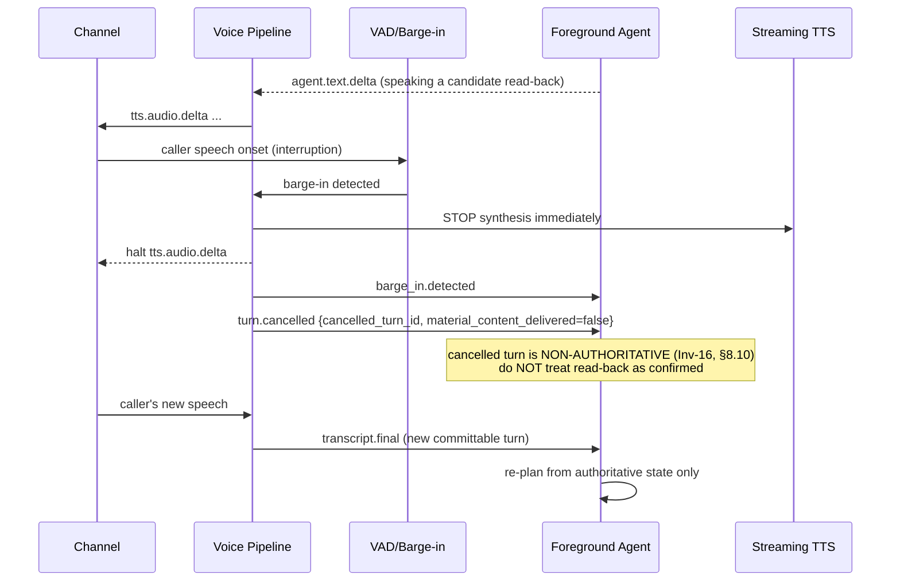
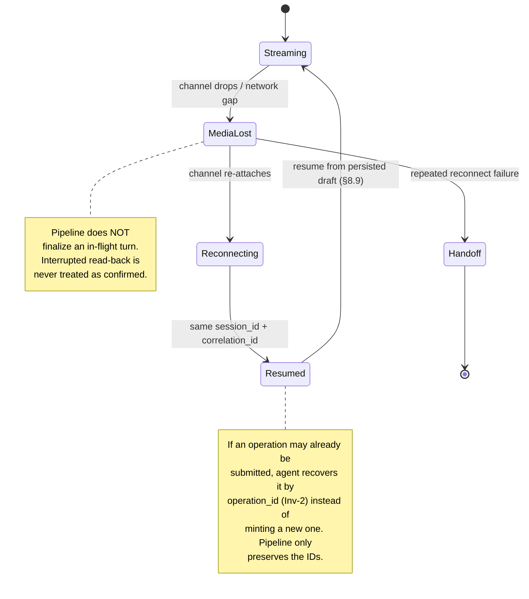

# 01 — Streaming Voice Pipeline

**Status:** Proposed
**Owner project(s):** `apps/langgraph` (pipeline orchestration, streaming-frame contracts), `apps/web` (DTMF/continuation surfaces), `libs/shared-schemas` (streaming frame schemas). The platform side (`apps/api`) is only a downstream tool callee here.
**Source design sections:** §6.2 First-class streaming voice architecture, §6.3 Streaming contracts, §6.4 Latency behavior, §6.5 Availability modes, §6.6 Foreground API budget, §8.10 Streaming voice requirements (and supporting §8.9 session recovery, §8.12 handoff, §25.1 correlation).

---

## 2. Purpose & scope

The Streaming Voice Pipeline is the realtime media path that turns telephone audio into incremental, normalized events for the conversational agent and turns the agent's streamed text back into audio. It owns streaming STT (partial vs final transcripts), the streaming event contract, sentence/phrase-chunked TTS, barge-in cancellation, DTMF capture for sensitive fields, reconnect recovery, the optional native speech-to-speech escalation mode, and the per-stage latency budget. Its job is to make the conversation feel instant while guaranteeing that **only `transcript.final` events and explicit tool results — never partial transcripts or interrupted speech — can mutate booking state**.

This spec covers only the media/streaming substrate and its frame contract. The agent's decision graph, slot capture, read-back, and confirmation logic live in [`02-foreground-conversational-agent.md`](02-foreground-conversational-agent.md); tool schemas in [`03-agent-tool-contracts.md`](03-agent-tool-contracts.md).

---

## 3. Position in the system

**Lane:** FOREGROUND (latency-optimized, customer-facing, streaming). This is the entry edge of the foreground lane.

```text
PSTN/SIP/WebRTC channel
  ──> [Streaming Voice Pipeline]            (this spec)
        ├─ media ingress / jitter buffer
        ├─ streaming STT  ──> transcript.partial / transcript.final
        ├─ barge-in / VAD ──> barge_in.detected / turn.cancelled
        ├─ TTS sentence chunker <── agent.text.delta / agent.text.final
        └─ DTMF capture
  <──> [Foreground Conversational Agent]    (02)
            └─ tool calls ──> Booking API    (03, 04, 07, 08)
```

**Upstream:** the telephony/channel provider (PSTN via SIP, or WebRTC for web voice). Emits raw media frames; the pipeline normalizes them.

**Downstream:** the Foreground Conversational Agent (LangGraph). The pipeline never talks to the Booking API directly — it produces transcripts and renders agent text; the *agent* decides on tool calls.

**What this component MUST NOT do (§6.6 disallowed foreground work, §8.2):**

- It must not call any Booking API tool itself, nor any provider/payment/notification API. It only carries `tool.progress` frames the agent emits.
- It must not treat partial transcripts or interrupted/un-acknowledged speech as committable facts (Inv-1, Inv-16).
- It must not place card data (PAN/CVV) into the transcript, agent context, queue, or logs — DTMF-captured sensitive digits are masked/tokenized at the edge and never streamed as transcript text (Inv-12).
- It must not mint operation IDs or perform mutations/retries/reconciliation (background lane only).

---

## 4. Component design

| Sub-component | Responsibility |
|---|---|
| **Media ingress / jitter buffer** | Accept channel media frames (SIP/RTP or WebRTC), de-jitter, decode to PCM, emit `audio.started` when media is active. Tag every frame with `session_id` + `correlation_id`. |
| **Streaming STT adapter** | Feed continuous audio to the STT provider. Emit `transcript.partial` rapidly (display + barge-in hints) and `transcript.final` at endpoint/utterance boundaries. Carries per-field/utterance ASR confidence used downstream (§25.2). |
| **VAD / barge-in detector** | Detect caller speech onset while TTS is playing. Emit `barge_in.detected`; trigger TTS stop and `turn.cancelled` for the in-flight assistant turn. |
| **Turn manager** | Maintain the current `turn_id`, monotonically sequence frames within a session, gate which events are "committable" (only `transcript.final`). Owns the rule that interrupted assistant speech is non-authoritative unless its material content was fully delivered and acknowledged (§8.10). |
| **TTS sentence chunker** | Buffer `agent.text.delta`, split on sentence/phrase boundaries, synthesize incrementally, emit `tts.audio.delta` so audio starts before the full response is complete. Cancellable mid-synthesis on barge-in. |
| **Progress filler** | When the agent emits `tool.progress` (slow tool), render brief conversational progress audio without implying success (§6.4, §8.10). |
| **DTMF capture** | Collect keypad digits for sensitive/error-prone fields (party size, dates, verification codes). Masked; never enters transcript. |
| **Reconnect / recovery handler** | On dropped media or channel reconnect, re-establish the streaming session under the **same** `session_id`/`correlation_id`, signal the agent to resume from the persisted draft (§8.9), and never replay a cancelled turn as authoritative. |
| **S2S escalation adapter** (optional) | For interruption-heavy/noisy/high-value calls, swap the STT→text→TTS chain for a native speech-to-speech model while keeping the *same* tool contract, confirmation contract, and authoritative state (§6.2). Emits the same frame envelope to the agent. |

---

## 5. Data contracts & schemas

### 5.1 Streaming frame envelope (the §6.3 event contract)

Every frame shares an envelope carrying the IDs required by §8.10 ("every streamed turn keeps the same session, turn, and correlation IDs") and §25.1 correlation. The frame *type* set is exactly the §6.3 table.

| Frame `type` | Direction | Committable? | Purpose |
|---|---|---|---|
| `audio.started` | channel → pipeline | n/a | Call media is active |
| `transcript.partial` | pipeline → agent | **No** | Low-latency display + barge-in hints |
| `transcript.final` | pipeline → agent | **Yes** | Safe point for slot updates / tool calls |
| `agent.text.delta` | agent → pipeline | n/a | Stream to TTS |
| `agent.text.final` | agent → pipeline | commit turn text | Commit assistant turn text |
| `tool.progress` | agent → pipeline | n/a | Fill latency while tools run |
| `tts.audio.delta` | pipeline → channel | n/a | Stream synthesized audio |
| `barge_in.detected` | pipeline → agent | n/a | Stop speaking, cancel speculative output |
| `turn.cancelled` | pipeline → agent | invalidates turn | Mark interrupted assistant output non-authoritative |

**Pydantic field sketch (`apps/langgraph/cordia_agent/streaming/frames.py`) — SOURCE OF TRUTH:**

```python
class StreamFrameType(str, Enum):
    AUDIO_STARTED      = "audio.started"
    TRANSCRIPT_PARTIAL = "transcript.partial"
    TRANSCRIPT_FINAL   = "transcript.final"
    AGENT_TEXT_DELTA   = "agent.text.delta"
    AGENT_TEXT_FINAL   = "agent.text.final"
    TOOL_PROGRESS      = "tool.progress"
    TTS_AUDIO_DELTA    = "tts.audio.delta"
    BARGE_IN_DETECTED  = "barge_in.detected"
    TURN_CANCELLED     = "turn.cancelled"

class StreamFrameEnvelope(BaseModel):
    model_config = {"extra": "forbid"}
    type: StreamFrameType
    tenant_id: str          # opaque; from the gateway's TenantContext (spec 15), propagated not resolved here (Inv-13)
    session_id: str         # one call/conversation
    turn_id: str            # one customer/agent contribution
    correlation_id: str     # begins at channel ingress (§25.1)
    causation_id: str | None = None   # event lineage
    seq: int                # monotonic per-session ordering
    ts: str                 # ISO-8601 with offset

class TranscriptFinalFrame(StreamFrameEnvelope):       # type == transcript.final
    text: str
    asr_confidence: float                  # 0..1, by-field where available
    is_endpoint: bool = True

class TranscriptPartialFrame(StreamFrameEnvelope):     # type == transcript.partial
    text: str
    stability: float                       # provider stability hint

class AgentTextDeltaFrame(StreamFrameEnvelope):        # type == agent.text.delta
    delta: str

class AgentTextFinalFrame(StreamFrameEnvelope):        # type == agent.text.final
    text: str

class ToolProgressFrame(StreamFrameEnvelope):          # type == tool.progress
    tool_name: str
    phase: str                              # e.g. "checking_availability"
    elapsed_ms: int

class TtsAudioDeltaFrame(StreamFrameEnvelope):         # type == tts.audio.delta
    audio_chunk_ref: str                    # opaque chunk id; bytes on media plane
    chunk_seq: int

class BargeInFrame(StreamFrameEnvelope): ...           # type == barge_in.detected
class TurnCancelledFrame(StreamFrameEnvelope):         # type == turn.cancelled
    cancelled_turn_id: str
    material_content_delivered: bool        # gates non-authoritative rule (§8.10)
```

DTMF digits captured for sensitive fields are surfaced to the agent as a separate, masked structured signal (a tool-side `verification_code` / numeric-field input), **not** as `transcript.final` text, so PAN/verification digits never appear in transcript frames (Inv-12).

### 5.2 Which frames belong in `libs/shared-schemas`

These streaming frames are a **cross-service contract** between the agent and any client/transport that renders or relays them (web voice UI, status surfaces, the API's status-streaming endpoint). They therefore live as Pydantic models in `cordia_agent` and are exported to `schemas/streaming/` per the §28.3 "streaming status frames" rule and the existing `streaming/` convention (mirrors `HelloStreamMessage.json` → `shared/PydanticSharedDefs.json#/$defs/...`). Generated C#/TS/Zod are consumed by `apps/web` and `apps/api` status streaming.

| Contract | Carrier | Where |
|---|---|---|
| `StreamFrameEnvelope` + all 9 frame variants | Pydantic → JSON Schema → C#/TS/Zod | `libs/shared-schemas/schemas/streaming/` |
| Availability mode enum (`informational`/`live`/`held`/`confirmed`, §6.5) | shared enum (tool-result, surfaced in agent wording) | `libs/shared-schemas/schemas/enums/` — owned by tool contracts in [`03`](03-agent-tool-contracts.md) |

**Not** in shared-schemas: raw audio bytes (media plane, not a typed contract) and internal STT/TTS provider payloads.

### 5.3 DB tables touched (§22)

The pipeline itself is stateless realtime; it does not own or write these tables, but it reads session continuity and depends on rows created by other owners:

- `conversation_sessions` — tenant-scoped session + consent state. The pipeline does **not** write this row itself; it is a single-writer table owned by the Booking API. The **channel gateway** ([`15-tenant-resolution-and-gateway.md`](15-tenant-resolution-and-gateway.md)) **creates** the session row via the Booking API at session start, carrying tenant scope from the `TenantContext` it minted/signed at channel ingress (Inv-13). Spec `15` is the owner of `TenantContext` and of `correlation_id` origination; the pipeline treats both as inputs propagated on every frame and uses the session as the anchor for reconnect lookup. Consent (`consent_*`) updates also flow through the Booking API (foreground consent gate, [`02`](02-foreground-conversational-agent.md)), never directly from the pipeline or voice path.
- Draft checkpointing on each material `transcript.final` is performed by the agent (§8.9), not the pipeline — see [`02`](02-foreground-conversational-agent.md). The pipeline only guarantees stable `session_id`/`correlation_id` across reconnect so the checkpoint can be found.

---

## 6. Workflows

### 6.1 Happy path — one streaming turn with sentence-chunked TTS

```mermaid
sequenceDiagram
    participant C as Channel (PSTN/WebRTC)
    participant P as Voice Pipeline
    participant STT as Streaming STT
    participant A as Foreground Agent
    participant TTS as Streaming TTS

    C->>P: media frames
    P->>A: audio.started {session,turn,correlation}
    P->>STT: stream PCM (continuous)
    STT-->>P: partial hypotheses
    P->>A: transcript.partial (display only, NOT committable)
    Note over C,P: caller stops speaking -> endpoint
    STT-->>P: final transcript + asr_confidence
    P->>A: transcript.final (COMMITTABLE — slot update / tool call)
    A->>A: update draft; decide tool call at checkpoint
    A-->>P: agent.text.delta ("Let me check...")
    P->>TTS: synth sentence 1
    TTS-->>P: audio chunk
    P->>C: tts.audio.delta (audio starts before full text)
    A-->>P: agent.text.delta (rest of sentence)
    A-->>P: agent.text.final
    P->>C: tts.audio.delta (remaining sentences)
```

### 6.2 Failure/recovery path 1 — barge-in cancels speculative output



### 6.3 Failure/recovery path 2 — dropped call / reconnect (no double submission)



---

## 7. Reliability mechanisms

Mapped to the release-blocking invariants this component touches:

- **Inv-1 (no side effect from transcript text alone):** the pipeline marks only `transcript.final` as committable; `transcript.partial` is display/barge-in only. Side effects require the agent to issue an explicit, typed tool call — the pipeline never converts speech into a booking action.
- **Inv-12 (card data never enters context/transcript/queue/logs):** PAN/CVV are not collected by voice at all — payment is handled entirely outside the call via a Stripe-hosted payment link ([`09`](09-payment-deposit-link.md)). DTMF digits for sensitive/verification fields are masked at the edge and delivered as a separate masked structured signal, never as transcript text. Frame logging excludes raw digit payloads (§25.3).
- **Inv-13 (tenant scope before data access):** tenant scope is resolved upstream — the channel gateway mints/signs the `TenantContext` at channel ingress and creates the tenant-scoped `conversation_sessions` row via the Booking API ([`15`](15-tenant-resolution-and-gateway.md)). The pipeline receives `tenant_id` as an input and propagates it on every frame from `audio.started` onward, so the agent never reads customer/knowledge/menu/booking data without a tenant scope; the pipeline does not itself resolve tenant or write the session row.
- **Inv-16 (agent states only authoritative outcomes):** `turn.cancelled` with `material_content_delivered=false` makes interrupted assistant speech non-authoritative; the agent must re-derive from authoritative state. Read-back interrupted by barge-in is never treated as confirmation.
- **Inv-2 (stable operation_id / recovery, supporting):** on reconnect the pipeline preserves `session_id`/`correlation_id` so the agent can recover an existing `operation_id` rather than mint a new one (§8.9). The pipeline never resubmits.
- **Inv-10 (material change → new revision, supporting):** because only `transcript.final` mutates the draft, a corrected slot captured after barge-in flows through the normal revision/confirmation path rather than silently editing a "spoken" value.

**Effectively-once at the edge:** frames carry a monotonic `seq` per session; the agent and any relay are idempotent on `(session_id, seq)`, tolerating duplicate frame delivery on flaky transports (Inv-5 spirit at the streaming boundary). Reconnect re-binds the session rather than creating a new one.

**Deterministic tool-call acknowledgement (§8.10):** a tool call announced via `tool.progress` is acknowledged on a stable `(turn_id, tool_name)` so a reconnect mid-tool does not re-announce or imply a second call.

---

## 8. Latency budget & optimizations

PRIMARY axis. §8.10 requires per-stage measurement; §6.4 gives interaction thresholds. Initial per-stage budgets (tune from production baselines per §6.4/§26 — these are UX targets, not correctness boundaries):

| Stage (§8.10) | Metric | Initial target (p50 / p95) |
|---|---|---|
| Media ingress | jitter-buffer + decode | < 50 ms / < 120 ms |
| STT partial latency | audio → first `transcript.partial` | < 200 ms / < 400 ms |
| STT final latency | endpoint → `transcript.final` | < 300 ms / < 700 ms |
| Text-agent decision | `transcript.final` → first `agent.text.delta` | < 350 ms / < 800 ms |
| First TTS audio | first `agent.text.delta` → first `tts.audio.delta` | < 250 ms / < 500 ms |
| Streamed TTS playback | inter-chunk gap (no underrun) | < 150 ms gap |
| **End-to-end turn** | caller endpoint → first audible response | **< 900 ms / < 1500 ms** |

**Tool-latency interaction behavior (§6.4) — driven by `tool.progress` timing:**

| Tool latency | Pipeline/voice behavior |
|---|---|
| < ~300 ms | Continue the same response; no filler |
| ~300–1000 ms | Render a brief natural transition |
| > ~1 s | Speak "checking availability"; allow barge-in during the wait |
| Several seconds / provider degraded | Agent offers asynchronous confirmation; pipeline does not hold the call indefinitely |

**Optimizations:**

- **Sentence/phrase-chunked TTS:** start synthesis on the first sentence boundary of `agent.text.delta`, so time-to-first-audio is bounded by one sentence, not the whole response (§8.10 rule).
- **Partial-transcript barge-in hints:** use `transcript.partial`/VAD to detect interruption early and stop TTS within one chunk.
- **Checkpointed tool calls, not per-token (§6.4):** the agent calls tools only at meaningful checkpoints (required fields present, changed field invalidates candidates, before read-back, on submit, on status check) — the pipeline never triggers a tool per spoken token.
- **Batched candidate availability + short provider timeouts (§6.6):** slow/degraded providers return pending/advisory; the pipeline plays a progress message rather than blocking. Availability `mode` (§6.5) controls truthful wording.
- **S2S escalation:** for interruption-heavy/high-value calls, the optional native speech-to-speech mode collapses STT/agent/TTS hops to cut turn latency while reusing the same tool/confirmation contracts.

---

## 9. Failure modes & recovery

| Failure mode | Detection | Recovery / behavior | Invariant |
|---|---|---|---|
| Media gap / packet loss | jitter buffer underrun | conceal/hold; do not finalize a partial as final | Inv-1 |
| STT provider slow/down | partial/final latency breach, error | conversational progress; fall back to DTMF for critical fields; escalate to handoff on repeat | Inv-16, §8.12 |
| Low ASR confidence (repeated) | `asr_confidence` below threshold by field | spell-back / DTMF for that field; on repeat, handoff trigger (§8.12) | Inv-16 |
| Barge-in mid read-back | VAD onset during TTS | stop TTS, `turn.cancelled material=false`; read-back NOT confirmed | Inv-16, Inv-10 |
| Caller speaks over partial tool result | VAD during `tool.progress` | cancel speculative speech; await authoritative tool result before stating outcome | Inv-16 |
| **Crash window: media drop after `transcript.final` but before tool call** | reconnect with same session | agent resumes from persisted draft; no submission happened, so re-derive | Inv-1, §8.9 |
| **Crash window: drop after submit tool call, response lost** | reconnect | agent queries by `operation_id` and recovers existing operation; pipeline never resubmits | Inv-2, §8.9 |
| TTS synthesis failure mid-turn | chunk error | retry next chunk / re-render sentence; if persistent, fall back to text/handoff | — |
| Reconnect storm / unrecoverable | repeated reconnect failures | route to human handoff with package (§8.12) | §8.12 |
| Sensitive digits at risk of logging | DTMF path | mask at edge; never emit as transcript or log payload | Inv-12 |

---

## 10. Interfaces to sibling specs

- [`02-foreground-conversational-agent.md`](02-foreground-conversational-agent.md) — consumes `transcript.final`/`transcript.partial`, emits `agent.text.delta/final` and `tool.progress`; owns draft checkpointing (§8.9), confidence/clarification policy, read-back, confirmation, handoff triggers. **Crosses boundary:** the streaming frame envelope and the committable-vs-non-committable rule.
- [`03-agent-tool-contracts.md`](03-agent-tool-contracts.md) — owns the availability `mode` enum (§6.5) and the candidate/availability tool result shapes whose latency drives `tool.progress` behavior. **Crosses boundary:** tool-result schemas and the masked DTMF/verification-code input.
- [`08-identity-and-manage-booking.md`](08-identity-and-manage-booking.md) — verification codes captured via DTMF feed step-up verification. **Crosses boundary:** masked verification input.
- [`09-payment-deposit-link.md`](09-payment-deposit-link.md) — payment is handled entirely outside the voice pipeline; a Stripe payment link for the deposit is sent via SMS/email at booking confirmation. The pipeline has no payment responsibilities. **Crosses boundary:** none (payment is post-confirmation, not in-call).
- [`13-observability-and-slos.md`](13-observability-and-slos.md) — per-stage latency metrics (§25.2 agent metrics: time-to-first-response, per-turn latency, barge-in success, reconnect rate, STT confidence by field) and `correlation_id`/`causation_id` propagation (§25.1). **Crosses boundary:** metric names + correlation IDs.
- [`14-security-and-privacy.md`](14-security-and-privacy.md) — consent capture in `conversation_sessions`, transcript/audio retention by jurisdiction, masking of sensitive digits. **Crosses boundary:** consent state + DTMF masking.

---

## 11. Implementation mapping

**`apps/langgraph/cordia_agent/` (pipeline orchestration + frame contracts — §28.1):**

```
cordia_agent/streaming/
  frames.py            # StreamFrameEnvelope + 9 frame variants (Pydantic, extra="forbid")
  turn_manager.py      # turn_id sequencing, committable gating, cancellation rules
  stt_adapter.py       # streaming STT -> transcript.partial / transcript.final + confidence
  tts_chunker.py       # sentence/phrase chunking, agent.text.delta -> tts.audio.delta, cancellable
  barge_in.py          # VAD + barge_in.detected / turn.cancelled
  dtmf.py              # masked sensitive-field / verification-code capture
  reconnect.py         # session re-binding, same session_id/correlation_id (§8.9)
  s2s_escalation.py    # optional native speech-to-speech adapter (same tool contract)
```

Extends the existing `cordia_agent/streaming_models.py` pattern (replaces the placeholder `HelloStreamMessage` with the real frame set). Pydantic models are the **source of truth**; never hand-edit generated types.

**`libs/shared-schemas/`:** after `bun nx run langgraph:generate-schemas` the frames land in `schemas/streaming/`, then `bun nx run shared-schemas:generate-types` produces C#/TS/Zod consumed by `apps/web` and `apps/api` status streaming. The availability `mode` enum is added under `schemas/enums/` by spec `03`.

**`apps/api`:** no new domain here — only the status-streaming/agent-facing endpoints (§28.2 "status polling or event streaming") may relay a subset of frames; transport (polling/SSE/WebSocket) is an open decision (§31).

---

## 12. Test strategy

From §27.1 (agent contract tests) and the streaming rules in §8.10, with deterministic fixtures for normalized tool responses (§27.1):

- **Committability:** assert `transcript.partial` never triggers a slot mutation or tool call; only `transcript.final` does (Inv-1, §27.1 "transcript text cannot directly trigger submission").
- **Barge-in non-authoritativeness:** a read-back interrupted by `barge_in.detected` → `turn.cancelled` is never treated as confirmation (§27.1 "agent never claims confirmation from accepted/pending state" analog; Inv-16).
- **Reconnect recovery:** dropped session resumes under the same `session_id`/`correlation_id` and recovers the existing `operation_id` rather than minting a new one (§27.1 "reconnect recovers the existing operation"; Inv-2).
- **Chunked-TTS first-audio:** first `tts.audio.delta` is emitted after the first sentence boundary, before `agent.text.final` (latency rule).
- **Tool-progress wording by latency band:** progress filler matches §6.4 thresholds and never implies success while pending (Inv-16).
- **DTMF masking:** sensitive/verification digits never appear in any `transcript.final` frame or log payload (Inv-12; §27.6 security tests).
- **Frame dedup:** duplicate frame delivery (same `session_id`, `seq`) is idempotent at the consumer (effectively-once at the edge).
- **Correlation continuity:** `correlation_id` is identical across all frames of a session including across reconnect (§25.1).

---

## 13. Open decisions (from §31)

- **Customer/status transport (§31):** polling vs SSE vs WebSocket vs channel callback for relaying streaming frames to `apps/web`/status surfaces. This component prefers a bidirectional low-latency transport (WebSocket) for the media-adjacent frame stream; the durable status stream may differ. **Must resolve before** the `apps/api` status-streaming endpoint and the web continuation surface are built.
- **Transcript and audio retention by jurisdiction (§31):** governs how long `transcript.final` payloads and recorded audio are kept and where; affects logging/masking in `dtmf.py` and `conversation_sessions`. Coordinated with [`14`](14-security-and-privacy.md).
- **Verification factors and risk policy (§31):** determines which fields require DTMF capture vs spoken capture and the confidence thresholds that trigger spell-back/handoff. Coordinated with [`08`](08-identity-and-manage-booking.md).
- **Voice turn-latency target / initial SLO values (§26, §31):** the per-stage budgets in §8 are proposed defaults pending measured baselines; the binding SLO is set in [`13`](13-observability-and-slos.md).
