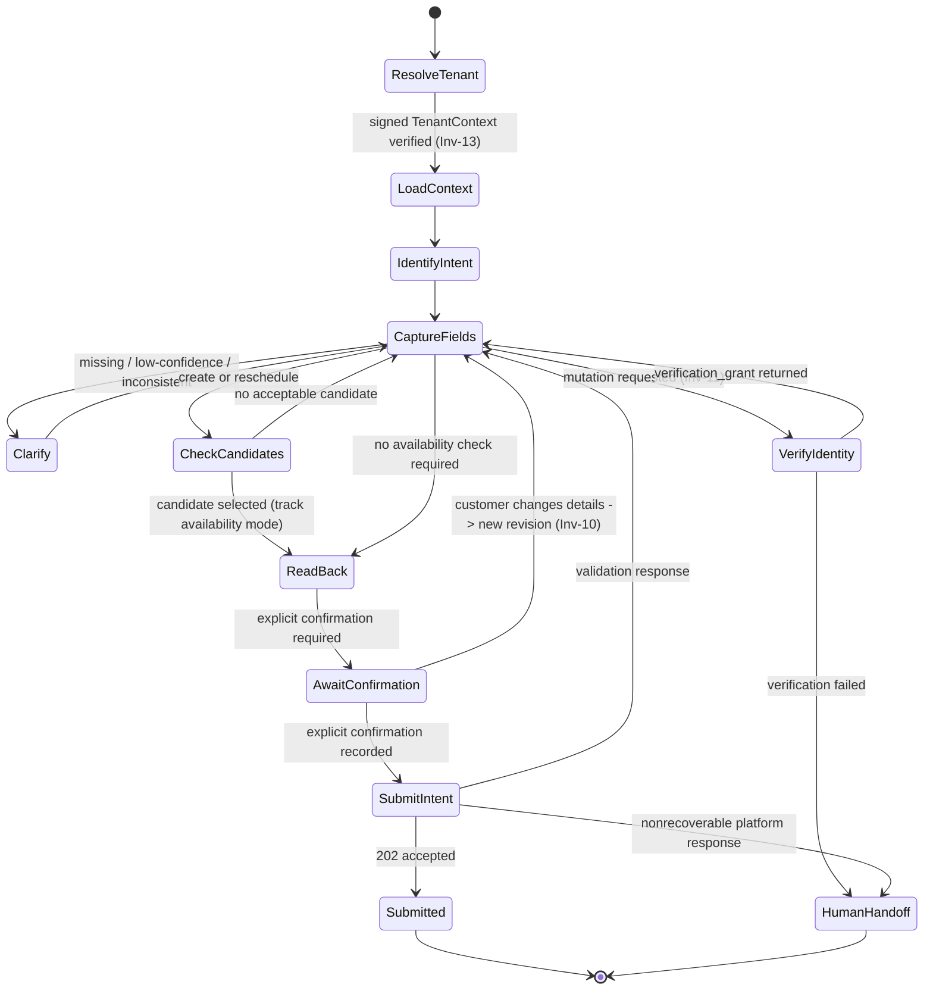

# 02 — Foreground Conversational Agent

**Status:** Proposed
**Owner project(s):** `apps/langgraph` (primary); `apps/api` (consumes its agent-facing endpoints); `libs/shared-schemas` (carries cross-service contracts)
**Source design sections:** §6.5–6.6 (availability modes, foreground API budget), §7 (tenant resolution), §8.1–8.12 (agent architecture), with downstream references to §9.2–9.3 (identity), §10 (submission contract), §11 (workflow state machine), §22 (data model), §27 (testing), §28 (implementation mapping), §31 (open decisions).

---

## 2. Purpose & scope

The foreground conversational agent is the customer-facing LangGraph graph that turns a live, streaming dialog into exactly one clean, confirmed, immutable booking command for the background platform. It optimizes for **latency** — it must stay responsive and truthful inside a voice or chat turn — while never performing a booking side effect itself. Its single deliverable is a durably-accepted `operation_id` (or a human-handoff package) produced by `ResolveTenant → LoadContext → IdentifyIntent → CaptureFields↔Clarify → VerifyIdentity → CheckCandidates → ReadBack → AwaitConfirmation → SubmitIntent → {Submitted | HumanHandoff}`.

This spec covers the graph, typed `BookingDraft` slot capture, the field confidence/validation table, deterministic canonical read-back, immutable intent revisions + confirmation evidence, session checkpointing/recovery, availability-mode wording, the foreground API budget, the prompt-injection harness, and the human-handoff package. It does **not** cover the streaming media layer (see `01-streaming-voice-pipeline.md`) or the tool wire-schemas in depth (see `03-agent-tool-contracts.md`).

---

## 3. Position in the system

**Lane:** FOREGROUND (latency-optimized). The agent **proposes**; the platform **disposes**.

```
[01 streaming-voice-pipeline] --transcript.final/tool.progress--> [02 THIS: foreground agent]
                                                                          │
        get_tenant_context / find_customer_context (read)  <─────────────┤
        validate_booking_draft / check_candidate_availability (read/short hold)
        request_verification / check_verification (bounded)
        submit_confirmed_intent (idempotent, durable)  ──> [04 submission-and-idempotency]
        get_operation_status (read)                    ──> [06 booking-workflow]
        request_human_handoff (idempotent)             ──> [13 observability / ops console]
```

**Upstream:** the streaming voice/chat pipeline (`01`) delivers `transcript.final` events and consumes `agent.text.delta` / `tool.progress`. The channel gateway delivers a signed `TenantContext` (§7).

**Downstream:** the agent-facing API surface in `apps/api` (`04` submission, `06` workflow status, `08` verification, `10` notifications are emitted by the platform — never by the agent).

**What it MUST NOT do** (§8.2, §6.6 disallowed list):
- Never produce a booking side effect from transcript text alone (Inv-1).
- Never call external booking/payment/notification providers directly.
- Never run mutations, retry loops, reconciliation, DLQ replay, or owner/manual-recovery actions.
- Never create a payment beyond returning a platform-generated payment-link action.
- Never collect PAN/CVV into context, transcript, queue, or logs (Inv-12).
- Never authorize a booking mutation from caller ID alone (Inv-11).
- Never tell the customer a booking is confirmed unless the platform returns `booked` (Inv-16).
- Never execute instructions embedded in retrieved/uploaded content (Inv-12 boundary; §8.11).
- Never mint a new `operation_id` inside a retry loop or on reconnect when one already exists (Inv-2; §8.9).

---

## 4. Component design

The graph is a LangGraph `StateGraph` whose channels are a typed `AgentState` (Pydantic). Each node is deterministic-where-it-matters: model calls drive **dialog**, but **business facts** only enter state through constrained tool functions and validated slot-capture functions.

| Sub-component | Responsibility |
|---|---|
| **TenantContext guard** | Verifies the signed `TenantContext` from the gateway (§7) before any data access (Inv-13). Establishes `tenant_id`, `channel`, `channel_endpoint_id`, `configuration_version`, `correlation_id`, allowed agent/tool policy IDs. Rejects any tenant identity sourced from the LLM or customer message. |
| **Context loader** | Calls `get_tenant_context` + `find_customer_context` to hydrate minimized, tenant-scoped policy and personalization (§9.2). No sensitive history without a verification grant. |
| **Intent classifier** | Maps the dialog to an `operation` (`create` / `reschedule` / `modify` / `cancel` / `inquire`). Drives which graph branches are reachable. |
| **Slot-capture engine** | Exposes constrained functions that write the typed `BookingDraft`; rejects unknown fields; records field provenance/confidence. Never keeps business-critical fields only in free-form model memory (§8.4). |
| **Clarifier** | Per the confidence/validation table (§8.5) decides ask-again vs. spell-back vs. DTMF vs. escalate when a field is missing, low-confidence, or contradictory. |
| **Identity/verification coordinator** | For mutations, requests/checks a platform-issued `verification_grant` (§9.3). Caller ID alone is never sufficient (Inv-11). |
| **Candidate-availability client** | Calls `check_candidate_availability` (batched), surfaces normalized slots + invalid fields + alternatives, and tracks the returned **availability mode** (§6.5). |
| **Canonical read-back renderer** | Deterministically renders material terms from the normalized draft, not model prose (§8.6). Produces the `read_back_version` recorded on confirmation. |
| **Confirmation recorder** | Captures explicit confirmation as an immutable `Confirmation` bound to one `intent_revision` + `payload_hash` (§8.8). |
| **Revision manager** | On any material change (§8.7), supersedes the current revision with a new immutable one and (post-submission) a new operation/idempotency key. |
| **Submission client** | Calls `submit_confirmed_intent` with a checkpointed `operation_id` + idempotency key (§10.1). Treats lost responses as recoverable, never resubmits with a new identity (§8.9). |
| **Session checkpointer** | Persists `AgentState` (esp. `BookingDraft`, `operation_id`, `idempotency_key`, last confirmed revision) after every material slot update (§8.9). Backed by a LangGraph checkpointer over the tenant-scoped session store. |
| **Prompt-injection harness** | Separates system policy / tool results / retrieved text; labels untrusted content; blocks retrieved text from granting tools or changing authorization (§8.11). |
| **Handoff packager** | Builds the structured handoff package and calls `request_human_handoff` (§8.12). |

---

## 5. Data contracts & schemas

Pydantic models in `apps/langgraph/cordia_agent` are the **source of truth**; C#/TS/Zod are generated (`libs/shared-schemas`). Cross-service shapes (`BookingDraft` → submitted `BookingIntent` revision, `Confirmation`, tool I/O, operation status, streaming frames) live in `libs/shared-schemas`. Internal-only provenance does not cross the wire.

### 5.1 `BookingDraft` (Pydantic field sketch — mutable, in-dialog)

```python
class TriState(str, Enum):
    absent = "absent"        # never provided
    unknown = "unknown"      # asked, customer doesn't know
    declined = "declined"    # explicitly refused

class FieldProvenance(BaseModel):
    model_config = ConfigDict(extra="forbid")
    source_turn_id: str | None = None
    stt_confidence: float | None = None        # internal-only; not submitted
    model_confidence: float | None = None      # internal-only; not submitted
    capture_method: Literal["speech", "dtmf", "tool_selection", "channel_verified"]
    normalized_value: str | None = None
    validation: Literal["valid", "invalid", "needs_clarification"] | None = None

class BookingRequest(BaseModel):
    model_config = ConfigDict(extra="forbid")
    operation: Literal["create", "reschedule", "modify", "cancel"]
    service_id: str | None = None              # stable ID, not display name
    location_id: str | None = None
    starts_at: AwareDatetime | None = None     # ISO-8601 with offset
    party_size: PositiveInt | None = None
    duration_minutes: PositiveInt | None = None
    special_requests: list[str] = []
    target_booking_id: str | None = None       # required for modify/cancel
    target_booking_version: int | None = None  # optimistic concurrency (§8 of 08)

class BookingDraft(BaseModel):
    model_config = ConfigDict(extra="forbid")  # reject unknown properties
    tenant_id: str
    session_id: str
    schema_version: str                        # carried into the intent
    tenant_policy_version: str                 # configuration_version from TenantContext
    customer: CustomerRef | None = None        # stable customer_id where possible
    request: BookingRequest
    preorder: PreorderDraft | None = None       # see 11-waitlist-menu-preorder.md
    source: SourceInfo                          # {channel, language}
    field_provenance: dict[str, FieldProvenance] = {}  # internal; stripped on submit
    # NB: no unbounded transcript text is stored in the draft (§8.4)
```

The submitted canonical payload is the draft **minus** `field_provenance` and any internal fields; missing optional values are encoded as `TriState` so that absent ≠ unknown ≠ declined survives canonicalization (§8.4, §10.2).

### 5.2 Intent revision + confirmation (cross-service via `libs/shared-schemas`)

The agent submits a revision; the API persists it. Agent-side Pydantic mirrors the shared contract (§8.7–8.8):

```python
class IntentRevision(BaseModel):
    model_config = ConfigDict(extra="forbid")
    intent_id: str
    revision: int
    canonical_payload: BookingRequest         # normalized, no provenance
    schema_version: str
    tenant_policy_version: str
    payload_hash: str                         # hash algorithm fixed by §10.2 (open decision)
    created_at: AwareDatetime
    source_session_id: str
    prior_revision: int | None = None
    supersession_reason: str | None = None

class Confirmation(BaseModel):
    model_config = ConfigDict(extra="forbid")
    confirmation_id: str
    intent_id: str
    intent_revision: int
    intent_payload_hash: str                  # MUST equal the revision's payload_hash
    identity: str | Literal["anonymous_session"]
    confirmation_channel: Literal["voice", "sms", "web", "email"]
    confirmed_at: AwareDatetime
    source_turn_id: str
    read_back_version: str
    disclosures_presented: list[str]          # consent + policy disclosures shown
    verification_level: str
```

API-side these arrive on the `submit_confirmed_intent` endpoint and are persisted in `booking_intent_revisions` and `intent_confirmations`. C# sketch of the accepted command (handler in `apps/api`, see §11 mapping):

```csharp
public record SubmitConfirmedIntentCommand(
    string TenantId,
    string OperationId,        // minted/checkpointed by the agent (Inv-2)
    string IdempotencyKey,     // bound to exactly one request hash (Inv-3)
    IntentRevisionDto Revision,
    ConfirmationDto Confirmation,
    string? VerificationGrantId) : IRequest<SubmissionResponse>;
```

### 5.3 Submission response (consumed by the agent; §10.4)

```json
{
  "operation_id": "op_01...",
  "intent_id": "intent_01...",
  "intent_revision": 3,
  "status": "accepted",
  "status_url": "/api/booking-operations/op_01...",
  "submitted_at": "2026-06-15T10:30:00Z"
}
```

`accepted` means durably accepted, **not** booked. The agent must say "I have submitted the request," not "you are confirmed" (Inv-16).

### 5.4 Availability mode (from `check_candidate_availability`; §6.5)

```python
class AvailabilityMode(str, Enum):
    informational = "informational"  # "That time appears available."
    live = "live"                    # "...available right now, subject to final confirmation."
    held = "held"                    # "I can hold that time until <expiry> while we finish."
    confirmed = "confirmed"          # "Your booking is confirmed." (only from platform booked state)
```

Only `held` closes the race during the confirmation/payment window; `live`/`informational` may go stale before submission, so finalization rechecks or atomically books (handled in `07`/`06`, never by the agent).

### 5.5 DB tables touched (read-side / agent-adjacent, §22)

The agent itself owns no authoritative state, but its calls cause writes to: `conversation_sessions` (single-writer rule — **all** writes go through the Booking API; the channel gateway *creates* the tenant-scoped session row at session start via the API and the foreground consent gate *updates* the `consent_*` fields via the API; the voice pipeline and the agent never write this row directly — §02 single-writer rule, D12), `booking_intents`, `booking_intent_revisions`, `intent_confirmations`, `booking_operations` (status `accepted`), `idempotency_records`, `verification_grants` (read), `operations_work_items` (handoff), `audit_events`. Reads: `vendor_catalogs`/`vendor_catalog_items` (catalog), customer context. The graph checkpoint store is a separate, **non-authoritative** session store (§8.3).

---

## 6. Workflows

### 6.1 Happy path — voice create, held capacity, confirmed submission

```mermaid
sequenceDiagram
    autonumber
    participant VP as Voice Pipeline (01)
    participant AG as Foreground Agent (02)
    participant API as Agent-facing API (04/06/08)
    Note over AG: TenantContext verified (Inv-13) before any data access
    VP->>AG: transcript.final ("book dinner for 4 Friday 7pm")
    AG->>API: get_tenant_context / find_customer_context (read)
    API-->>AG: policy + minimized customer context
    AG->>AG: IdentifyIntent=create; CaptureFields -> BookingDraft
    AG->>API: validate_booking_draft + check_candidate_availability (batched)
    API-->>AG: candidates + mode=held (expiry 19:05)
    AG-->>VP: tool.progress -> agent.text "checking availability..."
    AG->>AG: ReadBack (deterministic render from normalized draft)
    AG-->>VP: agent.text.final "Friday 20 Jun, 7:00pm ACST, party of 4, hold til 7:05..."
    VP->>AG: transcript.final ("yes, confirm")
    AG->>AG: Record Confirmation (binds revision + payload_hash); checkpoint op_id+idem key
    AG->>API: submit_confirmed_intent(op_id, idem_key, revision, confirmation)
    API-->>AG: 202 {operation_id, status: accepted, status_url}
    AG-->>VP: agent.text.final "I've submitted your request; you'll get a text shortly."
    Note over AG,API: Booking is fulfilled asynchronously by 06; agent never says "booked"
```

### 6.2 Failure / recovery — dropped call after submission, reconnect must recover not resubmit (§8.9, Inv-2)

```mermaid
sequenceDiagram
    autonumber
    participant VP as Voice Pipeline (01)
    participant AG as Foreground Agent (02)
    participant CP as Checkpoint store
    participant API as Agent-facing API
    AG->>CP: checkpoint(BookingDraft, op_id, idem_key) BEFORE first submit
    AG->>API: submit_confirmed_intent(op_id, idem_key, ...)
    Note over AG,API: network drops — response lost, submission may have committed
    VP-->>AG: (call dropped) turn.cancelled
    Note over VP,AG: reconnect on new media session, same session_id
    AG->>CP: load checkpoint -> finds op_id + idem_key, no accepted response
    AG->>API: get_operation_status(op_id)
    alt operation exists (commit had succeeded)
        API-->>AG: {status: accepted|in_progress|...}  %% NormalizedOperationStatus (06); internal substates collapsed
        AG-->>VP: "Good news — your request from earlier went through; it's being processed."
    else operation not found
        AG->>API: submit_confirmed_intent(SAME op_id, SAME idem_key, ...)
        Note over API: same key + same hash -> one operation (Inv-2,3,5)
        API-->>AG: {operation_id, status: accepted}
        AG-->>VP: "I've submitted your request."
    end
```

### 6.3 Graph state machine (mirrors §8.3, annotated with foreground constraints)



---

## 7. Reliability mechanisms (mapped to invariants)

- **Inv-1 (no side effect from transcript alone):** booking facts enter state only through constrained slot-capture functions and validated tool results; `transcript.partial` never mutates the draft — only `transcript.final` does (§6.3). The agent has no provider/mutation tools at all.
- **Inv-2 (stable operation_id + idempotency key):** the agent mints and checkpoints both *before* the first `submit_confirmed_intent` call and reuses them across timeout/replay/redelivery (§10.1). Never minted inside a retry.
- **Inv-3 (key bound to one request hash):** the canonical payload hash is computed by the API; the agent submits the same revision payload under the same key, so same-key+different-hash is rejected as a conflict rather than silently re-submitted (§10.2).
- **Inv-4 (atomic acceptance):** out of scope for the agent — it relies on the API's single-transaction acceptance (§10.3) and treats `202 accepted` as the durability signal.
- **Inv-5 (effectively-once / duplicate-safe):** on lost responses the agent recovers by `get_operation_status(op_id)` before any resubmission (§8.9); a resubmit under the same key collapses to one operation.
- **Inv-10 (material change → new revision + new confirmation):** the revision manager creates a new immutable revision on any material field change (§8.7) and requires a fresh `Confirmation`; an interrupted read-back is never treated as confirmed (§8.9).
- **Inv-11 (server-verified authorization for mutations):** `VerifyIdentity` obtains a platform-issued `verification_grant` scoped to tenant/customer/booking/action/expiry before a modify/cancel/reschedule is submittable; caller ID alone never advances the graph (§9.3).
- **Inv-12 (card data + prompt-injection boundary):** PAN/CVV are never captured (payment is a platform payment-link action only); the harness labels untrusted retrieved/uploaded content as data and blocks it from granting tools or changing authorization (§8.11).
- **Inv-13 (tenant scope first):** `ResolveTenant` verifies the signed `TenantContext` before `LoadContext`; every tool call, cache key, and checkpoint is tenant-scoped (§7).
- **Inv-16 (state-matched language):** customer-facing wording is driven by availability mode (§6.5) and the `NormalizedOperationStatus` projection returned by `get_operation_status` (the cross-service set owned by `06` — `accepted`, `in_progress`, `awaiting_user_action`, `alternatives_required`, `booked`, `waitlisted`, `rejected`, `expired`, `failed`); the agent never sees internal `OperationStatus` substates. "confirmed" is only emitted when the platform returns `booked`. The deterministic read-back/status renderer enforces this, not free model prose.

Supporting determinism: read-back is rendered from the normalized draft (§8.6); confirmation records the exact `read_back_version` and `payload_hash`; submission fails if `confirmation.intent_payload_hash != revision.payload_hash` (§8.8).

---

## 8. Latency budget & optimizations (PRIMARY axis)

The agent calls the **minimum** platform APIs needed to keep the conversation truthful and fast (§6.6). It updates the local draft during a turn and calls tools only at meaningful checkpoints (§6.4): after required candidate-search fields are present, when a changed field invalidates prior candidates, before read-back, on submit, and on status check.

### 8.1 Per-stage foreground turn budget (voice; media stages owned by `01`)

| Stage | Target (p95) | Technique |
|---|---|---|
| `transcript.final` → agent decision start | < 100 ms | warm graph, no cold model spin-up; speculative draft updates on partials (non-authoritative) |
| Slot capture + local validation (no tool) | < 150 ms | `validate_booking_draft` runs against locally cached tenant policy; only escalate to API on uncertainty |
| `check_candidate_availability` (batched) | < 800 ms | one request validates policy + returns candidates + alternatives; short provider timeouts; degraded provider returns pending/advisory, never blocks (§6.6) |
| Read-back render | < 30 ms | pure deterministic template over normalized draft |
| `submit_confirmed_intent` | per `13`'s SLO, p95 < 300 ms | API does only the atomic-acceptance transaction, not fulfillment (§10.3); this tool's latency is the durable-acceptance SLO owned by `13-observability-and-slos.md` |
| First TTS audio after decision | (owned by `01`) | chunk `agent.text.delta` so TTS starts before full text; `tool.progress` fills tool latency |

### 8.2 Conversational latency behavior (§6.4)

| Tool latency | Voice behavior |
|---|---|
| < ~300 ms | continue the same response |
| ~300–1000 ms | brief natural transition |
| > ~1 s | say availability is being checked; allow barge-in |
| several seconds / provider degraded | offer asynchronous confirmation rather than holding the call (the agent submits and says "I've submitted the request") |

Latency-safe-only call set (allowed): tenant/customer context, catalog lookup, draft validation, batched candidate availability, short hold only when the provider supports it quickly, verification request/check, durable submission, operation-status lookup (§6.6). Everything heavier is a background job in `04`/`06`.

---

## 9. Failure modes & recovery

| Failure | Detection | Agent behavior | Invariant |
|---|---|---|---|
| `submit_confirmed_intent` response lost (call/network drop) | no `accepted` in checkpoint after submit | reconnect → `get_operation_status(op_id)`; resubmit same key/hash only if not found (§8.9) | Inv-2, Inv-5 |
| Submission validation error | `status` indicates validation | route to `CaptureFields`, fix offending fields, new revision, re-confirm | Inv-10 |
| Nonrecoverable platform response | typed error from API | `HumanHandoff` with package (§8.12) | Inv-16 |
| Availability provider slow/degraded | tool returns `pending`/advisory mode | offer asynchronous confirmation; do not imply success (§6.5/6.6) | Inv-16 |
| Capacity stale between `live` check and submit | mode was `live`/`informational` | finalization rechecks/atomically books in background; agent only states `live` wording, not "confirmed" | Inv-6 (downstream), Inv-16 |
| Low STT/model confidence repeated | confidence table thresholds (§8.5) | spell-back / DTMF / escalate to `HumanHandoff` | Inv-1 |
| Verification failed for mutation | `check_verification` no grant | `HumanHandoff`; never proceed on caller ID | Inv-11 |
| Interrupted read-back (`turn.cancelled` mid-render) | barge-in / cancel event from `01` | treat as **not** confirmed; re-read-back on resume | Inv-10 |
| Prompt injection in catalog/retrieved text | harness labels content as untrusted | ignore embedded instructions; no tool grant change (§8.11) | Inv-12 |
| Checkpoint write fails before submit | checkpointer error | do **not** submit until op_id/idem_key are durably checkpointed (§10.1) | Inv-2 |

---

## 10. Interfaces to sibling specs

- `01-streaming-voice-pipeline.md` — consumes `transcript.final` (only these mutate state) and emits `agent.text.delta`/`agent.text.final`/`tool.progress`; honors `barge_in.detected`/`turn.cancelled`; shares session/turn/correlation IDs.
- `03-agent-tool-contracts.md` — the wire schemas for the foreground tool set (`get_tenant_context`, `find_customer_context`, `search_vendor_catalog`, `get_catalog_item`, `validate_booking_draft`, `check_candidate_availability`, `request_verification`, `check_verification`, `submit_confirmed_intent`, `get_operation_status`, `request_human_handoff`) and their `libs/shared-schemas` mapping.
- `04-submission-and-idempotency.md` — operation identity, canonical hashing, idempotency layers, atomic acceptance, submission response shape consumed here.
- `06-booking-workflow-and-fulfillment.md` — the authoritative status the agent reads via `get_operation_status` and the wording-to-state mapping (Inv-16).
- `07-capacity-and-holds.md` — availability modes (`held` vs `live`) and hold-expiry semantics the agent reflects in wording (§6.5).
- `08-identity-and-manage-booking.md` — step-up verification grant flow and optimistic-concurrency `target_booking_version` used for mutations.
- `09-payment-deposit-link.md` — deposit is a per-restaurant toggle; when enabled, a Stripe payment link is sent via SMS/email after booking confirmation. The agent only mentions the deposit if enabled — no PAN/CVV ever enters the conversation.
- `10-notifications.md` — the agent never sends notifications; it sets the customer's expectation ("you'll get a text").
- `11-waitlist-menu-preorder.md` — pre-order draft fields, catalog use, and the isolated menu-ingestion agent boundary.
- `13-observability-and-slos.md` — correlation/causation IDs, per-stage latency metrics, prompt-injection-harness metrics, handoff rate.
- `14-security-and-privacy.md` — consent disclosures recorded on confirmation, data minimization, the prompt-injection trust boundary.

---

## 11. Implementation mapping

### `apps/langgraph/cordia_agent` (owns the foreground graph; §28.1)

```
cordia_agent/
  graph.py                     # StateGraph wiring: nodes + edges per §8.3
  state.py                     # AgentState channels (tenant ctx, draft, op identity)
  nodes/
    resolve_tenant.py          # verify signed TenantContext (Inv-13)
    load_context.py            # get_tenant_context + find_customer_context
    identify_intent.py
    capture_fields.py          # constrained slot-capture functions -> BookingDraft
    clarify.py                 # confidence/validation policy (§8.5 table)
    verify_identity.py         # request_verification / check_verification (Inv-11)
    check_candidates.py        # batched availability, track mode (§6.5)
    read_back.py               # deterministic renderer (§8.6)
    await_confirmation.py      # records Confirmation evidence (§8.8)
    submit_intent.py           # checkpoint op_id+idem_key, submit_confirmed_intent
    human_handoff.py           # builds + submits handoff package (§8.12)
  models/
    booking_draft.py           # BookingDraft, BookingRequest, TriState, FieldProvenance
    intent.py                  # IntentRevision, Confirmation (source of truth)
    availability.py            # AvailabilityMode + candidate result models
    handoff.py                 # HandoffPackage
  readback/renderer.py         # pure deterministic material-terms renderer
  safety/injection_harness.py  # trust-labeling + tool-allowlist enforcement (§8.11)
  checkpoint.py                # tenant-scoped session checkpointer config (§8.9)
```

Pydantic models here are exported to JSON Schema and generated into C#/TS/Zod via `bun nx run langgraph:generate-schemas` → `shared-schemas:generate-types`. Never hand-edit generated types.

### `apps/api` (consumes the agent; §28.2 — only the agent-facing acceptance surface is in this spec's blast radius)

- **Domain:** `BookingIntent`, `BookingIntentRevision`, `IntentConfirmation`, `BookingOperation` entities; state-transition rules; repository interfaces. (Full workflow in `06`.)
- **Application:** `Application/Submission/SubmitConfirmedIntentCommand` + handler (atomic acceptance, §10.3), `GetOperationStatusQuery` + handler; `FluentValidation` validators enforcing `confirmation.payload_hash == revision.payload_hash` (Inv-3, §8.8).
- **Infrastructure:** EF Core `IEntityTypeConfiguration` (snake_case) for `booking_intent_revisions`, `intent_confirmations`, `idempotency_records`; outbox insert in the same transaction (`05`).
- **Api:** thin controllers for the agent-facing endpoints (`POST /api/bookings` → `202 + operation_id`, `GET /api/booking-operations/{operationId}` for status); typed domain exceptions mapped by middleware (idempotency conflict → 409).

### `libs/shared-schemas`

Carries: booking intent + revisions, confirmations, normalized operation statuses, agent tool I/O, streaming status frames (§28.3). Queue-only contracts stay under `schemas/job-events/` (owned by `05`).

---

## 12. Test strategy

From §27, the slices this component owns (deterministic fixtures for normalized tool responses; evaluate both structured output **and** customer-facing language, §27.1):

**Agent contract tests (§27.1):**
- all required fields are captured before candidate search / read-back;
- ambiguous dates/times force `Clarify` (date+local time+timezone read-back; §8.5);
- a changed material field after confirmation invalidates the confirmation and creates a new revision (Inv-10);
- transcript text alone cannot trigger `submit_confirmed_intent` (Inv-1) — only a recorded `Confirmation` on a final transcript can;
- untrusted menu/retrieved instructions cannot invoke privileged tools or change authorization (§8.11, Inv-12);
- the agent never says "confirmed" from any non-`booked` `NormalizedOperationStatus` (e.g. `accepted`/`in_progress`/`awaiting_user_action`; the normalized set is owned by `06`) (Inv-16);
- reconnect recovers the existing operation by `operation_id` and never mints a new one (§8.9, Inv-2);
- mutation flows require a valid `verification_grant` (Inv-11).

**Idempotency-adjacent (§27.2):** same key + same payload → one operation; same key + different payload → conflict surfaced to `CaptureFields`; lost-response-after-commit recovers the operation (the agent-side half of the API crash test).

**Concurrency (§27.3):** reconnect race where two media sessions both hold the same checkpoint must not produce two submissions (single-flight on `operation_id`).

**State-machine (§27.5):** enumerate allowed graph transitions (§8.3); reject undefined transitions; every terminal state (`Submitted`, `HumanHandoff`) emits the expected status-communication requirement.

**Security (§27.6):** prompt injection from menu/retrieved content; forged caller ID cannot authorize a mutation; expired/wrong-scope verification grants fail; transcript/logs redact configured sensitive data (no PAN/CVV ever present).

Python tests live under `apps/langgraph/tests/unit_tests` (run via `bun nx test langgraph`); the API acceptance/idempotency tests are xUnit `Category=Unit`/`Category=Integration` (Alba) under `apps/api` and are detailed in `04`.

---

## 13. Open decisions (from §31, scoped to this component)

- **Canonicalization spec + hash algorithm:** the agent must produce a payload that the API can canonicalize deterministically; the chosen algorithm (and property ordering, timestamp/timezone representation, null/absent semantics, monetary minor-units, list ordering) directly shapes `BookingRequest` field design and the `payload_hash` the agent submits (§10.2). **This component cannot ship without it fixed.**
- **Verification factors and risk policy:** which factors (`OTP` to verified phone/email, authenticated web session, booking-reference + secondary match, owner-assisted) gate which mutations, and the `verification_level` strings recorded on `Confirmation` (§9.3).
- **Customer status transport (polling / SSE / WebSocket / channel callback):** determines how the agent and the customer learn of post-`accepted` outcomes and what the agent promises ("you'll get a text" vs. "watch this screen"). Affects only wording here; the truth source remains `get_operation_status`.
- **Transcript and audio retention by jurisdiction:** bounds how `source_turn_id` pointers in the handoff package and confirmation evidence are stored/expired (§24, §8.12).
- **First booking provider hold/idempotency capabilities:** determines whether `check_candidate_availability` can return `held` vs only `live`/`informational`, which changes the read-back wording the agent is allowed to use (§6.5, §14.2).
