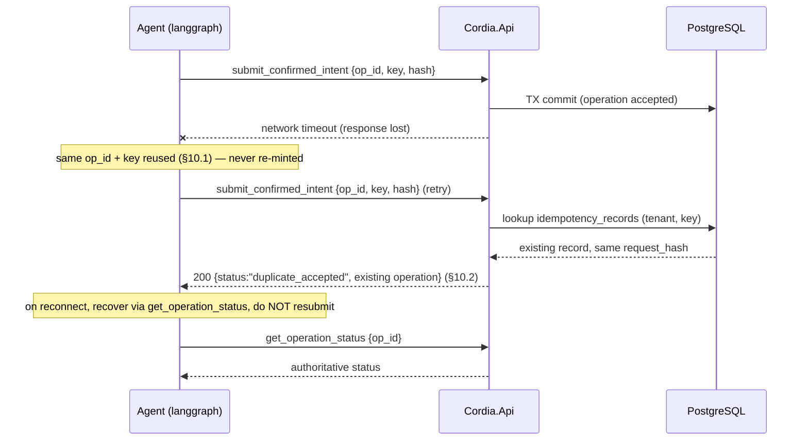

# 03 — Agent Tool Contracts

**Status:** Proposed
**Owner project(s):** `apps/langgraph` (tool client + Pydantic contracts), `apps/api` (REST endpoints + handlers), `libs/shared-schemas` (cross-language tool I/O)
**Source design sections:** §23 (API and Tool Surface), §9.4.6–9.4.7 (Manage Booking agent tools + API shape), §6.6 (Foreground API budget), §6.5 (Availability modes), §6.1 (Policy result shape), §10 (Submission contract), §13.2 (Idempotency layers), §22 (Data model), §27 (Testing strategy).

## 1. Purpose & scope

This spec defines the **narrow tool surface** the foreground conversational agent and the manage-booking flow are granted, and the REST endpoints in `apps/api` that back each tool. It fixes, per tool: the side-effect class, input/output schema sketch, machine-readable status codes with safe customer-facing hints, latency expectation, idempotency requirements, the REST endpoint, and the `libs/shared-schemas` contract that carries the I/O cross-service. It is the contract boundary between the agent (which *proposes*) and the platform (which *disposes*). It does **not** define the booking workflow internals (see `06-booking-workflow-and-fulfillment.md`), the submission/idempotency internals (see `04-submission-and-idempotency.md`), or the prompt/graph logic (see `02-foreground-conversational-agent.md`).

## 2. Position in the system

**Lane:** Spans the lane boundary. The *tool client* lives in the FOREGROUND lane (`apps/langgraph`); the *endpoints and handlers* live in the BACKGROUND/platform lane (`apps/api`). The tools are the only sanctioned way the agent touches the platform — the agent has no generic HTTP, no DB, and no provider credentials.

**Upstream:** The LangGraph graph (`02`) invokes these tools as LangChain/LangGraph tool calls. Voice/streaming (`01`) supplies the turn timing the latency budgets must fit inside.

**Downstream:** Endpoints dispatch to MediatR handlers in `Cordia.Application`. Read tools hit read models / repositories; mutation tools (`submit_*`, `request_verification`, `request_human_handoff`) perform the **atomic acceptance** of `04` and enqueue work for the workflow of `06`.

**What this component must NOT do (§6.6, §23):**

- No tool calls an external booking, payment, or notification provider directly. Foreground side effects are bounded to: send OTP/link, durably accept a confirmed operation, create/retrieve a handoff item.
- No tool performs provider booking creation, cancellation, modification, refund, pre-order commitment, retry loops, reconciliation, DLQ replay, or owner/manual recovery. Those are background jobs (`06`, `05`, `09`, `10`, `11`).
- The model never classifies raw provider exceptions. Every tool returns a **machine-readable status code** plus a **safe customer-facing hint**; the agent only reads back hints supported by current authoritative state (Inv-16).
- The agent never mutates a booking row or capacity directly; it submits operations (§9.4).

## 3. Component design

Three sub-components, two of them code:

| Sub-component | Project | Responsibility |
|---|---|---|
| **Tool definitions** | `apps/langgraph/cordia_agent/tools/` | Python tool functions with Pydantic input/output models, bound into the graph. Each marshals to one REST call via the typed client; never holds business logic. |
| **Typed tool client** | `apps/langgraph/cordia_agent/tools/client.py` | One thin HTTP client. Injects tenant context, correlation/causation IDs, and (for mutation tools) the checkpointed `operation_id` + `idempotency_key`. Maps non-2xx to typed tool errors, never raises raw exceptions into the model. Short, per-tool timeouts (§6.6). |
| **Agent-facing endpoints + handlers** | `apps/api` (`Cordia.Api` controllers → `Cordia.Application` CQRS) | Thin controllers over the §9.4.7 surface; each handler validates tenant/schema/policy/auth, evaluates idempotency, returns the normalized contract. |

### 3.1 Tool taxonomy by side-effect class

| Class | Tools | Guarantee |
|---|---|---|
| **Pure read (no side effect)** | `get_tenant_context`, `find_customer_context`, `search_vendor_catalog`, `get_catalog_item`, `validate_booking_draft`, `check_verification`, `get_operation_status`, `find_manageable_bookings`, `get_booking_details`, `validate_booking_change`, `get_booking_operation_status` | Safe to retry freely; reads may be audited (sensitive booking reads, §9.4.2). |
| **Bounded foreground side effect** | `check_candidate_availability` (only when an explicit short-hold contract is requested), `request_verification` (sends OTP/link), `request_human_handoff` (creates work item) | Side effect is local/bounded; idempotent on a caller-supplied key; never touches booking/payment providers. |
| **Durable acceptance (idempotent, mutation-of-record)** | `submit_confirmed_intent`, `submit_booking_modification`, `submit_booking_cancellation` | Performs the §10.3 atomic acceptance only; returns `202 accepted`. Provider work is deferred to `06`. |

Everything in §23's *background-only* table (`create_booking_from_operation`, `modify_booking_from_operation`, `cancel_booking_from_operation`, `create_payment_session`, `reconcile_provider_operation`, `run_compensation`, `send_notification`, `match_waitlist_offer`, `commit_preorder`, `ingest_vendor_menu`, `publish_vendor_catalog`) is **not** a tool the agent can call. They are workflow step handlers owned by `06` (and `09`/`10`/`11`). They are listed here only to mark the boundary.

## 4. Data contracts & schemas

### 4.1 Cross-service mapping rule

Per §28.3, agent tool inputs and outputs are cross-language contracts. The **Pydantic model in `apps/langgraph/cordia_agent`** is the source of truth; it is exported to JSON Schema and generated into C# (consumed by handlers as the request/response DTO) and TS/Zod (consumed by `apps/web` for status/verification continuation). The tool envelope, status enums, and availability mode enum belong in `libs/shared-schemas`. Queue-only payloads (the workflow jobs the `submit_*` handlers enqueue) live under `schemas/job-events/` and belong to `06` — **not** here.

| Contract group | shared-schemas location (logical) | Generated into |
|---|---|---|
| `ToolStatus` enum (per-tool codes), `ToolResultEnvelope<T>` | `schemas/enums/`, `schemas/shared/` | C# + TS/Zod |
| `AvailabilityMode` (`informational`/`live`/`held`/`confirmed`, §6.5) | `schemas/enums/AvailabilityMode.json` | C# + TS/Zod |
| `PolicyValidationResult` (§6.1 shape) | `schemas/models/` | C# + TS/Zod |
| `BookingDraft`, `BookingIntent`, `IntentRevision`, `Confirmation` | `schemas/models/` (owned by `02`/`04`) | C# + TS/Zod |
| `OperationStatusView`, `VerificationGrant` | `schemas/models/` | C# + TS/Zod |
| `BookingProjection` (verification-leveled, §9.4.2) | `schemas/models/` | C# + TS/Zod |

### 4.2 Common envelope

Every tool returns a normalized envelope. The model reads `status` + `customer_hint`, never raw errors.

```python
# apps/langgraph/cordia_agent/tools/contracts.py (Pydantic, source of truth)
class ToolResultEnvelope(BaseModel, extra="forbid"):
    ok: bool
    status: str                       # machine-readable code, per-tool enum
    customer_hint: str | None = None  # safe, customer-facing; never raw provider text
    recoverable_fields: list[str] = []      # mirrors §6.1 recoverable_fields
    suggested_action: str | None = None     # e.g. "request_alternative_time"
    data: dict | None = None          # tool-specific typed payload (see below)
    correlation_id: str
    schema_version: str
```

DB tables touched (from §22) are listed per-tool below; no tool writes outside its handler's transaction.

### 4.3 Foreground tools

#### `get_tenant_context` — pure read
Resolve trusted policy/configuration after tenant resolution (§7). **Inv-13:** must succeed before any other data tool runs.
- **In:** `{}` (tenant from session context). **Out:** `{ tenant_id, policy_version, timezone, supported_operations, capabilities, currency }`.
- **Status:** `resolved` | `tenant_not_resolved`. Hint on failure: generic "I'm having trouble reaching this business right now."
- **Endpoint:** `GET /api/tenant-context` (agent-facing). **Tables:** none mutated (reads tenant config). **Latency:** p95 ≤ 80 ms (cacheable). **Idempotency:** n/a (read).

#### `find_customer_context` — pure read
Tenant-scoped discovery (§9.2). Discovery ≠ auth (§9.1).
- **In:** `{ phone_e164?, email?, caller_id?, booking_reference? }`. **Out:** minimized `{ customer_id?, display_name?, usual_party_size?, communication_preference?, has_tokenized_payment: bool }`.
- **Status:** `found` | `multiple` | `none`. On `multiple`, the agent disambiguates with non-sensitive fields; never reveals another customer's data (§9.4.1).
- **Endpoint:** `GET /api/customers/context?...`. **Tables:** reads customer/CRM projection; `audit_events` on access. **Latency:** p95 ≤ 120 ms. **Idempotency:** n/a.

#### `search_vendor_catalog` / `get_catalog_item` — pure read
Approved catalog only (§21.2). Catalog text is **untrusted** for control purposes — see prompt-injection note in §6 below and `14`.
- **`search_vendor_catalog` In:** `{ query, category?, max_results? }`. **Out:** `{ items: [{ item_id, name, description, price_minor, currency, catalog_version }] }`.
- **`get_catalog_item` In:** `{ item_id }`. **Out:** one item by stable ID.
- **Status:** `ok` | `not_found` | `catalog_unavailable`. **Endpoint:** `GET /api/catalog/items?...` and `GET /api/catalog/items/{itemId}`. **Tables:** `vendor_catalogs`, `vendor_catalog_items` (read). **Latency:** p95 ≤ 150 ms. **Idempotency:** n/a.

#### `validate_booking_draft` — pure read (local policy, §6.1)
Deterministic policy evaluation against versioned tenant config; **not** an LLM judgment.
- **In:** `BookingDraft` (normalized; §8.4). **Out:** `PolicyValidationResult`:
```json
{ "valid": false, "code": "minimum_notice_not_met",
  "customer_message": "This business requires at least two hours' notice.",
  "recoverable_fields": ["starts_at"], "suggested_action": "request_alternative_time",
  "policy_version": "policy_2026_06_15" }
```
- **Status codes (extensible):** `valid` | `minimum_notice_not_met` | `outside_operating_hours` | `party_size_unsupported` | `service_ineligible` | `field_missing` | `field_ambiguous`. **Endpoint:** `POST /api/booking-drafts/validate`. **Tables:** reads tenant policy. **Latency:** p95 ≤ 100 ms (local, no provider call). **Idempotency:** n/a.

#### `check_candidate_availability` — read, or bounded short hold by explicit contract (§6.5, §6.6)
Latency-optimized: one call validates policy **and** returns candidate slots with machine-readable invalid fields + alternatives. External provider calls use short timeouts; a slow provider returns a `pending`/`advisory` result instead of blocking the conversation.
- **In:** `{ draft: BookingDraft, want_hold: bool, hold_ttl_seconds?: int }`. **Out:** `{ mode: AvailabilityMode, candidates: [{ starts_at, duration_minutes, availability_mode }], hold?: { hold_id, expires_at }, invalid_fields: [...], alternatives: [...] }`.
- **`mode` ∈ {`informational`, `live`, `held`, `confirmed`}** (§6.5) — the response states the strength so the agent uses the correct wording. Only `held` closes the race (Inv-6 lives in `07`; this tool merely *requests* a hold via the bounded contract).
- **Status:** `available` | `available_pending` (degraded provider) | `unavailable` | `held` | `hold_failed`. **Endpoint:** `POST /api/availability/candidates`. **Tables:** may insert `capacity_holds` when `want_hold` (atomic conditional write owned by `07`). **Latency:** p95 ≤ 400 ms with provider; degrades to `available_pending` past the short timeout. **Idempotency:** when `want_hold`, the request carries a `hold_idempotency_key`; repeat returns the same hold (hold mechanics in `07`).

#### `request_verification` — bounded side effect (sends OTP/link, §9.3)
- **In:** `{ target_booking_id?, customer_id?, channel: "sms"|"email", action: VerificationAction, verification_idempotency_key }`, where `VerificationAction ∈ {read_sensitive, modify, cancel, use_payment_method, refund, owner_override}` (the cross-service set owned by `08`). **Out:** `{ verification_id, channel, expires_at, masked_destination }`.
- **Side effect:** sends OTP/link via the platform (the *handler* may enqueue a notification; the **tool** itself never calls the SMS/email provider — Inv-1/§23). **Card data never enters here (Inv-12).**
- **Status:** `sent` | `already_sent` (dedup) | `rate_limited` | `no_verified_destination`. **Endpoint:** `POST /api/verifications`. **Tables:** `verification_grants` (pending), `notifications` (enqueued via outbox), `idempotency_records`. **Latency:** p95 ≤ 250 ms (enqueue-only). **Idempotency:** required — `verification_idempotency_key`; repeat returns the same in-flight verification.

#### `check_verification` — pure read (returns scoped grant, §9.3)
- **In:** `{ verification_id, code? }` (code present when verifying an OTP). **Out:** `VerificationGrant`: `{ grant_id?, tenant_id, customer_id?, target_booking_id?, allowed_action, expires_at, scope: "session"|"operation" }` or none, where `allowed_action ∈ {read_sensitive, modify, cancel, use_payment_method, refund, owner_override}` (the cross-service `verification_action` set owned by `08`).
- **Status:** `granted` | `pending` | `failed` | `expired`. The **platform**, not the agent, decides the grant (Inv-11). **Endpoint:** `GET /api/verifications/{verificationId}` (and `POST .../verify` when submitting a code). **Tables:** `verification_grants`. **Latency:** p95 ≤ 120 ms. **Idempotency:** n/a (idempotent read; submitting a wrong code is rate-limited).

#### `submit_confirmed_intent` — durable acceptance (idempotent mutation, §10)
The single foreground write that creates record-of-truth. Performs the §10.3 atomic acceptance only.
- **In:** `{ operation_id, idempotency_key, intent_id, intent_revision, intent_payload_hash, confirmation: Confirmation }`. The `operation_id` + `idempotency_key` are **checkpointed by the agent before the first call** and reused across every retry/replay (§10.1, Inv-2). The agent never mints them inside a retry loop.
- **Out (§10.4):**
```json
{ "operation_id": "op_01...", "intent_id": "intent_01...", "intent_revision": 3,
  "status": "accepted", "status_url": "/api/booking-operations/op_01...",
  "submitted_at": "2026-06-15T10:30:00Z" }
```
- **Status:** `accepted` (202) | `duplicate_accepted` (same key + same hash → existing op, §10.2) | `idempotency_conflict` (409; same key + different hash) | `confirmation_invalid` | `policy_failed` | `validation_failed`. The hint for `accepted` is "I have submitted the request" — **never** "booked" (Inv-16). **Endpoint:** `POST /api/bookings` (returns `202` + `operation_id`; status via `GET /api/booking-operations/{operationId}`). The backing MediatR command is `SubmitConfirmedIntentCommand`. **Tables (one transaction):** `idempotency_records`, `booking_intents`, `booking_intent_revisions`, `intent_confirmations`, `booking_operations`, `outbox_messages` (Inv-4). **Latency:** per `13`'s durable-acceptance SLO, p95 < 300 ms (single DB transaction; no provider call). **Idempotency:** required and central (Inv-2, Inv-3).

#### `get_operation_status` — pure read (authoritative status, §6.6)
- **In:** `{ operation_id }`. **Out:** `OperationStatusView`: `{ operation_id, status, booking_id?, booking_reference?, availability_mode?, customer_message, pending: bool, terminal: bool, updated_at }`.
- The agent reads back only what this authoritative view supports (Inv-16). On reconnect, the agent recovers the existing operation through this tool (no resubmit). **Status:** the cross-service `NormalizedOperationStatus` projection owned by `06`, EXACTLY `accepted` | `in_progress` | `awaiting_user_action` | `alternatives_required` | `booked` | `waitlisted` | `rejected` | `expired` | `failed`. Internal `OperationStatus` substates (e.g. `validating`/`held`/`awaiting_payment`/`failed_final`) are collapsed by `06` before crossing the service boundary and are **never** surfaced through this tool. **Endpoint:** `GET /api/booking-operations/{operationId}`. **Tables:** `booking_operations` (read). **Latency:** p95 ≤ 120 ms. **Idempotency:** n/a.

#### `request_human_handoff` — bounded side effect (idempotent, §8.12)
- **In:** `{ session_id, reason_code, handoff_idempotency_key, recommended_action? }`. The handler assembles the §8.12 package server-side (draft, confirmed/unconfirmed fields, transcript pointers, verification state, current operation status, non-authoritative summary).
- **Out:** `{ work_item_id, queue, status }`. **Status:** `created` | `existing` (same key) | `routing_unavailable`. **Endpoint:** `POST /api/handoffs`. **Tables:** `operations_work_items`, `audit_events`. **Latency:** p95 ≤ 200 ms. **Idempotency:** required — repeat returns the existing work item.

### 4.4 Manage-booking tools (§9.4)

A booking is an auditable aggregate; "CRUD" is operation submission, not row mutation (§9.4). Mutation tools require a verification grant (Inv-11, §27.1).

#### `find_manageable_bookings` — pure read
- **In:** `{ phone_e164?, booking_reference?, email? }`. **Out:** minimized candidate list `[{ booking_id, booking_reference, business, date, approx_time, party_size }]` — non-sensitive disambiguators only (§9.4.1). **Status:** `found` | `multiple` | `none`. **Endpoint:** `GET /api/bookings?reference=...`. **Tables:** reads bookings; `audit_events`. **Latency:** p95 ≤ 150 ms.

#### `get_booking_details` — pure read (verification-leveled projection, §9.4.2)
- **In:** `{ booking_id, grant_id? }`. **Out:** `BookingProjection` minimized to the verification level; the fully authorized view requires a valid grant. Read is side-effect free but **audited**; provider state may be refreshed when stale/ambiguous (read-only refresh, no mutation). **Status:** `ok` | `requires_verification` | `not_found`. **Endpoint:** `GET /api/bookings/{bookingId}`. **Tables:** `booking_operations`/bookings (read), `audit_events`. **Latency:** p95 ≤ 200 ms.

#### `validate_booking_change` — pure read (policy + fees + required confirmation, §9.4.3)
- **In:** `{ target_booking_id, expected_booking_version, requested_fields, grant_id }`. **Out:** `{ valid, code, fees_minor?, currency?, requires_confirmation: bool, requires_payment: bool, recoverable_fields, policy_version, capacity_mode: AvailabilityMode }`. **Status:** `valid` | `policy_failed` | `stale_version` | `capacity_unavailable`. **Endpoint:** `POST /api/bookings/{bookingId}/changes:validate` (validation-only, no operation created). **Tables:** reads booking + policy + capacity. **Latency:** p95 ≤ 350 ms.

#### `submit_booking_modification` — durable acceptance (idempotent, §9.4.3)
- **In:** `{ target_booking_id, expected_booking_version, operation_id, modification_idempotency_key, intent_revision, intent_payload_hash, confirmation, grant_id }`. The platform rejects stale modifications when `expected_booking_version` no longer matches (Inv via optimistic concurrency, §22.1) — the agent reloads and explains the changed state rather than overwriting (§9.4.3). The original booking stays valid until replacement is secured; this tool does **not** cancel the working reservation (that is the workflow's replacement strategy in `06`/`08`).
- **Out:** §10.4-shaped `{ operation_id, status: "accepted", status_url, ... }`. **Status:** `accepted` (202) | `duplicate_accepted` | `idempotency_conflict` | `stale_version` (409) | `verification_required` | `confirmation_invalid`. **Endpoint:** `POST /api/bookings/{bookingId}/modifications`. **Tables (one txn):** `booking_intents`, `booking_intent_revisions`, `intent_confirmations`, `booking_operations`, `idempotency_records`, `outbox_messages`. **Latency:** per `13`'s durable-acceptance SLO, p95 < 300 ms. **Idempotency:** required.

#### `submit_booking_cancellation` — durable acceptance (idempotent, §9.4.4)
- **In:** `{ target_booking_id, expected_booking_version, operation_id, cancellation_idempotency_key, reason_code, confirmation?, grant_id }`. Repeated cancellation with the same key returns the existing operation; a different request against an already-cancelled booking returns the current cancelled state **without invoking the provider again** (§9.4.4). The booking is not reported cancelled until Cordia releases inventory atomically or the provider confirms (`06`/`08`).
- **Out:** §10.4-shaped. **Status:** `accepted` (202) | `already_cancelled` | `duplicate_accepted` | `idempotency_conflict` | `stale_version` | `verification_required`. **Endpoint:** `POST /api/bookings/{bookingId}/cancellations`. **Tables (one txn):** `booking_operations`, `idempotency_records`, `outbox_messages`. **Latency:** per `13`'s durable-acceptance SLO, p95 < 300 ms. **Idempotency:** required.

#### `get_booking_operation_status` — pure read (§9.4.6)
Same shape and rules as `get_operation_status`, scoped to mutation operations. **Endpoint:** `GET /api/booking-operations/{operationId}`. **Latency:** p95 ≤ 120 ms.

> **Transport conveniences (§9.4.7):** `PUT`/`PATCH`/`DELETE` on `/api/bookings/{id}` MAY be exposed but MUST create the same durable modification/cancellation operations; they MUST NOT update or delete the booking row. Mutation responses return `202 Accepted` with an operation ID unless the entire authoritative mutation completed synchronously, and the response must still distinguish durable acceptance from provider-confirmed completion.

## 5. Workflows

### 5.1 Happy path: capture → validate → confirm → durable acceptance

```mermaid
sequenceDiagram
    participant A as Agent (langgraph)
    participant API as Cordia.Api
    participant DB as PostgreSQL
    participant OB as Outbox→Workflow (06)

    A->>API: get_tenant_context  (Inv-13)
    API-->>A: {policy_version, capabilities}
    A->>API: validate_booking_draft (BookingDraft)
    API-->>A: PolicyValidationResult{valid:true}
    A->>API: check_candidate_availability {want_hold:true}
    API->>DB: atomic conditional hold (07)
    API-->>A: {mode:"held", hold{expires_at}}
    Note over A: deterministic read-back; customer confirms
    A->>A: checkpoint operation_id + idempotency_key (§10.1)
    A->>API: submit_confirmed_intent {op_id, key, revision, hash, confirmation}
    API->>DB: TX: idempotency + revision + confirmation + operation(accepted) + outbox (Inv-4)
    DB-->>API: commit
    API-->>A: 202 {status:"accepted", status_url}
    A-->>A: say "I have submitted the request" (NOT "booked", Inv-16)
    OB-->>OB: workflow finalizes asynchronously (06)
    A->>API: get_operation_status {op_id}
    API-->>A: {status:"booked", customer_message}
```

### 5.2 Failure/recovery: client timeout + reconnect (idempotent re-submit)



### 5.3 Failure: idempotency conflict + stale modification

```mermaid
stateDiagram-v2
    [*] --> SameKey
    SameKey --> SameHash: payload unchanged
    SameKey --> DiffHash: payload changed under old key
    SameHash --> DuplicateAccepted: return existing operation
    DiffHash --> IdempotencyConflict: 409 reject (Inv-3)
    IdempotencyConflict --> NewRevision: agent mints NEW op_id+key for material change (Inv-10)
    NewRevision --> [*]

    [*] --> ModifySubmit
    ModifySubmit --> VersionMatch: expected_booking_version current
    ModifySubmit --> StaleVersion: version moved (concurrent modify)
    VersionMatch --> Accepted202
    StaleVersion --> Reload: 409; agent reloads booking, explains change (§9.4.3)
    Reload --> [*]
    Accepted202 --> [*]
```



## 6. Reliability mechanisms

| Mechanism | Invariant |
|---|---|
| No tool ingests transcript text as a command; only normalized `BookingDraft`/`Confirmation` reach `submit_*`. Catalog/menu text is data, never control (prompt-injection boundary, `14`). | **Inv-1** |
| Every `submit_*` and `request_verification`/`request_human_handoff` call carries a stable `operation_id`/`idempotency_key` checkpointed before the first call, reused across all retries (§10.1). | **Inv-2** |
| `submit_*` handlers bind one idempotency key to exactly one canonical request hash; `same key + diff hash → idempotency_conflict` (409). | **Inv-3** |
| `submit_*` endpoints perform durable acceptance + operation creation + outbox insert in one DB transaction; `202` only after commit (§10.3). | **Inv-4** |
| Read tools are freely retryable; bounded side-effect tools (`request_verification`, `request_human_handoff`, hold request) are dedup-keyed → effectively-once. | **Inv-5** |
| `check_candidate_availability {want_hold}` uses the atomic conditional hold of `07`; the tool only requests, never mutates capacity itself. | **Inv-6** |
| Mutation tools cannot trigger provider calls; ambiguous outcomes reconcile in the workflow (`06`) before any repeated create/charge — the tool surface gives the agent no way to retry a provider. | **Inv-7** |
| `submit_booking_cancellation`/`submit_confirmed_intent` only accept; success vs notification ordering is enforced downstream. | **Inv-8** |
| `request_verification` enqueues a deduplicated notification; never calls the provider directly. | **Inv-9** |
| Material change after confirmation forces a new revision + new operation/key; the agent cannot reuse a key for a changed payload (the `idempotency_conflict` path drives this). | **Inv-10** |
| `submit_booking_modification`/`submit_booking_cancellation`/`get_booking_details` (sensitive) require a server-issued `verification_grant`; caller ID alone never authorizes (§9.3, §27.1). | **Inv-11** |
| No tool input/output carries PAN/CVV; payment is a platform-generated link action only (§19.1), not a tool field. | **Inv-12** |
| `get_tenant_context` must resolve before any customer/catalog/booking tool; client refuses calls without tenant scope. | **Inv-13** |
| Tool errors are advisory states; they never substitute for a customer-visible business state — the agent reports operation status from `get_operation_status`, not from a transient tool error. | **Inv-14, Inv-16** |
| Agent reads back only what the authoritative `OperationStatusView`/`BookingProjection` supports; `accepted`/`pending` is never spoken as "booked". | **Inv-16** |

## 7. Latency budget & optimizations

Balanced axis: reads and the durable-acceptance write are tuned for foreground latency; provider work is pushed to the background SLA windows of `06`.

| Tool | p95 target | Technique |
|---|---|---|
| `get_tenant_context` | 80 ms | Versioned config cache keyed by `policy_version`. |
| `find_customer_context` | 120 ms | Indexed lookup on tenant + phone/email; minimized projection. |
| `search_vendor_catalog` / `get_catalog_item` | 150 ms | Read model of published catalog version. |
| `validate_booking_draft` | 100 ms | Deterministic local policy eval, no provider call (§6.1). |
| `check_candidate_availability` | 400 ms | One call validates policy + returns slots; short provider timeout → `available_pending` on degradation (§6.6, §6.5). |
| `request_verification` | 250 ms | Enqueue-only (outbox); provider send is async. |
| `check_verification` / `get_operation_status` / `*_operation_status` | 120 ms | Direct indexed read of grant/operation row. |
| `submit_confirmed_intent` / `submit_booking_*` | p95 < 300 ms (per `13`'s durable-acceptance SLO) | Single DB transaction; **no synchronous provider call** — the 202 returns before fulfillment. |
| `find_manageable_bookings` / `get_booking_details` / `validate_booking_change` | 150–350 ms | Indexed reads; optional read-only provider refresh bounded by short timeout. |

Client-side: per-tool deadlines, one retry on idempotent reads only, connection reuse, and concurrency hints (batch availability). The agent never blocks the call waiting on fulfillment — it says "I've submitted the request" and polls status (§6.6).

## 8. Failure modes & recovery

| Failure | Detection | Recovery |
|---|---|---|
| `submit_*` response lost after commit | Client timeout | Re-call with same `op_id`+`key` → `duplicate_accepted`; or recover via `get_operation_status` (§5.2). |
| Same key, changed payload | Handler hash mismatch | `idempotency_conflict` (409); agent mints new op for the new revision (Inv-3/Inv-10). |
| Concurrent duplicate submits | DB unique `(tenant_id, idempotency_key)` | One election; losers receive the elected operation (`04` concurrent-duplicate election). |
| Stale modification | `expected_booking_version` mismatch | `stale_version` (409); agent reloads booking, explains change, does not overwrite (§9.4.3). |
| Provider slow/degraded on availability | Short timeout exceeded | Return `available_pending`/`informational`; agent uses advisory wording (§6.5), never claims "held". |
| Verification not granted / expired | `check_verification` status | Re-request or escalate; mutation tools refuse without a valid grant. |
| Missing/expired tenant scope | `get_tenant_context` fails | Client blocks downstream tools; generic hint, escalate to handoff. |
| Untrusted instruction in catalog/customer text | Boundary enforced in `02`/`14` | Catalog text never invokes privileged tools; tool surface itself cannot be invoked by data (§27.1). |
| Handler raises raw provider/DB exception | Middleware maps typed domain exceptions | Client maps non-2xx to a typed `ToolResultEnvelope` with a safe hint; the model never sees raw exceptions (§23). |

## 9. Interfaces to sibling specs

- **`01-streaming-voice-pipeline.md`** — turn timing that the per-tool latency budgets must fit within; `available_pending` keeps the conversation flowing during slow availability.
- **`02-foreground-conversational-agent.md`** — owns the graph that *calls* these tools, the `BookingDraft`/read-back/confirmation logic, the prompt-injection boundary, and the handoff trigger logic; this spec owns only the tool I/O contracts.
- **`04-submission-and-idempotency.md`** — owns `operation_id`/`idempotency_key` minting, canonical request hashing, atomic acceptance, and concurrent-duplicate election that `submit_*` tools depend on.
- **`05-job-queue-outbox-inbox.md`** — receives the outbox messages inserted by `submit_*` handlers; queue-only `schemas/job-events/` payloads.
- **`06-booking-workflow-and-fulfillment.md`** — owns all background-only handlers (`create_booking_from_operation`, etc.), reconciliation, and the workflow status surfaced via `get_operation_status`.
- **`07-capacity-and-holds.md`** — owns the atomic conditional hold that `check_candidate_availability {want_hold}` requests; defines `AvailabilityMode` semantics.
- **`08-identity-and-manage-booking.md`** — owns the manage-booking authorization, optimistic-concurrency/version rules, and the modify replacement strategy backing `validate_booking_change`/`submit_booking_*`.
- **`09-payment-deposit-link.md`** — deposit link sent via SMS/email after booking confirmation (per-restaurant toggle); payment is never a tool input field (Inv-12).
- **`10-notifications.md`** — `request_verification` enqueues a deduplicated notification through this spec's flow.
- **`11-waitlist-menu-preorder.md`** — owns `ingest_vendor_menu`/`publish_vendor_catalog`/`commit_preorder`; this spec's catalog reads consume the published version.
- **`12-data-model-and-persistence.md`** — defines every `§22` table touched (`booking_operations`, `idempotency_records`, `verification_grants`, `capacity_holds`, `operations_work_items`, `outbox_messages`, `audit_events`, catalog tables) and EF Core mapping.
- **`13-observability-and-slos.md`** — correlation/causation IDs the tool client propagates; per-tool latency/error SLO metrics.
- **`14-security-and-privacy.md`** — data minimization on reads, prompt-injection boundary, PAN/CVV exclusion, audit of sensitive reads.

## 10. Implementation mapping

**`apps/langgraph/cordia_agent/`**
- `tools/contracts.py` — `ToolResultEnvelope`, per-tool input/output Pydantic models (source of truth → exported to `libs/shared-schemas`).
- `tools/foreground.py` — the 11 foreground tools bound to the graph.
- `tools/manage_booking.py` — the 6 manage-booking tools.
- `tools/client.py` — typed HTTP client (tenant/correlation injection, op-id/key checkpoint reuse, short timeouts, non-2xx → typed errors).

**`apps/api/` (clean architecture, per `docs/dotnet-api-patterns.md` — one request+handler per file under `Application/Handlers/<Feature>/`)**
- `Cordia.Api/Controllers/` — thin: `TenantContextController`, `CustomersController`, `CatalogController`, `BookingDraftsController`, `AvailabilityController`, `VerificationsController`, `BookingsController` (POST = submit_confirmed_intent; modifications/cancellations sub-routes), `BookingOperationsController`, `HandoffsController`.
- `Cordia.Application/` features (CQRS): `TenantContext/GetTenantContextQuery`, `Customers/FindCustomerContextQuery`, `Catalog/SearchVendorCatalogQuery` + `GetCatalogItemQuery`, `BookingDrafts/ValidateBookingDraftQuery`, `Availability/CheckCandidateAvailabilityQuery`, `Verifications/RequestVerificationCommand` + `CheckVerificationQuery`, `Bookings/SubmitConfirmedIntentCommand`, `Bookings/SubmitBookingModificationCommand`, `Bookings/SubmitBookingCancellationCommand`, `Bookings/FindManageableBookingsQuery` + `GetBookingDetailsQuery` + `ValidateBookingChangeQuery`, `BookingOperations/GetOperationStatusQuery`, `Handoffs/RequestHumanHandoffCommand`. FluentValidation validators per command.
- `Cordia.Domain/` — `BookingOperation`, `IntentRevision`, `Confirmation`, `VerificationGrant`, `WorkItem` entities; repository + provider interfaces; typed domain exceptions (`IdempotencyConflictException`, `StaleBookingVersionException`, `VerificationRequiredException`) mapped to status codes by `Cordia.Api` middleware.
- `Cordia.Infrastructure/` — EF Core `IEntityTypeConfiguration` (snake_case) for the §22 tables; idempotency-record store; outbox writer used by `submit_*` handlers.

**`libs/shared-schemas/`** — export the Pydantic tool contracts to `schemas/models/`, `AvailabilityMode`/`ToolStatus` to `schemas/enums/`, the envelope to `schemas/shared/`; regenerate C# + TS/Zod. Never hand-edit generated types.

## 11. Test strategy

From §27 (tests this component must carry):

- **Agent contract (§27.1):** transcript text cannot directly trigger `submit_*` (Inv-1); mutation tools require a verification grant (Inv-11); the agent never claims confirmation from an `accepted`/`pending` status (Inv-16); reconnect recovers the existing operation via `get_operation_status` rather than resubmitting; untrusted catalog instructions cannot invoke privileged tools. Use deterministic fixtures for normalized tool responses; assert both structured output and customer-facing hint wording.
- **Idempotency (§27.2):** `submit_*` with same key + same payload → one operation (`duplicate_accepted`); same key + different payload → `idempotency_conflict`; concurrent submissions elect one operation; API crash after commit but before response recovers the operation.
- **Concurrency (§27.3):** `submit_booking_modification` against a moved `expected_booking_version` → `stale_version`; cancellation-races-creation surfaced as the correct tool status.
- **Failure (§27.4):** availability provider timeout → `available_pending` (no block); 409/conflict mapping; malformed provider response never leaks into a tool envelope.
- **Security (§27.6):** tenant isolation on every endpoint; forged caller ID cannot obtain a grant or call a mutation tool; expired/wrong-scope grants fail `submit_booking_*`; sensitive reads are audited; tool I/O never carries PAN/CVV.
- **Contract/compatibility:** round-trip the Pydantic → JSON Schema → C#/TS generation; assert handler DTOs match generated C# and `apps/web` Zod parses the same envelope. Run as `bun nx test langgraph` (contract) + `bun nx test api --filter Category=Unit` and Alba integration (`Category=Integration`).

## 12. Open decisions (from §31)

- **Canonicalization spec + hash algorithm** — the exact `intent_payload_hash` computation `submit_*` tools depend on (resolved jointly with `04`).
- **Verification factors and risk policy** — which factors `request_verification`/`check_verification` support and which actions require which level (drives the `allowed_action` scope).
- **Customer status transport** — polling vs SSE/WebSocket/channel callback determines whether `get_operation_status` is the sole status path or augmented by push (affects `apps/web` continuation).
- **First-party vs provider-owned capacity** — governs whether `check_candidate_availability {want_hold}` returns `held` synchronously or always `live`/`informational` (resolved with `07`).
- **Idempotency + audit retention periods** — how long `idempotency_records` outlive a booking, bounding the `duplicate_accepted` recovery window.
