# 05 — Job Queue, Outbox & Inbox

**Status:** Proposed
**Owner project(s):** `apps/api` (Cordia.Infrastructure + Cordia.Application + Cordia.Domain), `libs/shared-schemas` (envelope + queue-only contracts)
**Source design sections:** §12.1–12.5 (logical queues, envelope, outbox, inbox, claiming/leases), §12.6–12.8 (worker boundary, attempt records, crash-window matrix), §13.1–13.3 (effectively-once, idempotency layers), §15.2–15.5 (retry schedule, circuit breaking, cancellation), §17.1–17.5 (DLQ & manual recovery), §22 (data model & key constraints)

---

## 1. Purpose & scope

This spec defines Cordia's **durable messaging substrate**: the logical queue topology, the versioned job envelope, the transactional **outbox** publisher, the consumer **inbox** dedup layer, job claiming/leases with visibility timeout, scheduled-job storage, and **DLQ** semantics including replay rules. It is the plumbing that makes the platform's "agent proposes, platform disposes" split *effectively-once* under at-least-once delivery and arbitrary worker/network crashes.

It deliberately does **not** define the booking workflow state machine, the worker staged transaction protocol, retry taxonomy, or reconciliation logic — those are owned by [`06-booking-workflow-and-fulfillment.md`](06-booking-workflow-and-fulfillment.md). This spec defines the *contracts and guarantees* that 06 relies on, and references 06 wherever the worker body runs.

---

## 2. Position in the system

**Lane:** BACKGROUND fulfillment plumbing (`apps/api`). Pure platform infrastructure. The foreground agent never touches it.

```
[04 submission] --(outbox row in same txn as acceptance)--> outbox_messages
        outbox publisher --> broker/job-store --> consumer (inbox dedup) --> [06 worker]
        [06 worker] --(state txn + new outbox rows)--> outbox_messages --> ... --> [09 payment] [10 notifications] [07 holds] [11 waitlist/menu]
```

| Upstream (produces into this substrate) | Downstream (consumes from this substrate) |
|---|---|
| [`04-submission-and-idempotency.md`](04-submission-and-idempotency.md) — durable acceptance writes the first `outbox_messages` row in the acceptance transaction (Inv-4) | [`06-booking-workflow-and-fulfillment.md`](06-booking-workflow-and-fulfillment.md) — booking workflow consumers |
| [`06`](06-booking-workflow-and-fulfillment.md), [`09`](09-payment-deposit-link.md) — workers emit follow-on outbox events in their state transactions | [`09-payment-deposit-link.md`](09-payment-deposit-link.md), [`10-notifications.md`](10-notifications.md), [`07-capacity-and-holds.md`](07-capacity-and-holds.md), [`11-waitlist-menu-preorder.md`](11-waitlist-menu-preorder.md) |
| [`13-observability-and-slos.md`](13-observability-and-slos.md) — correlation/causation propagation rules | [`08-identity-and-manage-booking.md`](08-identity-and-manage-booking.md) — manage-booking commands ride `booking.commands` |

**What this component MUST NOT do:**

- It MUST NOT execute external provider calls or run business logic. It moves envelopes and guarantees dedup; the worker body belongs to 06.
- It MUST NOT carry secrets or raw payment details (PAN/CVV) in envelopes, payloads, or logs (Inv-12). Payloads reference authoritative records by ID.
- It MUST NOT treat an inbox-admitted message as proof an external effect completed (§12.4). Admission marks the *step durable*, not *done*.
- DLQ placement MUST NOT replace a customer-visible business state or SLA (Inv-14); business state is persisted *before* dead-lettering.
- It MUST NOT mint a new logical operation key, idempotency key, or provider key because a process or network failed (§12.8 closing rule).

---

## 3. Component design

| Sub-component | Project / layer | Responsibility |
|---|---|---|
| **Logical queue registry** | `Cordia.Domain` (enum + metadata) | Names the 8 logical queues, their message-type prefixes, ordering needs, and consumer set. Physical consolidation is allowed; contracts stay distinct (§12.1). |
| **Job envelope** | `libs/shared-schemas` + `Cordia.Domain` | Versioned, immutable transport envelope (§12.2). Cross-service contract. |
| **Outbox store** | `Cordia.Infrastructure` (`outbox_messages` table + EF config) | Append-only rows written in the producer's business transaction (Inv-4). |
| **Outbox publisher** | `Cordia.Infrastructure` (`IHostedService` background loop) | Claims unpublished rows via `FOR UPDATE SKIP LOCKED` + lease, publishes, marks, crash-safe (§12.3). |
| **Broker/job-store transport** | `Cordia.Infrastructure` (`IMessageTransport` abstraction) | Pluggable: Postgres-job-store **or** external broker. Open Decision §31. |
| **Consumer inbox** | `Cordia.Infrastructure` (`consumer_inbox` table) + `Cordia.Application` (pipeline behavior) | Dedup keyed by `(consumer_name, tenant_id, message_id)`; shares one txn with the state transition (§12.4, Inv-5). |
| **Job claimer / lease manager** | `Cordia.Infrastructure` | `FOR UPDATE SKIP LOCKED`, bounded lease/visibility timeout, worker identity, heartbeat for long ops (§12.5). |
| **Scheduled-job store** | `Cordia.Infrastructure` (`scheduled_jobs` table + poller) | Durable retries, hold/payment expiry, delayed work. Authoritative schedule lives in job state, not in-process timers (§15.2). |
| **Step sweeper** | `Cordia.Infrastructure` (`IHostedService`) | Finds non-terminal durable workflow steps/attempts and re-enqueues continuation so admitted-but-incomplete external effects are never forgotten (§12.4, §12.6). |
| **DLQ handler + replay command** | `Cordia.Infrastructure` (transport) + `Cordia.Application` (typed replay command) | Quarantine after business state persisted; typed, audited replay with strict ID rules (§17). |

**Consumer dispatch model.** Each logical consumer is a named handler (`consumer_name`, e.g. `booking.finalizer`, `notification.sender`). A MediatR pipeline behavior — `InboxDeduplicationBehavior` — wraps every queue-driven `IRequest`, opening the inbox transaction before the handler runs and committing inbox + business state together.

---

## 4. Data contracts & schemas

### 4.1 Job envelope (cross-service — `libs/shared-schemas`)

The envelope is the source-of-truth contract shared by the C# transport and any Pydantic-side producer/consumer. Because it is a queue-only transport contract (not a Pydantic graph model), it is hand-authored under `libs/shared-schemas/schemas/job-events/JobEnvelope.json` and generated to C#/TS, per the CLAUDE.md "queue-only contracts may live under `schemas/job-events/`" rule.

```json
{
  "message_id": "msg_01J...",
  "message_type": "booking.finalize.requested.v1",
  "occurred_at": "2026-06-15T10:30:00+00:00",
  "tenant_id": "tenant_01J...",
  "correlation_id": "corr_01J...",
  "causation_id": "msg_00J...",
  "operation_id": "op_01J...",
  "intent_id": "intent_01J...",
  "intent_revision": 3,
  "attempt_hint": 0,
  "payload": {}
}
```

Envelope rules (§12.2): globally unique `message_id`; immutable body; explicit schema version in `message_type` (`<domain>.<event>.<verb>.vN`); `tenant_id` + `correlation_id` on every message; **no secrets / no raw payment data** (Inv-12); small payloads that reference authoritative records by ID rather than copying mutable state; consumers stay backward-compatible during rolling deploys. `attempt_hint` is advisory only — the authoritative attempt count lives in `workflow_attempts`/`scheduled_jobs`, never in the envelope (§15.2).

C# transport shape (`Cordia.Domain/Messaging/JobEnvelope.cs`):

```csharp
public sealed record JobEnvelope(
    string MessageId,
    string MessageType,
    DateTimeOffset OccurredAt,
    string TenantId,
    string CorrelationId,
    string? CausationId,
    string? OperationId,
    string? IntentId,
    int? IntentRevision,
    int AttemptHint,
    JsonDocument Payload);
```

### 4.2 `outbox_messages` (table §22)

```csharp
public sealed class OutboxMessage
{
    public string MessageId { get; init; }       // PK, == envelope.message_id
    public string TenantId { get; init; }
    public string? OperationId { get; init; }
    public string MessageType { get; init; }
    public string DestinationQueue { get; init; } // logical queue name
    public string CorrelationId { get; init; }
    public string? CausationId { get; init; }
    public JsonDocument Payload { get; init; }    // sanitized; no secrets
    public DateTimeOffset OccurredAt { get; init; }
    // publication metadata (set by publisher)
    public DateTimeOffset? ClaimedAt { get; set; }
    public string? ClaimedBy { get; set; }        // publisher worker id
    public DateTimeOffset? LeaseExpiresAt { get; set; }
    public DateTimeOffset? PublishedAt { get; set; }
    public int PublishAttempts { get; set; }
}
```

Index: partial index on `(occurred_at)` `WHERE published_at IS NULL` for cheap claim scans. EF Core mapping via `OutboxMessageConfiguration : IEntityTypeConfiguration<OutboxMessage>`, snake_case columns.

### 4.3 `consumer_inbox` (table §22)

```csharp
public sealed class ConsumerInboxRecord
{
    public string ConsumerName { get; init; }     // composite PK part
    public string TenantId { get; init; }          // composite PK part
    public string MessageId { get; init; }         // composite PK part
    public DateTimeOffset AdmittedAt { get; init; }
    public string? OperationId { get; init; }
    public InboxOutcome Outcome { get; init; }      // admitted | completed | rejected
}
```

**Constraint (§22.1, Inv-5):** `unique (consumer_name, tenant_id, message_id)`. A uniqueness violation on insert means *already processed* → acknowledge and drop. `Outcome = admitted` records "durable step created, external effect not yet done"; the sweeper drives admitted→completed (§12.4).

### 4.4 `scheduled_jobs` (table §22)

```csharp
public sealed class ScheduledJob
{
    public string JobId { get; init; }             // PK
    public string TenantId { get; init; }
    public string JobType { get; init; }           // e.g. hold.expiry, retry.continue, payment.expiry
    public string? OperationId { get; init; }
    public string? WorkflowStepId { get; init; }
    public string DestinationQueue { get; init; }
    public JsonDocument Payload { get; init; }
    public DateTimeOffset RunAfter { get; set; }    // authoritative schedule (§15.2)
    public int AttemptNumber { get; set; }          // NEVER reset on restart/replay
    public DateTimeOffset? ClaimedAt { get; set; }
    public string? ClaimedBy { get; set; }
    public DateTimeOffset? LeaseExpiresAt { get; set; }
    public ScheduledJobStatus Status { get; set; }  // pending | claimed | done | dead
}
```

### 4.5 Tables touched

`outbox_messages`, `consumer_inbox`, `scheduled_jobs` (owned here). Read/advanced (owned by 06/04): `booking_operations` (version transition shares the inbox txn), `workflow_attempts` (sweeper reads non-terminal), `idempotency_records` (referenced, not written here), `operations_work_items` (created before dead-lettering, owned by 06/08). DLQ payloads persist into a transport-level `dead_letter_messages` store (logical extension of `outbox_messages`/broker DLQ; not a business table).

---

## 5. Workflows

### 5.1 Happy path — outbox publish → inbox admit → step durable

```mermaid
sequenceDiagram
    autonumber
    participant Prod as Producer (04 / 06 worker)
    participant DB as PostgreSQL
    participant Pub as Outbox Publisher
    participant Brk as Broker / Job-store
    participant Con as Consumer (06 worker via Inbox behavior)
    participant Swp as Step Sweeper

    Prod->>DB: BEGIN; update state (version+1); insert outbox_messages; COMMIT  %% Inv-4
    loop publisher tick
        Pub->>DB: SELECT ... FOR UPDATE SKIP LOCKED WHERE published_at IS NULL (lease)
        Pub->>Brk: publish(envelope) by message_id
        Pub->>DB: UPDATE outbox SET published_at=now()  %% mark
    end
    Brk->>Con: deliver(envelope)  [at-least-once]
    Con->>DB: BEGIN
    Con->>DB: INSERT consumer_inbox (consumer,tenant,message_id) outcome=admitted
    Con->>DB: create/advance workflow_step (durable, NOT "done")  %% Inv-5
    Con->>DB: COMMIT
    Con->>Brk: ack
    Note over Swp,DB: external effect executed by 06 worker (staged txn, see 06)
    Swp->>DB: find non-terminal steps → enqueue continuation
```

### 5.2 Failure & recovery — duplicate delivery + crash before mark

```mermaid
sequenceDiagram
    autonumber
    participant Pub as Outbox Publisher
    participant Brk as Broker
    participant Con as Consumer
    participant DB as PostgreSQL

    Pub->>Brk: publish(msg_X)
    Note over Pub: CRASH before UPDATE published_at  %% §12.8 row 4
    Pub-->>Brk: (republish on restart) publish(msg_X) again
    Brk->>Con: deliver(msg_X)   [first copy]
    Con->>DB: BEGIN; INSERT inbox(...msg_X) OK; advance step; COMMIT; ack
    Brk->>Con: deliver(msg_X)   [duplicate]
    Con->>DB: BEGIN; INSERT inbox(...msg_X) -> UNIQUE VIOLATION
    Con->>DB: ROLLBACK
    Con->>Brk: ack (already processed)  %% Inv-5 effectively-once
    Note over Con,DB: no second step, no duplicate effect
```

### 5.3 DLQ + replay state machine

```mermaid
stateDiagram-v2
    [*] --> Delivered
    Delivered --> Processing: inbox txn opens
    Processing --> Done: inbox+state committed, ack
    Processing --> Retryable: transient failure (re-enqueue via scheduled_jobs)
    Retryable --> Processing: RunAfter elapses (attempt# preserved)
    Processing --> PreDLQ: poison / bad schema / invariant / exhausted
    PreDLQ --> Quarantined: persist business state + error class + attempt history + ops work-item + user comms, THEN dead-letter  %% Inv-14
    Quarantined --> ReplayNeverAdmitted: replay, PRESERVE original message_id
    Quarantined --> ReplayAdmitted: replay, NEW control-message-id (resume step)
    ReplayNeverAdmitted --> Processing
    ReplayAdmitted --> Processing: inbox shows processed -> ack w/o re-admit; resume from durable state
    Done --> [*]
```



---

## 6. Reliability mechanisms

| Mechanism | Invariant | How |
|---|---|---|
| Atomic acceptance + operation + outbox insert | **Inv-4** | The first outbox row is written in the *same* DB transaction as durable acceptance + operation creation in [`04`](04-submission-and-idempotency.md). This substrate guarantees no message escapes without its state, and no state lands without its message. |
| Duplicate-safe consumers | **Inv-5** | `consumer_inbox` unique `(consumer_name, tenant_id, message_id)`; insert-or-violation gives effectively-once. Inbox + state transition share one txn (§12.4). |
| Inbox admits ≠ effect complete | **Inv-5, §12.4** | Inbox txn marks `admitted` and creates a durable step; the **step sweeper** resumes non-terminal steps so a duplicate-suppression never suppresses recovery. |
| Stable identities, never regenerated | **Inv-2, Inv-15, §12.8** | `message_id`, `operation_id`, idempotency keys, provider keys all flow through the envelope unchanged. No crash/network path mints a new logical key. |
| Crash-safe publisher | §12.3, §12.8 | `FOR UPDATE SKIP LOCKED` + lease prevents double-claim across publishers; "publish then mark" means a crash between publish and mark republishes (duplicate) and the inbox absorbs it. |
| Lease/visibility ≠ idempotency | §12.5 | Leases prevent *simultaneous* processing only; they do not replace operation-level optimistic concurrency (Inv handled in 06) or inbox dedup. |
| Authoritative retry schedule in storage | §15.2 | Delayed work lives in `scheduled_jobs.run_after` + `attempt_number`; worker restart never resets attempt count or delay. |
| DLQ preserves business reality | **Inv-14, §17.2** | Consumer persists current recoverable/terminal state, error class, attempt history, ops work-item, and user comms *before* dead-lettering. The customer never becomes invisible because a message changed queues. |
| Replay preserves one logical effect | **Inv-2, Inv-15, §17.4** | Strict ID rules (see §6.1). If inbox already records success, replay acks without re-admission and resumes from durable operation/step/attempt state. |
| No effect from text | **Inv-1** | This substrate only carries envelopes referencing already-durable operation/intent records; it cannot originate a side effect from transcript text. |

### 6.1 Replay ID rules (§17.4) — table

| Situation | message_id | control-message-id | replay command id | idempotency / provider keys | attempts |
|---|---|---|---|---|---|
| Message **never admitted** by consumer | **preserve original** | n/a | new (audit) | preserve | preserve |
| Workflow step **already admitted** | n/a (do not reuse) | **new** control message to resume step | new (audit) | preserve | preserve |
| Inbox already records success | — | replay **acks without re-admit**; resume from durable state | new (audit) | preserve | preserve |

Replay also requires a compatible consumer version and may first target a quarantine environment for inspection.

---

## 7. Latency budget & optimizations

Reliability leads here, but the substrate sits on the critical path between acceptance and first provider call, so it has SLA windows rather than per-keystroke budgets.

| Stage | Target (p95) | Technique |
|---|---|---|
| Acceptance commit → outbox row visible | within the acceptance txn (0 extra hops) | Outbox insert is part of Inv-4 txn; no second round-trip. |
| Outbox row → broker publish | ≤ 500 ms | Short publisher tick (e.g. 100–250 ms) + `LISTEN/NOTIFY` wake on insert when Postgres-job-store; batch-claim N rows per tick. |
| Broker → consumer admit | ≤ 200 ms broker hop | Visibility timeout ≫ processing window, renewable (§12.5). |
| Scheduled-job dispatch precision | ≤ 1 s past `run_after` | Poller interval bounded; index on `(status, run_after)` partial `WHERE status='pending'`. |
| Sweeper continuation latency | ≤ sweeper interval (default 30 s) | Tunable per criticality; sweeper is a safety net, not the primary path. |

Optimizations: partial indexes to keep claim scans O(due rows); `SKIP LOCKED` so N publishers/workers scale horizontally without lock contention; `LISTEN/NOTIFY` to avoid hot-polling; small payloads (reference-by-ID) to minimize serialization and broker bandwidth. The publisher and sweeper are independent `IHostedService` loops so neither blocks request-path acceptance latency.

---

## 8. Failure modes & recovery

Aligned to the §12.8 crash-window matrix; rows owned by this substrate:

| Crash point | Durable evidence | Recovery |
|---|---|---|
| Before acceptance commit | No operation, no outbox row | Client retries with same idempotency key (Inv-2); nothing leaked. |
| After acceptance commit, before API response | Operation + outbox row exist | Client re-submits same key → loads existing operation (04). Outbox will publish independently. |
| After outbox claim, before broker publish | Unpublished row, lease set | Lease expires → another publisher reclaims and publishes. |
| After broker publish, before outbox marked | Broker may hold a duplicate | Publisher republishes on restart; **inbox deduplicates** by `message_id`. |
| Before command admission commit | No inbox row, no step | Broker redelivers; processed cleanly. |
| After command admission, before provider call | Inbox `admitted` + durable pending step | **Step sweeper** resumes the step (§12.4). Owned-by-06 worker executes; this spec guarantees the step is discoverable. |
| During provider call | Dispatch may or may not have occurred | Treated as ambiguous by 06 reconciliation; substrate does not re-create — it only redelivers the same `message_id`. |
| After provider success, before result commit | Provider effect may exist | 06 reconciles by stable provider key; substrate redelivery is dedup-safe. |
| After result commit, before broker ack | Result + next outbox event exist | Redelivery deduplicated by inbox; next event already durable. |
| Lease expired but original worker still alive (zombie) | Two claimants possible | Optimistic-concurrency on `booking_operations` version (06) rejects the loser; lease alone is not the safety boundary (§12.5). |
| Poison / unsupported schema / invariant violation | Message cannot be processed | Persist business state + error + work-item + user comms, **then** DLQ (Inv-14, §17.2). |

---

## 9. Interfaces to sibling specs

- [`04-submission-and-idempotency.md`](04-submission-and-idempotency.md) — **crosses:** the initial `outbox_messages` row written inside the Inv-4 acceptance transaction; `idempotency_records`/`operation_id` referenced by envelope.
- [`06-booking-workflow-and-fulfillment.md`](06-booking-workflow-and-fulfillment.md) — **crosses:** the consumer handler body, the worker **staged transaction boundary** (owned by 06, §12.6), `workflow_attempts`, retry taxonomy and reconciliation. This spec provides inbox dedup, lease/claim, sweeper re-enqueue, and scheduled-job storage that 06 builds on.
- [`07-capacity-and-holds.md`](07-capacity-and-holds.md) — **crosses:** `booking.scheduled` hold-expiry jobs; `booking.compensate` hold-release commands.
- [`09-payment-deposit-link.md`](09-payment-deposit-link.md) — **crosses:** `booking.scheduled` deposit-link-expiry jobs; `stripe.webhook.received` enqueue.
- [`10-notifications.md`](10-notifications.md) — **crosses:** `notification.commands` envelopes; notification-side independent dedup is owned by 10 (Inv-9), not by the inbox.
- [`11-waitlist-menu-preorder.md`](11-waitlist-menu-preorder.md) — **crosses:** `waitlist.commands`, `menu.commands` topics.
- [`08-identity-and-manage-booking.md`](08-identity-and-manage-booking.md) — **crosses:** manage-booking mutation commands enqueued onto `booking.commands`; `operations.review` work-items created pre-DLQ.
- [`13-observability-and-slos.md`](13-observability-and-slos.md) — **crosses:** `correlation_id`/`causation_id` propagation through every envelope; outbox lag, inbox-dup-rate, DLQ depth, scheduled-job lateness metrics.
- [`12-data-model-and-persistence.md`](12-data-model-and-persistence.md) — **crosses:** authoritative DDL for `outbox_messages`, `consumer_inbox`, `scheduled_jobs` and their constraints/indexes.

---

## 10. Implementation mapping

**`apps/api/src/Cordia.Domain`**
- `Messaging/JobEnvelope.cs` — envelope record (mirrors `schemas/job-events/JobEnvelope.json`).
- `Messaging/LogicalQueue.cs` — enum + metadata for the 8 queues (`booking.commands`, `booking.reconcile`, `booking.scheduled`, `booking.compensate`, `notification.commands`, `waitlist.commands`, `menu.commands`, `operations.review`).
- `Entities/OutboxMessage.cs`, `Entities/ConsumerInboxRecord.cs`, `Entities/ScheduledJob.cs`.
- `Interfaces/IMessageTransport.cs`, `Interfaces/IOutboxStore.cs`, `Interfaces/IInboxStore.cs`, `Interfaces/IScheduledJobStore.cs`.

**`apps/api/src/Cordia.Infrastructure`**
- `EntityFramework/Configurations/{OutboxMessage,ConsumerInboxRecord,ScheduledJob}Configuration.cs` — `IEntityTypeConfiguration<T>`, snake_case, the §22.1 unique constraints + partial indexes.
- `Messaging/OutboxPublisherHostedService.cs` — `IHostedService` claim/publish/mark loop.
- `Messaging/StepSweeperHostedService.cs` — non-terminal step re-enqueue.
- `Messaging/ScheduledJobPollerHostedService.cs` — due-job dispatch.
- `Messaging/PostgresMessageTransport.cs` and/or `Messaging/BrokerMessageTransport.cs` — behind `IMessageTransport` (Open Decision §13).
- `Messaging/DeadLetterHandler.cs` + `dead_letter_messages` mapping.
- `Extensions/MessagingServiceCollectionExtensions.cs` — wire into `AddInfrastructure()`.

**`apps/api/src/Cordia.Application`**
- `Messaging/InboxDeduplicationBehavior.cs` — `IPipelineBehavior<,>` opening the inbox txn for queue-driven requests.
- `Handlers/DeadLetters/ReplayDeadLetterCommand.cs` + handler — typed, audited replay enforcing the §6.1 ID rules (Inv-15).
- Per-queue consumer requests live under `Application/Handlers/<Feature>/` per [`docs/dotnet-api-patterns.md`](../dotnet-api-patterns.md) (one request+handler per file).

**`libs/shared-schemas`**
- `schemas/job-events/JobEnvelope.json` (hand-authored, queue-only) → generated C#/TS. Never hand-edit generated outputs.

Typed domain exceptions (`PoisonMessageException`, `UnsupportedSchemaVersionException`, `InboxConflict` handled as ack-and-drop) mapped by middleware per the conventions doc.

---

## 11. Test strategy

From §27 (idempotency/concurrency/retry rows relevant to the substrate):

**Idempotency (§27.2)**
- Outbox publication duplicates are suppressed by consumer inbox (publish twice → one admit).
- Worker crash after provider success reconciles rather than duplicates (substrate side: redelivery of same `message_id` → inbox dedup; reconciliation body in 06).
- DLQ replay preserves one logical effect — assert §6.1 ID rules for both never-admitted and already-admitted cases.
- Manual retry cannot change payload under the old key (replay preserves idempotency/provider keys).

**Concurrency (§27.3)**
- Two workers receive the same job → `FOR UPDATE SKIP LOCKED`/lease yields exactly one active claimant; the other gets nothing or loses optimistic concurrency.
- Stale worker (expired lease zombie) loses the optimistic-concurrency write (06) and does not double-apply.

**Retry & failure (§27.4)**
- Broker redelivery → inbox dedup.
- Outbox publisher crash (between publish and mark) → republish + dedup, one logical effect.
- Inbox transaction rollback → no inbox row, no partial state; broker redelivers cleanly.
- Database failover during publish/admit → lease reclaim, no lost or duplicated logical effect.

**Substrate-specific**
- Inbox `admitted` (not `completed`) + crash → step sweeper re-enqueues; assert the durable step is discovered and continuation runs once.
- `scheduled_jobs` attempt count and `run_after` survive worker restart unchanged (§15.2).
- Pre-DLQ ordering: assert business state + work-item + user comms persist *before* the message is dead-lettered (Inv-14) via fault injection at the dead-letter boundary.

Integration tests use Alba host + a real Postgres (Testcontainers) with `Category=Integration`; concurrency tests drive parallel claimers against the same row.

---

## 12. Open decisions

- **OD-1 (§31 — broker vs PostgreSQL job-store).** *Recommendation: start with a PostgreSQL-based job-store* (`outbox_messages` + `scheduled_jobs` claimed via `FOR UPDATE SKIP LOCKED`, `LISTEN/NOTIFY` for wakeups) behind the `IMessageTransport` seam. Rationale: the outbox/inbox/idempotency tables are already in Postgres, so transactional atomicity (Inv-4, Inv-5) is free and there is no second durability system to keep consistent during crash windows; it removes a moving part for the skeleton stage and is sufficient to several hundred jobs/sec. Adopt an external broker (e.g. for fan-out, cross-region, or very high throughput) later **without** changing the envelope or dedup contract, since `IMessageTransport` isolates it. This decision must not weaken any invariant.
- **OD-2 (§31 — customer status transport).** Whether scheduled-job/sweeper progress is surfaced to customers via polling, SSE, WebSocket, or channel callback affects how aggressively `scheduled_jobs` emit status notifications; flagged here, resolved with [`10-notifications.md`](10-notifications.md) and [`13`](13-observability-and-slos.md).
- **OD-3 (visibility-timeout / lease duration default).** Must exceed the normal processing window per logical queue and be renewable (§12.5); concrete values depend on provider latency profiles resolved in [`06`](06-booking-workflow-and-fulfillment.md)/[`09`](09-payment-deposit-link.md). Default proposal: lease = 2× p99 step latency, heartbeat-renewable for legitimately long ops only.
