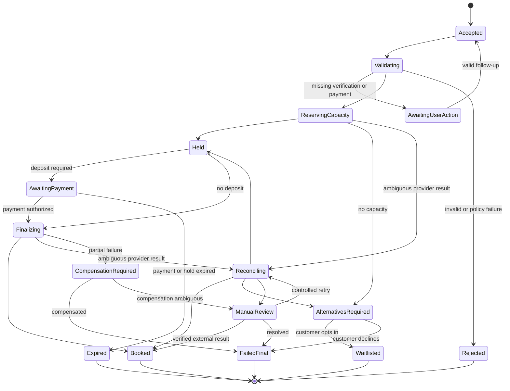
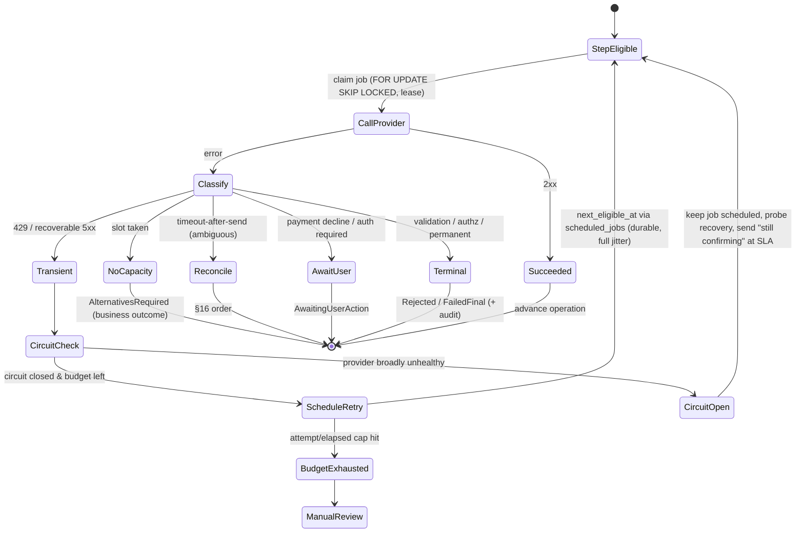

# 06 — Booking Workflow & Background Fulfillment

- **Status:** Proposed
- **Owner project(s):** `apps/api` (Cordia.Domain / Cordia.Application / Cordia.Infrastructure)
- **Source design sections:** §11 State Machine (1111–1156), §12.5–12.7 Job claiming, worker boundary, attempt records (1266–1334), §15 Retry Policy (1516–1597), §16 Reconciliation (1599–1631), §17 DLQ & manual recovery (1633–1693), §17.5 User SLA (1695–1709), §22 Data Model (1926–1977)

---

## 2. Purpose & scope

This is the **background fulfillment engine**: the durable operation state machine and the worker protocol that drives a *durably accepted* booking intent to a terminal authoritative outcome. It owns the `booking_operations` state graph, the staged worker transaction boundary that lets external provider calls survive crashes, attempt records, the retry/reconciliation/compensation taxonomy, circuit breaking, cancellation races, and the SLA timers that decide when a customer gets a "still confirming" message.

It does **not** own: capacity primitives ([07](07-capacity-and-holds.md)), deposit collection ([09](09-payment-deposit-link.md)), notification delivery ([10](10-notifications.md)), the submission/idempotency front door ([04](04-submission-and-idempotency.md)), or queue transport mechanics ([05](05-job-queue-outbox-inbox.md)). It *invokes* those as workflow steps and references their contracts.

## 3. Position in the system

**Lane: BACKGROUND fulfillment (the platform DISPOSES).** This engine is the canonical implementation of the principle that the agent proposes and the platform disposes — it is the only place that mutates authoritative booking state and the only place that calls external booking providers.

| Direction | Component | What crosses the boundary |
|---|---|---|
| Upstream | [04 submission](04-submission-and-idempotency.md) | Atomic acceptance commits `booking_operations` in `Accepted` + first outbox event. We begin from `Accepted`. |
| Upstream | [05 queue/outbox/inbox](05-job-queue-outbox-inbox.md) | Worker is invoked after inbox admission of a `booking.*` message; the inbox txn marks admitted and advances a durable workflow step. |
| Step | [07 capacity & holds](07-capacity-and-holds.md) | `ReservingCapacity`/`Held` invoke atomic capacity write or external hold primitive; we mirror hold state, we do not implement the conditional write. |
| Step | [09 deposit link](09-payment-deposit-link.md) | When deposit is enabled: `AwaitingPayment` waits for the Stripe payment link to be paid; `deposit_paid` → `Finalizing`, `deposit_expired` → `Expired`. When deposit is disabled: skip straight to `Finalizing`. |
| Step | [10 notifications](10-notifications.md) | Terminal/SLA transitions emit notification outbox events; we never send directly. |
| Downstream | [13 observability](13-observability-and-slos.md) | Per-step metrics, correlation/causation propagation, SLA alerts. |

**This component MUST NOT:**
- accept or re-derive intent from transcript text (Inv-1) — it only acts on a committed, hashed intent revision;
- mint operation IDs or idempotency keys (those are bound at submission, [04](04-submission-and-idempotency.md), Inv-2/3);
- issue a repeated provider create/charge after an ambiguous outcome without reconciling first (Inv-7);
- send a notification before the booking success it describes is persisted (Inv-8);
- treat DLQ placement as a customer-visible state (Inv-14).

## 4. Component design

| Sub-component | Layer | Responsibility |
|---|---|---|
| `BookingOperation` aggregate + `OperationStatus` enum | Domain | Holds status + `version`; exposes guarded transition methods that encode the §11 allowed-transition set. Undefined transitions throw `InvalidStateTransitionException`. |
| `WorkflowStep` entity + `WorkflowStepKind` enum | Domain | Durable record of one logical fulfillment phase (validate, reserve-capacity, await-payment, finalize, reconcile, compensate). Survives broker dedup so recovery is never suppressed (§12.6). |
| `WorkflowAttempt` entity + `AttemptStatus` enum | Domain | One external-call attempt per §12.7; carries stable provider idempotency key, request hash, normalized outcome, retry class, `next_eligible_at`. |
| `ErrorCategory` + `RetryClassifier` | Domain | Maps a normalized provider/internal failure to one of the §15.1 categories and the policy action. |
| `IRetryPolicy` / `StepRetryBudget` | Domain | Per-step attempt count + elapsed budget; full-jitter exponential backoff schedule (§15.2/15.3). |
| Step command handlers (one file each) | Application | MediatR `IRequest` + handler per step: `ValidateOperation`, `ReserveCapacity`, `RequestPayment`, `FinalizeBooking`, `ReconcileOperation`, `CompensateOperation`. Each implements the staged worker protocol. |
| `IProviderCircuitBreaker` | Domain (iface) / Infrastructure (impl) | Provider+account scoped circuit; open → keep job scheduled, do not flood (§15.4). |
| `IBookingProviderAdapter` | Domain (iface) / Infrastructure (impl) | Create/lookup/cancel against an external provider; lookup-by-key + lookup-by-reference + status endpoint for reconciliation order (§16.2). |
| Scheduled sweeper (`SweepStuckStepsCommand`) | Application + Infrastructure host | Finds non-terminal `workflow_steps`/`workflow_attempts` past lease/`next_eligible_at`; re-enqueues. Closes the inbox-dedup-suppresses-recovery gap (§12.6). |
| SLA evaluator (`EvaluateOperationSlaCommand`) | Application | Compares elapsed time to per-op-type thresholds; emits pending/escalation notification events and `operations_work_items` (§17.5). |

## 5. Data contracts & schemas

### Cross-service contract (libs/shared-schemas)

The **normalized operation status** is the customer/agent-facing projection and is the only state that crosses services. It is a shared-schema (Pydantic source → C#/TS/Zod), distinct from the internal `OperationStatus` enum so that internal substates (e.g. `Validating`) can be collapsed for the customer. Internal step/attempt records are **API-private** and never leave `apps/api`. `NormalizedOperationStatus` is exactly the nine values below — `get_operation_status` ([03](03-agent-tools.md)) surfaces only this set and never an internal `OperationStatus` value.

```python
# apps/langgraph/cordia_agent/contracts/operation_status.py  (SOURCE OF TRUTH)
class NormalizedOperationStatus(str, Enum):
    accepted = "accepted"
    in_progress = "in_progress"              # Validating/ReservingCapacity/Held/Finalizing/Reconciling/CompensationRequired/ManualReview
    awaiting_user_action = "awaiting_user_action"  # AwaitingPayment also collapses here
    alternatives_required = "alternatives_required"
    booked = "booked"
    waitlisted = "waitlisted"
    rejected = "rejected"
    expired = "expired"
    failed = "failed"                        # FailedFinal projection

class OperationStatusView(BaseModel):
    operation_id: str
    intent_id: str
    intent_revision: int
    status: NormalizedOperationStatus
    status_detail: str | None      # safe, customer-facing reason
    updated_at: AwareDatetime      # ISO-8601 with offset
```

Internal→normalized projection (Inv-16: agent only states outcomes backed by authoritative state). The collapse runs **before** the status crosses the service boundary, so internal substates such as `Reconciling`/`ManualReview` never surface to the agent or customer:

| Internal `OperationStatus` | Normalized | Customer assertion allowed |
|---|---|---|
| `Accepted` | `accepted` | "received" |
| `Validating` / `ReservingCapacity` / `Held` / `Finalizing` / `Reconciling` / `CompensationRequired` / `ManualReview` | `in_progress` | "received, not yet confirmed"; for the reconcile/manual-review substates **never** "booked" or "charged" |
| `AwaitingPayment` / `AwaitingUserAction` | `awaiting_user_action` | action prompt |
| `Booked` | `booked` | "confirmed" |
| `AlternativesRequired` | `alternatives_required` | offer alternatives/waitlist |
| `Rejected` | `rejected` | terminal reason |
| `Expired` | `expired` | terminal reason |
| `Waitlisted` | `waitlisted` | terminal reason |
| `FailedFinal` | `failed` | terminal reason |

### API-side entity sketches (Cordia.Domain)

```csharp
// Tables: booking_operations
public class BookingOperation
{
    public Guid Id { get; private set; }
    public string TenantId { get; private set; } = default!;
    public string OperationId { get; private set; } = default!;  // opaque "op_..."
    public string IntentId { get; private set; } = default!;
    public int IntentRevision { get; private set; }
    public OperationStatus Status { get; private set; }
    public int Version { get; private set; }                     // optimistic-concurrency token
    public string? StatusReason { get; private set; }            // durable terminal/recoverable reason
    public DateTimeOffset CreatedAt { get; private set; }
    public DateTimeOffset UpdatedAt { get; private set; }
    public DateTimeOffset? CancellationRequestedAt { get; private set; }

    // Guarded transition — throws InvalidStateTransitionException on an undefined edge.
    public void TransitionTo(OperationStatus next, string? reason = null) { /* §11 edge table */ }
}

// Exactly 16 members. The C# enum uses PascalCase; the persisted pg-enum (operation_status,
// DDL owned by [12](12-data-model-and-persistence.md)) uses snake_case values, mapped via
// [PgName]/[JsonStringEnumMemberName] (entries in tools/config/ef-enum-mappings.json).
public enum OperationStatus
{
    Accepted,             // accepted
    Validating,           // validating
    AwaitingUserAction,   // awaiting_user_action
    ReservingCapacity,    // reserving_capacity
    Held,                 // held
    AwaitingPayment,      // awaiting_payment
    Finalizing,           // finalizing
    Booked,               // booked
    AlternativesRequired, // alternatives_required
    Reconciling,          // reconciling
    CompensationRequired, // compensation_required
    ManualReview,         // manual_review
    Rejected,             // rejected
    Expired,              // expired
    Waitlisted,           // waitlisted
    FailedFinal           // failed_final
}

// Tables: workflow_steps (ratified; DDL owned by [12](12-data-model-and-persistence.md)) — the
// durable per-phase step record, distinct from workflow_attempts (individual external calls).
public class WorkflowStep
{
    public Guid Id { get; private set; }
    public string TenantId { get; private set; } = default!;
    public string OperationId { get; private set; } = default!;
    public WorkflowStepKind Kind { get; private set; }
    public WorkflowStepStatus Status { get; private set; }       // pending | in_progress | succeeded | failed | terminal
    public string ProviderName { get; private set; } = default!;
    public string ProviderAccount { get; private set; } = default!;
    public int Version { get; private set; }
    public DateTimeOffset? NextEligibleAt { get; private set; }  // durable schedule, NOT in-process timer
}

public class WorkflowAttempt
{
    public Guid Id { get; private set; }
    public string AttemptId { get; private set; } = default!;
    public Guid WorkflowStepId { get; private set; }
    public string OperationId { get; private set; } = default!;
    public string ProviderIdempotencyKey { get; private set; } = default!;  // stable across retries
    public string ProviderName { get; private set; } = default!;
    public string ProviderAccount { get; private set; } = default!;
    public string RequestHash { get; private set; } = default!;
    public int AttemptNumber { get; private set; }
    public DateTimeOffset StartedAt { get; private set; }
    public DateTimeOffset? CompletedAt { get; private set; }
    public AttemptStatus Status { get; private set; }
    public ErrorCategory? RetryClassification { get; private set; }
    public string? ProviderReference { get; private set; }
    public string? ErrorCode { get; private set; }
    public string? SanitizedRequestMeta { get; private set; }   // NO PAN/CVV/credentials (Inv-12)
    public string? SanitizedResponseMeta { get; private set; }
    public DateTimeOffset? NextEligibleAt { get; private set; }
}

public enum AttemptStatus
{ Planned, Dispatching, Succeeded, Rejected, TransientFailure, Ambiguous, Reconciled, Abandoned }

public enum ErrorCategory
{ Transient, Ambiguous, NoCapacity, Validation, Authentication, Authorization,
  PaymentAction, Policy, Conflict, PermanentProvider, InternalDefect }
```

**DB tables touched** (§22): `booking_operations` (authoritative state+version), `workflow_steps` (the durable per-phase step record — **ratified** in [12](12-data-model-and-persistence.md); the unit the sweeper resumes, keyed unique on `(tenant_id, operation_id, step_type)`), `workflow_attempts` (individual external-call attempts + reconciliation metadata, distinct from steps), `scheduled_jobs` (durable retry/expiry schedule), `outbox_messages` (emit next step / notification / compensation), `consumer_inbox` (per-consumer dedup, owned by [05](05-job-queue-outbox-inbox.md)), `capacity_holds` (mirrored, owned by [07](07-capacity-and-holds.md)), `operations_work_items` (manual review + SLA), `audit_events` (resolution/replay/override).

## 6. Workflows

### 6.1 Operation state machine (§11, verbatim edge set preserved)



Preserved invariants from §11: durable acceptance before async work; explicit user-action states; no-slot is a business outcome (`AlternativesRequired`), not a retry; ambiguous outcomes route to `Reconciling`, not blind retry; `ManualReview` is a business state separate from DLQ; every terminal state carries a durable `StatusReason`.

### 6.2 Staged worker protocol — happy path AND crash-after-provider recovery (§12.6, §16)

```mermaid
sequenceDiagram
    autonumber
    participant Broker
    participant W as Finalize Worker (Cordia.Application)
    participant DB as PostgreSQL
    participant P as Booking Provider (Infrastructure adapter)

    Broker->>W: booking.finalize.requested.v1 (message_id, operation_id, version hint)
    W->>DB: TXN1 begin — insert consumer_inbox (consumer,tenant,message_id)
    Note over W,DB: unique violation ⇒ already processed ⇒ ack, sweeper still owns the step
    W->>DB: load operation; assert status=Held/Finalizing & version=expected
    W->>DB: create/load workflow_step (Finalize); persist attempt (Planned)<br/>with stable provider_idempotency_key + request_hash
    W->>DB: TXN1 commit  ✅ COMMIT BEFORE EXTERNAL CALL (Inv-4 spirit)
    W->>DB: mark attempt Dispatching (best effort)
    W->>P: createBooking(provider_idempotency_key, canonical payload)

    alt Happy path
        P-->>W: 201 {provider_reference}
        W->>DB: TXN2 — attempt=Succeeded(ref); operation Finalizing→Booked (version+1);<br/>outbox: notification.booking_confirmed (Inv-8 order)
        W->>DB: TXN2 commit
        W-->>Broker: ack
    else Crash after provider commit, before TXN2  (AMBIGUOUS)
        P-->>W: (timeout / lost ack — worker dies)
        Note over Broker: visibility timeout elapses ⇒ redelivery
        Broker->>W: redeliver booking.finalize.requested.v1
        W->>DB: inbox insert (already admitted on first delivery) ⇒ but step is non-terminal
        W->>W: attempt status=Dispatching/ambiguous ⇒ enter RECONCILE, do NOT re-create (Inv-7)
        W->>P: lookup by provider_idempotency_key
        alt Effect found
            P-->>W: {provider_reference}
            W->>DB: TXN — attempt=Reconciled; operation→Booked; outbox notification
        else No effect proven
            P-->>W: not found (key+reference+status endpoint all clear)
            W->>DB: TXN — re-create allowed under SAME provider key; or →ManualReview if not uniquely provable
        end
    end
```

### 6.3 Retry / circuit / SLA loop for a transient failure



## 7. Reliability mechanisms

- **Inv-4 (atomic acceptance + outbox):** the worker mirrors the principle within fulfillment — every state transition and the outbox event(s) it produces commit in **one** transaction (TXN2 above; §12.3). The worker never publishes to the broker outside a committed outbox row.
- **Inv-5 (effectively-once under duplicate delivery):** consumer inbox dedup keyed `(consumer_name, tenant_id, message_id)` in the same transaction as the state transition (§12.4). A duplicate is a unique-violation → ack. Crucially, **inbox dedup does not terminate the underlying `workflow_step`** — a sweeper resumes non-terminal steps so dedup never strands a pending external call (§12.6).
- **Inv-6 (capacity separate from idempotency):** `ReservingCapacity` delegates the atomic conditional write to [07](07-capacity-and-holds.md); the operation's optimistic `version` and the provider idempotency key are independent of the hold's own conditional write.
- **Inv-7 (reconcile before repeat):** `Ambiguous` classification (timeout-after-send, lost ack) forces `Reconciling` and the §16.2 lookup order (key → reference → status endpoint → narrow search → human) **before** any repeated create. Circuit state never converts an uncertain request into a failure or a duplicate create (§15.4).
- **Inv-8 (success persisted before notify):** the `→Booked` transition and the `notification.booking_confirmed` outbox row are written together; the notification consumer ([10](10-notifications.md)) only fires from a committed terminal/SLA event.
- **Inv-14 (DLQ ≠ business state):** before dead-lettering, the consumer persists the recoverable/terminal operation state, the error classification + attempt history, an `operations_work_items` row where required, and the SLA user message — *then* rejects the transport message (§17.2).
- **Inv-15 (typed human retries preserve history):** `ManualReview` exits only via typed authorized commands (`ResumeWorkflowStep`, `ReconcileOperation`, `CompensateOperation`, `ResolveManualReview`). Replay reuses operation + provider idempotency keys, never resets attempt count, and is audited with a separate replay command ID (§17.4). No "re-book from email."
- **Inv-16 (only authoritative outcomes):** the normalized projection collapses `Reconciling`/`ManualReview` to `in_progress`, which the agent must surface as "still confirming, no booking/charge assumed" — never "booked."
- **Optimistic concurrency (§22.1):** every transition runs `update … where status=:expected and version=:expected`. Zero affected rows ⇒ reload + deterministically reevaluate (`Conflict` category), never force the transition. This is the defense for two-workers-same-job and stale-worker races.
- **Durable schedule, not in-process timers (§15.2):** retry `next_eligible_at` lives in `scheduled_jobs` / the attempt row. Worker restart never resets attempt count or delay.

## 8. Latency budget & optimizations (background = SLA windows, not turn budgets)

This is a reliability-first component; "latency" here is **time-to-durable-outcome** and the customer-facing SLA, not a per-turn budget (that is [01](01-streaming-voice-pipeline.md)). Per-operation-type SLA timers (§17.5, §26):

| Operation type | Expected completion (p95) | Pending-notification threshold | Escalation / max automated-recovery | Owner response target |
|---|---|---|---|---|
| First-party booking (no deposit) | ≤ 5 s | 15 s | 2 min → `ManualReview` | 30 min |
| External-provider booking | ≤ 30 s | 30 s | 10 min → `ManualReview` | 1 h |
| Deposit booking (payment) | ≤ payment window | at link-sent + 30 s | hold-expiry − safety margin | 1 h |
| Reconciliation | n/a (already pending) | immediate "still confirming" msg (`in_progress`) | 15 min → human | 30 min |
| Compensation | ≤ 5 min | n/a (internal) | 30 min → human | 2 h |

Optimizations consistent with reliability:
- **Outbox + immediate enqueue:** acceptance commits then the publisher enqueues without waiting on the worker; the first step typically starts within sub-second.
- **`FOR UPDATE SKIP LOCKED` claim with bounded lease** (§12.5): high worker concurrency without double-processing; heartbeats only for legitimately long calls.
- **Step-scoped retry budgets** (§15.3): availability reads tolerate several short retries; create-booking reconciles after the *first* ambiguous result; notification retries never block booking completion.
- **Per-provider circuit + concurrency limit:** caps blast radius and protects p95 under provider degradation while keeping jobs durably scheduled.
- **Full-jitter backoff** `delay = random(0, min(max_delay, base_delay * 2^attempt))` avoids retry stampedes after a provider blip.

## 9. Failure modes & recovery

| # | Failure / crash window | Detection | Recovery | Invariant |
|---|---|---|---|---|
| 1 | Crash **after** TXN1 commit, **before** provider call | redelivery; attempt `Planned`/`Dispatching` | replay re-sends under same provider key (idempotent create) | Inv-2/3 |
| 2 | Crash **after** provider commit, **before** TXN2 (ambiguous) | redelivery; step non-terminal | `Reconciling` via §16.2 lookup order before any re-create | Inv-7 |
| 3 | Worker crash mid-call, no provider effect | lease expiry / sweeper | re-claim, retry under same key | Inv-5 |
| 4 | Two workers claim same job | lease + version precondition | second worker gets 0 rows on transition ⇒ reload | §22.1 |
| 5 | Stale worker (lease lapsed, op advanced) | version mismatch | abandon transition, reload, reevaluate | Conflict cat. |
| 6 | Inbox dedup suppresses a redelivery whose step never finished | sweeper finds non-terminal step | resume durable step independent of broker dedup | §12.6 |
| 7 | Timeout after request sent (lost ack) | adapter timeout class | classify `Ambiguous` → `Reconciling`, never blind retry | Inv-7 |
| 8 | No capacity | provider/first-party signal | `AlternativesRequired` (not a retry); waitlist opt-in → `Waitlisted` | §15.1 |
| 9 | Payment decline / auth required | payment classification | `AwaitingUserAction`; resume on valid follow-up | §15.1, [09] |
| 10 | Provider broadly unhealthy | error rate / circuit | open circuit, keep jobs scheduled, send pending msg, probe | §15.4 |
| 11 | Retry budget exhausted (attempt or elapsed) | budget tracker | `ManualReview` (+ work item, + SLA msg) | §15.3, §17.2 |
| 12 | Partial finalize (booked but downstream side effect failed) | finalize partial-failure signal | `CompensationRequired` → compensate → `FailedFinal`, or `ManualReview` if ambiguous | §11 |
| 13 | Cancellation races an in-flight create | `CancellationRequestedAt` set, attempt dispatching | reconcile create result; cancel/compensate if created; expose `cancellation_pending` | §15.5 |
| 14 | Poison payload / unsupported schema / invariant violation | deserialization / classifier `InternalDefect` | persist state + classification, work item, user msg, then DLQ; quarantine + alert | Inv-14, §17.2 |
| 15 | DLQ replay of an already-admitted step | inbox shows admitted | new control-message ID, preserve keys + attempt history, resume from durable state | §17.4, Inv-15 |

## 10. Interfaces to sibling specs

- **[04-submission-and-idempotency.md](04-submission-and-idempotency.md)** — receives `booking_operations` rows in `Accepted` with bound `operation_id`/idempotency key/`request_hash`; we never mint identity. Material revision creates a *new* linked operation (we expose the supersession link).
- **[05-job-queue-outbox-inbox.md](05-job-queue-outbox-inbox.md)** — job envelope (`message_id`, `message_type` versioned, `correlation_id`, `causation_id`), `booking.commands`/`booking.reconcile`/`booking.scheduled`/`booking.compensate` queues, inbox dedup contract, `FOR UPDATE SKIP LOCKED` claiming, outbox publisher, DLQ transport semantics.
- **[07-capacity-and-holds.md](07-capacity-and-holds.md)** — `ReservingCapacity`/`Held` invoke the atomic conditional capacity write or external hold primitive; hold-expiry races and the safety margin we schedule against.
- **[09-payment-deposit-link.md](09-payment-deposit-link.md)** — when deposit is enabled (per-restaurant toggle), `AwaitingPayment` waits for the Stripe payment link to be paid. We consume the simplified deposit event contract owned by 09:

| Deposit event (from [09](09-payment-deposit-link.md)) | Drives `OperationStatus` → |
|---|---|
| `deposit_paid` | `Finalizing` |
| `deposit_expired` | `Expired` (+ release hold) |

When deposit is disabled, the workflow skips `AwaitingPayment` and goes directly from `Held` to `Finalizing`. Refunds are handled manually via Stripe Dashboard for now.
- **[10-notifications.md](10-notifications.md)** — terminal/SLA transitions emit notification outbox events; delivery dedup and message priority live there (Inv-8/9).
- **[08-identity-and-manage-booking.md](08-identity-and-manage-booking.md)** — supplies the verification grant that `Validating → AwaitingUserAction` checks; modify/cancel operations re-enter this same engine.
- **[12-data-model-and-persistence.md](12-data-model-and-persistence.md)** — EF Core mapping, snake_case, key constraints, the `workflow_steps`/`workflow_attempts` table shape, retention.
- **[13-observability-and-slos.md](13-observability-and-slos.md)** — per-step latency/outcome metrics, SLA alert thresholds, the accepted/confirmed/notified reporting separation (§26).

## 11. Implementation mapping (apps/api)

```
apps/api/src/
  Cordia.Domain/
    Bookings/
      BookingOperation.cs                 # aggregate + guarded TransitionTo
      OperationStatus.cs                   # enum (16 states)  → ef-enum-mappings.json
      WorkflowStep.cs / WorkflowStepKind.cs / WorkflowStepStatus.cs
      WorkflowAttempt.cs / AttemptStatus.cs
      ErrorCategory.cs
      InvalidStateTransitionException.cs   # typed domain exception → middleware-mapped
      OperationConflictException.cs        # optimistic-concurrency (0 rows)
    Bookings/Abstractions/
      IBookingOperationRepository.cs
      IWorkflowStepRepository.cs / IWorkflowAttemptRepository.cs
      IBookingProviderAdapter.cs           # create/lookupByKey/lookupByReference/status
      IProviderCircuitBreaker.cs
      IRetryPolicy.cs / StepRetryBudget.cs
  Cordia.Application/
    Booking/Fulfillment/
      ValidateOperationCommand.cs (+Handler +Validator)
      ReserveCapacityCommand.cs (+Handler)
      RequestPaymentCommand.cs (+Handler)
      FinalizeBookingCommand.cs (+Handler)   # canonical staged-protocol example
      ReconcileOperationCommand.cs (+Handler) # §16.2 order
      CompensateOperationCommand.cs (+Handler)
      SweepStuckStepsCommand.cs (+Handler)    # scheduled sweeper
      EvaluateOperationSlaCommand.cs (+Handler)
      ResumeWorkflowStepCommand.cs / ResolveManualReviewCommand.cs  # typed human retries (Inv-15)
    Booking/Queries/
      GetOperationStatusQuery.cs (+Handler)   # → OperationStatusView (shared-schema)
  Cordia.Infrastructure/
    Persistence/Configurations/
      BookingOperationConfiguration.cs        # IEntityTypeConfiguration, snake_case, version concurrency token
      WorkflowStepConfiguration.cs / WorkflowAttemptConfiguration.cs
    Providers/
      <Provider>BookingAdapter.cs             # IBookingProviderAdapter impl
      PollyCircuitBreaker.cs                  # IProviderCircuitBreaker
    Retry/FullJitterRetryPolicy.cs
  Cordia.Api/
    Controllers/BookingOperationsController.cs # thin: GET status only (workers run from queue)
```

- Each step handler is one MediatR command + handler + (where input rules exist) FluentValidation validator, colocated. Handlers depend on Domain interfaces, thread `CancellationToken`, and never touch `ApplicationDbContext` directly.
- The 16-state `OperationStatus` and `AttemptStatus`/`ErrorCategory`/`WorkflowStepStatus` enums are pg-enum-mapped → add entries to `tools/config/ef-enum-mappings.json` and register the pg enums in the Npgsql data source.
- `NormalizedOperationStatus` + `OperationStatusView` are **generated** from the Pydantic source in `apps/langgraph/cordia_agent/contracts/`; never hand-edit `SharedTypes.cs`.
- Workers are hosted as `IHostedService` queue consumers in Cordia.Api composition; the sweeper and SLA evaluator run as scheduled hosts reading `scheduled_jobs`.

## 12. Test strategy (§27)

**Idempotency (§27.2):**
- worker crash after provider success **reconciles rather than duplicates** (FM #2) — the headline test of this component;
- outbox publication duplicates suppressed by consumer inbox; DLQ replay preserves one logical effect (FM #15);
- manual retry cannot change payload under the old key (Inv-15).

**Concurrency (§27.3):**
- two operations race for the final capacity unit; hold expiry races finalization; **cancellation races creation** (FM #13); two workers receive the same job (FM #4); stale worker loses optimistic concurrency (FM #5).

**Retry & failure (§27.4):**
- inject network timeout before transmission, **timeout after provider commit** (ambiguous), 429+retry-after, recoverable/permanent 5xx, malformed response, broker redelivery, DB failover, outbox publisher crash, inbox rollback, unavailable slot.

**State-machine (§27.5):**
- enumerate the §11 allowed transitions; **reject every undefined transition** (`InvalidStateTransitionException`); assert each terminal state emits the expected domain event + user-communication requirement.

Unit tests (`Category=Unit`, Moq) cover each handler's transition logic and classifier in isolation; integration tests (`Category=Integration`, Alba + real Postgres) cover the staged protocol across real transactions, lease claiming, and reconciliation with a fake provider adapter.

## 13. Open decisions (§31 this component must resolve)

- **Broker vs PostgreSQL job store** — drives `scheduled_jobs` claiming (`FOR UPDATE SKIP LOCKED` + lease) vs broker visibility timeout; the sweeper resumes the ratified durable `workflow_steps` table regardless of this choice.
- **First booking provider + its hold/idempotency capabilities** — determines whether reconciliation can rely on lookup-by-key / status endpoint or must fall to narrow search + human (§16.2), and whether holds are first-party or provider-owned ([07](07-capacity-and-holds.md)).
- **Canonicalization spec + hash algorithm** — the `request_hash` stored on every attempt must match the [04](04-submission-and-idempotency.md) canonical hash; the provider idempotency key derivation depends on it.
- **Initial SLO values** — the §8 SLA table thresholds (expected completion, pending/escalation, max automated-recovery window) are placeholders pending measured baselines (§26).
- **`workflow_steps` table** — *resolved.* The durable per-phase **step** record (distinct from `workflow_attempts`) that the worker protocol (§12.6) needs for sweeper recovery and inbox-dedup-independence is **ratified** and its DDL is owned by [12](12-data-model-and-persistence.md). It carries `workflow_step_id`, `tenant_id`, `operation_id`, `step_type`, `status` (pending|in_progress|succeeded|failed|terminal), `provider_idempotency_key`, `attempt_count`, `version`, `not_before`, with unique `(tenant_id, operation_id, step_type)`. This spec owns the step protocol; 12 owns the table shape.

## 19. State ownership and ManualReview durability (implementation-resolved)

### 19.1 Single ownership of state classification

Spec 06 owns `operation_status` (D1) **and its classifications**. A component that needs to know
whether an operation has ended, is waiting on the customer, is waiting on an operator, or is being
driven by the platform **must ask `OperationStateMachine`** — it must not keep its own set.

`OperationStateMachine` exposes the questions callers actually have:

| Question | Method |
|---|---|
| Has it ended? | `IsTerminal` — **derived** from absence of outgoing edges, not listed |
| Did it end badly? | `IsTerminalFailure` — terminals minus `Booked` and `Waitlisted` |
| Waiting on the customer? | `IsAwaitingUser` |
| Waiting on an operator? | `RequiresOperator` |
| Will the platform advance it? | `IsDriverDispatchable` |
| Does the SLA clock apply? | `IsSlaEligible` — non-terminal and not the customer's turn |
| What may happen next? | `NextStates` |

**Why this is normative rather than stylistic.** A reconciler once kept its own narrower terminal
set. The set fell behind the enum, two statuses fell through the gap, and they were re-probed to
exhaustion and then abandoned — with nothing failing anywhere. The failure mode of a duplicated
state set is silence.

**Permitted exceptions**, in this shape only:

- **A materialised collection** where a method call cannot be used — EF Core cannot translate
  `IsTerminal` into SQL — provided it is *derived* from the state machine, not retyped.
- **A documented delta**: a short, named list of states that are terminal *for one component
  specifically*, with the reason stated per entry, on top of `IsTerminal`. A delta must never grow
  into a second terminal set.
- **A product classification** (e.g. what belongs on an operator's queue board) that is separately
  proven exhaustive against D1.

Anything else is a defect. `StateOwnershipArchitectureTests` enforces this by reflection: a new
static collection of state values outside `Cordia.Domain` fails until it is justified in writing.
`WorkflowDefinitionTests` enforces the relationships — terminality equals edge-map absence, every
status is classified exactly once, the driver's dispatch table matches `IsDriverDispatchable`, and
the SLA partition is disjoint and total.

Every `operation_status` write goes through `TryTransitionStatusAsync`, which calls
`OperationStateMachine.EnsureAllowed`. The §11 edge map is therefore **load-bearing, not advisory**:
an illegal edge cannot reach the database, and removing an edge cannot silently diverge from what
handlers actually write. An `InvalidStateTransitionException` is already handled by the driver's
poison path — business state is persisted with an open work item before the transport message is
dead-lettered (Inv-14).

### 19.2 ManualReview must be tracked, not merely entered

`ManualReview` is a business state that waits for a person, and it never auto-advances (Inv-15). It
therefore has one requirement above every other state: **it must be impossible to enter it silently.**

- **On entry**, in the SAME transaction as the status transition: an open `operations_work_items` row
  carrying a reason and an SLA deadline, a `notification.still_confirming.v1` outbox row, and an
  audit event. `ManualReviewEscalator` is the only sanctioned way in.
- **At most one open work item per operation**, enforced by `uq_open_work_item_per_operation` and
  written with an atomic `INSERT … ON CONFLICT DO NOTHING`. Read-then-insert is **not** acceptable:
  the losing insert raises `23505`, which aborts the whole ambient transaction and takes the
  transition, the outbox row and the audit event down with it — losing an escalation to a race whose
  correct outcome was "someone else already did it".
- **Outstanding items MUST be enumerable.** `GET /api/booking-operations/work-items` returns the open
  queue for a tenant, most overdue first, with each item's reason, SLA deadline, assignee and the
  linked operation's *current* status. A durable record nothing can read is not meaningfully
  different from no record: the manual-review depth gauge could show the queue growing with no way
  to see what was in it.
- **Giving up is an event, not a silence.** Any reconciler that stops watching an operation whose
  outcome it does not know MUST write an audit event **and** open a work item. An audit row is
  history — nothing reads it proactively, it carries no deadline and no assignee. A log line is
  less than that.
