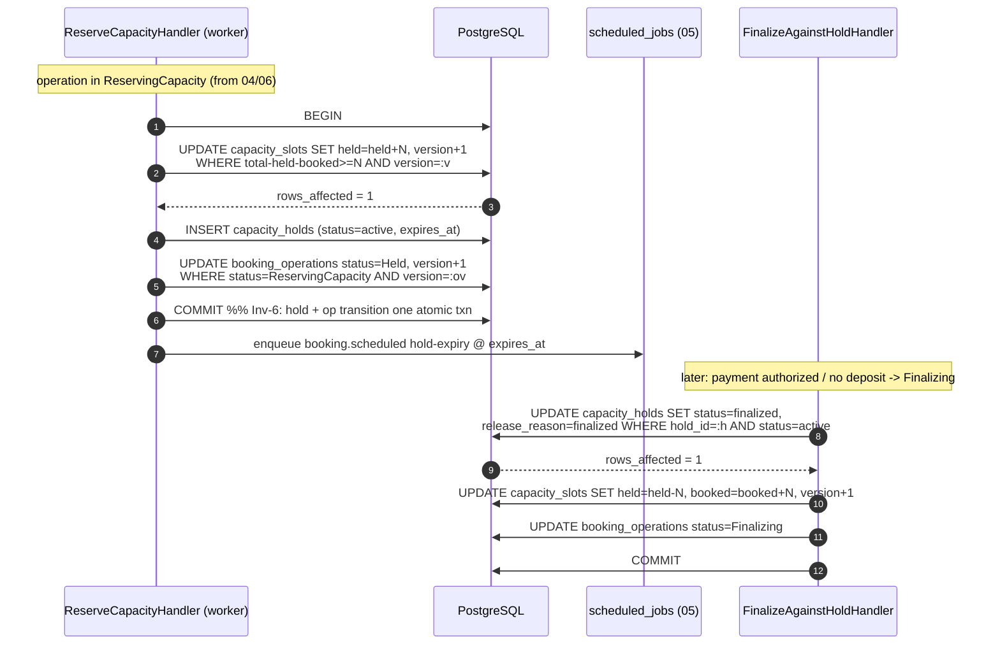
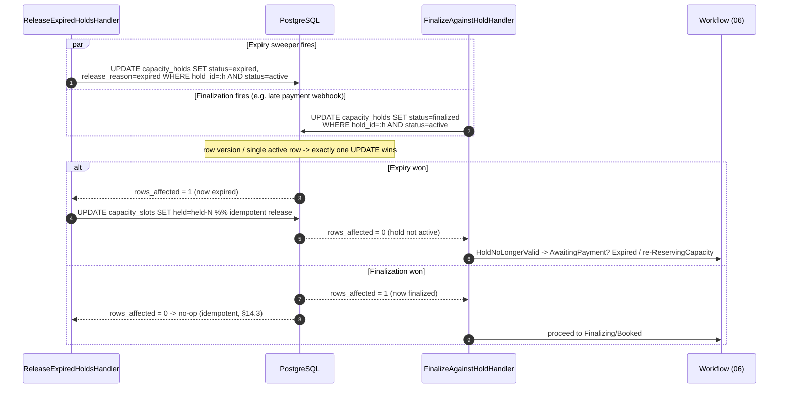
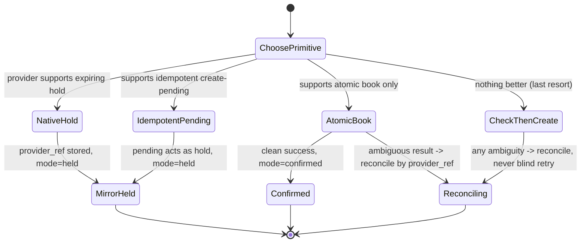

# 07 — Atomic Capacity & Holds

**Status:** Proposed
**Owner project(s):** `apps/api` (Domain, Application, Infrastructure), with read contracts consumed by `apps/langgraph`
**Source design sections:** §14 Atomic Capacity and Holds (lines 1464–1514); §2.5 Idempotency is not capacity control (lines 99–107); §6.5 Availability modes (lines 406–420); §11 Booking Workflow State Machine (lines 1111–1156); §12.8 Crash-window matrix (lines 1335–1351); §22 Data Model (lines 1926–1977)

## 1. Purpose & scope

This component owns **capacity reservation as a concern fully independent of request idempotency** (Inv-6). It provides the atomic conditional write that guards first-party Cordia inventory, the adapter primitive ladder that guards external-provider inventory, the `capacity_holds` durable record, the scheduled idempotent hold-expiry release, and the finalization conditional transition that fails closed on an expired hold. It also defines how the four availability modes (`informational`/`live`/`held`/`confirmed`) bound what the foreground agent may say. It does **not** own operation identity, idempotency-key binding, the fulfillment state machine as a whole, or payment — those live in sibling specs and only cross this boundary at named seams.

## 2. Position in the system

**Lane: BACKGROUND fulfillment (`apps/api`).** Capacity mutation is a side effect; per the core principle the agent proposes and the platform disposes. The foreground agent never writes capacity.

```
upstream                         THIS COMPONENT                         downstream
──────────                       ─────────────────────                  ──────────
04 submission/idempotency  ──>   ReservingCapacity step    ──>          06 workflow (Held → Finalizing)
  (operation accepted,           - first-party atomic UPDATE            09 payment-saga (Held → AwaitingPayment)
   request_hash bound)           - external primitive ladder            10 notifications (after Booked)
                                 - capacity_holds lifecycle             05 queue (booking.scheduled expiry job)
03 tool contracts          ──>   availability mode tagging  ──>         02 foreground agent (allowed wording)
  (check_candidate_availability)
```

**What this component MUST NOT do:**

- It must **not** be used as a duplicate-suppression mechanism. An idempotency key prevents re-execution of one logical operation; it does **not** stop two distinct customers racing for the last unit (§2.5). Capacity and idempotency are orthogonal layers and are tested separately.
- It must **not** be invoked from the live voice session for any *mutating* reservation. A short hold during dialog is permitted only through the explicit `check_candidate_availability` contract when the provider can hold quickly and safely; the durable workflow hold is created by the background worker.
- It must **not** call external booking providers from the foreground lane (those clients live only in Infrastructure adapters driven by jobs).
- It must **not** resolve an expiry↔finalization race by comparing wall-clock timestamps in worker code. The race is decided by the database row-version / provider-side atomic transition only (§14.3).

## 3. Component design

| Sub-component | Project / layer | Responsibility |
|---|---|---|
| `ICapacityReservation` | `Cordia.Domain` (interface) | Abstract "reserve N against slot, conditionally" + "release hold idempotently" + "finalize against still-valid hold". |
| `FirstPartyCapacityReservation` | `Cordia.Infrastructure` | The conditional atomic `UPDATE capacity_slots` (Inv-6); exactly-one-row success; writes `capacity_holds` row in the **same** EF Core transaction as the operation transition. |
| `IExternalInventoryAdapter` (+ per-provider impls) | `Cordia.Domain` interface / `Cordia.Infrastructure` impls | Implement the strongest supported primitive of the ladder (native hold > idempotent create-pending > atomic book > check-then-create). Mirror provider hold into `capacity_holds`. |
| `CapacityPrimitive` resolver | `Cordia.Domain` | Per (tenant, provider, slot-source) decide which ladder rung applies and therefore the resulting availability mode. |
| `ReserveCapacityHandler` | `Cordia.Application/Booking` | MediatR command handler driving the `ReservingCapacity → Held / AlternativesRequired / Reconciling` transition; one request+handler per file. |
| `ReleaseExpiredHoldsHandler` | `Cordia.Application/Capacity` | Scheduled, idempotent expiry release driven by a `booking.scheduled` job. |
| `FinalizeAgainstHoldHandler` | `Cordia.Application/Booking` | Conditional `Held → Finalizing` transition that fails if the hold is no longer `active` (Inv-6 + crash-window row §12.8). |
| `AvailabilityMode` tagging | shared-schemas contract | Every availability result carries a mode; the agent's allowed wording is derived from it (§6.5). |

## 4. Data contracts & schemas

### 4.1 DB tables touched (§22)

| Table | Use here |
|---|---|
| `capacity_slots` | First-party inventory: `total_capacity`, `held_capacity`, `booked_capacity`, `version`. The conditional UPDATE target. |
| `capacity_holds` | Durable hold record (first-party or mirrored external). |
| `booking_operations` | The owning operation; its `status`/`version` transition commits with the hold. |
| `scheduled_jobs` | Drives `booking.scheduled` hold-expiry jobs (see 05). |
| `workflow_attempts` | External adapter attempt + provider reference for reconciliation (see 06). |

### 4.2 `capacity_slots` (first-party, illustrative DDL)

```sql
create table capacity_slots (
  tenant_id       text        not null,
  slot_id         text        not null,
  resource_id     text        not null,           -- table/room/staff/etc.
  starts_at       timestamptz not null,
  total_capacity  integer     not null check (total_capacity >= 0),
  held_capacity   integer     not null default 0 check (held_capacity >= 0),
  booked_capacity integer     not null default 0 check (booked_capacity >= 0),
  version         bigint      not null default 0,
  primary key (tenant_id, slot_id),
  check (held_capacity + booked_capacity <= total_capacity)  -- never overcommit (Inv-6)
);
```

The CHECK constraint is the last line of defense; the conditional WHERE is the primary guard. Both must hold.

### 4.3 The conditional atomic write (§14.1, Inv-6)

```sql
update capacity_slots
set held_capacity = held_capacity + :requested,
    version       = version + 1
where tenant_id = :tenant_id
  and slot_id   = :slot_id
  and total_capacity - held_capacity - booked_capacity >= :requested
  and version   = :expected_version;
```

`rows_affected == 1` ⇒ reserved. `rows_affected == 0` ⇒ either insufficient remaining capacity (→ `AlternativesRequired`) or a lost optimistic-concurrency race (reload `version`, re-evaluate; do **not** force). Exactly-one-row success is the contract.

### 4.4 `capacity_holds` (§14.3)

```sql
create table capacity_holds (
  tenant_id        text        not null,
  hold_id          text        not null,
  operation_id     text        not null,
  workflow_step    text        not null,                 -- e.g. 'create', 'modify-new-slot'
  slot_id          text,                                 -- null for external-only holds
  reserved_capacity integer    not null check (reserved_capacity > 0),
  status           text        not null,                 -- active | released | expired | finalized | reconciling
  created_at       timestamptz not null,
  expires_at       timestamptz not null,
  release_reason   text,                                 -- expired | finalized | compensated | superseded | provider_released
  provider_ref     text,                                 -- external hold/reservation id, null first-party
  version          bigint      not null default 0,
  primary key (tenant_id, hold_id),
  constraint uq_active_hold_per_op_step
    exclude (tenant_id with =, operation_id with =, workflow_step with =)
    where (status = 'active')                            -- unique active hold per operation & step (§22.1, Inv-6)
);
```

The partial unique/exclusion constraint enforces "the schema must prevent one operation from acquiring the same logical hold twice" (§14.1) at the (operation, workflow_step) grain, matching §22.1 `unique active hold per operation and workflow step`.

### 4.5 C# domain sketch (`Cordia.Domain`)

```csharp
public enum HoldStatus { Active, Released, Expired, Finalized, Reconciling }
public enum ReleaseReason { Expired, Finalized, Compensated, Superseded, ProviderReleased }
public enum AvailabilityMode { Informational, Live, Held, Confirmed }

public sealed record CapacityHold(
    string TenantId, string HoldId, string OperationId, string WorkflowStep,
    string? SlotId, int ReservedCapacity, HoldStatus Status,
    DateTimeOffset CreatedAt, DateTimeOffset ExpiresAt,
    ReleaseReason? ReleaseReason, string? ProviderRef, long Version);

public interface ICapacityReservation
{
    // Returns Held with a hold, or NoCapacity, or Ambiguous (external). Atomic + same-txn op transition.
    Task<ReservationOutcome> ReserveAsync(ReserveRequest req, CancellationToken ct);
    // Idempotent: releasing an already-released/expired/finalized hold is a no-op success.
    Task ReleaseAsync(string tenantId, string holdId, ReleaseReason reason, CancellationToken ct);
    // Conditional Held->Finalizing; fails (returns HoldNoLongerValid) if hold not active.
    Task<FinalizeOutcome> FinalizeAgainstHoldAsync(string tenantId, string holdId, CancellationToken ct);
}
```

### 4.6 Cross-service contracts (`libs/shared-schemas`)

Source of truth is Pydantic in `apps/langgraph/cordia_agent`; C#/TS/Zod are generated — never hand-edit generated types.

The agent only **reads** availability; it never holds durably. The candidate-availability result is the cross-service carrier of mode:

```python
# apps/langgraph/cordia_agent/contracts/availability.py  (Pydantic, source of truth)
class AvailabilityMode(str, Enum):
    informational = "informational"
    live = "live"
    held = "held"
    confirmed = "confirmed"

class CandidateSlot(BaseModel):
    slot_id: str
    starts_at: datetime                # ISO-8601 with offset
    party_size: int
    mode: AvailabilityMode
    hold_id: str | None = None         # present only when mode == held
    held_until: datetime | None = None # present only when mode == held; drives agent wording
```

Provider-internal request/release shapes (e.g. `ReserveRequest`, `provider_ref`, attempt outcome) are **queue-only / API-internal** and live under `schemas/job-events/` or stay in `Cordia.Domain` — they never enter agent context.

## 5. Availability modes → allowed agent claims (§6.5, Inv-16)

| Mode | Backing | Race closed? | Agent may say (Inv-16) |
|---|---|---|---|
| `informational` | cached / non-atomic | No | "That time appears available." |
| `live` | fresh provider query, no hold | No (can go stale before submit) | "…available right now, subject to final confirmation." |
| `held` | `capacity_holds` row `active` until `expires_at` | Yes, until expiry | "I can hold that time until 7:05 PM while we finish." |
| `confirmed` | authoritative `Booked` | Yes (committed) | "Your booking is confirmed." |

Only `held` closes the race during the confirmation/payment window; a `live` result without a hold can become stale, so finalization must recheck or atomically book (§6.5). This table is the single source for spec 02's wording guardrails.

## 6. Workflows

### 6.1 Happy path — first-party reserve then finalize



### 6.2 Failure / recovery — expiry races finalization



### 6.3 External inventory primitive ladder



## 7. Reliability mechanisms (mapped to invariants)

- **Inv-6 (capacity is an atomic conditional write, separate from idempotency):** the §14.1 `UPDATE … WHERE total-held-booked >= :requested AND version = :expected_version` with `rows_affected == 1` semantics; the `held + booked <= total` CHECK; the partial exclusion constraint giving a unique active hold per (operation, workflow_step). No idempotency key is ever consulted to decide capacity.
- **Inv-4 (durable acceptance + operation creation + outbox one atomic txn):** capacity reservation respects that boundary — the hold INSERT and the `booking_operations` status/version transition commit in the **same** EF Core transaction (§14.1); the expiry-job enqueue uses the outbox/scheduled-job seam (05), not an in-line side effect.
- **Inv-7 (ambiguous provider outcomes reconcile before any repeated create/charge):** the external ladder routes `AtomicBook`/`CheckThenCreate` ambiguity to `Reconciling` keyed by `provider_ref` in `workflow_attempts` (§12.8 row "After provider success, before result commit"); never a blind re-create.
- **Inv-16 (agent only states outcomes supported by authoritative state):** availability `mode` is the contract that bounds wording; `live` may never be voiced as a guarantee, only `confirmed`/`held` close the race.
- **Idempotent expiry release (§14.3):** `ReleaseExpiredHoldsHandler` UPDATEs only `WHERE status='active'`; re-running on an already-released/finalized hold affects zero rows and is a successful no-op — safe under duplicate `booking.scheduled` delivery (supports Inv-5 at this seam).
- **Race resolution by storage atomicity, not worker timing (§14.3):** expiry vs finalization both target the single `active` row with a `WHERE status='active'` guard; the DB decides the winner; the loser observes `rows_affected == 0` and reloads.

## 8. Latency budget & optimizations

This is a background (reliability-first) component; its budget is expressed as SLA windows, plus one foreground-facing latency seam.

| Operation | Target | Technique |
|---|---|---|
| First-party `ReserveAsync` (single conditional UPDATE + 2 row writes, one txn) | p99 < 25 ms in-db | Single-statement conditional UPDATE; covering PK index `(tenant_id, slot_id)`; no row locks held across network. |
| Foreground `check_candidate_availability` returning `live`/`informational` | p95 < 300 ms (stay "in same response" per §6.4) | Read-only; cached/non-atomic for `informational`; no hold write on the dialog path. |
| Foreground short hold (mode `held`) | only when provider can hold "quickly and safely" (§14.2); else fall back to `live` + async confirmation (§6.4) | Bounded provider call; if "several seconds or provider degraded" offer async confirmation instead of holding the call. |
| Scheduled expiry release latency | fire within < 30 s of `expires_at` | `booking.scheduled` due-time index; idempotent so jitter/late-fire is harmless. |
| External reconcile after ambiguity | minutes-scale SLA (06) | Decoupled `booking.reconcile` queue; not on any user-blocking path. |

Hold TTL (`expires_at`) is set generously enough to span the confirmation/payment window but short enough to free inventory promptly; the exact default is an open decision (§13).

## 9. Failure modes & recovery

| Failure / crash point | Durable evidence | Recovery |
|---|---|---|
| Conditional UPDATE returns 0 rows — insufficient capacity | slot row unchanged | Transition `ReservingCapacity → AlternativesRequired` (business outcome, **not** a retry, §11). |
| Conditional UPDATE returns 0 rows — version mismatch (lost race) | slot row at newer version | Reload `version`, re-evaluate remaining capacity, retry conditional write once or yield to alternatives. |
| Crash after hold INSERT + op transition COMMIT, before expiry job enqueued | hold `active`, operation `Held` | Sweeper / idempotent re-enqueue from `Held` operations lacking a scheduled expiry; expiry job creation is idempotent on `(operation_id, hold_id)`. |
| Crash during external provider hold/book call | maybe a `provider_ref` (or none) | Treat as **ambiguous** unless non-delivery is proven (§12.8 "During provider call"); route to `Reconciling`, resolve by `provider_ref`; never blind re-create (Inv-7). |
| Crash after provider success, before mirrored `capacity_holds` commit | provider effect may exist | Reconcile by stable `provider_ref` (§12.8); mirror the existing reservation rather than create a second. |
| Expiry job and finalization both target the active hold | exactly one `active` row | DB/provider atomicity picks the winner; loser sees `rows_affected == 0` and reloads (§14.3). No timestamp comparison in worker code. |
| Hold finalized but slot decrement crashed before commit | txn rolled back, hold still `active` | Whole finalize txn is atomic (hold→finalized **and** slot held→booked together); on rollback nothing changed; worker reloads and re-runs. |
| Duplicate expiry job delivery | hold already `released`/`expired` | Idempotent no-op (UPDATE … WHERE status='active' affects 0 rows). |
| External provider releases a hold we still think is `active` | `provider_ref` no longer valid on next call | Mark `expired`/`reconciling` with `release_reason=provider_released`; route to `AlternativesRequired` or `Reconciling`. |

## 10. Interfaces to sibling specs

- **04-submission-and-idempotency.md** — supplies the accepted `operation_id` + bound `request_hash`; this spec proves idempotency ≠ capacity (Inv-6 vs Inv-2/3). The reservation never reads the idempotency key.
- **05-job-queue-outbox-inbox.md** — `booking.scheduled` carries hold-expiry jobs; the expiry enqueue rides the transactional outbox / scheduled-job store; consumer inbox dedups duplicate expiry deliveries.
- **06-booking-workflow-and-fulfillment.md** — owns the `ReservingCapacity → Held → Finalizing` transitions, attempt records, retry taxonomy, and reconciliation; this spec is the concrete reservation/finalization step within it and emits the crash-window rows for capacity.
- **08-identity-and-manage-booking.md** — modify-affecting-capacity uses replacement (hold new slot, then release old, §9 of design doc); this spec provides the new-slot hold and the old-slot release via `workflow_step`.
- **09-payment-deposit-link.md** — when deposit is enabled, `Held → AwaitingPayment` keeps the hold alive until the Stripe payment link expires or is paid; link expiry releases the hold.
- **10-notifications.md** — notification is sent only after `Finalizing → Booked` is persisted (Inv-8); capacity finalization is the persistence event that gates it.
- **03-agent-tool-contracts.md** — defines `check_candidate_availability`'s I/O including the `AvailabilityMode`/`hold_id`/`held_until` fields produced here.
- **02-foreground-conversational-agent.md** — consumes the mode→wording table (§5) as its read-back/claim guardrail (Inv-16).
- **12-data-model-and-persistence.md** — owns the canonical DDL/EF Core mapping for `capacity_slots` and `capacity_holds`; sketches here defer to it.
- **13-observability-and-slos.md** — consumes metrics: reservation success/no-capacity/lost-race counts, hold-active gauge, expiry-release lag, reconcile-by-provider-ref rate.

## 11. Implementation mapping

`apps/api` (clean architecture; MediatR one-request-per-file; FluentValidation; EF Core snake_case + `IEntityTypeConfiguration`; typed domain exceptions mapped by middleware):

```
apps/api/src/Cordia.Domain/
  Capacity/CapacityHold.cs                 # entity + HoldStatus/ReleaseReason/AvailabilityMode enums
  Capacity/CapacitySlot.cs                 # first-party slot entity
  Capacity/ICapacityReservation.cs         # reserve / release / finalize-against-hold
  Capacity/IExternalInventoryAdapter.cs    # ladder primitive interface
  Capacity/ReservationOutcome.cs           # Held | NoCapacity | Ambiguous (+ provider_ref)
  Capacity/CapacityExceptions.cs           # HoldNoLongerValid, OvercommitAttempted (typed, middleware-mapped)

apps/api/src/Cordia.Application/Booking/
  ReserveCapacity/ReserveCapacityCommand.cs + Handler.cs + Validator.cs
  FinalizeAgainstHold/FinalizeAgainstHoldCommand.cs + Handler.cs
apps/api/src/Cordia.Application/Capacity/
  ReleaseExpiredHolds/ReleaseExpiredHoldsCommand.cs + Handler.cs   # driven by booking.scheduled

apps/api/src/Cordia.Infrastructure/
  Persistence/Configurations/CapacitySlotConfiguration.cs   # version concurrency token, check constraint
  Persistence/Configurations/CapacityHoldConfiguration.cs   # partial exclusion 'unique active hold'
  Capacity/FirstPartyCapacityReservation.cs                 # the conditional UPDATE (raw SQL / ExecuteUpdate)
  Capacity/Providers/<Provider>InventoryAdapter.cs          # one adapter per booking provider, ladder rung
```

`apps/langgraph/cordia_agent/`:

```
contracts/availability.py    # Pydantic AvailabilityMode + CandidateSlot (source of truth, generates C#/TS/Zod)
```

EF Core note: the conditional capacity write is expressed as `ExecuteUpdateAsync` (or raw SQL) so it is a single atomic statement, **not** a load-then-save; `version` is the EF concurrency token for the reload-on-zero-rows path. The hold INSERT and operation transition share the `DbContext` transaction with the reservation.

## 12. Test strategy (from §27)

| § | Test | Assertion here |
|---|---|---|
| 27.3 | two operations race for the final capacity unit | exactly one conditional UPDATE returns 1 row; the other gets `AlternativesRequired`; slot never overcommits. |
| 27.3 | hold expiry races with finalization | exactly one of {expire, finalize} succeeds; loser observes 0 rows; no double slot decrement (§14.3). |
| 27.3 | first-party capacity never negative or overcommitted | property/fuzz test of interleaved reserves/releases against the CHECK + conditional WHERE. |
| 27.3 | stale worker state loses optimistic concurrency | reserve with stale `expected_version` → 0 rows → reload, not force. |
| 27.4 | unavailable slot | `ReservingCapacity → AlternativesRequired` as a business outcome, not a retry. |
| 27.4 | timeout after provider commit / malformed provider response | external ladder routes to `Reconciling` by `provider_ref`, no blind re-create (Inv-7). |
| 27.2 | DLQ / broker redelivery replay preserves one logical effect | duplicate expiry job is an idempotent no-op; duplicate reserve under same operation hits the unique-active-hold constraint. |
| 27.1 | agent never claims confirmation from non-confirmed state | mode→wording: `live`/`held` never voiced as `confirmed` (Inv-16). |
| 27.5 | state-machine | `ReservingCapacity`/`Held`/`Finalizing` transitions enumerated; undefined transitions rejected. |

Use Alba integration tests against a real PostgreSQL for the concurrency/race cases (deterministic two-transaction interleaving), xUnit v3 `Category=Unit` for the ladder selection and mode-mapping logic, `Category=Integration` for the conditional-write and expiry-race suites.

## 13. Open decisions (from §31)

- **First-party versus provider-owned capacity model** — determines whether `capacity_slots` is the authority or a mirror of provider state per tenant; sets which ladder rung is the default.
- **First booking provider and its hold/idempotency capabilities** — fixes the top rung the external adapter can use (native expiring hold vs idempotent create-pending vs atomic book vs check-then-create).
- **Default hold TTL (`expires_at` window)** — must span the confirmation/payment window (coordinate with 09) yet free inventory promptly; not specified by the design doc, must be chosen and documented.
- **Idempotency and audit retention periods** — governs how long released/expired `capacity_holds` rows are retained for audit before pruning (coordinate with 12/14).
- **Initial SLO values** — the reservation-latency and expiry-release-lag targets in §8 are placeholders to be ratified in 13.

## 14. Open decisions resolved (implementation, `apps/api`)

The §13 items are resolved as follows for the initial implementation (revisit when a real provider is onboarded):

- **First-party is the authority.** `capacity_slots` is the source of truth; `FirstPartyCapacityReservation` performs the §14.1 conditional `ExecuteUpdateAsync`. The external-provider ladder ships as interfaces + `CapacityPrimitiveResolver` (defaults every `(tenant, provider, slot-source)` to the first-party rung) + a `StubExternalInventoryAdapter` (not wired into the live workflow — mirrors `StubBookingProviderAdapter`). No real provider is configured yet.
- **Default hold TTL = 45 minutes** (FIX 7), configurable via `CapacityOptions.HoldTtl` (config section `Capacity`). Chosen as the deposit window (30 min) plus a 15-minute buffer: the hold TTL is computed at reserve time, before the deposit session exists, so a plain 30-minute TTL risks the hold expiring just as the deposit link is being confirmed. The 15-minute buffer ensures the hold outlives the deposit link even with job-poller lag.
- **Slot identity.** The canonical payload has no `slot_id`; `CapacitySlotKey.Derive` builds a deterministic key `"{resource_id|service_id|location_id}|{starts_at:O}"` (the agent payload's slot-start field is `starts_at`; `requested_at` is accepted as a back-compat fallback). An operation whose derived slot has **no provisioned `capacity_slots` row** is treated as **not first-party-tracked** → transitions `ReservingCapacity → Held` *without* a durable hold (availability mode `live`), preserving prior always-available behavior. Slot provisioning is out of scope (tenant onboarding).
- **Availability mode** is the generated `Cordia.Domain.Generated.AvailabilityModeEnum` (owned by the spec-03 Pydantic contract); the resolver maps rungs → mode per §5 (FirstParty/NativeHold/IdempotentPending → `held`, AtomicBook → `confirmed`, CheckThenCreate → `live`).
- **Retention** of released/expired `capacity_holds` is deferred to the spec-12/14 retention sweeper (no pruning added here).
- **SLOs** remain placeholders for spec 13.

### Workflow integration & seams
- **Reserve** (`ReserveCapacityCommandHandler`): one transaction does conditional reserve + active-hold insert + `ReservingCapacity → Held` + hold-expiry job enqueue (`CapacityExpiryScheduler` → `booking.scheduled.hold_expiry.v1`) — Inv-4/Inv-6. `NoCapacity → AlternativesRequired`; external `Ambiguous → Reconciling`.
- **Release** (`ReleaseExpiredHoldsCommand`, consumer `capacity.release`): idempotent; consumes both the scheduled `booking.scheduled.hold_expiry.v1` job (by `hold_id`) and the spec-06 `capacity.hold_release.requested.v1` deposit-expiry event (by `operation_id`). Frees capacity only; no op-status transition (no legal `Held → Expired` edge per §11).
- **Finalize** (`FinalizeBookingCommandHandler`): in the success transaction, `FinalizeAgainstOperationAsync` (FIX 2+3+4+8) is the SINGLE decision point — looks up the latest hold by (op, "create"), flips `active → finalized` and moves slot `held → booked` atomically with `Finalizing → Booked`; on `Finalized` (idempotent: already finalized, no second slot move) → Booked; on `HoldNoLongerValid` (hold expired/released — capacity gone, but provider effect exists) → routes `Finalizing → CompensationRequired` so Compensate cancels the booking and keeps capacity consistent (not Reconciling — that would confirm a booking with no capacity backing); on `NotTracked` (no hold ever created) → non-tracked op, Booked unchanged.
- **Compensation** (`CompensateOperationCommandHandler`): releases the active hold (`ReleaseReason.Compensated`) atomically with `CompensationRequired → FailedFinal`.

### Capacity lock ordering (CLO) — normative

Spec 07 owns the capacity tables' access discipline. Two deadlock cycles have been built out of them
in practice, both from acquiring rows lazily — each step taking what it happened to need, in the
order it happened to need it. The rule below makes both unreachable rather than merely unlikely.

**Within a single transaction:**

1. Acquire every `capacity_holds` row lock **before** any `capacity_slots` row lock.
2. Acquire multiple `capacity_holds` rows in **ascending `hold_id`** order.
3. Acquire multiple `capacity_slots` rows in **ascending `slot_id`** order.
4. **Carve-out.** An `INSERT` of a *new* hold row acquires no lock any other transaction can already
   hold, so it cannot be an edge in a wait cycle. `ReserveAsync`'s slot-update-then-hold-insert is
   compliant.

Clause 4 is why the rule is stated over **row locks on pre-existing rows**, not over "which table is
touched first". Read the naive way, `ReserveAsync` looks like the very inversion clause 1 forbids.

**Why holds must be locked before slots.** Both orders are internally consistent; what matters is
that *every* transaction picks the same one. Holds are chosen as the entry point because the release
paths have no choice: freeing a seat requires deciding the hold's fate first (the conditional
`WHERE status = 'active'` flip is what elects a single winner between expiry and finalization, §14.3),
and only a hold that actually flipped may move slot counters. A release therefore cannot take the
slot first without giving up the guard that makes it idempotent. The modify path has no such
constraint — it can take a lock without writing — so the modify path yields.

**One implementation.** `ICapacityLockOrder` is the only place that knows the order. Call sites name
the rows they will touch and never the sequence; a hand-rolled acquisition is how the rule gets
broken. Acquire the whole set up front, before the first write: every later step then re-touches a
row the transaction already holds and can re-order nothing.

**Incorrect transaction patterns.** Each of these has existed in this codebase:

| Anti-pattern | Why it deadlocks | Correct form |
|---|---|---|
| `FinalizeAgainstOperationAsync` (hold→slot) then `AbsorbSameSlotAsync` reaching for the previous owner's hold | Net order is `SLOT → HOLD(prev)`, against a concurrent cancel's `HOLD(prev) → SLOT`. Cannot be fixed inside `Absorb` — the slot is already held by the time it runs. | Acquire `HOLD(prev)` before the capacity phase begins. |
| Cross-slot reschedule taking `SLOT(new)` (via finalize) then `SLOT(old)` (via release) | Ordered by ROLE. Two reschedules moving in opposite directions between the same pair each hold one row and want the other. **Clause 1 does not help — both rows are slots.** | Name both slots in one acquisition so clause 3 sorts them. |
| Looping `HOLD(h₁) → SLOT(s₁) → HOLD(h₂) → SLOT(s₂)` over an unordered result set | Takes a hold *after* a slot, and takes the holds in whatever order the query returned. | `ORDER BY hold_id`, then acquire the whole set before the write loop. |
| Retrying on `40P01` | Treats the symptom and hides the next inversion. | Fix the order so the cycle is unreachable. **Explicitly out of scope for this component.** |

**Isolation.** READ COMMITTED, unchanged. The ordering rule does not depend on a stricter level, and
raising it would change the semantics of the conditional writes in §4.3.

**Verification.** `IntegrationTests/Capacity/CapacityLockOrderTests` proves this against real
PostgreSQL, per §12's requirement for "deterministic two-transaction interleaving". Every safety
proof is paired with a negative control that takes the *same rows* in the *wrong order* and is shown
to abort with `40P01` — a test showing "this does not deadlock" is worthless if the scenario could
never have deadlocked. Row locks are additionally proven real (`55P03` under `lock_timeout` for a
concurrent writer) and proven to release on both commit and rollback.
