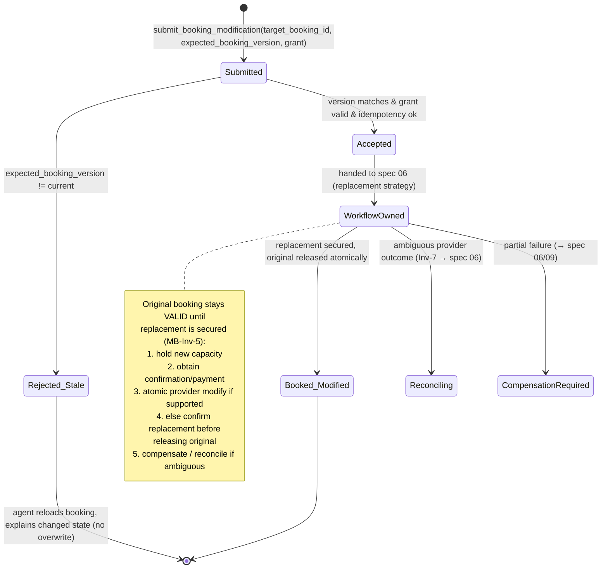
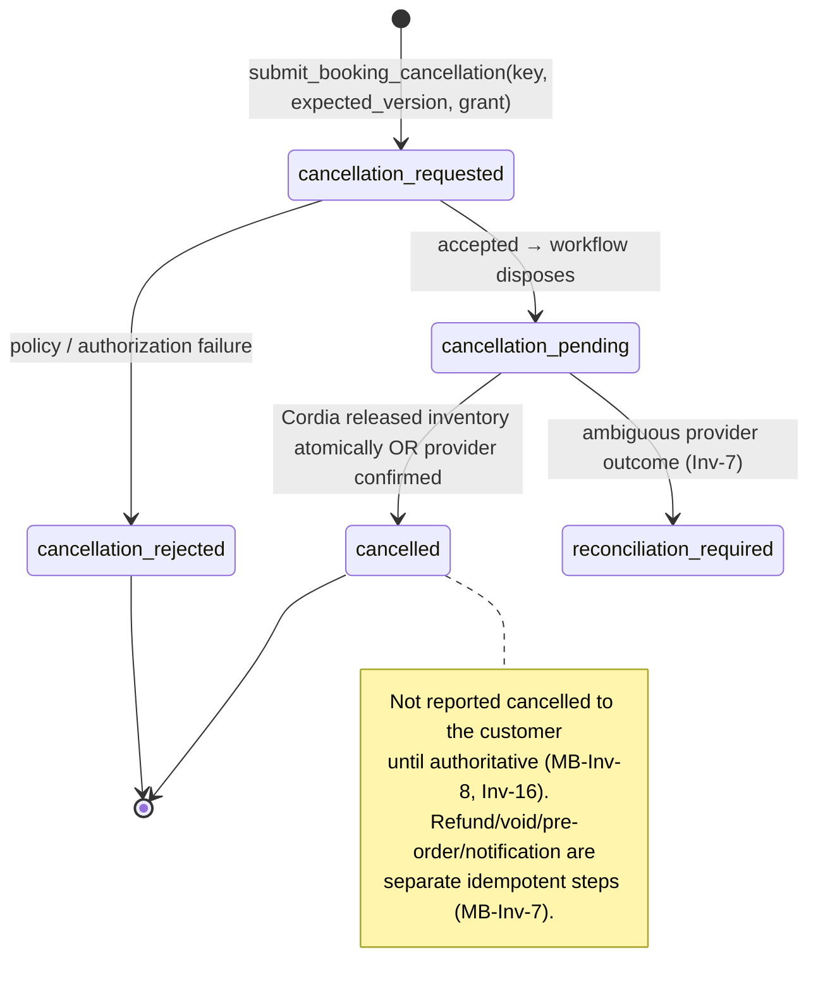

# 08 — Identity, Authorization & Manage Booking

**Status:** Proposed
**Owner project(s):** `apps/api` (authoritative), `apps/langgraph` (foreground tool calls only), `libs/shared-schemas` (cross-service contracts)
**Source design sections:** §9 in full (9.1–9.4.8), with supporting reads of §10 (Submission Contract), §13.2–13.5 (idempotency layers / concurrent duplicates / manual replay), §22 (Data Model), §24.5 (Authorization), §25.1 (Correlation), §27 (Testing), §30 (Invariants), §31 (Decisions).

---

## 1. Purpose & scope

This component defines how Cordia decides **who a caller is** versus **what a caller is allowed to do**, and how the platform exposes existing bookings as an auditable business aggregate ("Manage Booking"). It owns discovery-vs-authentication separation, in-dialog minimized customer lookup, platform-evaluated step-up verification producing an expiring action-scoped `verification_grant`, and the create/read/modify/cancel operations against confirmed bookings — all as durable operations, never physical row mutations. Payment, capacity, queueing, reconciliation, and notification mechanics live in sibling specs and are referenced, not redefined here.

## 2. Position in the system

**Lane:** primarily **BACKGROUND / authoritative** (`apps/api`). All authorization decisions, verification evaluation, projection shaping, and mutation acceptance are server-side. The foreground agent (`apps/langgraph`) only *calls narrow tools* (§9.4.6) and *reports* results; it never decides authorization and never mutates a booking.

```
apps/langgraph (foreground)                 apps/api (authoritative)
  find_manageable_bookings   ──read──▶   Discovery lookup (minimized, no auth)
  request_verification       ──write──▶  Verification request (OTP/link, bounded)
  check_verification         ──read──▶   verification_grant issuance (platform-evaluated)
  get_booking_details        ──read──▶   Read projection (gated by grant level)
  validate_booking_change    ──read──▶   Policy/capacity/fee evaluation (no side effect)
  submit_booking_modification──write──▶  Durable modification operation (idempotent)
  submit_booking_cancellation──write──▶  Durable cancellation operation (idempotent)
  get_booking_operation_status─read──▶   Authoritative mutation status
```

**Upstream:** Tenant resolution (§7) must have run — tenant scope precedes any lookup (Inv-13). The foreground agent (spec 02) drives the dialog; verification request/check **tool schemas are owned by spec 03**.
**Downstream:** Accepted modification/cancellation operations flow into the submission/idempotency machinery (spec 04) and the booking workflow (spec 06); payment, capacity, notification effects are handled by specs 09 / 07 / 10.

**This component MUST NOT:**
- Treat caller ID, channel handle, or email as authorization (Inv-1, MB-Inv-1).
- Let the agent classify verification outcomes or self-issue grants — the platform evaluates (§9.3).
- Physically `UPDATE`/`DELETE` a confirmed booking row from a customer/owner/agent path (Inv-MB-6; §9.4 prohibits it except privacy-retention workflows).
- Call external booking/payment/notification providers from a Manage Booking accept path — accept durably, then let the workflow dispose.
- Reveal another customer's details during disambiguation (§9.4.1).
- Report a booking as cancelled/modified before authoritative state confirms it (Inv-16, MB-Inv-8).

## 3. Component design

| Sub-component | Layer | Responsibility |
|---|---|---|
| **Discovery service** | Application + Infrastructure | Minimized, tenant-scoped customer/booking lookup from caller ID, contact, reference, or history. Returns non-sensitive disambiguators only. No authorization, no sensitive history. |
| **Verification engine** | Application | Determine the *required* verification level for a (tenant, action, risk) tuple; coordinate factor challenge/check; mint scoped `verification_grant` on success. The platform — not the agent — owns this decision. |
| **Grant store & validator** | Domain + Infrastructure | Persist `verification_grants`; validate a presented grant against (tenant, customer, target_booking, action, expiry, session/operation) at every mutation accept and sensitive read. |
| **Booking projection service** | Application | Build read projections sized to the caller's current verification level (minimal → fully authorized). Audited reads of sensitive data. |
| **Modification accept handler** | Application | Accept a modification as a *new* immutable intent + operation with `target_booking_id` + `expected_booking_version`; enforce optimistic concurrency; defer the replacement strategy to the workflow. |
| **Cancellation accept handler** | Application | Accept an idempotent cancellation command keyed by its own idempotency key; return existing state on replay. |
| **Owner action authorization** | Application | Authenticated tenant-owner permissions (role + tenant scope + reason code), still requiring version, idempotency, audit, reconciliation. |
| **Audit writer** | Application + Infrastructure | Append-only `audit_events` for sensitive reads, grant issuance, mutation accepts, owner overrides. |

### Authorization decision order (every Manage Booking entry point)
1. **Tenant scope** resolved (Inv-13) — else reject before touching data.
2. **Discovery** may identify a likely customer — never authorizes (MB-Inv-1).
3. For sensitive read or any mutation: locate a **valid `verification_grant`** *or* an authenticated **owner permission** (MB-Inv-2). Absent/expired/wrong-scope → `verification_required`.
4. **Optimistic concurrency**: mutation carries `expected_booking_version` (MB-Inv-4).
5. **Idempotency**: mutation carries its own key + canonical hash (MB-Inv-3, Inv-2/3).
6. **Accept durably** as an operation; never mutate the booking row inline (MB-Inv-6).

## 4. Data contracts & schemas

### 4.1 Cross-service contracts (`libs/shared-schemas`)
Source of truth is Pydantic in `apps/langgraph/cordia_agent`; C#/TS/Zod are generated. These contracts cross Python↔C#↔TS and so live in shared-schemas (`models/`, tool I/O in `models/manage_booking/`):

- `ManageBookingCandidate` — minimized disambiguation row (tool output of `find_manageable_bookings`).
- `BookingProjection` — read projection (output of `get_booking_details`), with a `verification_level` discriminator controlling which fields are populated.
- `BookingChangeEvaluation` — output of `validate_booking_change` (policy/capacity/fee/required-confirmation).
- `ModificationRequest` / `CancellationRequest` — tool inputs carrying `operation_id`, idempotency key, grant id, `target_booking_id`, `expected_booking_version`.
- `OperationStatus` — authoritative mutation status (shared with spec 04/06; reused, not redefined).

The **verification request/check** tool I/O (`request_verification`, `check_verification`) schemas are **owned by spec 03** — this spec consumes `VerificationGrantRef` from them.

```python
# apps/langgraph/cordia_agent/contracts/manage_booking.py  (source of truth)
class ManageBookingCandidate(BaseModel):  # NEVER includes another customer's data
    booking_id: str
    booking_reference: str                # non-secret, customer-facing
    business_name: str
    booking_date: date
    approx_time: str                       # coarse, e.g. "evening / ~19:00"
    party_size: int
    lifecycle_status: Literal["confirmed", "modification_pending", "cancellation_pending", "cancelled"]

class VerificationGrantRef(BaseModel):     # produced by spec 03's check_verification
    grant_id: str
    tenant_id: str
    customer_id: str
    target_booking_id: str | None
    action: Literal["read_sensitive", "modify", "cancel", "use_payment_method", "refund", "owner_override"]
    expires_at: datetime                   # ISO-8601 with offset
    session_id: str | None
    operation_id: str | None

class ModificationRequest(BaseModel):
    operation_id: str                      # minted before first submit (§10.1), stable across retry
    idempotency_key: str
    grant_id: str
    target_booking_id: str
    expected_booking_version: int
    replacement_fields: dict[str, object]  # only the fields being changed
    confirmation_id: str                   # evidence for the revised canonical values
    policy_version: str
```

### 4.2 API-side shapes (`apps/api`, `Cordia.Domain` / generated)

This spec **owns** the canonical `verification_action` enum (the `VerificationGrant.allowed_action` /
`Action` value set). It has **exactly six** values — no more, no fewer:

| `verification_action` | Meaning |
|---|---|
| `read_sensitive` | Disclose sensitive booking/customer detail in a projection (formerly named `disclose`). |
| `modify` | Accept a modification operation against the target booking. |
| `cancel` | Accept a cancellation operation against the target booking. |
| `use_payment_method` | Authorize use of a stored payment method (deposit/charge; formerly named `pay`). |
| `refund` | Authorize a refund/void on the target booking. |
| `owner_override` | Authenticated tenant-owner override (role + reason code). |

These are the only legal values; any legacy `disclose`/`pay` names map to `read_sensitive`/`use_payment_method`
respectively. The pg-enum lives in spec 12; **spec 03** (agent tool I/O) and **spec 09** (payment deposit link) *consume*
this exact set — they reference it here and must not introduce variants. The C# domain enum below
(`VerificationAction`) is the source projection of this contract.

```csharp
// Cordia.Domain/Bookings/VerificationGrant.cs
public sealed record VerificationGrant
{
    public required string GrantId { get; init; }
    public required string TenantId { get; init; }
    public required string CustomerId { get; init; }
    public string? TargetBookingId { get; init; }          // null => customer-wide (rare)
    public required VerificationAction Action { get; init; } // read_sensitive | modify | cancel | use_payment_method | refund | owner_override
    public required VerificationFactor Factor { get; init; } // otp_sms | otp_email | web_session | reference_plus_match | owner_assisted
    public required DateTimeOffset IssuedAt { get; init; }
    public required DateTimeOffset ExpiresAt { get; init; }  // expiring (§9.3)
    public string? SessionId { get; init; }
    public string? OperationId { get; init; }
    public required string CorrelationId { get; init; }      // §25.1
    public DateTimeOffset? ConsumedAt { get; init; }         // single-use for high-risk actions
}

// Cordia.Domain/Bookings/Booking.cs (authoritative aggregate — never hard-deleted)
public sealed record Booking
{
    public required string BookingId { get; init; }
    public required string TenantId { get; init; }
    public required string BookingReference { get; init; }   // non-secret, customer-facing
    public string? ProviderReference { get; init; }
    public required int Version { get; init; }               // optimistic concurrency token
    public required BookingLifecycleStatus LifecycleStatus { get; init; }
    public required string CustomerId { get; init; }         // ownership / authorized-party relationship
}
```

### 4.3 Tables touched (§22)
`verification_grants` (owned here), `booking_operations`, `booking_intents`, `booking_intent_revisions`, `intent_confirmations`, `idempotency_records`, `audit_events`. Read-only joins to `conversation_sessions` (consent/session) and the booking table. Capacity (`capacity_holds`), `workflow_attempts`, `outbox_messages`, `notifications` are written by downstream specs, not by the accept path here.

#### `verification_grants` (new)
```sql
create table verification_grants (
    grant_id          text primary key,
    tenant_id         text not null,
    customer_id       text not null,
    target_booking_id text null,
    action            text not null,             -- read_sensitive|modify|cancel|use_payment_method|refund|owner_override
    factor            text not null,             -- otp_sms|otp_email|web_session|reference_plus_match|owner_assisted
    issued_at         timestamptz not null,
    expires_at        timestamptz not null,
    session_id        text null,
    operation_id      text null,
    consumed_at       timestamptz null,
    correlation_id    text not null
);
create index ix_vg_lookup on verification_grants
    (tenant_id, customer_id, target_booking_id, action, expires_at);
```
Constraint discipline: a grant is valid only when `tenant_id`, `customer_id`, `action` match, `target_booking_id` matches (or is intentionally null), `now() < expires_at`, and (for single-use high-risk actions) `consumed_at is null`. Grants are never extended in place; a renewed grant is a new row.

## 5. Workflows

### 5.1 Discovery → verification → read (happy path) + forged-caller-ID rejection

```mermaid
sequenceDiagram
    autonumber
    participant C as Customer
    participant A as Foreground Agent (langgraph)
    participant API as Cordia.Api
    participant V as Verification Engine
    participant G as verification_grants
    participant AU as audit_events

    Note over API: tenant scope already resolved (Inv-13)
    C->>A: "I need to change my booking"
    A->>API: find_manageable_bookings (caller hints only)
    API-->>A: minimized candidates (ref/date/~time/party)
    Note right of A: caller ID identifies, never authorizes (MB-Inv-1)
    A->>C: "Which one — the Friday table for 4?"
    C->>A: selects candidate
    A->>API: request_verification(action=modify, booking)
    API->>V: required level for (tenant, modify, risk)
    V-->>C: OTP to booking's verified phone
    C->>A: provides OTP
    A->>API: check_verification(otp)
    API->>V: evaluate factor
    V->>G: insert scoped grant (tenant,customer,booking,modify,expiry,session)
    V->>AU: append grant_issued
    API-->>A: VerificationGrantRef(grant_id, expires_at)
    A->>API: get_booking_details(grant_id)
    API->>G: validate grant (scope + not expired)
    API->>AU: append sensitive_read
    API-->>A: full BookingProjection
    A->>C: reads back current booking truthfully

    rect rgb(255,235,235)
    Note over C,API: Failure path — forged caller ID, no valid grant
    C->>A: "Just cancel it, it's me" (no OTP completed)
    A->>API: submit_booking_cancellation(no/expired grant)
    API->>G: validate grant
    G-->>API: none / expired / wrong-scope
    API-->>A: 401/403 verification_required (MB-Inv-2)
    A->>C: "I need to verify you first; sending a code."
    end
```

### 5.2 Modification as a versioned operation (optimistic concurrency, original preserved)



Replay safety: a duplicate `submit_booking_modification` with the same idempotency key + same canonical hash returns the existing operation (§13.4). Same key + different hash → idempotency conflict (§10.2). A *materially changed* modification gets a **new** operation/key linked via `replaces_operation_id` (§10.1, §13.5).

### 5.3 Cancellation as an idempotent state transition



Repeated cancellation with the **same key** returns the existing operation. A *different* cancellation request against an already-cancelled booking returns the current cancelled state **without re-invoking the provider** (§9.4.4).

## 6. Reliability mechanisms (mapped to invariants)

| Mechanism | Invariant(s) |
|---|---|
| Caller ID / channel handle used only for personalization & discovery candidates; never gates a tool that mutates or reveals sensitive data. | Inv-1, MB-Inv-1, Inv-11 |
| Every mutation accept requires a valid `verification_grant` (or authenticated owner role) scoped to (tenant, customer, target booking, action, expiry, session/operation); platform evaluates, agent only reports. | Inv-11, MB-Inv-2 |
| Each modification and cancellation carries its **own** stable `operation_id` + idempotency key + canonical request hash; minted before first submit, reused across all retries. | Inv-2, Inv-3, MB-Inv-3 |
| `expected_booking_version` checked via conditional `UPDATE ... where version = :expected`; zero rows → reload & reevaluate (§22.1). | MB-Inv-4, Inv-MB optimistic concurrency |
| Modification preserves the original reservation until replacement safety is established; the accept path never cancels the working reservation. | MB-Inv-5, §9.4.3 |
| Cancellation is a state transition through `cancellation_requested → pending → cancelled`; no physical `DELETE`. | MB-Inv-6 |
| Accept = one atomic transaction (idempotency record + intent revision + operation + outbox/job), no provider call inline; payment/inventory/pre-order/notification effects are independently idempotent & reconcilable downstream. | Inv-4, Inv-5, MB-Inv-7 |
| Ambiguous provider outcomes route to `reconciliation_required` before any repeat create/charge. | Inv-7, MB-Inv-7 |
| Agent reports only authoritative `OperationStatus`; never claims booked/modified/cancelled from `accepted`/`pending`. | Inv-16, MB-Inv-8 |
| Tenant scope resolved before any lookup; every repository query is `(tenant_id, …)`-scoped. | Inv-13 |
| PAN/CVV never enter the grant, projection, transcript, queue, or audit; payment-method *availability* is a boolean token only. | Inv-12 |
| Sensitive reads, grant issuance, mutation accepts, and owner overrides write append-only `audit_events` with `correlation_id`/`causation_id`. | §24.5, §25.1 |
| Disambiguation exposes only the caller's own candidates; cross-customer matches are never surfaced. | §9.4.1 |

## 7. Latency budget & optimizations

Reliability-led, but the discovery + verification + read path is *in-dialog* and customer-facing, so it must stay snappy. Targets are server-side (p95), excluding human OTP entry and external SMS/email transit (those belong to spec 03/10 SLAs).

| Stage | Side effect | p95 target | Optimization |
|---|---|---|---|
| `find_manageable_bookings` | none | ≤ 150 ms | covering index `(tenant_id, customer_id/caller_hint)`; `AsNoTracking`; cap candidate count |
| `request_verification` | bounded (enqueue OTP) | ≤ 200 ms server, send is async | enqueue via spec 10; do not block on provider |
| `check_verification` + grant issue | write (1 insert + 1 audit) | ≤ 120 ms | single transaction; PK/index-only validation |
| `get_booking_details` (post-grant) | none (audited) | ≤ 180 ms | projection sized by level; cache stable booking fields; refresh provider state only when stale/ambiguous (§9.4.2) |
| `validate_booking_change` | none | ≤ 250 ms | local policy/fee compute; capacity check may short-hold per explicit contract (spec 07) |
| `submit_booking_modification` / `cancellation` accept | atomic write | ≤ 200 ms | one DB transaction, return `202 Accepted` immediately (§9.4.7) |
| `get_booking_operation_status` | none | ≤ 100 ms | indexed by `(tenant_id, operation_id)`; cached response snapshot for terminal states |

Grant validation is index-only and added to every gated call without a perceptible cost. Mutation accepts return `202 Accepted` with an operation id — they never wait on provider completion (§9.4.7); the SLA for *completion* belongs to spec 06.

## 8. Failure modes & recovery

| Failure | Detection | Recovery | Customer-visible behavior |
|---|---|---|---|
| Forged / spoofed caller ID attempts mutation | No valid grant for action/scope | Reject `verification_required`; trigger step-up | "I need to verify you first." |
| Expired / wrong-scope grant presented | Grant validator: `expires_at` past or scope mismatch | Reject; require fresh verification | Re-challenge |
| Stale modification (`expected_booking_version` mismatch) | Conditional update affects 0 rows | Reject `idempotency_conflict`-class *version* error; agent reloads & explains | "Your booking changed since we last looked; here's the current state." |
| Concurrent duplicate submit (same key, same hash) | Unique `(tenant_id, idempotency_key)` insert race | Loser loads winner's operation; return same status | Single coherent answer |
| Same key, different payload | Hash mismatch on existing key | Return idempotency conflict; never silently merge | "That looks like a different change — let's start it fresh." |
| Ambiguous provider modify/cancel outcome | Worker (spec 06) timeout/uncertain response | Operation → `reconciliation_required`; no repeat create/charge | "Still confirming with the venue." |
| API crash after accept commit, before HTTP response | Client retry with same key | Idempotency record returns existing operation | Reconnect resumes (Inv-2/3, §27.2) |
| Modify replacement secured but original release ambiguous | Workflow detects partial state | Compensation / reconciliation; original stays valid until safe | Never double-charged, never silently dropped |
| Disambiguation would leak another customer | Discovery service scoping | Return only caller's candidates; ask for non-sensitive disambiguator | No cross-customer data shown |
| Owner override attempted via free-form note | Override must be explicit field | Reject; require explicit override field + reason code | Owner re-enters structured override |

## 9. Interfaces to sibling specs

- **`03-agent-tool-contracts.md`** — owns `request_verification` / `check_verification` tool schemas and the six Manage Booking tool I/O shapes; this spec consumes `VerificationGrantRef` and defines the *authorization semantics* behind them. The tool `action` parameter **consumes the `verification_action` enum owned here (§4.2)** — the same six values, verbatim.
- **`04-submission-and-idempotency.md`** — operation identity, canonical request hash, atomic acceptance, concurrent-duplicate election; modification/cancellation accepts reuse this machinery (each with its own key).
- **`06-booking-workflow-and-fulfillment.md`** — receives accepted modification/cancellation operations; owns the replacement strategy, provider modify/cancel, reconciliation, manual review.
- **`07-capacity-and-holds.md`** — `validate_booking_change` capacity check and the hold of *new* capacity during a modification replacement.
- **`09-payment-deposit-link.md`** — deposit collection via Stripe payment link (per-restaurant toggle). Refunds on cancellation are handled manually via Stripe Dashboard for now. No PAN/CVV enters Cordia.
- **`10-notifications.md`** — independent, deduplicated delivery of modify/cancel outcome and OTP/verification-link sends.
- **`11-waitlist-menu-preorder.md`** — affected pre-order operations on modify/cancel.
- **`12-data-model-and-persistence.md`** — canonical definition of `verification_grants`, `booking_operations`, `audit_events`, and key constraints.
- **`13-observability-and-slos.md`** — correlation/causation propagation through grants, sensitive reads, and mutation accepts; audit and SLO metrics.
- **`14-security-and-privacy.md`** — consent, data minimization in projections, secret handling, prompt-injection boundary; this spec is the authorization-enforcement surface for §14.

## 10. Implementation mapping (`apps/api`, clean architecture)

```
Cordia.Domain/
  Bookings/Booking.cs                         (aggregate, version token)
  Bookings/VerificationGrant.cs               (record + VerificationAction/Factor enums)
  Bookings/IVerificationGrantRepository.cs
  Bookings/IBookingReadRepository.cs          (discovery + projection reads)
  Bookings/Exceptions/VerificationRequiredException.cs
  Bookings/Exceptions/StaleBookingVersionException.cs
  # IdempotencyConflictException is DEFINED by spec 04 (Cordia.Domain/.../Exceptions); 08 references it, never redefines a copy.

Cordia.Application/
  ManageBooking/FindManageableBookings/{Query,Handler,Validator}.cs   (minimized, no auth)
  ManageBooking/GetBookingDetails/{Query,Handler}.cs                  (projection by grant level)
  ManageBooking/ValidateBookingChange/{Query,Handler}.cs
  ManageBooking/SubmitBookingModification/{Command,Handler,Validator}.cs
  ManageBooking/SubmitBookingCancellation/{Command,Handler,Validator}.cs
  ManageBooking/GetBookingOperationStatus/{Query,Handler}.cs
  Verification/RequestVerification/{Command,Handler}.cs               (enqueues send via spec 10)
  Verification/CheckVerification/{Command,Handler,Validator}.cs       (evaluates + issues grant)
  Common/Authorization/GrantAuthorizationService.cs                  (validate scope+expiry+owner role)

Cordia.Infrastructure/
  Persistence/Configurations/VerificationGrantConfiguration.cs        (IEntityTypeConfiguration, snake_case)
  Persistence/Repositories/VerificationGrantRepository.cs
  Persistence/Repositories/BookingReadRepository.cs                   (AsNoTracking, tenant-scoped)
  EntityFramework/Migrations/<ts>_AddVerificationGrants.cs

Cordia.Api/
  Controllers/BookingsController.cs            (GET/POST per §9.4.7, thin → IMediator)
  Controllers/BookingOperationsController.cs   (GET status)
```

Conventions: one request+handler per file under `Application/ManageBooking/`; commands mutate / queries read; handlers depend on Domain interfaces; FluentValidation validators colocated; typed exceptions mapped by middleware to 401/403/409/202; controllers thin (`api/[controller]`), returning `202 Accepted` + operation id for mutations. `VerificationAction`/`VerificationFactor` get entries in `tools/config/ef-enum-mappings.json` if pg-enum-mapped. Cross-service shapes regenerated from Pydantic via `bun nx run shared-schemas:generate-types` — never hand-edit `SharedTypes.cs`.

## 11. Test strategy (from §27, relevant slice)

**Contract / agent (§27.1):** mutation tools require verification (no grant → reject); the agent never claims confirmation from `accepted`/`pending`; reconnect recovers the existing operation; transcript text alone cannot trigger a cancel.

**Idempotency (§27.2):** same key + same payload → one operation; same key + different payload → conflict; concurrent submits elect one operation; API crash after commit before response recovers the operation; manual retry cannot change payload under the old key (new key + `replaces_operation_id`).

**Concurrency (§27.3):** cancellation races with creation; stale worker/version loses optimistic concurrency (conditional update → 0 rows → reload); two simultaneous modifications on the same booking serialize correctly.

**Security (§27.6):** tenant isolation across the discovery/projection/grant repositories; forged caller ID cannot authorize mutation; expired or wrong-scope `verification_grants` fail; disambiguation never leaks another customer; operator/owner override actions are audited; configured sensitive fields redacted from projections and audit.

**Integration (Alba):** full HTTP through `BookingsController` — discovery → request_verification → check_verification → get_booking_details → submit_modification, asserting `202 Accepted` + operation id and that no booking row was physically mutated; replay returns the same operation.

## 12. Open decisions (from §31, to resolve for this component)

1. **Verification factors & risk policy** — which factors per action/risk tier, grant TTLs, and single-use vs. multi-use semantics for high-risk actions (modify/cancel/refund). *(§31: "verification factors and risk policy".)*
2. **Owner & internal operations roles** — the role model and tenant-scoped permission matrix backing owner overrides and the explicit override-field requirement. *(§31: "owner and internal operations roles".)*
3. **Idempotency & audit retention periods** — retention of `verification_grants` and `audit_events` (booking life + dispute/audit window per §13.3). *(§31: "idempotency and audit retention periods".)*
4. **Customer status transport** — polling vs. SSE vs. WebSocket vs. channel callback for `get_booking_operation_status` after a `202`. *(§31: "customer status transport".)*
5. **Canonicalization spec & hash algorithm** — the canonical request hash for modification/cancellation requests (shared with spec 04, but modify/cancel field sets must be enumerated here). *(§31: "canonicalization specification and hash algorithm".)*
