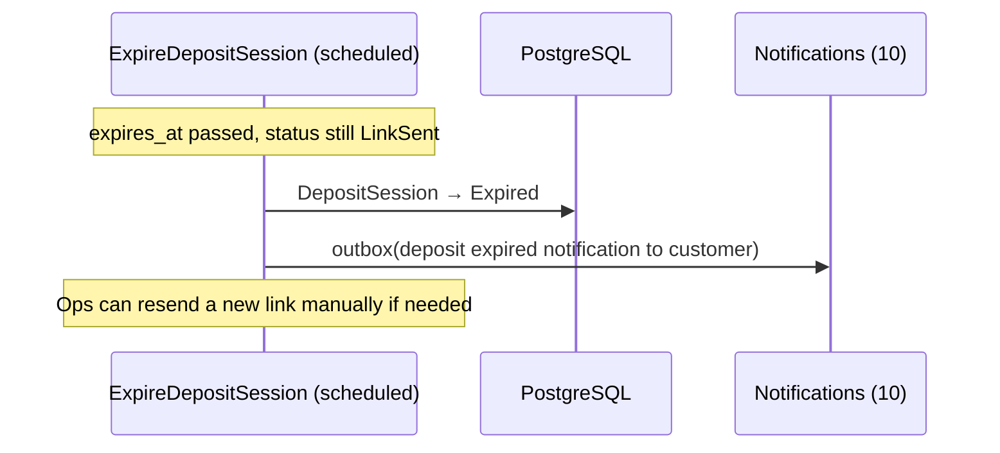

# 09 — Payment Deposit Link

- **Status:** Proposed
- **Owner project(s):** `apps/api` (Cordia.Domain / Cordia.Application / Cordia.Infrastructure / Cordia.Api). The foreground agent only tells the customer a payment link will be sent — it never collects or processes payment.
- **Source design sections:** §19 Payment (simplified to deposit-link-only).

---

## 2. Purpose & scope

Cordia **optionally** collects a **deposit** for confirmed bookings by sending the customer a **Stripe-hosted payment link** via SMS or email. Deposit collection is a **per-restaurant toggle** — restaurants can enable or disable it in their settings. When enabled, a Stripe Checkout Session is created and the link is delivered after booking confirmation. When disabled, the booking is confirmed without any payment step. Card data never enters Cordia — Stripe's hosted page handles collection, PCI compliance, and retries.

**Not in scope (deferred):**
- Card-on-file / tokenized payment for returning customers.
- In-call payment capture (voice pipeline has zero payment responsibility).
- Authorize-then-capture (we use Stripe's immediate capture for deposits).
- Complex saga orchestration, ambiguous-outcome reconciliation, or multi-provider routing.
- Refund policy automation (handled manually via Stripe Dashboard for now).

## 3. Position in the system

**Lane: BACKGROUND.** Payment link creation and webhook processing happen after the booking is confirmed, not during the voice call.

```text
Booking confirmed (06 workflow)
  → Check restaurant deposit setting (enabled/disabled)
  → IF enabled:
       → Create Stripe Checkout Session (this spec)
       → Send link via SMS/email (10 notifications)
       → Customer pays on Stripe-hosted page
       → Stripe webhook → mark deposit paid
  → IF disabled:
       → Skip payment, booking is confirmed directly
```

| Direction | Component | What crosses the boundary |
|---|---|---|
| Upstream | [06 workflow](06-booking-workflow-and-fulfillment.md) | Operation reaches `AwaitingPayment` after booking confirmed; triggers deposit link creation. |
| Step out | [10 notifications](10-notifications.md) | Payment-link URL delivered via SMS/email to customer's verified contact. |
| Inbound | `PaymentWebhooksController` | Stripe webhook with `checkout.session.completed`; signature-verified, enqueued for processing. |
| Down | [13 observability](13-observability-and-slos.md) | Link→paid conversion rate, webhook processing latency, expired-link rate. |

**This component MUST NOT:**
- Accept, log, or store PAN / expiry / CVV anywhere in Cordia.
- Let the agent process payment or assert a charge occurred.
- Create payment sessions without a confirmed booking operation.

## 4. Component design

| Sub-component | Layer | Responsibility |
|---|---|---|
| `DepositSession` entity + `DepositStatus` enum | Domain | One Stripe Checkout Session for one booking operation. Holds `operation_id`, `amount_minor`, `currency`, `stripe_session_id`, `payment_link_url`, `expires_at`, `status`. |
| `IStripeAdapter` | Domain (iface) / Infrastructure (impl) | `CreateCheckoutSession(amount, currency, metadata)`, `GetSession(session_id)`. Thin wrapper around the Stripe SDK. |
| `CreateDepositLink` | Application | MediatR command+handler. Creates the Stripe Checkout Session, persists the `DepositSession`, emits a notification event (outbox) to send the link via SMS/email. |
| `HandleStripeWebhook` | Application | MediatR command+handler. Processes `checkout.session.completed` — marks deposit as paid, advances the booking operation. Idempotent on `stripe_event_id`. |
| `ExpireDepositSession` | Application | Scheduled job. When `expires_at` passes without payment, marks the session expired and notifies the customer. |
| `PaymentWebhooksController` | Api | Thin: verify Stripe signature (`Stripe-Signature` header), enqueue `stripe.webhook.received`, return 200. No business logic. |

### Deposit status lifecycle

```
Created → LinkSent → Paid
                   → Expired
```

That's it. No ambiguous states, no reconciliation, no compensation branches. If something goes wrong, ops handles it in the Stripe Dashboard.

## 5. Data contracts & schemas

### 5.1 Agent-facing contract

The agent checks the restaurant's `deposit_enabled` setting. If enabled, after booking confirmation the agent tells the customer: *"I'll send you a payment link for the deposit to [phone/email]."* If disabled, the booking is confirmed without mentioning payment at all.

The agent does **not** return a link URL or amount in the conversation — the notification system delivers those. The agent only needs to know whether deposit is enabled (from the restaurant/tenant configuration) and the customer's verified contact.

No new shared-schema types are needed for the agent. The `OperationStatusView` ([06](06-booking-workflow-and-fulfillment.md)) includes a `deposit_status` field (`not_required` | `link_sent` | `paid` | `expired`) so the agent can answer "did you get the link?" or "has the deposit been paid?" questions.

### 5.2 API-side entity (Cordia.Domain)

```csharp
// Cordia.Domain/Payments/DepositSession.cs
public sealed class DepositSession
{
    public Guid Id { get; init; }
    public Guid TenantId { get; init; }
    public string OperationId { get; init; }
    public int AmountMinor { get; init; }           // e.g. 5000 = $50.00
    public string Currency { get; init; }           // ISO 4217
    public string? StripeSessionId { get; private set; }
    public string? PaymentLinkUrl { get; private set; }
    public DepositStatus Status { get; private set; }
    public DateTimeOffset ExpiresAt { get; init; }
    public DateTimeOffset CreatedAt { get; init; }
    public DateTimeOffset? PaidAt { get; private set; }
}

public enum DepositStatus
{
    Created,
    LinkSent,
    Paid,
    Expired
}
```

### 5.3 Webhook event (queue contract)

```jsonc
// Enqueued by PaymentWebhooksController after signature verification
{
  "message_type": "stripe.webhook.received",
  "payload": {
    "stripe_event_id": "evt_...",
    "event_type": "checkout.session.completed",
    "stripe_session_id": "cs_...",
    "operation_id": "op_...",      // from Stripe session metadata
    "amount_received": 5000,
    "currency": "aud"
  }
}
```

## 6. Workflows

### 6.1 Happy path — deposit link sent, customer pays

```mermaid
sequenceDiagram
    autonumber
    participant WF as Booking Workflow (06)
    participant CMD as CreateDepositLink
    participant DB as PostgreSQL
    participant S as Stripe API
    participant N as Notifications (10)
    participant CUST as Customer
    participant WH as PaymentWebhooksController

    Note over WF: booking confirmed, deposit_enabled=true → AwaitingPayment
    WF->>CMD: create deposit link (operation_id, amount, currency, contact)
    CMD->>S: Create Checkout Session (amount, currency, success_url, metadata={operation_id})
    S-->>CMD: session_id, payment_link_url
    CMD->>DB: persist DepositSession (LinkSent) + outbox(notify)
    N->>CUST: SMS/email with payment link + deposit amount + expiry
    CUST->>S: pays on Stripe-hosted page
    S->>WH: webhook (checkout.session.completed, signature)
    WH->>WH: verify Stripe-Signature; reject if invalid
    WH->>DB: enqueue stripe.webhook.received
    DB->>CMD: HandleStripeWebhook (deduplicated by stripe_event_id)
    CMD->>DB: DepositSession → Paid, booking operation → deposit_paid
    CMD->>N: outbox(deposit confirmed notification)
```

### 6.2 Failure path — link expires unpaid



## 7. Reliability mechanisms

| Concern | Mechanism |
|---|---|
| **No card data in Cordia** | Stripe's hosted Checkout page collects all card details. Cordia only stores `stripe_session_id` and `payment_link_url`. No PAN/CVV field exists in any schema. |
| **Webhook idempotency** | `stripe_event_id` is stored in `consumer_inbox`; redelivered webhooks are deduplicated. Status transitions are guarded by current status (LinkSent → Paid only). |
| **Webhook authenticity** | Controller verifies `Stripe-Signature` header using the webhook signing secret before enqueuing. Invalid signatures are rejected and logged. |
| **Link expiry** | `expires_at` is set when the Checkout Session is created. A scheduled job checks for expired sessions and marks them. Stripe also expires the session server-side. |
| **Tenant scoping** | `tenant_id` is set on the `DepositSession` from the booking operation; webhook processing matches the session by `stripe_session_id` which is already tenant-scoped. |
| **No double-charge** | One `DepositSession` per booking operation. Stripe Checkout Sessions are single-use. Creating a new link for the same booking requires a new session (ops action). |

## 8. Latency budget

| Window | Target | Notes |
|---|---|---|
| Agent tells customer → link arrives via SMS/email | < 30 s p95 | Stripe session creation is fast (~500ms); SMS/email delivery is the bottleneck. |
| Webhook received → deposit marked paid | < 2 s p95 | Controller acks fast; handler applies idempotent transition. |
| Link expiry check | Within 5 min of `expires_at` | Scheduled sweep interval; not latency-critical. |

## 9. Failure modes

| Failure | Recovery |
|---|---|
| Stripe API down when creating session | Retry with backoff; tell customer "link will arrive shortly." |
| Webhook never arrives (Stripe down) | Expiry sweep calls `Stripe.GetSession()` before marking expired — if paid, transition to Paid. |
| Duplicate webhook | Deduplicated by `stripe_event_id` in consumer inbox. |
| Customer pays after link expired | Stripe prevents payment on expired sessions. If edge case, ops handles via Stripe Dashboard. |
| Refund needed | Manual via Stripe Dashboard for now. Automated refund flow is a future enhancement. |

## 10. Interfaces to sibling specs

- **[02-foreground-conversational-agent.md](02-foreground-conversational-agent.md)** — agent tells customer a deposit link will be sent; can check `deposit_status` to answer follow-ups.
- **[06-booking-workflow-and-fulfillment.md](06-booking-workflow-and-fulfillment.md)** — triggers deposit link creation at `AwaitingPayment`; receives `deposit_paid` transition.
- **[10-notifications.md](10-notifications.md)** — delivers the payment link SMS/email and the deposit-confirmed notification.
- **[13-observability-and-slos.md](13-observability-and-slos.md)** — link→paid conversion, webhook latency, expired-link rate.
- **[14-security-and-privacy.md](14-security-and-privacy.md)** — webhook signature verification guidance, no-PAN-in-Cordia boundary.

## 11. Implementation mapping

```
apps/api/
  Cordia.Domain/Payments/
    DepositSession.cs                     (entity + DepositStatus enum)
    IStripeAdapter.cs                     (interface: CreateCheckoutSession, GetSession)
  Cordia.Application/Payments/
    CreateDepositLink/                    (Command + Handler + Validator)
    HandleStripeWebhook/                  (Command + Handler)
    ExpireDepositSession/                 (scheduled-job handler)
  Cordia.Infrastructure/Payments/
    DepositSessionConfiguration.cs        (IEntityTypeConfiguration, snake_case)
    StripeAdapter.cs                      (Stripe SDK wrapper)
  Cordia.Api/Controllers/
    PaymentWebhooksController.cs          (thin; signature verify → enqueue)
```

## 12. Test strategy

- **No card data:** assert no schema field can carry PAN/CVV; only `stripe_session_id` and `payment_link_url` are stored.
- **Webhook idempotency:** replayed `checkout.session.completed` with same `stripe_event_id` → single state transition.
- **Webhook signature:** invalid/missing `Stripe-Signature` → 400, not enqueued.
- **Status transitions:** only `LinkSent → Paid` and `LinkSent → Expired` are valid; others rejected.
- **Expiry sweep:** session past `expires_at` still in `LinkSent` → calls Stripe to verify, then marks `Expired` or `Paid`.
- **Tenant isolation:** deposit sessions are scoped to `tenant_id`; cross-tenant access rejected.

## 13. Open decisions

1. **Stripe product:** Checkout Sessions vs Payment Links API — Checkout Sessions give more control (metadata, expiry); Payment Links are simpler but less flexible. Recommend Checkout Sessions.
2. **Deposit amount source:** fixed per restaurant, percentage of estimated total, or flat fee. Needs business input.
3. **Link expiry duration:** 24 hours? 48 hours? Tied to hold deadline if capacity holds are in play.
4. **Automated refunds:** currently manual via Stripe Dashboard. Add a `RefundDeposit` command when needed.
