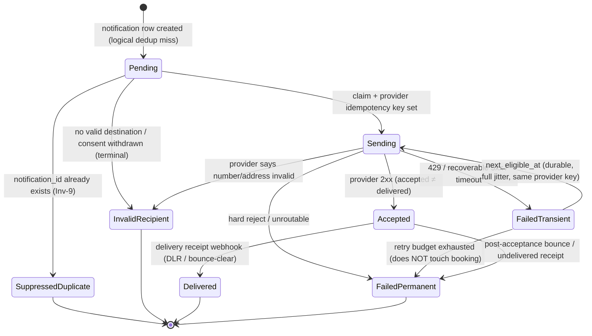

# 10 — Notifications

- **Status:** Proposed
- **Owner project(s):** `apps/api` (Cordia.Domain / Cordia.Application / Cordia.Infrastructure)
- **Source design sections:** §18 Notifications (1710–1758), §13.6 notification provider limitation (1458–1462), §12.1 `notification.commands` queue (1170), §12.4 consumer inbox (delivery dedup), §12.8 crash window "after notification send, before delivery state commit" (1348), §13.2 idempotency layers — notification provider (1386), §17.5 User SLA pending message (1695–1709), §22 Data Model `notifications` + key constraints (1945, 1958), §25.2 notification metrics (2116–2122), §26 reporting separation (2162–2168)

---

## 2. Purpose & scope

This component is the **independent delivery lane**: it turns committed booking/operation events into deduplicated customer- and owner-facing messages over SMS, email, and channel callbacks. It owns the `notifications` table, the `notification.commands` consumer, the per-notification delivery state machine, notification identity/dedup (Inv-9), provider idempotency on retries, and the required message-priority catalogue. It exists so that no notification failure can ever roll back a confirmed booking (Inv-8) and so that a single logical outcome produces exactly one logical message even under duplicate delivery.

It does **not** decide *when* a booking outcome occurs (that is [06](06-booking-workflow-and-fulfillment.md)), does not author the customer-facing reasons inside an operation, and does not own the agent's spoken/streamed turn responses (those are [01](01-streaming-voice-pipeline.md)/[02](02-foreground-conversational-agent.md)).

## 3. Position in the system

**Lane: BACKGROUND fulfillment (the platform DISPOSES).** Notifications are a downstream, asynchronous, durable side effect. They are deliberately *after* the authoritative state commit and are never on the critical path of booking success. The foreground agent never sends a provider notification; it only speaks what authoritative state already supports (Inv-16).

| Direction | Component | What crosses the boundary |
|---|---|---|
| Upstream | [06 workflow](06-booking-workflow-and-fulfillment.md) | Terminal/SLA transitions emit `notification.*` outbox events in the **same txn** as the state change (Inv-8). We consume them; we never send before the success they describe is persisted. |
| Upstream | [05 queue/outbox/inbox](05-job-queue-outbox-inbox.md) | `notification.commands` queue + job envelope; consumer-inbox dedup is the transport-level dedup that complements our logical `notification_id` dedup. |
| Upstream | [09 deposit link](09-payment-deposit-link.md) | Emits deposit-link-send and deposit-confirmed events; we deliver the Stripe payment link via SMS/email. Never carries PAN/CVV (Inv-12). |
| Upstream | [11 waitlist/menu/preorder](11-waitlist-menu-preorder.md) | Emits `waitlist_offer` events carrying the offer-expiry deadline. |
| Downstream | SMS / Email / Channel providers | Adapter sends a message under a provider idempotency key; provider **acceptance ≠ recipient delivery**. |
| Downstream | [13 observability](13-observability-and-slos.md) | Duplicate-suppression, acceptance vs delivery, pending-message rate, invalid-recipient rate; the accepted/confirmed/**notified** reporting separation (§26). |
| Lateral | [14 security & privacy](14-security-and-privacy.md) | Recipient is a minimized destination; message bodies and logs redact secrets and payment data; consent gating per channel. |

**This component MUST NOT:**
- send any message before the booking/operation state it describes is durably committed (Inv-8);
- roll back, mutate, or block any `booking_operations` state because a notification failed (§15.3: "notification retries must not block booking completion");
- claim "exactly-once" delivery — for providers lacking send-idempotency *or* message lookup, duplicate sends are a documented, measured residual risk (§13.6, §12.8);
- place card data (PAN/CVV) into a message body, the queue, the agent context, or logs (Inv-12) — payment is always a tokenized link;
- treat DLQ placement as a customer-visible business state (Inv-14) — a notification that exhausts retries still leaves the booking confirmed and surfaces the failure to operations.

## 4. Component design

| Sub-component | Layer | Responsibility |
|---|---|---|
| `Notification` aggregate + `DeliveryStatus` enum | Domain | Holds `notification_id`, delivery status + `version`; guarded `TransitionTo` over the §18.3 state set. Undefined edges throw `InvalidStateTransitionException`. |
| `NotificationIdentity` value object | Domain | Deterministically derives `notification_id` from `(tenant, operation, event_type, recipient, template_version, material_revision)` (§18.2, Inv-9). Same logical event ⇒ same id ⇒ dedup. |
| `MessagePriority` / `NotificationEventType` enums | Domain | The §18.4 required-communication catalogue + delivery priority/channel-fallback policy. |
| `RenderedMessage` value object | Domain | Resolved `(template_version, channel, locale)` → body + minimized recipient. Carries no secrets. |
| `SendNotificationCommand` (+Handler) | Application | The `notification.commands` consumer body: inbox-admit, logical-dedup on `notification_id`, render, dispatch via adapter, persist delivery state. One file. |
| `RecordDeliveryReceiptCommand` (+Handler) | Application | Webhook/callback consumer: provider acceptance→delivered or →failed updates; idempotent on `(notification_id, provider_message_id)`. |
| `ReconcileNotificationCommand` (+Handler) | Application | After the §12.8 ambiguous "sent-but-not-committed" window: look up by provider idempotency key/`provider_message_id`; resolve `sending`→`accepted`/`failed_transient`, or accept documented duplicate (§13.6). |
| `INotificationProviderAdapter` | Domain (iface) / Infrastructure (impl) | `Send(idempotencyKey, rendered)` + `LookupByKey` + capability flags `supports_send_idempotency` / `supports_lookup`. Per-channel impls (SMS/email/channel). |
| `INotificationTemplateResolver` | Domain (iface) / Infrastructure | Resolves `template_version` for an event type + channel + locale; version is part of the identity so a template change is a *new* logical notification. |
| `IConsentGate` | Domain (iface) / Infrastructure | Per-recipient/per-channel consent + quiet-hours; a suppressed message resolves to `suppressed_duplicate`/policy-suppressed, never an error. |

## 5. Data contracts & schemas

### Cross-service contract (libs/shared-schemas, queue-only)

Notification delivery is an internal API concern, so the **delivery state** is not a public shared-schema; the agent only learns "notified" through the normalized operation status ([06](06-booking-workflow-and-fulfillment.md)). The **trigger event** crossing the broker is a queue-only contract under `schemas/job-events/` (versioned, compatibility-tested; §28.3). It references authoritative records and copies no mutable state and no secrets (§12.2).

```jsonc
// libs/shared-schemas/schemas/job-events/notification.requested.v1.json  (queue-only)
{
  "message_type": "notification.requested.v1",
  "tenant_id":      "tenant_01...",
  "correlation_id": "corr_01...",
  "causation_id":   "msg_00...",
  "operation_id":   "op_01...",          // null only for non-operation messages
  "intent_revision": 3,                   // material revision → part of identity
  "event_type":     "booking_confirmed",  // see catalogue §5 table below
  "recipient_ref":  "recip_01...",        // opaque handle → minimized destination, NOT raw phone/email in plaintext
  "template_hint":  "booking_confirmed",  // resolver maps to a concrete template_version
  "priority":       "high",
  "data_refs": { "booking_id": "bk_01...", "offer_expires_at": null, "payment_link_token": null }
}
```

> `notification_id` is **derived by the consumer**, not carried in the envelope — so a redelivered or republished trigger for the same logical event always derives the *same* id and dedups (Inv-9).

### API-side entity sketch (Cordia.Domain)

```csharp
// Table: notifications   (unique (tenant_id, notification_id) — §22.1)
public class Notification
{
    public Guid Id { get; private set; }
    public string TenantId { get; private set; } = default!;
    public string NotificationId { get; private set; } = default!;  // derived, deterministic (§18.2)
    public string? OperationId { get; private set; }                // null for non-operation messages
    public NotificationEventType EventType { get; private set; }
    public string RecipientRef { get; private set; } = default!;    // minimized handle; PAN/CVV never present (Inv-12)
    public NotificationChannel Channel { get; private set; }        // Sms | Email | Channel
    public int TemplateVersion { get; private set; }                // identity input
    public int MaterialRevision { get; private set; }               // intent_revision; identity input
    public MessagePriority Priority { get; private set; }
    public DeliveryStatus Status { get; private set; }
    public int Version { get; private set; }                        // optimistic-concurrency token
    public string? ProviderIdempotencyKey { get; private set; }     // stable across retries (§13.2)
    public string? ProviderMessageId { get; private set; }          // returned on acceptance
    public string? FailureCategory { get; private set; }            // normalized; no secrets
    public int AttemptCount { get; private set; }
    public DateTimeOffset? NextEligibleAt { get; private set; }      // durable retry schedule, not in-process timer
    public DateTimeOffset CreatedAt { get; private set; }
    public DateTimeOffset UpdatedAt { get; private set; }

    public void TransitionTo(DeliveryStatus next, string? reason = null) { /* §18.3 edge table */ }
}

public enum DeliveryStatus
{
    Pending, Sending, Accepted, Delivered,
    FailedTransient, FailedPermanent, SuppressedDuplicate, InvalidRecipient
}

public enum NotificationEventType   // §18.4 required communications
{
    RequestAccepted, StillPending, ActionRequired, BookingConfirmed,
    NoCapacityAlternatives, WaitlistOffer, FinalFailure, CancelOrModifyConfirmed
}

public enum MessagePriority { Critical, High, Normal }
public enum NotificationChannel { Sms, Email, Channel }
```

### Required communication catalogue (§18.4)

| `NotificationEventType` | Trigger (upstream) | Priority | Customer assertion | Identity note |
|---|---|---|---|---|
| `RequestAccepted` | durable acceptance ([04](04-submission-and-idempotency.md)) | High | "received, not yet confirmed" | per operation+revision |
| `StillPending` | SLA pending threshold ([06](06-booking-workflow-and-fulfillment.md) §17.5) | Normal | "still confirming; no booking/charge assumed" | one per threshold crossing; dedups on repeat |
| `ActionRequired` | deposit payment link ([09](09-payment-deposit-link.md)) / step-up verification ([08](08-identity-and-manage-booking.md)) | Critical | Stripe payment link / verification prompt — never PAN/CVV | per action+revision |
| `BookingConfirmed` | `→Booked` commit (Inv-8) | High | "confirmed" | the headline confirmation |
| `NoCapacityAlternatives` | `AlternativesRequired` | High | offer alternatives | per operation+revision |
| `WaitlistOffer` | waitlist match ([11](11-waitlist-menu-preorder.md)) | Critical | offer + **expiry deadline** (ISO-8601 +offset) | per offer; expiry in body |
| `FinalFailure` | `FailedFinal` / `ManualReview` resolution | High | failure + human follow-up | per terminal outcome |
| `CancelOrModifyConfirmed` | manage-booking commit ([08](08-identity-and-manage-booking.md)) | High | "cancellation/modification confirmed" | per new material revision |

**Tables touched:** `notifications` (owned), `consumer_inbox` (transport dedup), `outbox_messages` (read-only origin of the trigger; written by [06](06-booking-workflow-and-fulfillment.md)/[09](09-payment-deposit-link.md)/[11](11-waitlist-menu-preorder.md)), `audit_events` (delivery + suppression audit), `scheduled_jobs` (durable retry of `failed_transient`).

## 6. Workflows

### 6.1 Delivery state machine (§18.3) — including provider-acceptance ≠ delivery



`accepted` is recorded the moment the provider takes responsibility; `delivered` only on a positive receipt. Absence of a receipt never silently becomes `delivered`. A booking remains confirmed in every terminal failure branch (Inv-8).

### 6.2 Happy path AND the §12.8 ambiguous send-crash recovery

```mermaid
sequenceDiagram
    autonumber
    participant Broker
    participant C as SendNotification handler (Cordia.Application)
    participant DB as PostgreSQL
    participant P as Notification Provider (Infrastructure adapter)

    Broker->>C: notification.requested.v1 (message_id, operation_id, event_type, ...)
    C->>DB: TXN1 begin — insert consumer_inbox (consumer,tenant,message_id)
    Note over C,DB: unique violation ⇒ transport dup ⇒ ack (logical row already handled)
    C->>C: derive notification_id = H(tenant,op,event_type,recipient,template_version,material_rev)
    C->>DB: insert notifications (notification_id) — unique (tenant_id, notification_id)
    Note over C,DB: unique violation ⇒ suppressed_duplicate ⇒ ack (Inv-9)
    C->>DB: consent + recipient resolve; if invalid ⇒ InvalidRecipient (terminal)
    C->>DB: status=Sending, set stable provider_idempotency_key; TXN1 commit
    C->>P: send(provider_idempotency_key, rendered body)

    alt Happy path
        P-->>C: 202 {provider_message_id}
        C->>DB: TXN2 — status=Accepted, store provider_message_id
        C-->>Broker: ack
        P-->>C: (later) delivery receipt webhook
        C->>DB: RecordDeliveryReceipt ⇒ status=Delivered (or FailedPermanent on bounce)
    else Crash AFTER provider accepts, BEFORE delivery-state commit (§12.8 — AMBIGUOUS)
        P-->>C: (provider accepted — worker dies before TXN2)
        Note over Broker: visibility timeout ⇒ redelivery; notification row stuck in Sending
        Broker->>C: redeliver notification.requested.v1
        C->>DB: inbox/notification_id show row exists, status=Sending ⇒ enter Reconcile
        alt Provider supports lookup
            C->>P: lookupByKey(provider_idempotency_key)
            P-->>C: found {provider_message_id}
            C->>DB: status=Accepted (no resend) — effectively-once
        else Provider supports send-idempotency only
            C->>P: send(SAME provider_idempotency_key)  %% provider dedups
            P-->>C: 202 {provider_message_id}
            C->>DB: status=Accepted
        else Provider supports NEITHER (documented residual risk §13.6)
            C->>P: send(provider_idempotency_key)  %% may produce a DUPLICATE message
            C->>DB: status=Accepted; increment duplicate-risk metric (measured, not "exactly-once")
        end
    end
```

The three reconcile branches are exactly the §13.6 capability ladder: lookup-by-key, idempotent-mutation-by-key, or neither. Only the last branch can duplicate a *message*; it is metered (`notification_duplicate_risk_total`) and never described as exactly-once.

## 7. Reliability mechanisms

- **Inv-8 (success persisted before notify):** the trigger event is an `outbox_messages` row written in the **same DB transaction** as the `→Booked`/terminal transition ([06](06-booking-workflow-and-fulfillment.md) §12.3). This consumer can only ever fire from an already-committed authoritative state; there is no code path that sends from in-flight or transcript state (Inv-1).
- **Inv-8 (no rollback):** delivery is its own transaction graph on its own table. `failed_transient → failed_permanent` (budget exhausted) and `invalid_recipient` are terminal *for the notification only*; they raise no exception into the booking workflow and write nothing to `booking_operations`. Notification retries live in `scheduled_jobs` and never block booking completion (§15.3).
- **Inv-9 (independent dedup):** logical dedup is the `unique (tenant_id, notification_id)` constraint where `notification_id = H(tenant, operation, event_type, recipient, template_version, material_revision)` (§18.2). A second trigger for the same logical event hits the unique violation and resolves `suppressed_duplicate`. This is **independent** of, and layered on top of, the transport-level `consumer_inbox` dedup (Inv-5) — duplicate *delivery* and duplicate *logical event* are caught by different keys.
- **Provider idempotency on retries (§13.2):** a single stable `provider_idempotency_key` is minted once per `notification_id` and reused on every retry/reconcile; where the provider also supports lookup, reconcile prefers lookup over resend (§13.6 ladder).
- **Provider-acceptance ≠ delivery (§18.3):** `accepted` and `delivered` are distinct states with distinct sources (synchronous send response vs asynchronous receipt). Confirmed-outcome reporting counts `accepted` for SLA dispatch but only `delivered` for true reach; the two are never conflated (§26).
- **Inv-12 (no card data):** `ActionRequired` for deposit carries only a Stripe payment link URL ([09](09-payment-deposit-link.md)); the envelope, body, queue, and logs are scrubbed of PAN/CVV; `RecipientRef` is a minimized handle and template render output is redaction-checked.
- **Inv-14 (DLQ ≠ business state):** when a notification exhausts its retry budget, the booking stays confirmed; the failure surfaces as a metric + (for `Critical`/`High` priority) an `operations_work_items`/alert ("missing notification for terminal booking outcome", §25.4), and only then the transport message is dead-lettered. The customer's booking SLA is unaffected (§13.5/§17.5 separation).
- **Inv-16 (truthful outcomes):** the `StillPending` template uses the §17.5 wording — "no booking or charge should be assumed until we send confirmation" — so a pending message never implies success. The agent's spoken status derives from normalized operation status, not from notification state.
- **Optimistic concurrency (§22.1):** every delivery transition is `update notifications … where notification_id=:id and version=:expected`; a receipt webhook racing a retry resolves via reload, never a forced transition.
- **Documented residual duplicate risk (§13.6, §12.8):** explicitly recorded in this spec and instrumented (`notification_duplicate_risk_total`) for providers lacking both send-idempotency and lookup. Cordia measures it rather than asserting exactly-once.

## 8. Latency budget & optimizations (reliability-first; SLA windows)

This is a reliability-first component; "latency" is **dispatch latency** (§25.2/§26 notification dispatch latency), not a per-turn budget. Delivery is intentionally off the booking critical path.

| Message class | Dispatch target (event commit → provider `accepted`) p95 | Retry window | Notes |
|---|---|---|---|
| `Critical` (`ActionRequired`, `WaitlistOffer`) | ≤ 3 s | aggressive: short backoff, capped at offer/payment expiry − safety margin | must reach before the actionable deadline lapses |
| `High` (`BookingConfirmed`, `NoCapacityAlternatives`, `CancelOrModifyConfirmed`, `RequestAccepted`, `FinalFailure`) | ≤ 10 s | full-jitter exponential, longer elapsed budget | confirmation should feel near-immediate |
| `Normal` (`StillPending`) | ≤ 30 s | sparse; one logical message per threshold | low-priority, must not crowd Critical |

Optimizations consistent with reliability:
- **Outbox-driven enqueue:** the trigger is enqueued the moment the booking transition commits; sub-second hand-off to the notification consumer.
- **Priority lanes / weighted claim:** `Critical` notifications are claimed ahead of `Normal` so a backlog of `StillPending` messages never delays a `WaitlistOffer`.
- **Pre-resolved templates + minimized recipient lookup:** `template_version` resolved once at render; recipient handle dereferenced from a tenant-scoped store, cached per session, never re-derived from transcript.
- **Channel fallback policy:** a permanent SMS failure for a `Critical` message may trigger an *email* fallback — but as a **new** `notification_id` (different `recipient`/`channel`), preserving dedup semantics.
- **Durable retry schedule (§15.2):** `next_eligible_at` in the row/`scheduled_jobs`; a worker restart never resets attempt count or delay.

## 9. Failure modes & recovery

| # | Failure / crash window | Detection | Recovery | Invariant |
|---|---|---|---|---|
| 1 | Duplicate transport delivery of the same trigger | `consumer_inbox` unique violation | ack; no second send | Inv-5 |
| 2 | Two distinct triggers for one logical event (republish, re-emit) | `notifications` unique `(tenant,notification_id)` violation | `suppressed_duplicate`; ack | Inv-9 |
| 3 | Crash **after** `Sending` set, **before** provider call | redelivery; row stuck `Sending`, no `provider_message_id` | resend under same provider key (idempotent) | §13.2 |
| 4 | Crash **after** provider accepts, **before** delivery commit (§12.8) | redelivery; row `Sending` | reconcile: lookup-by-key → idempotent-resend → documented-duplicate ladder | §13.6, Inv-9 |
| 5 | Provider lacks send-idempotency **and** lookup | capability flags both false | best-effort resend; **possible duplicate message** — metered, documented, not "exactly-once" | §13.6 |
| 6 | Transient provider error (429 / 5xx / timeout) | adapter classification | `failed_transient`; durable backoff; **booking unaffected** | Inv-8, §15.3 |
| 7 | Retry budget exhausted | attempt/elapsed cap | `failed_permanent`; alert/work-item for terminal-outcome message; booking still confirmed | Inv-14 |
| 8 | Provider accepts then bounces (post-acceptance undelivered) | delivery-receipt webhook | `Accepted → FailedPermanent`; optional channel fallback (new id) | §18.3 |
| 9 | Invalid / withdrawn recipient or consent | resolve/consent gate | `invalid_recipient` (terminal); audit; no retry storm | §18.3, [14] |
| 10 | Material intent change before send | new `material_revision` ⇒ new `notification_id` | stale message dedups out; new confirmation message sent | Inv-10 |
| 11 | Receipt webhook races a retry | optimistic `version` mismatch | reload + reapply, never force transition | §22.1 |
| 12 | Missing notification for a terminal booking outcome | reconciliation: terminal op with no `accepted` notification | alert (§25.4) + operations work item | Inv-14 |

## 10. Interfaces to sibling specs

- **[06-booking-workflow-and-fulfillment.md](06-booking-workflow-and-fulfillment.md)** — source of `RequestAccepted`/`BookingConfirmed`/`NoCapacityAlternatives`/`StillPending`/`FinalFailure`/`CancelOrModifyConfirmed` triggers; emits them as outbox rows in the same txn as the state change (Inv-8); SLA thresholds (§17.5) drive `StillPending`.
- **[05-job-queue-outbox-inbox.md](05-job-queue-outbox-inbox.md)** — `notification.commands` queue, versioned job envelope, `consumer_inbox` transport dedup, DLQ transport semantics, durable `scheduled_jobs` retry.
- **[04-submission-and-idempotency.md](04-submission-and-idempotency.md)** — supplies `operation_id` + `intent_revision` (material revision) that are identity inputs to `notification_id`.
- **[09-payment-deposit-link.md](09-payment-deposit-link.md)** — `ActionRequired` deposit-link trigger; the Stripe payment link URL we deliver (never PAN/CVV); `deposit_expired` notification.
- **[11-waitlist-menu-preorder.md](11-waitlist-menu-preorder.md)** — `WaitlistOffer` trigger carrying the offer-expiry deadline that bounds our `Critical` retry window.
- **[08-identity-and-manage-booking.md](08-identity-and-manage-booking.md)** — `ActionRequired` step-up verification prompt; `CancelOrModifyConfirmed` after a verified mutation produces a new material revision.
- **[12-data-model-and-persistence.md](12-data-model-and-persistence.md)** — `notifications` EF Core mapping, snake_case, `unique (tenant_id, notification_id)`, `version` concurrency token, retention.
- **[13-observability-and-slos.md](13-observability-and-slos.md)** — duplicate-suppression count, provider acceptance vs delivery, pending-message rate, permanent invalid-recipient rate (§25.2); the accepted/confirmed/**notified** reporting separation (§26); missing-notification alert (§25.4).
- **[14-security-and-privacy.md](14-security-and-privacy.md)** — recipient minimization, consent/quiet-hours gating, body + log redaction, no card data (Inv-12).

## 11. Implementation mapping (apps/api)

```
apps/api/src/
  Cordia.Domain/
    Notifications/
      Notification.cs                      # aggregate + guarded TransitionTo
      DeliveryStatus.cs                    # enum (8 states, §18.3) → ef-enum-mappings.json
      NotificationEventType.cs             # §18.4 catalogue → ef-enum-mappings.json
      MessagePriority.cs / NotificationChannel.cs
      NotificationIdentity.cs              # VO: derives notification_id (§18.2)
      RenderedMessage.cs                   # VO: body + minimized recipient, no secrets
      InvalidStateTransitionException.cs   # reused typed domain exception
    Notifications/Abstractions/
      INotificationRepository.cs
      INotificationProviderAdapter.cs      # Send / LookupByKey + capability flags (§13.6)
      INotificationTemplateResolver.cs     # template_version resolution
      IConsentGate.cs
  Cordia.Application/
    Notifications/
      SendNotificationCommand.cs (+Handler)            # notification.commands consumer
      RecordDeliveryReceiptCommand.cs (+Handler)       # provider receipt webhook
      ReconcileNotificationCommand.cs (+Handler)       # §12.8 ambiguous-send recovery
      AuditMissingTerminalNotificationQuery.cs (+Handler)  # §25.4 alert source
  Cordia.Infrastructure/
    Persistence/Configurations/
      NotificationConfiguration.cs         # IEntityTypeConfiguration, snake_case, version token, unique (tenant_id, notification_id)
    Notifications/
      SmsNotificationAdapter.cs            # INotificationProviderAdapter
      EmailNotificationAdapter.cs
      ChannelCallbackAdapter.cs
      <Provider>TemplateResolver.cs
      ConsentGate.cs
  Cordia.Api/
    Controllers/NotificationWebhooksController.cs      # thin: authenticated delivery-receipt webhook → RecordDeliveryReceiptCommand
```

- The `SendNotificationCommand` handler is hosted as the `notification.commands` `IHostedService` consumer in Cordia.Api composition; `ReconcileNotificationCommand` and the missing-terminal-notification audit run as scheduled hosts over `scheduled_jobs`/`notifications`.
- `DeliveryStatus`, `NotificationEventType`, `MessagePriority`, `NotificationChannel` are pg-enum-mapped → add entries to `tools/config/ef-enum-mappings.json` and register the pg enums on the Npgsql data source (note quicktype suffixes generated enum type names with `Enum`).
- `notification.requested.v1` is a **queue-only** contract authored under `libs/shared-schemas/schemas/job-events/` (versioned + compatibility-tested, §28.3); it is not a generated agent model. Never hand-edit generated `SharedTypes.cs`.
- Handlers depend only on Domain interfaces, thread `CancellationToken`, never touch `ApplicationDbContext` directly; controllers stay thin and only translate the authenticated webhook.

## 12. Test strategy (§27)

**Idempotency (§27.2):**
- **duplicate terminal events produce one logical notification** (FM #2) — the headline test: two triggers with identical identity inputs ⇒ one `notifications` row, second resolves `suppressed_duplicate`.
- outbox publication / broker redelivery of the trigger suppressed by `consumer_inbox` (FM #1).
- a material-revision change yields a *new* `notification_id` and a new message while the stale one dedups out (Inv-10, FM #10).

**Retry & failure (§27.4):**
- **notification provider duplicate acceptance** (explicit §27.4 line): inject crash-after-accept (FM #4); assert reconcile uses lookup/idempotent-key and produces no second logical notification; for the neither-capability provider (FM #5), assert the duplicate-risk metric increments and no exactly-once claim is made.
- inject 429 + retry-after, recoverable/permanent 5xx, timeout ⇒ `failed_transient`→durable backoff→`failed_permanent`, and assert **no booking state mutation** occurs (Inv-8).
- post-acceptance bounce receipt ⇒ `Accepted → FailedPermanent` + optional fallback as new id (FM #8).

**State-machine (§27.5):** enumerate the §18.3 transitions; reject every undefined edge; assert `accepted` is never auto-promoted to `delivered` without a receipt; assert each terminal failure state still leaves a confirmed booking.

**Security (§27.6):** tenant isolation on the `notifications` repository and the `notification.commands` consumer; template render + log scrubbing redacts PAN/CVV and secrets (Inv-12); withdrawn-consent ⇒ `invalid_recipient`/suppressed, never a retry storm.

**Concurrency (§27.3):** delivery-receipt webhook races a scheduled retry ⇒ optimistic `version` resolves to one consistent terminal state (FM #11).

## 13. Open decisions (§31)

- **Customer status transport** (polling / SSE / WebSocket / channel callback): determines whether `StillPending`/`BookingConfirmed` are *pushed* via this notification lane or *pulled* via operation-status query — affects which event types are mandatory pushes vs optional. To be resolved with [13](13-observability-and-slos.md)/[06](06-booking-workflow-and-fulfillment.md).
- **First booking/notification provider selection** and its §13.6 capability set (send-idempotency? lookup? delivery receipts?): determines whether the documented duplicate-send residual risk is *active* and how aggressively it must be metered and alerted.
- **Canonicalization spec + hash algorithm** for `notification_id` derivation (must align with the request-hash canonicalization chosen in [04](04-submission-and-idempotency.md) so identity is stable and collision-resistant).
- **Notification / audit retention periods** and **transcript-vs-message retention by jurisdiction** (§31): how long `notifications` rows and message bodies persist; coordinate with [14](14-security-and-privacy.md).
- **Initial SLO values** for dispatch latency, pending-message threshold, and acceptable duplicate-suppression / invalid-recipient rates (§26, baselined).
