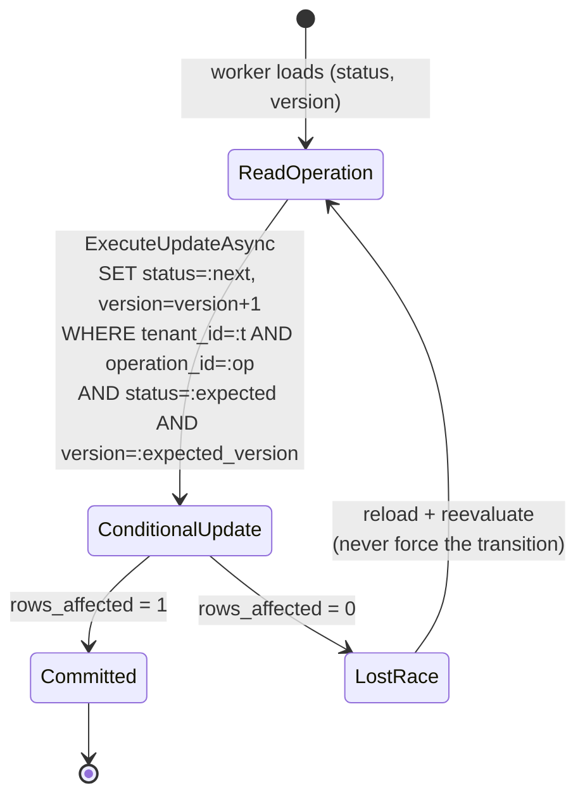

# 12. Data Model & Persistence

**Status:** Proposed
**Owner project(s):** `apps/api` (`Cordia.Domain` entities + interfaces, `Cordia.Infrastructure` EF Core mapping & migrations); PostgreSQL is the single system of record.
**Source design sections:** §22 Data Model (1926–1977) incl. §22.1 key constraints & version-token UPDATE; §8.7 Intent revisions (672–699); §8.8 Confirmation evidence (701–718); §10 Submission Contract (1036–1109); §12.2–12.7 Job envelope / outbox / inbox / leases / worker boundary / attempt records (1178–1334); §13.3 Idempotency record lifecycle (1391–1409); §14.3 Hold expiry (1500–1514); §16.3 Reconciliation records (1621–1631); §18.2–18.3 Notification identity & states (1717–1745); §9.3 Verification grants (837–859); §31 Decisions still required (2387–2404).

---

## 2. Purpose & scope

This spec defines the **PostgreSQL schema that underpins every other Cordia spec**: the twenty-four logical tables of §22 (the seventeen original business/transport tables; the ratified `workflow_steps` and transport-level `dead_letter_messages`; and five tables ratified in from sibling specs — `deposit_sessions` ([09](09-payment-deposit-link.md)), `waitlist_enrollments` / `waitlist_offers` / `preorder_sagas` ([11](11-waitlist-menu-preorder.md)), and `tenant_channel_endpoints` ([15](15-tenant-resolution-and-gateway.md))), their identity/uniqueness/foreign-key/check constraints (§22.1), the optimistic-concurrency version-token UPDATE pattern, the mandatory tenant-scoping of every row and index, the EF Core mapping conventions (snake_case, `IEntityTypeConfiguration<T>`, pg-enum mapping, migration command), and the retention/audit windows. It is the **integration point** of the platform: it owns the canonical DDL and EF Core configuration for all tables, but it does **not** own the *behavior* over those tables — each behavioral spec listed in §10 below owns its rows' lifecycle and only crosses this boundary at named seams.

## 3. Position in the system

**Lane:** neither foreground nor background — this is the shared **durable substrate** both lanes write through. The foreground agent (apps/langgraph) never opens a connection to this database; it reaches durable state only through the API submission/status tools (see [04](04-submission-and-idempotency.md), [03](03-agent-tool-contracts.md)). All durable writes flow through `Cordia.Infrastructure` (`ApplicationDbContext`).

```
                 apps/langgraph (foreground)          apps/api (background workers + API)
                        │ no DB access                          │
                        ▼ (tools/HTTP)                          ▼
   ┌─────────────────────────────────────────────────────────────────────────────┐
   │  Cordia.Infrastructure / ApplicationDbContext  (Npgsql, snake_case)           │
   │  ── owns: DDL, IEntityTypeConfiguration<T>, pg-enum registration, migrations  │
   └─────────────────────────────────────────────────────────────────────────────┘
                        │
                        ▼
                 PostgreSQL — 24 logical tables, all tenant-scoped (§22)
```

**Upstream of this component:** every spec that defines a write (04 submission, 05 queue, 06 workflow, 07 holds, 08 manage-booking, 09 payment, 10 notifications, 11 waitlist/menu, 13 audit emission).
**Downstream:** the migrations and EF Core model are consumed by all API handlers and workers; the logical schema is the contract those specs build against.

**What this component MUST NOT do:**
- It must not embed business state transitions — it provides constraints and the version-token *mechanism*; the legality of a transition lives in 06.
- It must not store secrets, PAN/CVV, or full provider payloads (Inv-12). Columns are sanitized metadata only.
- It must not allow any table or index without a `tenant_id` leading column (Inv-13).
- It must not let a `verification_grant`, `idempotency_record`, or transcript-bearing row outlive its retention window or be physically deleted outside the privacy-retention workflow (§9.4 "physical deletion is prohibited except through privacy-retention workflows").
- It must not be edited via `OnModelCreating` inline once a table has more than trivial config, nor by hand-editing applied migrations (dotnet-api-patterns.md).

## 4. Component design

| Sub-component | Project | Responsibility |
|---|---|---|
| Domain entities + enums | `Cordia.Domain/Entities`, `/Enums` | POCO aggregates for each table; concurrency `Version` (`long`) where §22.1 demands it. Some enums are **generated** into `Cordia.Domain.Generated` from Pydantic; pg-enum-mapped ones get `[PgName]`/`[JsonStringEnumMemberName]` via `tools/config/ef-enum-mappings.json`. |
| Repository interfaces | `Cordia.Domain/Repositories` | Per-aggregate interfaces (`IBookingOperationRepository`, `IIdempotencyRepository`, `IOutboxRepository`, `IInboxRepository`, …). Handlers depend only on these. |
| `ApplicationDbContext` | `Cordia.Infrastructure/EntityFramework` | Single context, `UseSnakeCaseNamingConvention()`, `UseNpgsql` with registered pg enums, global tenant query filter. |
| `IEntityTypeConfiguration<T>` per table | `Cordia.Infrastructure/EntityFramework/Configurations` | One file per table: PK, tenant-leading indexes, unique/check constraints, concurrency token, default values. |
| Migrations | `Cordia.Infrastructure/EntityFramework/Migrations` | Append-only; created via `dotnet ef migrations add` (never hand-edited once applied). |
| Concurrency helper | `Cordia.Infrastructure` | The version-token conditional `ExecuteUpdateAsync` pattern (§22.1) used by 06/07/09; returns rows-affected so the caller reloads on 0. |
| Retention sweepers | `Cordia.Infrastructure` (scheduled, see [05](05-job-queue-outbox-inbox.md)) | Prune/anonymize rows past their window; emit `audit_events` for each privacy action. |

## 5. Data contracts & schemas

### 5.0 Universal column conventions (every table)

- `tenant_id text not null` is the **first** column and **first** key/index member (Inv-13). The context applies a global EF query filter `e.TenantId == _tenantContext.TenantId`.
- Primary keys are `(tenant_id, <entity>_id)`. IDs are stable opaque strings (`op_01…`, `intent_01…`).
- Timestamps are `timestamptz` (ISO-8601 with offset on the wire). Monetary values are `integer`/`bigint` **minor units** (cents) — never floats.
- Concurrency token `version bigint not null default 0` on every mutable-state table (operations, holds, notifications, work items, deposit sessions, waitlist offers, pre-order sagas, sessions).
- Status/type columns are PostgreSQL **enums** registered with Npgsql where the value set is closed and shared cross-service; free-form metadata is `jsonb`.

### 5.1 Table catalog (§22) — ownership map and column sketches

> Each table's *lifecycle* is owned by the spec in the **Owner** column. This spec owns the DDL & EF mapping.

| Table | Owner spec | Carries (DDL sketch — abbreviated) |
|---|---|---|
| `conversation_sessions` | [02](02-foreground-conversational-agent.md) | `session_id`, `channel`, `consent_state` (enum), `consent_recorded_at`, `customer_ref?`, `started_at`, `ended_at?`, `version` |
| `vendor_catalogs` | [11](11-waitlist-menu-preorder.md) | `catalog_id`, `version_label`, `status` (enum: uploaded/scanning/quarantined/extracting/draft_ready/in_review/approved/published/superseded), `approved_at?`, `approved_by?`, `source_hash` |
| `vendor_catalog_items` | [11](11-waitlist-menu-preorder.md) | `item_id`, `catalog_id` (FK), `name`, `description`, `price_minor int`, `currency`, `menu_metadata jsonb?`, `allergen_info jsonb?` |
| `booking_intents` | [04](04-submission-and-idempotency.md) | `intent_id`, `session_id?`, `operation_type` (enum), `created_at`, `superseded_by_intent_id?` |
| `booking_intent_revisions` | [04](04-submission-and-idempotency.md) | `intent_id` (FK), `revision int`, `canonical_payload jsonb`, `payload_hash`, `schema_version`, `tenant_policy_version`, `prior_revision?`, `supersession_reason?`, `source_session_id?`, `created_at` |
| `intent_confirmations` | [04](04-submission-and-idempotency.md) | `confirmation_id`, `intent_id`, `intent_revision`, `intent_payload_hash`, `identity_ref`, `confirmation_channel`, `source_turn_id`, `readback_version`, `disclosures jsonb`, `verification_level` (enum), `confirmed_at` |
| `booking_operations` | [06](06-booking-workflow-and-fulfillment.md) | `operation_id`, `intent_id`, `intent_revision`, `operation_type` (enum), `status` (enum), `superseded_operation_id?`, `booking_id?`, `created_at`, `updated_at`, `version` |
| `idempotency_records` | [04](04-submission-and-idempotency.md) | `idempotency_key`, `operation_type`, `request_hash`, `operation_id`, `processing_status` (enum), `response_snapshot jsonb?`, `created_at`, `last_seen_at`, `retention_deadline` |
| `capacity_holds` | [07](07-capacity-and-holds.md) | (canonical DDL lives in 07) `hold_id`, `operation_id`, `workflow_step`, `slot_id?`, `reserved_capacity`, `status` (enum), `expires_at`, `release_reason?`, `provider_ref?`, `version` |
| `workflow_steps` | [06](06-booking-workflow-and-fulfillment.md) | `workflow_step_id`, `operation_id` (FK), `step_type`, `status` (enum: pending/in_progress/succeeded/failed/terminal), `provider_idempotency_key`, `attempt_count int`, `version`, `not_before?`, `created_at`, `updated_at` — durable unit the sweeper resumes; unique `(tenant_id, operation_id, step_type)` |
| `workflow_attempts` | [06](06-booking-workflow-and-fulfillment.md) | `attempt_id`, `operation_id`, `workflow_step`, `provider_idempotency_key`, `provider_name`, `provider_account`, `request_hash`, `attempt_number`, `started_at?`, `completed_at?`, `outcome` (enum), `retry_classification` (enum), `provider_ref?`, `request_meta jsonb`, `response_meta jsonb`, `error_code?`, `next_eligible_at?`, `reconciliation jsonb?` |
| `outbox_messages` | [05](05-job-queue-outbox-inbox.md) | `message_id`, `operation_id?`, `message_type`, `correlation_id`, `causation_id?`, `payload jsonb`, `occurred_at`, `published_at?`, `publish_attempts int`, `lease_owner?`, `lease_expires_at?` |
| `consumer_inbox` | [05](05-job-queue-outbox-inbox.md) | `consumer_name`, `message_id`, `correlation_id`, `operation_id?`, `outcome` (enum: admitted/completed/rejected), `admitted_at`, `completed_at?` |
| `scheduled_jobs` | [05](05-job-queue-outbox-inbox.md) | `job_id`, `job_type` (enum), `run_after`, `workflow_step_id?`, `destination_queue`, `status` (enum: pending/claimed/done/dead), `attempt int`, `lease_owner?`, `lease_expires_at?`, `payload jsonb`, `operation_id?` |
| `dead_letter_messages` | [05](05-job-queue-outbox-inbox.md) | (transport-level, not a business table) `message_id`, `consumer_name`, `message_type`, `payload jsonb`, `error_class`, `attempt_history jsonb`, `first_failed_at`, `dead_lettered_at`, `replay_state` (enum: quarantined/replayed/discarded) |
| `notifications` | [10](10-notifications.md) | `notification_id`, `operation_id`, `event_type` (enum), `recipient_ref`, `template_version`, `material_revision`, `state` (enum), `provider_idempotency_key?`, `provider_ref?`, `version` |
| `verification_grants` | [08](08-identity-and-manage-booking.md) | `grant_id`, `customer_ref`, `target_booking_id?`, `allowed_action` (enum), `verification_level` (enum), `session_or_operation_ref?`, `issued_at`, `expires_at`, `consumed_at?` |
| `operations_work_items` | [06](06-booking-workflow-and-fulfillment.md) | `work_item_id`, `operation_id`, `reason` (enum), `state` (enum), `sla_deadline`, `assignee?`, `resolution jsonb?`, `created_at`, `version` |
| `audit_events` | [14](14-security-and-privacy.md) (write path) / [13](13-observability-and-slos.md) (telemetry appends) | `event_id`, `event_type`, `actor`, `subject_ref`, `correlation_id?`, `operation_id?`, `metadata jsonb` (sanitized), `occurred_at` — **append-only** |
| `deposit_sessions` | [09](09-payment-deposit-link.md) | `deposit_session_id`, `operation_id` (FK; unique → one per operation), `amount_minor`, `currency`, `stripe_session_id?`, `payment_link_url?`, `status` (enum: created/link_sent/paid/expired), `expires_at`, `paid_at?`, `version` — no PAN/CVV column (Inv-12) |
| `waitlist_enrollments` | [11](11-waitlist-menu-preorder.md) | `enrollment_id`, `customer_ref`, `acceptable_from`, `acceptable_to`, `party_size`, `location_id`, `service_id`, `offer_lifetime_seconds`, `deposit_terms jsonb?`, `notification_channel`, `auto_book jsonb?` (null ⇒ offer-only, §20), `version` |
| `waitlist_offers` | [11](11-waitlist-menu-preorder.md) | `offer_id`, `enrollment_id` (FK), `hold_id?` (07), `operation_id?` (04), `status` (enum: pending/matched/offered/accepted/declined/expired/released), `offer_expires_at?`, `matched_at?`, `offered_at?`, `resolved_at?`, `version` |
| `preorder_sagas` | [11](11-waitlist-menu-preorder.md) | `saga_id`, `operation_id` (FK), `saga_state` (enum, §5.3 state machine), `preorder_reference jsonb` (immutable `catalog_version` + captured-price lines), `hold_id?`, `deposit_session_id?`, `version` — references only, never PAN (Inv-12) |
| `tenant_channel_endpoints` | [15](15-tenant-resolution-and-gateway.md) | `channel_endpoint_id`, `channel` (enum), `signal_type` (enum), `signal_value`, `configuration_version`, `policy_bundle_id`, `status` (enum: active/disabled), `version` — partial-unique `(channel, signal_type, signal_value) where status='active'` (Inv-13 ingress resolution) |

### 5.2 Identity & confirmation chain (Inv-1, Inv-3, Inv-10) — concrete DDL

```sql
create table booking_intent_revisions (
  tenant_id             text        not null,
  intent_id             text        not null,
  revision              integer     not null,
  canonical_payload     jsonb       not null,
  payload_hash          text        not null,
  schema_version        text        not null,
  tenant_policy_version text        not null,
  prior_revision        integer,
  supersession_reason   text,
  source_session_id     text,
  created_at            timestamptz not null default now(),
  primary key (tenant_id, intent_id, revision),
  foreign key (tenant_id, intent_id) references booking_intents (tenant_id, intent_id)
);

create table intent_confirmations (
  tenant_id           text        not null,
  confirmation_id     text        not null,
  intent_id           text        not null,
  intent_revision     integer     not null,
  intent_payload_hash text        not null,
  identity_ref        text        not null,           -- customer or anonymous session
  confirmation_channel text       not null,
  source_turn_id      text        not null,
  readback_version    text        not null,
  disclosures         jsonb       not null,
  verification_level  verification_level_enum not null,
  confirmed_at        timestamptz not null default now(),
  primary key (tenant_id, confirmation_id),
  -- FK to the EXACT revision (§22.1, §8.8)
  foreign key (tenant_id, intent_id, intent_revision)
    references booking_intent_revisions (tenant_id, intent_id, revision),
  -- payload-hash binding (§22.1, §8.8): confirmation must match the revision it confirms
  constraint ck_confirmation_hash_binding
    check (intent_payload_hash is not null)
);
```

The `check confirmation.payload_hash = intent_revision.payload_hash` of §22.1 cannot be a pure column check (it spans two tables). It is enforced as a **two-layer** guarantee:
1. **Application layer (04):** the submission handler loads the referenced revision and rejects if `intent_payload_hash != revision.payload_hash` before insert (§8.8 "submission must fail if the confirmation hash does not match").
2. **DB layer:** a `BEFORE INSERT` trigger on `intent_confirmations` re-reads the FK-target revision's `payload_hash` and raises if mismatched — a defense-in-depth backstop so the invariant holds even if an application path is added later. The migration creates this trigger; EF Core does not model it, so it lives in the migration's raw-SQL `Up()`.

### 5.3 Idempotency & operation identity (Inv-2, Inv-3) — concrete DDL

```sql
create table idempotency_records (
  tenant_id         text        not null,
  idempotency_key   text        not null,
  operation_type    operation_type_enum not null,
  request_hash      text        not null,              -- canonical request hash (§10.2)
  operation_id      text        not null,
  processing_status idempotency_status_enum not null,  -- in_progress | completed | failed
  response_snapshot jsonb,                              -- or pointer; may expire earlier than the record
  created_at        timestamptz not null default now(),
  last_seen_at      timestamptz not null default now(),
  retention_deadline timestamptz not null,             -- §13.3: life of booking + dispute/audit window
  primary key (tenant_id, idempotency_key)             -- §22.1 unique (tenant_id, idempotency_key)
);

create table booking_operations (
  tenant_id              text        not null,
  operation_id           text        not null,
  intent_id              text        not null,
  intent_revision        integer     not null,
  operation_type         operation_type_enum not null,
  status                 operation_status_enum not null,  -- accepted | validating | awaiting_user_action | reserving_capacity | held | awaiting_payment | finalizing | booked | alternatives_required | reconciling | compensation_required | manual_review | rejected | expired | waitlisted | failed_final (16 values)
  superseded_operation_id text,
  booking_id             text,
  created_at             timestamptz not null default now(),
  updated_at             timestamptz not null default now(),
  version                bigint      not null default 0,
  primary key (tenant_id, operation_id),               -- §22.1 unique (tenant_id, operation_id)
  foreign key (tenant_id, intent_id, intent_revision)
    references booking_intent_revisions (tenant_id, intent_id, revision)
);
```

`(tenant_id, idempotency_key)` is unique and `request_hash` is a single column — together they enforce **one key bound to exactly one canonical request hash** (Inv-3): a second arrival with the same key but a different `request_hash` is detected by the application as an idempotency conflict (§10.2 "same key and different request hash: reject"), never by silently overwriting the row.

### 5.4 Outbox / inbox (Inv-4, Inv-5) — concrete DDL

```sql
create table outbox_messages (
  tenant_id       text        not null,
  message_id      text        not null,
  operation_id    text,
  message_type    text        not null,             -- e.g. booking.finalize.requested.v1
  correlation_id  text        not null,
  causation_id    text,
  payload         jsonb       not null,             -- no secrets / no PAN (Inv-12)
  occurred_at     timestamptz not null default now(),
  published_at    timestamptz,
  publish_attempts integer    not null default 0,
  lease_owner     text,
  lease_expires_at timestamptz,
  primary key (tenant_id, message_id)
);
create index ix_outbox_unpublished
  on outbox_messages (tenant_id, occurred_at) where published_at is null;  -- FOR UPDATE SKIP LOCKED scan

create table consumer_inbox (
  tenant_id      text        not null,
  consumer_name  text        not null,
  message_id     text        not null,
  correlation_id text,
  operation_id   text,
  outcome        inbox_outcome_enum not null,            -- admitted | completed | rejected
  admitted_at    timestamptz not null default now(),
  completed_at   timestamptz,
  primary key (consumer_name, tenant_id, message_id) -- §22.1 unique (consumer_name, tenant_id, message_id)
);
create index ix_inbox_stuck_admitted
  on consumer_inbox (tenant_id, admitted_at) where outcome = 'admitted';  -- sweeper recovers rows stuck at admitted

create table scheduled_jobs (
  tenant_id        text        not null,
  job_id           text        not null,
  job_type         job_type_enum not null,
  run_after        timestamptz not null,                -- not run_at: earliest eligible time (D11)
  workflow_step_id text,                                -- the durable step this job resumes (FK workflow_steps)
  destination_queue text       not null,                -- queue the claimed job is dispatched to
  status           scheduled_job_status_enum not null,  -- pending | claimed | done | dead
  attempt          integer     not null default 0,
  lease_owner      text,
  lease_expires_at timestamptz,
  payload          jsonb       not null,
  operation_id     text,
  primary key (tenant_id, job_id)
);
create index ix_scheduled_jobs_due
  on scheduled_jobs (tenant_id, run_after) where status = 'pending';  -- FOR UPDATE SKIP LOCKED claim scan

-- transport-level dead-letter store (D10): NOT a business table; never overwrites booking_operations.status (Inv-14)
create table dead_letter_messages (
  tenant_id        text        not null,
  message_id       text        not null,
  consumer_name    text        not null,
  message_type     text        not null,
  payload          jsonb       not null,                -- sanitized; no secrets / no PAN (Inv-12)
  error_class      text        not null,
  attempt_history  jsonb       not null,
  first_failed_at  timestamptz not null,
  dead_lettered_at timestamptz not null default now(),
  replay_state     dlq_replay_state_enum not null,      -- quarantined | replayed | discarded
  primary key (tenant_id, message_id, consumer_name)
);
```

The §22.1 inbox uniqueness is the table's **primary key**; the consumer inserts the inbox row at `outcome='admitted'`, applies the transition and writes the resulting outbox in one transaction, then advances the row to `outcome='completed'`. A `unique_violation` on insert means a row already exists for `(consumer_name, tenant_id, message_id)`: if it is `completed` the delivery is already-processed → acknowledge (§12.4); if it is still `admitted` the prior attempt crashed mid-transaction, and the sweeper (05/06) recovers it (`ix_inbox_stuck_admitted`) rather than dedup suppressing the work. The atomic acceptance transaction (Inv-4) — operation insert + revision insert + outbox insert — is a single EF Core `DbContext` transaction owned by the 04 submission handler; this spec only guarantees the **constraints make that transaction's success/failure unambiguous**.

### 5.5 Notifications, holds, verification, work items, attempts

```sql
create table notifications (
  tenant_id        text        not null,
  notification_id  text        not null,             -- stable, derived from tenant+op+event+recipient+template+revision (§18.2)
  operation_id     text        not null,
  event_type       notification_event_enum not null,
  recipient_ref    text        not null,
  template_version text        not null,
  material_revision integer    not null,
  state            notification_state_enum not null, -- pending|sending|accepted|delivered|failed_transient|failed_permanent|suppressed_duplicate|invalid_recipient
  provider_idempotency_key text,
  provider_ref     text,
  version          bigint      not null default 0,
  primary key (tenant_id, notification_id)           -- §22.1 unique (tenant_id, notification_id) → dedup (Inv-9)
);

create table verification_grants (
  tenant_id        text        not null,
  grant_id         text        not null,
  customer_ref     text        not null,
  target_booking_id text,
  allowed_action   verification_action_enum not null,  -- read_sensitive | modify | cancel | use_payment_method | refund | owner_override (D5)
  verification_level verification_level_enum not null,
  session_or_operation_ref text,
  issued_at        timestamptz not null default now(),
  expires_at       timestamptz not null,             -- expiring, action-scoped (§9.3, Inv-11)
  consumed_at      timestamptz,
  primary key (tenant_id, grant_id)
);

create table workflow_steps (
  tenant_id        text        not null,
  workflow_step_id text        not null,
  operation_id     text        not null,
  step_type        text        not null,
  status           workflow_step_status_enum not null, -- pending | in_progress | succeeded | failed | terminal
  provider_idempotency_key text,
  attempt_count    integer     not null default 0,
  version          bigint      not null default 0,
  not_before       timestamptz,
  created_at       timestamptz not null default now(),
  updated_at       timestamptz not null default now(),
  primary key (tenant_id, workflow_step_id),
  foreign key (tenant_id, operation_id)
    references booking_operations (tenant_id, operation_id),
  -- one logical step per (operation, step_type): the durable unit the sweeper resumes (D8)
  constraint uq_workflow_step_per_type unique (tenant_id, operation_id, step_type)
);
```

`workflow_attempts`, `operations_work_items`, and `capacity_holds` (latter owned by 07) follow the same conventions; `workflow_attempts.reconciliation jsonb` carries the §16.3 record (why ambiguous, last provider key, queries performed, candidate matches, confidence, resolution actor, links to compensation) — supporting Inv-7. `workflow_steps` is the **durable unit of work the sweeper resumes** (one row per `(operation_id, step_type)`, carrying its own `version` for the concurrency-token UPDATE), distinct from `workflow_attempts`, which is the append-only log of individual external calls made *within* a step; the step protocol is owned by 06.

### 5.6 Cross-service contract mapping (`libs/shared-schemas`)

These tables persist payloads whose **shape is a cross-service contract**, so the column `jsonb`/enum content is generated from Pydantic, never hand-defined here:

| Column → shared-schemas contract | Source-of-truth |
|---|---|
| `booking_intent_revisions.canonical_payload` | `schemas/models/BookingIntent*` (Pydantic) → C#/TS/Zod |
| `intent_confirmations` fields | confirmation contract |
| `outbox_messages.payload` (booking.*) | `schemas/job-events/` (queue-only) |
| `booking_operations.status`, `notifications.state`, attempt outcome | shared enums (pg-enum-mapped via `tools/config/ef-enum-mappings.json`) |
| `preorder_sagas.preorder_reference` | `PreorderReference` ([11](11-waitlist-menu-preorder.md) §4.3) |
| `waitlist_enrollments.auto_book` / `deposit_terms` | `AutoBookGrant` / `DepositTerms` ([11](11-waitlist-menu-preorder.md) §4.4) |
| `tenant_channel_endpoints.channel` / `signal_type`, `deposit_sessions.status` enums | shared enums (`TenantChannel`/`SignalType` from [15](15-tenant-resolution-and-gateway.md), `DepositStatus` from [09](09-payment-deposit-link.md)) |

The DB stores the **canonical** form; the canonicalization algorithm and `request_hash` computation are owned by [04](04-submission-and-idempotency.md), not here.

### 5.7 Deposit, waitlist, pre-order & channel registry — concrete DDL (ratified from 09/11/15)

These five tables are owned (lifecycle) by their sibling specs, but their canonical DDL/EF mapping lives **here** — 09 §4/§5.2 nominates this spec for `deposit_sessions`; 11 §4.4 (and its §76/§321 deferral) nominates it for the waitlist/pre-order trio; 15 §5.5 + OD-2 nominates it for the registry. Contract-shaped `jsonb`/enum content is generated from Pydantic per §5.6.

```sql
create table deposit_sessions (
  tenant_id          text        not null,
  deposit_session_id text        not null,             -- opaque id, e.g. dep_01…
  operation_id       text        not null,
  amount_minor       integer     not null,             -- minor units (cents)
  currency           text        not null,             -- ISO 4217
  stripe_session_id  text,                              -- the ONLY Stripe identifier stored (Inv-12); null until session created
  payment_link_url   text,                              -- Stripe-hosted link; null until session created
  status             deposit_status_enum not null,     -- created | link_sent | paid | expired (09 §5.2)
  expires_at         timestamptz not null,             -- link expiry; ExpireDepositSession sweep (09 §4)
  created_at         timestamptz not null default now(),
  paid_at            timestamptz,                       -- set on checkout.session.completed
  version            bigint      not null default 0,
  primary key (tenant_id, deposit_session_id),
  foreign key (tenant_id, operation_id)
    references booking_operations (tenant_id, operation_id),
  -- one deposit session per booking operation: structural no-double-charge (09 §3/§4)
  constraint uq_deposit_session_per_operation unique (tenant_id, operation_id)
);
create index ix_deposit_sessions_expiry
  on deposit_sessions (tenant_id, expires_at) where status = 'link_sent';  -- ExpireDepositSession claim scan

create table waitlist_enrollments (
  tenant_id              text        not null,
  enrollment_id          text        not null,
  customer_ref           text        not null,
  acceptable_from        timestamptz not null,
  acceptable_to          timestamptz not null,
  party_size             integer     not null,
  location_id            text        not null,
  service_id             text        not null,
  offer_lifetime_seconds integer     not null,          -- TimeSpan OfferLifetime, stored as seconds
  deposit_terms          jsonb,                          -- nullable DepositTerms? (contract-shaped, §5.6)
  notification_channel   text        not null,
  auto_book              jsonb,                          -- nullable AutoBookGrant? (constraint-scoped consent); null ⇒ offer-only (default, §20)
  created_at             timestamptz not null default now(),
  version                bigint      not null default 0,
  primary key (tenant_id, enrollment_id)
);

create table waitlist_offers (
  tenant_id        text        not null,
  offer_id         text        not null,
  enrollment_id    text        not null,
  hold_id          text,                                 -- temporary capacity_holds row (07); null until Matched
  operation_id     text,                                 -- booking operation minted on accept (04); null until Accepted
  status           waitlist_offer_status_enum not null,  -- pending | matched | offered | accepted | declined | expired | released
  offer_expires_at timestamptz,                          -- offer lifetime; scheduled_jobs fires expiry
  matched_at       timestamptz,
  offered_at       timestamptz,
  resolved_at      timestamptz,                           -- accepted/declined/expired/released timestamp
  created_at       timestamptz not null default now(),
  version          bigint      not null default 0,        -- guards the conditional Offered→Expired transition (11 §5.1)
  primary key (tenant_id, offer_id),
  foreign key (tenant_id, enrollment_id)
    references waitlist_enrollments (tenant_id, enrollment_id)
);

create table preorder_sagas (
  tenant_id          text        not null,
  saga_id            text        not null,
  operation_id       text        not null,               -- the booking operation the saga rides (11 §4.1)
  saga_state         preorder_saga_state_enum not null,  -- §5.3 state machine (revalidating … completed | failed_final | manual_review)
  preorder_reference jsonb       not null,               -- PreorderReference: immutable catalog_version + captured-price lines (contract-shaped, §5.6, §4.3)
  hold_id            text,                                 -- capacity hold acquired in HoldingCapacity (07); nullable
  deposit_session_id text,                                 -- payment reference from 09 (nullable; references only, never PAN — Inv-12)
  created_at         timestamptz not null default now(),
  updated_at         timestamptz not null default now(),
  version            bigint      not null default 0,       -- saga resumes from state on crash (11 §8)
  primary key (tenant_id, saga_id),
  foreign key (tenant_id, operation_id)
    references booking_operations (tenant_id, operation_id)
);

create table tenant_channel_endpoints (
  tenant_id             text        not null,
  channel_endpoint_id   text        not null,
  channel               channel_enum not null,            -- voice | messaging | web | email (15 §5.1 TenantChannel)
  signal_type           signal_type_enum not null,        -- phone_number | messaging_recipient | widget_key | email_recipient | web_origin | directory_slug
  signal_value          text        not null,             -- transport-attested signal (DID, recipient, widget key, origin…)
  configuration_version text        not null,             -- pinned into the minted TenantContext (15 §5.1)
  policy_bundle_id      text        not null,             -- resolves allowed agent/tool policy ids
  status                endpoint_status_enum not null,    -- active | disabled
  version               bigint      not null default 0,
  primary key (tenant_id, channel_endpoint_id)
);
-- a single inbound channel signal MUST resolve to exactly one ACTIVE tenant (Inv-13; 15 §5.5):
-- zero active rows ⇒ tenant_not_resolved; more than one ⇒ ambiguous_endpoint. Partial-unique over active rows only.
create unique index uq_channel_signal_active
  on tenant_channel_endpoints (channel, signal_type, signal_value) where status = 'active';
```

`deposit_status_enum` stores `created | link_sent | paid | expired` only; the `not_required` value in `06`'s `OperationStatusView.deposit_status` projection is a **derived** state (deposit disabled / no `deposit_sessions` row), **never** a stored enum member. `deposit_sessions` holds no PAN/CVV — only `stripe_session_id` + `payment_link_url` (Inv-12); webhook idempotency is keyed on `stripe_event_id` via `consumer_inbox` (05), not a column here.

`uq_channel_signal_active` is the one **deliberate exception** to the tenant-leading-index rule of §5.0: it is intentionally **not** tenant-scoped, because its purpose is precisely to guarantee that one inbound `(channel, signal_type, signal_value)` cannot fan out to two tenants — the structural form of Inv-13 at ingress (15 §5.5).

## 6. Workflows

### 6.1 Atomic acceptance write path (happy + rollback) — Inv-4

```mermaid
sequenceDiagram
    participant H as 04 Submission handler
    participant DB as PostgreSQL (ApplicationDbContext txn)
    Note over H,DB: one DbContext transaction (Inv-4)
    H->>DB: BEGIN
    H->>DB: INSERT idempotency_records (status=in_progress)<br/>UNIQUE(tenant_id, idempotency_key)
    alt key already present, same request_hash
        DB-->>H: unique_violation
        H->>DB: ROLLBACK; load existing operation
        H-->>H: return existing 202 (Inv-3 reuse)
    else key already present, different request_hash
        DB-->>H: unique_violation
        H->>DB: ROLLBACK
        H-->>H: 409 idempotency conflict (Inv-3)
    else new key
        H->>DB: INSERT booking_intent_revisions (immutable)
        H->>DB: INSERT intent_confirmations<br/>(FK→exact revision; trigger checks payload_hash, §22.1)
        H->>DB: INSERT booking_operations (status=accepted, version=0)
        H->>DB: INSERT outbox_messages (booking.finalize.requested.v1)
        H->>DB: COMMIT
        DB-->>H: committed
        H-->>H: 202 Accepted (durable, not booked)
    end
```

If any insert fails (hash mismatch trigger, FK violation, crash before COMMIT), the whole transaction rolls back: **no operation, no outbox row, no job** — exactly the §10.3 guarantee.

### 6.2 Optimistic-concurrency version-token UPDATE (happy + lost-race recovery) — §22.1



Zero affected rows means another worker advanced the operation or the lease expired and was reclaimed; the worker reloads and reevaluates rather than forcing the transition (§22.1). This is the single mechanism that lets duplicate broker delivery and concurrent workers be **effectively-once** (Inv-5) at the row level.

### 6.3 Retention / privacy-deletion sweep (recovery from over-retention)

```mermaid
sequenceDiagram
    participant SJ as scheduled_jobs (05)
    participant DB as PostgreSQL
    participant AU as audit_events
    SJ->>DB: claim due retention job (FOR UPDATE SKIP LOCKED)
    DB->>DB: SELECT rows past retention_deadline<br/>(idempotency_records / transcripts / verification_grants)
    alt financial/audit window still open
        DB-->>SJ: skip row (Inv-14: state/SLA preserved)
    else window elapsed & no open dispute
        DB->>DB: anonymize/prune (logical, not hard-delete of bookings §9.4)
        DB->>AU: INSERT audit_events (privacy_action) — append-only
    end
    SJ->>DB: mark job done; reschedule next window
```

## 7. Reliability mechanisms (mapped to invariants)

- **Inv-1 (no side effect from transcript text):** no table can be written by the agent directly; the only intent-bearing rows (`booking_intent_revisions`, `intent_confirmations`) are inserted by the API submission handler under FK + hash constraints, not from raw transcript.
- **Inv-2 / Inv-3 (stable operation_id + key; one key ↔ one hash):** `idempotency_records` PK `(tenant_id, idempotency_key)` + single `request_hash` column + `(tenant_id, operation_id)` unique on `booking_operations`.
- **Inv-4 (atomic acceptance + operation + outbox):** all three inserts share one `DbContext` transaction; constraints make partial success impossible.
- **Inv-5 (effectively-once under duplicate delivery):** `consumer_inbox` PK `(consumer_name, tenant_id, message_id)` + the version-token UPDATE (§6.2).
- **Inv-6 (capacity reservation is a separate atomic write):** `capacity_holds` partial-unique active-hold constraint (owned by 07) is independent of `idempotency_records`; this spec keeps the two tables and constraints disjoint.
- **Inv-7 (reconcile ambiguous outcomes before re-create/charge):** `workflow_attempts.provider_ref` + `reconciliation jsonb` (§16.3) carry the data the reconciler keys on; `attempts.outcome` enum includes `ambiguous`/`reconciled`.
- **Inv-8 / Inv-9 (success persisted before notify; independent dedup):** `notifications.notification_id` PK enforces dedup; FK to `booking_operations` and the 18.1 ordering (booking committed before notification row created) are honored by 10's emission path.
- **Inv-10 (material change → new revision + confirmation):** `booking_intent_revisions` PK includes `revision`; revisions are insert-only; `intent_confirmations` FK targets the **exact** revision.
- **Inv-11 (server-verified authorization):** `verification_grants` are expiring, action-scoped, server-issued; caller ID is never a column that grants access.
- **Inv-12 (no card data):** no PAN/CVV column exists; `payload`/`*_meta` are sanitized `jsonb`; documented in 09/14.
- **Inv-13 (tenant scope first):** `tenant_id` leads every PK and index; global EF query filter; no cross-tenant FK.
- **Inv-14 (DLQ never replaces business state/SLA):** retention sweeps skip rows with open SLA/dispute windows; DLQ tables (05) don't overwrite `booking_operations.status`.
- **Inv-15 (human retries typed, preserve history):** `workflow_attempts` is append-only — a manual retry adds a new attempt with a new `attempt_number`, never mutating prior attempts.
- **Inv-16 (agent states only authoritative state):** the API status projection reads `booking_operations`/`notifications` directly; there is no separate "optimistic" agent-side store.

## 8. Latency budget & optimizations

Primary axis is reliability, but the schema is also the hot read path for the foreground status lookup and the worker claim loop.

| Operation | Target | Technique |
|---|---|---|
| Idempotency PK lookup (replay/duplicate) | p99 < 5 ms | PK index `(tenant_id, idempotency_key)`; covered. |
| Atomic acceptance transaction | p99 < 30 ms | All inserts on PK-indexed tables; one round trip; trigger reads one indexed row. |
| Version-token conditional UPDATE | p99 < 10 ms | Single statement against PK; no SELECT-then-UPDATE; no row lock held across network. |
| Outbox publisher claim batch | p99 < 15 ms / batch | Partial index `where published_at is null`; `FOR UPDATE SKIP LOCKED`. |
| Status projection (foreground tool) | p99 < 20 ms | `.AsNoTracking()` read of `booking_operations` by PK; index `(tenant_id, intent_id)` for intent-keyed lookups. |

Conventions: short transactions (no external call inside any DB txn — §12.6); `jsonb` for variable payloads to avoid wide migrations; `bigint` minor units to avoid float math; partial indexes to keep hot scans (unpublished outbox, active holds, due jobs) small.

## 9. Failure modes & recovery

| Failure | Symptom | Recovery |
|---|---|---|
| Crash mid-acceptance, before COMMIT | partial inserts | Full rollback; no durable artifacts; client retries with same key → idempotent (§6.1). |
| Two requests, same key, different hash | second arrives | DB unique constraint surfaces conflict; app returns 409, never overwrites `request_hash` (Inv-3). |
| Confirmation hash ≠ revision hash | bad submission | App rejects (04); DB trigger backstop raises on insert (Inv-1/10). |
| Concurrent workers on one operation | both attempt transition | Version-token UPDATE: one gets `rows_affected=1`, the other `0` → reload (§6.2, Inv-5). |
| Duplicate broker delivery | same `message_id` | `consumer_inbox` PK unique_violation → ack as already-processed (§12.4). |
| Inbox row written but external step not executed | worker crash after admit | Inbox marks *admitted*, not *completed*; sweeper (06) finds non-terminal `workflow_steps`/`workflow_attempts` and resumes — dedup never suppresses recovery (§12.6). |
| Crash after provider commit, before result commit | ambiguous attempt | `workflow_attempts.outcome=ambiguous`; reconcile by `provider_ref`/`provider_idempotency_key` before any re-create (Inv-7, §12.6). |
| Retention sweep would prune row with open dispute | premature deletion risk | Sweep checks `retention_deadline` AND open-SLA/dispute guard; skips; logs `audit_events` (Inv-14, §6.3). |
| Migration drift (model vs DB) | `dotnet ef` reports pending model changes | Add a new migration (never edit applied ones); CI `--verify-no-changes` gate. |

## 10. Interfaces to sibling specs

- **[04-submission-and-idempotency.md](04-submission-and-idempotency.md)** — owns `booking_intents`, `booking_intent_revisions`, `intent_confirmations`, `idempotency_records`; defines canonicalization + `request_hash`. This spec provides their DDL/constraints + the atomic-acceptance transaction shape.
- **[05-job-queue-outbox-inbox.md](05-job-queue-outbox-inbox.md)** — owns `outbox_messages`, `consumer_inbox` (admitted/completed outcome), `scheduled_jobs` (run_after claim), and the transport-level `dead_letter_messages` lifecycle, lease/claim queries; uses the partial indexes defined here.
- **[06-booking-workflow-and-fulfillment.md](06-booking-workflow-and-fulfillment.md)** — owns `booking_operations` state graph, `workflow_steps` (the resumable step protocol), `workflow_attempts`, `operations_work_items`; uses the version-token UPDATE mechanism.
- **[07-capacity-and-holds.md](07-capacity-and-holds.md)** — owns `capacity_holds` (canonical DDL there) and `capacity_slots`; this spec defers to it and only keeps the active-hold constraint consistent with §22.1.
- **[08-identity-and-manage-booking.md](08-identity-and-manage-booking.md)** — owns `verification_grants` issuance/consumption and optimistic-concurrency on `booking_operations` modify/cancel.
- **[09-payment-deposit-link.md](09-payment-deposit-link.md)** — owns the `deposit_sessions` lifecycle; this spec provides its DDL/EF mapping (§5.7) under the Inv-12 no-card-data boundary (only `stripe_session_id` and link URL stored; no PAN/CVV column).
- **[10-notifications.md](10-notifications.md)** — owns `notifications` lifecycle/dedup via the `notification_id` PK.
- **[11-waitlist-menu-preorder.md](11-waitlist-menu-preorder.md)** — owns `vendor_catalogs`, `vendor_catalog_items`, and the `waitlist_enrollments` / `waitlist_offers` / `preorder_sagas` rows; this spec provides their DDL/EF mapping (§5.7).
- **[15-tenant-resolution-and-gateway.md](15-tenant-resolution-and-gateway.md)** — owns the `tenant_channel_endpoints` registry *contract*; this spec provides its DDL/EF mapping (§5.7), including the partial-unique active-signal index that makes Inv-13 resolvable at ingress.
- **[14-security-and-privacy.md](14-security-and-privacy.md)** — owns the `audit_events` (append-only) write-path contract and the retention/encryption policy this spec's sweepers enforce. **[13-observability-and-slos.md](13-observability-and-slos.md)** — is the narrow appender for telemetry-plane access events only (D13).

## 11. Implementation mapping (apps/api)

```
apps/api/src/
  Cordia.Domain/
    Entities/            BookingOperation.cs, IntentRevision.cs, IntentConfirmation.cs,
                         IdempotencyRecord.cs, OutboxMessage.cs, InboxRecord.cs, ScheduledJob.cs,
                         DeadLetterMessage.cs, WorkflowStep.cs, WorkflowAttempt.cs,
                         Notification.cs, VerificationGrant.cs,
                         OperationWorkItem.cs, AuditEvent.cs, ConversationSession.cs,
                         VendorCatalog.cs, VendorCatalogItem.cs, DepositSession.cs,
                         WaitlistEnrollment.cs, WaitlistOffer.cs, PreorderSaga.cs,
                         TenantChannelEndpoint.cs  (CapacityHold.cs lives w/ 07)
    Enums/               OperationStatus.cs, IdempotencyStatus.cs, NotificationState.cs,
                         VerificationLevel.cs, VerificationAction.cs, AttemptOutcome.cs,
                         WorkflowStepStatus.cs, ScheduledJobStatus.cs, InboxOutcome.cs,
                         DlqReplayState.cs, CatalogStatus.cs, DepositStatus.cs,
                         WaitlistOfferStatus.cs, PreorderSagaState.cs, TenantChannel.cs,
                         SignalType.cs, EndpointStatus.cs, …
                         (pg-enum-mapped ones generated into Cordia.Domain.Generated)
    Repositories/        IBookingOperationRepository.cs, IIdempotencyRepository.cs,
                         IOutboxRepository.cs, IInboxRepository.cs, IScheduledJobRepository.cs, …
  Cordia.Infrastructure/
    EntityFramework/
      ApplicationDbContext.cs                 (UseSnakeCaseNamingConvention, global tenant filter,
                                               Npgsql MapEnum<...> for each pg enum)
      Configurations/   <Table>Configuration.cs : IEntityTypeConfiguration<T>  (one per table)
      Concurrency/      VersionTokenUpdate.cs   (ExecuteUpdateAsync helper, returns rows-affected)
      Migrations/       <timestamp>_InitialSchema.cs (+ raw-SQL trigger for confirmation hash)
      Retention/        RetentionSweepHandler.cs (scheduled via 05)
    Repositories/       EfCore implementations of the Domain interfaces (AddInfrastructure)
```

EF Core notes following dotnet-api-patterns.md:
- `ApplicationDbContext` enables `UseSnakeCaseNamingConvention()`; each table gets an `IEntityTypeConfiguration<T>` (not inline `OnModelCreating`).
- The version-token transition is `ExecuteUpdateAsync` (single atomic statement), not load-then-`SaveChanges`; `version` is the EF concurrency token for the reload-on-zero path.
- pg-enum-mapped enums: add each to `tools/config/ef-enum-mappings.json` (quicktype suffixes the type with `Enum`) so `[PgName]`/`[JsonStringEnumMemberName]` are generated, then `MapEnum<>` on the Npgsql data source.
- Migrations created via:
  ```bash
  cd apps/api/src/Cordia.Infrastructure
  dotnet ef migrations add InitialSchema --startup-project ../Cordia.Api \
    --context ApplicationDbContext --output-dir EntityFramework/Migrations
  ```
- Reads use `.AsNoTracking()`. Never hand-edit applied migrations or generated `SharedTypes.cs`.

## 12. Test strategy (from §27)

| Layer | Test |
|---|---|
| Constraint (Integration, Alba + real Postgres) | Insert duplicate `(tenant_id, idempotency_key)` → unique_violation; duplicate `(consumer_name, tenant_id, message_id)` → ack-as-processed; duplicate `(tenant_id, notification_id)` → suppressed. |
| Confirmation binding | Insert confirmation whose `intent_payload_hash` ≠ target revision hash → app reject **and** trigger raise (Inv-1/10). |
| Concurrency | Two concurrent version-token UPDATEs from `expected_version=N` → exactly one `rows_affected=1`, other `0` (Inv-5); fuzz with interleaving. |
| Atomicity (Inv-4) | Force failure on the outbox insert inside acceptance → assert operation/revision/confirmation all rolled back; no orphan rows. |
| Tenant isolation (Inv-13) | Query under tenant A's filter never returns tenant B's rows; attempt cross-tenant FK insert fails. |
| Idempotency conflict (Inv-3) | Same key + different `request_hash` → 409, original row's hash unchanged. |
| Reconciliation (Inv-7) | Simulate ambiguous attempt; assert `outcome=ambiguous` + `reconciliation` populated before any second create. |
| Retention | Row past `retention_deadline` with open dispute guard → skipped; without → anonymized + `audit_events` appended (Inv-14). |
| Migration drift | CI runs `dotnet ef migrations` model check; `dotnet format --verify-no-changes`. |

Unit tests (`Category=Unit`) cover the `VersionTokenUpdate` helper's reload-on-zero branch with a mocked context; integration tests (`Category=Integration`) exercise real Postgres constraints.

## 13. Open decisions (from §31)

- **Idempotency and audit retention periods** — concrete `retention_deadline` formula (booking life + dispute/audit window) and the `audit_events` retention window must be set; the sweeper and this DDL's defaults depend on it.
- **Transcript and audio retention by jurisdiction** — drives `conversation_sessions`/transcript-bearing storage retention and the privacy-deletion workflow (coordinate with 14).
- **Canonicalization specification and hash algorithm** — determines what `payload_hash`/`request_hash` columns store; owned by 04 but constrains the hash-binding trigger here.
- **Broker or PostgreSQL job-store technology** — if PostgreSQL-only, `scheduled_jobs`/`outbox_messages` claim queries are authoritative; if a broker is added, the inbox/outbox tables still stand but lease columns may shift to broker visibility timeouts.
- **First-party vs provider-owned capacity model** — shapes whether `capacity_holds.slot_id`/`capacity_slots` are populated first-party or only mirror provider refs (owned by 07; this spec keeps both columns nullable accordingly).
