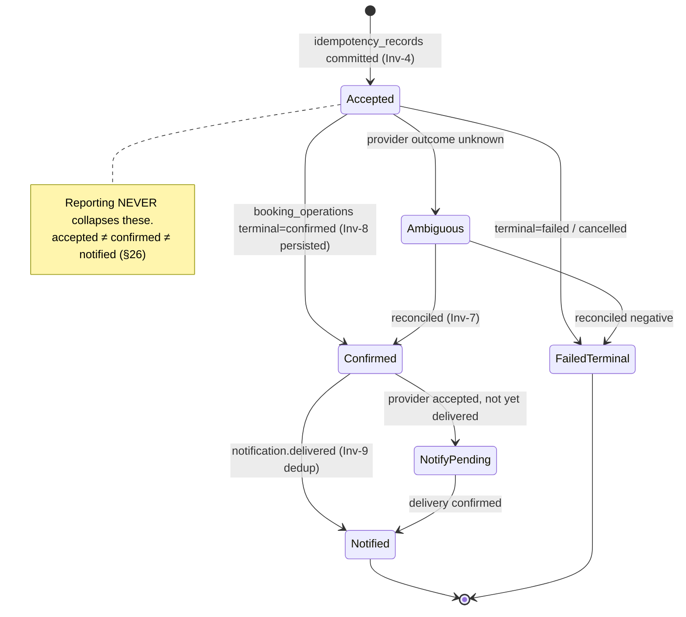

# 13 — Observability & SLOs

**Status:** Proposed
**Owner project(s):** `apps/api` (Cordia.Api + Cordia.Infrastructure + Cordia.Application), `apps/langgraph` (cordia_agent instrumentation), `apps/web` (status-surface reporting), `libs/shared-schemas` (correlation fields on every cross-service contract)
**Source design sections:** §25 Observability (§25.1 correlation, §25.2 required metrics, §25.3 logs/traces, §25.4 alerts), §26 Service Objectives (objectives + product-reporting separation), §8.10 streaming latency stages (lines 744–766), supporting: §22 data model, §30 invariants

---

## 1. Purpose & scope

This spec defines Cordia's **measurement contract**: the single `correlation_id` minted at channel ingress and the `causation_id` lineage chain that every other component is obligated to thread through traces, tool calls, intents, operation transitions, the outbox/inbox/broker, provider attempts, notifications, and handoff; the **required metrics** (agent, fulfillment, notifications); the **alert** set; the **SLOs/SLIs**; and the mandatory product-reporting separation of *request accepted ≠ booking confirmed ≠ customer notified*. It also fixes the **redaction rules** so secrets, PAN/CVV, and raw transcript content never reach logs, traces, or metrics.

This spec is **balanced** — it instruments both the latency lane (foreground voice turns) and the reliability lane (durable fulfillment) — but it is itself almost pure measurement: it owns *no* business state and *no* side effects. Every sibling spec **emits into** the contract defined here; this spec does not redefine their behavior.

---

## 2. Position in the system

**Lane:** CROSS-CUTTING. Observability is neither foreground nor background business logic — it is the telemetry plane both lanes write into. It reads authoritative state to *report* on it but is forbidden from mutating it.

```
channel ingress (01) ── mint correlation_id ──┐
                                              ▼
 [01 voice][02 agent][03 tools]  ──spans+metrics──►  trace/log/metric backend
 [04 submit][05 outbox/inbox/broker][06 worker/attempts]  ──spans+metrics──►  (OpenTelemetry)
 [07 holds][09 payment][10 notify][08 manage]  ──spans+metrics──►  alerts + SLO burn
                                              │
 product reporting plane (separate)  ◄────────┘  accepted | confirmed | notified
```

| Upstream (emits telemetry into this contract) | Downstream (consumes telemetry) |
|---|---|
| Every spec 01–12, 14 — spans, metrics, structured logs carrying `correlation_id`/`causation_id` | Alerting + on-call (§25.4) |
| [`01`](01-streaming-voice-pipeline.md) mints `correlation_id` at ingress; threads `session_id`/`turn_id` | SLO burn-rate dashboards (§26) |
| [`05`](05-job-queue-outbox-inbox.md) propagates IDs on every envelope | Product reporting plane (accepted/confirmed/notified, §26) |
| [`12`](12-data-model-and-persistence.md) supplies the audited state this plane reports on | [`14`](14-security-and-privacy.md) — redaction + log-access policy enforcement |

**What this component MUST NOT do:**

- It MUST NOT write or mutate any business state. Reporting reads authoritative state; it never derives a customer-facing fact that the platform has not persisted (Inv-16). A dashboard counter is never the source of truth.
- It MUST NOT collapse *accepted*, *confirmed*, and *notified* into a single "success" number (§26) — that hides the exact failures this platform exists to surface.
- It MUST NOT log or export secrets, PAN/CVV, or raw transcript/audio content (Inv-12, §25.3, §24.2). Model prompts/outputs are not ordinary logs and carry stricter access + retention.
- It MUST NOT treat DLQ depth or a fired alert as a substitute for the customer-visible business state and SLA they shadow (Inv-14) — telemetry observes those states; it does not replace them.
- It MUST NOT require any new ID minting on failure; correlation reuses the existing operation/idempotency/provider keys (Inv-2).

---

## 3. Component design

| Sub-component | Project / layer | Responsibility |
|---|---|---|
| **Correlation context** | `Cordia.Application` (`AmbientContext` + MediatR behavior) / `cordia_agent` (contextvar) | Holds `tenant_id`, `correlation_id`, `causation_id`, `operation_id`, `session_id`, `turn_id` for the current unit of work. Set once at ingress, propagated automatically. |
| **Ingress correlation minter** | [`01`](01-streaming-voice-pipeline.md) channel gateway + `apps/api` middleware | Mints `correlation_id` at channel ingress (§25.1); echoes inbound `correlation_id` on webhooks/agent calls; never re-mints mid-flow. |
| **Telemetry SDK wiring** | `Cordia.Infrastructure` (`OpenTelemetry` setup) / `cordia_agent` (OTel Python) | One tracer/meter provider; OTLP export; resource attributes (`service.name`, `tenant_id` as a low-cardinality dimension only where safe). Serilog enricher binds the correlation context to every log line. |
| **Metric registry** | `Cordia.Infrastructure/Observability/Metrics.cs` / `cordia_agent/observability/metrics.py` | Declares the §25.2 instruments (counters/histograms/gauges) with fixed names + label sets. Single source so names don't drift across services. |
| **Redaction pipeline** | `Cordia.Infrastructure` (Serilog `IDestructuringPolicy` + masking) / `cordia_agent` log filter | Strips/masks secrets, PAN/CVV, raw transcript before any sink (§25.3, Inv-12). Default-deny: only allowlisted fields are logged verbatim. |
| **Model-trace sink** | `cordia_agent` + `Cordia.Infrastructure` | Separate, stricter-access store for model prompts/outputs with shorter retention (§25.3). Tagged, not co-mingled with app logs. |
| **SLO/SLI definitions** | repo config (`tools/config/slos.yaml`) + dashboards | Declarative SLO targets, windows, burn-rate alerts (§26). Initial values are baselines pending measurement (§31). |
| **Alert rules** | repo config (`tools/config/alerts.yaml`) | The §25.4 alert set as code, mapped to metrics + invariants. |
| **Product-reporting projector** | `Cordia.Application` (read-model queries) + `apps/web` operations/reporting views | Computes the three separated funnels (accepted / confirmed / notified) from authoritative state + `audit_events` (§26). Read-only. |

**Correlation context flow.** A MediatR `CorrelationEnrichmentBehavior` reads (or, at ingress, creates) the correlation context and pushes it into the OTel `Activity` and the Serilog `LogContext`. On the agent side a Python `contextvar` carries the same fields across async tool calls and graph nodes. When a unit of work *causes* a new message, it sets that message's `causation_id` to the current `message_id`/span ID — preserving lineage (§25.1) — while keeping the same `correlation_id`.

---

## 4. Data contracts & schemas

### 4.1 Correlation envelope fields (cross-service — every contract carries them)

These fields are not a standalone message; they are the **mandatory header set** present on every cross-service contract in `libs/shared-schemas` (tool I/O, intent/revision/confirmation, operation status, streaming frames, and the queue-only job envelope in [`05`](05-job-queue-outbox-inbox.md)).

```jsonc
{
  "tenant_id":      "tenant_01J...",   // Inv-13 — set before any data access
  "correlation_id": "corr_01J...",     // minted once at channel ingress (§25.1)
  "causation_id":   "msg_00J...",      // the id of the event/span that caused this one (lineage)
  "session_id":     "sess_01J...",     // foreground only (01/02)
  "turn_id":        "turn_01J...",     // foreground only (per voice turn)
  "operation_id":   "op_01J..."        // present once a durable operation exists (04+)
}
```

Pydantic side (`cordia_agent/observability/correlation.py`) — the source of truth that generates the C#/TS header type:

```python
class CorrelationContext(BaseModel):
    tenant_id: str
    correlation_id: str
    causation_id: str | None = None
    session_id: str | None = None
    turn_id: str | None = None
    operation_id: str | None = None
```

C# ambient shape (`Cordia.Application/Observability/CorrelationContext.cs`):

```csharp
public sealed record CorrelationContext(
    string TenantId,
    string CorrelationId,
    string? CausationId,
    string? SessionId,
    string? TurnId,
    string? OperationId);
```

**Where `correlation_id` must appear (§25.1 checklist — enforced by contract tests):** conversation/model traces → tool calls → intent revisions → operation state transitions → outbox + inbox records → broker messages → provider attempts → notifications → handoff & operations actions. Any record in these tables that lacks a non-null `correlation_id` is a contract violation.

### 4.2 Metric registry (names are the contract)

Metric names are **frozen identifiers** other specs emit against. Grouped per §25.2. (`_total` = counter, `_seconds`/`_ms` = histogram, `_depth`/`_age` = gauge.)

**Agent metrics (foreground — emitted by [`01`](01-streaming-voice-pipeline.md), [`02`](02-foreground-conversational-agent.md), [`03`](03-agent-tool-contracts.md)):**

| Metric | Type | Source §25.2 line |
|---|---|---|
| `agent.turn.time_to_first_response_ms` | histogram | time to first response |
| `agent.turn.latency_ms` | histogram | per-turn latency |
| `agent.bargein.success_total` / `agent.bargein.attempt_total` | counter | barge-in success |
| `agent.session.reconnect_total` | counter | reconnect rate |
| `agent.stt.confidence{field_type}` | histogram | STT/ASR confidence by field type |
| `agent.clarification_total{reason}` | counter | clarification & spell-back rate |
| `agent.spellback_total` | counter | spell-back rate |
| `agent.draft.validation_failure_total{field}` | counter | draft validation failure rate |
| `agent.confirmation.abandonment_total` | counter | confirmation abandonment rate |
| `agent.tool.error_total{tool,category}` / `agent.tool.timeout_total{tool}` | counter | tool error & timeout rate |
| `agent.handoff_total{reason}` | counter | human-handoff rate & reason |

**Fulfillment metrics (background — emitted by [`04`](04-submission-and-idempotency.md), [`05`](05-job-queue-outbox-inbox.md), [`06`](06-booking-workflow-and-fulfillment.md), [`07`](07-capacity-and-holds.md), [`09`](09-payment-deposit-link.md)):**

| Metric | Type | Source §25.2 line |
|---|---|---|
| `fulfillment.accepted_to_held_ms` | histogram | accepted-to-held latency |
| `fulfillment.accepted_to_booked_ms{provider}` | histogram | accepted-to-booked latency |
| `fulfillment.capacity.race_loss_total` | counter | capacity race loss rate |
| `fulfillment.hold.acquired_total` / `fulfillment.hold.expired_total` | counter | hold acquisition & expiry rate |
| `fulfillment.operation.terminal_total{state}` | counter | operations by terminal state |
| `fulfillment.retry.attempt_total{category}` / `fulfillment.retry.elapsed_ms` | counter/histogram | retry attempts & elapsed retry time |
| `fulfillment.ambiguous_outcome_total` / `fulfillment.reconciliation_total{result}` | counter | ambiguous-outcome & reconciliation rate |
| `fulfillment.delivery.duplicate_total` / `fulfillment.inbox.dedup_suppressed_total` | counter | duplicate delivery & dedup suppression |
| `fulfillment.provider.idempotency_conflict_total{provider}` | counter | provider idempotency conflict count |
| `fulfillment.dlq.depth` / `fulfillment.dlq.oldest_age_seconds` | gauge | DLQ depth & age |
| `fulfillment.manual_review.depth` / `fulfillment.manual_review.oldest_age_seconds` | gauge | manual-review depth & SLA age |
| `fulfillment.compensation.success_total` / `fulfillment.compensation.failure_total` | counter | compensation success & failure |

**Notification metrics (emitted by [`10`](10-notifications.md)):**

| Metric | Type | Source §25.2 line |
|---|---|---|
| `notification.duplicate_suppressed_total` | counter | duplicate suppression |
| `notification.provider_accepted_total` / `notification.delivered_total` | counter | provider acceptance & delivery |
| `notification.pending_status_total` | counter | pending-status message rate |
| `notification.invalid_recipient_total` | counter | permanent invalid-recipient rate |

### 4.3 Tables touched (read-only, §22)

This spec **reads** to report and observe; it never writes business rows. The product-reporting projector reads: `booking_operations` (terminal state), `idempotency_records` (accepted), `intent_confirmations` (confirmed), `notifications` (notified), `audit_events` (append-only lineage), `outbox_messages`/`consumer_inbox` (lag), `scheduled_jobs` (lateness), `workflow_attempts` (reconciliation), `operations_work_items` (manual-review SLA). The *only* table this component may append to is `audit_events`, and only for telemetry-plane access events (e.g. who viewed model traces, §24.5/§14) — never business state.

---

## 5. Workflows

### 5.1 Happy path — one `correlation_id` threaded end-to-end

```mermaid
sequenceDiagram
    participant CH as Channel ingress (01)
    participant AG as Agent (02/03)
    participant API as Durable acceptance (04)
    participant OB as Outbox/Inbox/Broker (05)
    participant WK as Worker + attempts (06)
    participant NO as Notifications (10)
    participant TE as Telemetry plane (13)

    CH->>CH: mint correlation_id=corr_X (causation_id=null)
    CH->>TE: span ingress {corr_X}
    CH->>AG: turn {corr_X, session, turn}
    AG->>TE: model+tool spans {corr_X, causation=turn span}
    AG->>API: submit confirmed intent {corr_X}
    API->>TE: durable_acceptance span; metric accepted_to_* started {corr_X}
    API->>OB: outbox row {corr_X, causation=acceptance}
    OB->>WK: deliver envelope {corr_X, causation=msg_id}
    WK->>TE: attempt span; fulfillment.* metrics {corr_X}
    WK->>OB: result + notify outbox {corr_X, causation=attempt}
    OB->>NO: notify command {corr_X}
    NO->>TE: notification.* metrics {corr_X}
    Note over TE: One corr_X links ingress→trace→tool→intent→<br/>operation→outbox→inbox→broker→attempt→notification (§25.1)
```

### 5.2 Failure / recovery — ambiguous outcome surfaced without lying to the customer

```mermaid
sequenceDiagram
    participant WK as Worker (06)
    participant PR as Provider
    participant TE as Telemetry plane (13)
    participant RP as Product reporting (26)
    participant CU as Customer-facing (02/10)

    WK->>PR: create booking (attempt 1) {corr_X}
    PR--xWK: timeout (outcome unknown)
    WK->>TE: fulfillment.ambiguous_outcome_total++ ; attempt span=ambiguous
    TE->>TE: ALERT: rising booking ambiguity (§25.4)
    Note over RP: reporting shows accepted=yes, confirmed=NO (separation §26)
    WK->>PR: reconcile by stable provider key (Inv-7) {corr_X}
    PR-->>WK: found existing booking
    WK->>TE: fulfillment.reconciliation_total{result=resolved}++ ; terminal=confirmed
    WK->>TE: persist booking BEFORE notify (Inv-8)
    TE->>RP: confirmed=yes
    WK->>CU: notify (notified funnel advances only now)
    Note over CU,TE: agent/notification state only what platform persisted (Inv-16)
```

### 5.3 Product-reporting separation as a state lens



---

## 6. Reliability mechanisms

| Mechanism | Invariant / source |
|---|---|
| `correlation_id` present on every record in the §25.1 chain; contract test fails the build if any sibling emits a chain record with null correlation. | §25.1 |
| `causation_id` set to the causing `message_id`/span on every derived event → reconstructable lineage; reconciliation and DLQ traces are walkable end-to-end. | §25.1 |
| **Ambiguous-outcome metric + alert** make Inv-7 violations visible: a repeated create/charge without a reconciliation event is an alertable anomaly. | Inv-7, §25.4 |
| **Idempotency-key-reuse-with-different-payload alert** fires on the §13.3 conflict path → catches Inv-3 breaches in production. | Inv-3, §25.4 |
| **Capacity-invariant-violation alert** (first-party capacity negative/overcommitted, §27.3) → Inv-6 guardrail. | Inv-6, §25.4 |
| **Missing-notification-for-terminal-outcome alert**: a `booking_operations` terminal state with no corresponding `notifications` row past threshold → Inv-8/Inv-9 watchdog. | Inv-8, Inv-9, §25.4 |
| **Tenant cross-scope access attempt alert** wired to the §7/§14 tenant guard → Inv-13 enforcement is observable. | Inv-13, §25.4 |
| **DLQ growth / stale holds / retry-backlog-age / reconciliation-beyond-SLA alerts** observe — never replace — the customer-visible state and SLA they shadow. | Inv-14, §25.4 |
| **Product-reporting separation** prevents a green "success" number from masking accepted-but-unconfirmed or confirmed-but-unnotified failures, keeping operator + customer statements truthful. | Inv-16, §26 |
| **Redaction default-deny** keeps PAN/CVV, secrets, and raw transcript out of every sink, so an observability leak can't become an Inv-12 breach. | Inv-12, §25.3 |
| Reporting reads authoritative state only; the telemetry plane is read-only and cannot fabricate an outcome the platform hasn't persisted. | Inv-16 |

---

## 7. Latency budget & optimizations

Balanced spec: the foreground budget below is the **measurement target** (binding SLI), not a new behavior — the per-stage stages come from §8.10; the proposed numbers are inherited from [`01`](01-streaming-voice-pipeline.md) §8 and are *UX targets pending measured baselines* (§26/§31). The background side is expressed as SLA windows.

**Foreground per-stage latency stages to measure (§8.10):**

| Stage (§8.10) | SLI metric | Initial target (p50 / p95) |
|---|---|---|
| Media ingress | jitter-buffer + decode | < 50 ms / < 120 ms |
| STT partial latency | audio → first partial transcript | < 200 ms / < 400 ms |
| STT final latency | endpoint → final transcript | < 300 ms / < 700 ms |
| Text-agent decision | final transcript → first agent text delta (`agent.turn.time_to_first_response_ms`) | < 350 ms / < 800 ms |
| Tool execution | tool call → tool result | tracked per tool; > budget triggers `tool.progress` |
| First TTS audio | first agent delta → first audio | < 250 ms / < 500 ms |
| Streamed TTS playback | inter-chunk gap (no underrun) | < 150 ms gap |
| **End-to-end turn** (`agent.turn.latency_ms`) | caller endpoint → first audible response | **< 900 ms / < 1500 ms** |

**Observability self-cost optimizations:** metrics use pre-declared instruments (no per-event allocation); spans sample at 100% for error/ambiguous/DLQ paths and head-sample the high-volume happy path; telemetry export is async/batched so the foreground turn never blocks on a flush; cardinality is bounded (`tenant_id` only where its cardinality is operationally safe; never raw IDs as metric labels). Logs are structured + sampled on the hot path, full-fidelity on failure paths.

---

## 8. Failure modes & recovery

| Failure | Detection | Recovery / behavior |
|---|---|---|
| Telemetry backend unavailable | export errors / dropped-span counter | Fail-open: business path never blocks on telemetry; buffer + drop oldest; alert on sustained export loss. Telemetry is non-authoritative. |
| Missing `correlation_id` on a chain record | contract test (CI) + runtime "uncorrelated record" counter | Build fails in CI; runtime emits to a quarantine counter + alert so the gap is visible, never silently swallowed. |
| Redaction rule misses a sensitive field | security test (§27.6 "logs redact configured sensitive data") + sampled log audit | Default-deny means unallowlisted fields are dropped, not leaked; add the field to the allowlist only after review; treat any confirmed leak as an Inv-12 incident. |
| Reporting funnel collapses accepted/confirmed/notified | reporting contract test asserts three distinct counts | Reject the report shape in review; the projector must expose all three (§26). |
| Metric label cardinality explosion | meter export size / TSDB ingestion alarm | Drop offending label; IDs go to traces/logs, not metric labels. |
| Alert fires but underlying state already recovered | alert auto-resolve on metric clearing | Alerts are derived signals; the authoritative state + SLA (Inv-14) drive the actual customer outcome, not the alert. |
| Model-trace store accessed without authorization | `audit_events` access log + access-control denial | Stricter access tier (§25.3/§14); access is itself audited; no model prompt/output in ordinary app logs. |

---

## 9. Interfaces to sibling specs

- [`01-streaming-voice-pipeline.md`](01-streaming-voice-pipeline.md) — **crosses:** mints `correlation_id` at ingress; emits agent latency-stage SLIs (§8.10) and barge-in/reconnect/STT-confidence metrics; keeps `session_id`/`turn_id` stable per streamed turn.
- [`02-foreground-conversational-agent.md`](02-foreground-conversational-agent.md) — **crosses:** clarification/spell-back, draft-validation-failure, confirmation-abandonment, handoff metrics; the Inv-16 rule that agent statements match persisted state ties into the product-reporting separation.
- [`03-agent-tool-contracts.md`](03-agent-tool-contracts.md) — **crosses:** tool error/timeout metrics; correlation fields are part of every tool I/O contract; the `submit_confirmed_intent` tool latency target **references this spec's** binding durable-acceptance SLO (p95 < 300 ms), not a separate figure.
- [`04-submission-and-idempotency.md`](04-submission-and-idempotency.md) — **crosses:** durable-acceptance latency SLI start point — the binding SLO (request received → 202 committed, p95 < 300 ms / p99 < 500 ms) is **owned here**; 04 references this number and treats its inner atomic DB transaction budget (~80 ms) as a component of it, not a separate target. Also: idempotency-key-conflict alert (Inv-3); marks the *accepted* funnel.
- [`05-job-queue-outbox-inbox.md`](05-job-queue-outbox-inbox.md) — **crosses:** `correlation_id`/`causation_id` on every envelope, outbox lag, inbox dedup-suppression, broker delivery duplicate counts, DLQ depth/age.
- [`06-booking-workflow-and-fulfillment.md`](06-booking-workflow-and-fulfillment.md) — **crosses:** attempt spans, terminal-state counts, retry/elapsed metrics, ambiguous-outcome + reconciliation metrics + the *confirmed* funnel.
- [`07-capacity-and-holds.md`](07-capacity-and-holds.md) — **crosses:** hold acquisition/expiry, capacity race-loss, stale-hold alert, hold-expiry safety-margin SLO.
- [`09-payment-deposit-link.md`](09-payment-deposit-link.md) — **crosses:** deposit link→paid conversion rate, webhook processing latency, expired-link rate.
- [`10-notifications.md`](10-notifications.md) — **crosses:** duplicate-suppression/delivery/pending/invalid-recipient metrics; the *notified* funnel; missing-notification alert (Inv-8/9).
- [`08-identity-and-manage-booking.md`](08-identity-and-manage-booking.md) — **crosses:** operations/human-review work-item depth + SLA age; operator replay/override actions are audited and observed.
- [`12-data-model-and-persistence.md`](12-data-model-and-persistence.md) — **crosses:** the read-only tables the reporting projector queries; `audit_events` append for telemetry-access events.
- [`14-security-and-privacy.md`](14-security-and-privacy.md) — **crosses:** the canonical redaction/data-minimization rules and the stricter model-trace access + retention policy this spec enforces in its sinks.

---

## 10. Implementation mapping

**`apps/api/src/Cordia.Domain`**
- `Observability/MetricNames.cs` — frozen metric-name constants (the §25.2 registry as code; one place so names don't drift).

**`apps/api/src/Cordia.Application`**
- `Observability/CorrelationContext.cs` — ambient correlation record.
- `Observability/CorrelationEnrichmentBehavior.cs` — `IPipelineBehavior<,>` setting `Activity` + `LogContext` and propagating `causation_id`.
- `Reporting/GetBookingFunnelQuery.cs` (+ handler) — the accepted/confirmed/notified read model (one request+handler per file per [`dotnet-api-patterns.md`](../dotnet-api-patterns.md)).

**`apps/api/src/Cordia.Infrastructure`**
- `Observability/TelemetryServiceCollectionExtensions.cs` — OpenTelemetry tracer/meter + OTLP export; wired into `AddInfrastructure()`.
- `Observability/Metrics.cs` — instrument instances bound to `MetricNames`.
- `Observability/RedactingDestructuringPolicy.cs` + `Observability/SerilogCorrelationEnricher.cs` — default-deny redaction (Inv-12) + correlation enrichment on every log line.
- `Observability/ModelTraceSink.cs` — stricter-access, shorter-retention sink for prompts/outputs (§25.3).

**`apps/api/src/Cordia.Api`**
- `Middleware/CorrelationMiddleware.cs` — echo inbound / mint at API edge; never re-mint.
- Reporting + SLO/operations endpoints (thin controllers) exposing the funnel read model.

**`apps/langgraph/cordia_agent`**
- `observability/correlation.py` — `CorrelationContext` Pydantic model (source of truth) + `contextvar` propagation across graph nodes/tools.
- `observability/metrics.py` — OTel Python meter declaring the agent metric set.
- `observability/redaction.py` — transcript/secret log filter.

**`libs/shared-schemas`**
- After `bun nx run langgraph:generate-schemas`, the correlation header fields ship as part of `schemas/shared/` and are embedded in every cross-service contract; `bun nx run shared-schemas:generate-types` regenerates C#/TS/Zod. Never hand-edit generated outputs.

**`tools/config`**
- `slos.yaml`, `alerts.yaml` — §26 objectives and §25.4 alerts as code.

---

## 11. Test strategy

Drawn from §27 (the rows this measurement contract is responsible for proving):

**Correlation / contract**
- Every record in the §25.1 chain (trace, tool call, intent revision, operation transition, outbox, inbox, broker message, attempt, notification, handoff/ops action) carries a non-null `correlation_id`; assert via an integration walk of one booking from ingress to notification.
- `causation_id` reconstructs the full lineage tree for one `correlation_id` (parent links resolve, no orphans).

**Redaction (§27.6 — "transcript and logs redact configured sensitive data")**
- Inject PAN/CVV, a secret, and raw transcript into a logged object → assert sinks contain none of them (default-deny).
- Model prompts/outputs route only to the stricter-access sink and never to the app-log sink.

**Product-reporting separation (§26)**
- An accepted-but-unconfirmed operation reports accepted=1, confirmed=0, notified=0.
- A confirmed-but-unnotified booking reports confirmed=1, notified=0 (proves the funnels never collapse).
- An ambiguous outcome reports confirmed=0 until reconciliation resolves (Inv-7), then advances.

**Metric/alert behavior**
- Idempotency key reused with a different payload increments the conflict metric and fires the §25.4 alert (Inv-3).
- A terminal `booking_operations` state with no `notifications` row past threshold fires the missing-notification alert (Inv-8/9).
- Capacity going negative (driven from §27.3 concurrency test) fires the capacity-invariant alert (Inv-6).
- Operator replay/override action is audited and emits the expected `audit_events` row (§27.6).

**Resilience**
- Telemetry backend down → business path completes (fail-open); dropped-export counter increments.

Integration tests use Alba host + real Postgres (Testcontainers, `Category=Integration`); contract/redaction tests run as `Category=Unit` where they don't need the DB.

---

## 12. Open decisions

- **OD-1 (§31 — initial SLO values).** This spec owns the consolidated SLO table; values below are **proposed baselines to be re-derived from measurement** (§26: "objectives should be established from measured baselines"). They must not weaken any invariant.

  | SLO (§26) | Proposed initial target | Source / owner spec |
  |---|---|---|
  | Voice turn latency | end-to-end turn p95 < 1500 ms (per-stage in §7) | §8.10 / [`01`](01-streaming-voice-pipeline.md) |
  | API durable-acceptance latency (binding; this spec is sole owner) | request received → 202 committed: **p95 < 300 ms, p99 < 500 ms** | owned here; referenced by [`02`](02-foreground-conversational-agent.md)/[`03`](03-agent-tool-contracts.md)/[`04`](04-submission-and-idempotency.md) |
  | Booking completion percentile by provider | accepted→booked p95 per `{provider}` (baseline TBD) | [`06`](06-booking-workflow-and-fulfillment.md) |
  | Pending-message threshold | `notification.pending_status` ratio < 2% over 1h | [`10`](10-notifications.md) |
  | Retry / reconciliation SLA | ambiguous outcome reconciled p95 < 15 min | [`06`](06-booking-workflow-and-fulfillment.md) |
  | Hold-expiry safety margin | finalize completes ≥ 30 s before hold TTL p95 | [`07`](07-capacity-and-holds.md) |
  | Notification dispatch latency | confirmed→dispatched p95 < 60 s | [`10`](10-notifications.md) |
  | Human-review response | `operations_work_items` oldest age < SLA (proposed 4 h) | [`08`](08-identity-and-manage-booking.md) |
  | RPO / RTO | RPO ≤ 5 min, RTO ≤ 30 min (proposed) | [`12`](12-data-model-and-persistence.md) |

- **OD-2 (§31 — customer status transport: polling / SSE / WebSocket / channel callback).** The accepted/confirmed/notified funnel must be observable to `apps/web` regardless of transport; this spec depends on the choice made in [`01`](01-streaming-voice-pipeline.md)/[`04`](04-submission-and-idempotency.md) only for *where* status SLIs are measured. **Must resolve before** the status-streaming endpoint's latency SLI is finalized.
- **OD-3 (§31 — idempotency & audit retention; transcript & audio retention by jurisdiction).** Sets the retention tiers for the model-trace sink and `audit_events`; this spec enforces whatever §14/§24 decide. Stricter retention for prompts/outputs than ordinary logs is fixed (§25.3); the exact windows are a §14 decision.
- **OD-4 (§31 — owner and internal operations roles).** Determines who may view model traces, the operations/reconciliation reporting views, and replay/override audit trails; this spec audits the access regardless.
