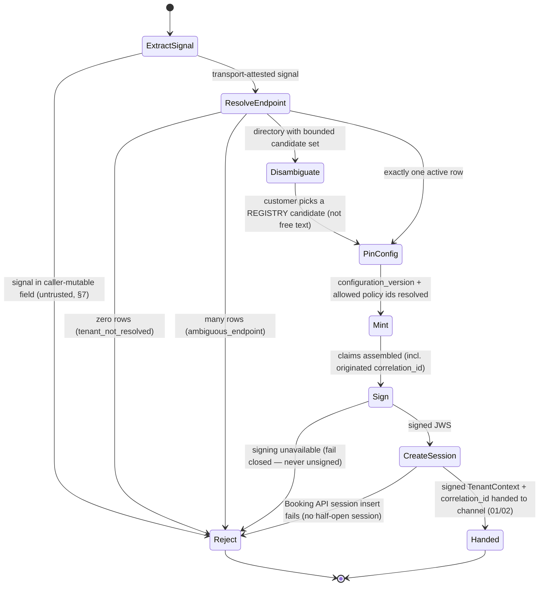

# 15 — Tenant Resolution & Channel Gateway

**Status:** Proposed
**Owner project(s):** `apps/api` (Cordia.Api ingress endpoints + Cordia.Application resolution/issuance handlers + Cordia.Infrastructure endpoint registry, signing-key custody, EF mapping); `apps/langgraph` (`cordia_agent` verifies the signed `TenantContext` in the `ResolveTenant` node — it does **not** resolve tenant); `libs/shared-schemas` (the `TenantContext` cross-service contract, Pydantic-as-source-of-truth)
**Source design sections:** §7 Tenant Resolution (lines 463–499), §5 System Context (lines 171–229, the Channel Gateway node), §25.1 Correlation (lines 2073–2087, `correlation_id` originates at channel ingress), §2.6 (lines 108–117, user-facing language ↔ persisted truth — the gateway never asserts a tenant fact it has not verified), §24.5 Authorization (lines 2066–2069), §30 Inv-13. Frozen decision **D15** (this spec owns tenant resolution + `TenantContext` minting/signing/verification + `correlation_id` origination) and **D12** (the gateway is the single creator of the `conversation_sessions` row, via the Booking API).

---

## 2. Purpose & scope

The Channel Gateway is the **first hop of every conversation, on every channel**, and it exists to answer one question *before any tenant data is loaded*: **which tenant is this, and is that answer trustworthy?** (§7, Inv-13). It resolves tenant identity from **channel-controlled signals only** — never from an LLM or a customer's words — mints a **signed, short-lived `TenantContext`** that downstream components (the voice pipeline, the agent, the Booking API) cryptographically verify before touching data, **originates the `correlation_id`** that spec 13 threads through everything, and **creates the tenant-scoped `conversation_sessions` row via the Booking API** at session start (D12).

This spec owns the responsibility an adversarial review found *owned nowhere*: the trust boundary at channel ingress. Its **primary axis is reliability** — it gates **Inv-13** for the entire platform; a wrong or forged tenant answer here is a cross-tenant data breach everywhere downstream. Its **secondary, hard constraint is latency**: it sits on the critical path *before* the first conversational turn, so it must resolve, sign, and persist the session within a tight budget (§8) or it delays every call's "hello."

In scope: the resolution-signal precedence table; the `tenant_channel_endpoints` registry; the `TenantContext` claim set + signing/verification mechanism + key rotation; `correlation_id` origination; the gated `tenant_configuration` surface (timezone/hours/policies/catalog/credentials/routing, §7); the tenant-scoping obligation it imposes on every downstream record/query/cache key/queue message/object path (Inv-13); and the `conversation_sessions` creation call. Out of scope: the media substrate (`01`), the agent graph (`02`), tool wire-schemas (`03`), the authorization spine for owner/operator actions and verification grants (`14`/`08`), and all business state.

---

## 3. Position in the system

**Lane:** INGRESS / CROSS-CUTTING, reliability-weighted. The gateway is the `channelGateway` node of the §5 System Context — the single edge between *Customer* and the *Channel and Conversation* subgraph. It is upstream of **both** foreground entry points (voice pipeline `01` and text agent `02`) and feeds the Booking API once, at session start, to persist the session.

```text
Customer / Owner
   │  (inbound phone, messaging webhook, web-widget bootstrap, email, web origin, explicit selection)
   ▼
[15 THIS: Channel Gateway]
   ├─ 1. resolve tenant from channel signal ──► tenant_channel_endpoints registry (read, tenant-scoped by endpoint)
   ├─ 2. originate correlation_id (§25.1)
   ├─ 3. load configuration_version + allowed agent/tool policy ids
   ├─ 4. mint + SIGN TenantContext (short-lived JWS, kid → rotating key)
   ├─ 5. create conversation_sessions row VIA Booking API (D12 single-writer)
   └─ 6. hand signed TenantContext + correlation_id to the channel session
         │
         ├──► [01 streaming-voice-pipeline]  (consumes TenantContext at audio.started; propagates on every frame)
         └──► [02 foreground-agent]           (ResolveTenant node VERIFIES the signature before LoadContext)
                    │ tools (03) — every call is tenant-scoped from the verified context
                    ▼
              [04 submission] / [06 workflow] / [12 persistence] — tenant_id leads every row, query, key, path
```

| Upstream (produces the signal) | Downstream (consumes the trusted context) |
|---|---|
| Telephony provider (DID / inbound phone number) | [`01`](01-streaming-voice-pipeline.md) — `TenantContext` consumed at `audio.started`, then propagated on every frame |
| Messaging webhook (recipient / page / business id) | [`02`](02-foreground-conversational-agent.md) — `ResolveTenant` node **verifies** signature; `LoadContext` runs only after |
| Web widget bootstrap (deployment key) | [`03`](03-agent-tool-contracts.md) — every tool is tenant-scoped from the verified `tenant_id`; `get_tenant_context` returns the gated config |
| Inbound email (recipient address) | Booking API ([`12`](12-data-model-and-persistence.md)) — `conversation_sessions` row created with `tenant_id` leading the PK |
| Authenticated web origin (owner/operator portal) | [`13`](13-observability-and-slos.md) — `correlation_id` originated here is the root of the §25.1 chain |
| Explicit business selection (multi-tenant directory) | [`14`](14-security-and-privacy.md) — the trusted `tenant_id` is the precondition for the Inv-13 tenant-scope guard + secret custody |

**What this component MUST NOT do:**

- It MUST NOT accept tenant identity from an **LLM output, a customer utterance, transcript text, or any caller-supplied field that is not channel-controlled** (§7, Inv-13). The caller saying "this is Bella's Bistro" is *data*, not a tenant claim. Only the channel signal (the DID they dialed, the page that received the message, the widget key the site embedded, the authenticated origin) resolves tenant.
- It MUST NOT load **customer, knowledge, menu, or booking data** — it resolves tenant and reads only the endpoint registry + tenant configuration *metadata* needed to mint the context. All business reads happen downstream, after the context is verified (Inv-13 ordering).
- It MUST NOT **write `conversation_sessions` directly** — the Booking API is the single writer (D12). The gateway *invokes* the API to create the row.
- It MUST NOT perform any **booking side effect, mutation, or provider call** (Inv-1) — it is pre-conversation.
- It MUST NOT **re-mint `correlation_id` mid-flow** (§25.1) — it originates exactly one per session, and echoes an inbound `correlation_id` on provider webhooks rather than minting a second.
- It MUST NOT issue a `TenantContext` whose claims it cannot **sign** — an unsigned/unsignable context fails closed (no session, channel-appropriate "can't reach this business" reject), never a downgrade to an unscoped or "default tenant" session.

---

## 4. Component design

| Sub-component | Project / layer | Responsibility |
|---|---|---|
| **Channel ingress adapters** | `Cordia.Api` (one thin controller/webhook endpoint per channel) | Terminate the channel-specific inbound (telephony webhook, messaging webhook, widget bootstrap, inbound-email hook, authenticated portal origin, directory selection). Extract the **raw channel signal** and nothing else. Map each to a single `ResolveTenantContextCommand`. |
| **Resolution-signal extractor** | `Cordia.Application` | Normalize the raw signal into a typed `ChannelSignal { channel, signal_type, signal_value }`. Reject signals carried in caller-mutable fields (e.g. SIP display name, message body) — only transport-attested fields are eligible. |
| **Endpoint registry resolver** | `Cordia.Infrastructure` (repo over `tenant_channel_endpoints`) | Look up `(channel, signal_type, signal_value)` → `{ tenant_id, channel_endpoint_id, configuration_version, policy_bundle_id }`. Exactly-one match required; zero → `tenant_not_resolved`; many → `ambiguous_endpoint` (fail closed). |
| **Configuration-version resolver** | `Cordia.Application` | Resolve the *current* `configuration_version` and the **allowed agent + tool policy identifiers** for the endpoint (the closed set the agent may use), without loading the config body. Pins the version into the context so downstream reads are consistent (`get_tenant_context` reads against the same version). |
| **Correlation originator** | `Cordia.Application` (`CorrelationContext` from [`13`](13-observability-and-slos.md)) | Mint `correlation_id` once (§25.1). If the provider passed an inbound `correlation_id` on a webhook, echo it; otherwise generate. `causation_id` is null at the root. |
| **TenantContext minter** | `Cordia.Application` | Assemble the claim set (§5.1), stamp `issued_at`/`expires_at`, and request a signature. Never emits an unsigned context. |
| **Signer / verifier** | `Cordia.Infrastructure` (`ITenantContextSigner`) | Sign the canonical claim JSON into a compact **JWS** with a `kid` header bound to the active signing key; verify on the inbound side. Keys live in the server-side secret store (`14`) and never leave it. Supports overlapping active keys for zero-downtime rotation. |
| **Session creator (API client)** | `Cordia.Application` → Booking API | Issue the `CreateConversationSessionCommand` so the **Booking API** inserts the tenant-scoped `conversation_sessions` row (D12). The gateway supplies `tenant_id`, `channel`, `session_id`, `correlation_id`, `channel_endpoint_id`; consent fields are left for the foreground consent gate (`14`) to UPDATE later. |
| **TenantContext guard (verifier side)** | `apps/langgraph` `ResolveTenant` node + `Cordia.Api` middleware | On every downstream entry, verify signature + `expires_at` + audience, then bind `tenant_id` into the ambient `CorrelationContext`/repository scope **before** any data access (Inv-13). A failed/expired/unsigned context is rejected; the agent never proceeds to `LoadContext`. |

**Resolution-signal precedence.** When a channel can present more than one signal (e.g. an authenticated portal origin *and* an explicit directory selection), precedence runs **most-attested → least**:

| Rank | Signal | Channel(s) | Trust basis |
|---|---|---|---|
| 1 | Authenticated web origin / session | web (owner/operator portal) | server-validated auth + tenant claim on the session |
| 2 | Inbound phone number (called DID) | voice | telephony transport attests the dialed number, not the caller |
| 3 | Messaging recipient / page / business id | messaging | platform webhook attests the receiving asset |
| 4 | Inbound email recipient | email | the `To`/delivery address the MX received |
| 5 | Web widget deployment key | web (embed) | per-deployment key minted for one tenant origin; validated against allowed origins |
| 6 | Explicit business selection | directory / disambiguation | a *bounded choice among already-resolved candidates* — never free text |

Explicit selection (rank 6) is only ever a choice **among endpoint-registry candidates**, never a tenant id typed or spoken by the customer. The signal value is matched against the registry; the *name* the customer says is never trusted (§7).

---

## 5. Data contracts & schemas

Pydantic models in `apps/langgraph/cordia_agent` are the **source of truth**; the C#/TS/Zod shapes are generated into `libs/shared-schemas` (`bun nx run langgraph:generate-schemas` → `shared-schemas:generate-types`). `TenantContext` is a cross-service contract because both the agent and the API verify it.

### 5.1 `TenantContext` (the signed claim set, §7)

```python
class TenantChannel(str, Enum):
    voice = "voice"
    messaging = "messaging"
    web = "web"
    email = "email"

class TenantContext(BaseModel):
    model_config = ConfigDict(extra="forbid")     # closed → Zod .strict()
    tenant_id: str                                 # opaque, e.g. "tenant_01J..."; leads every downstream key (Inv-13)
    channel: TenantChannel
    channel_endpoint_id: str                       # the resolved tenant_channel_endpoints row
    configuration_version: str                     # pins the gated tenant_configuration snapshot
    correlation_id: str                            # ORIGINATED here (§25.1); root of the lineage chain
    session_id: str                                # the conversation_sessions row this context anchors
    allowed_agent_policy_ids: list[str]            # closed set the agent graph may run
    allowed_tool_policy_ids: list[str]             # closed allowlist the tool layer (03) enforces
    issued_at: AwareDatetime                       # ISO-8601 + offset
    expires_at: AwareDatetime                      # short-lived (see §8); verifier rejects past this
```

**Wire form.** The context crosses the boundary as a compact **JWS**: `base64url(header).base64url(payload).base64url(signature)`, where `header = { "alg": <signing-alg>, "kid": <key-id>, "typ": "tenantctx+jws" }` and `payload` is the canonical JSON of the claims above. The **`tenant_id` is a signed claim, never a bare field** a caller could set. Downstream components receive the JWS, verify it, and only then read the claims.

### 5.2 Signing & verification mechanism (how downstream trusts it; key rotation)

- **Why signed.** Inv-13 requires that tenant scope be *established* and *trustworthy* before data access. The agent runs in a separate process (`apps/langgraph`) from the authoritative API (`apps/api`); a plain field could be forged or mutated in transit. A signature makes the context **tamper-evident and origin-attested**: a downstream verifier accepts `tenant_id` *only* if the signature validates against a known gateway key. Tenant identity reconstructed any other way (LLM, transcript) is rejected (§7).
- **Algorithm.** Compact JWS over the canonical claim JSON. The concrete `alg` is an open decision (§13, OD-1): symmetric **HMAC (HS256)** is simplest when issuer and verifiers share a secret inside one trust domain; **asymmetric (EdDSA/ES256)** lets the agent verify with a public key while only the gateway holds the private key (preferred if the agent is less trusted). Either way the verifier needs no business state to validate — verification is pure crypto + clock.
- **Key custody.** Signing keys live in the server-side **secret store** owned by [`14`](14-security-and-privacy.md) and are injected into `ITenantContextSigner` only; they are **never** serialized into the context, a log, a trace, a queue message, or an exception (Inv-12).
- **Key rotation.** Each key has a `kid`. The signer always signs with the *current* key; verifiers resolve the key by the `kid` in the JWS header and accept any key in the **active set**. Rotation is staged: (1) publish the new key to verifiers as active-but-unused; (2) flip the signer to the new `kid`; (3) after `max(expires_at)` of all in-flight contexts has passed, retire the old key. Because `TenantContext` is short-lived (§8), the overlap window is minutes, not days. A `kid` the verifier does not recognize → reject (fail closed), with a "tenant-context verification failure" metric/alert wired through [`13`](13-observability-and-slos.md) (the §25.4 cross-scope/verification alert family).
- **Verification order (downstream).** verify signature → check `kid` is active → check `expires_at` not passed and `issued_at` not in the future (small skew allowed) → check audience/`typ` → **then** bind `tenant_id` into scope. Any failure short-circuits before data access (Inv-13). The agent's `ResolveTenant` node performs exactly this and refuses to advance to `LoadContext` on failure (`02` §4).

### 5.3 The gated `tenant_configuration` surface (§7)

The gateway **gates** (resolves the version of, and authorizes access to) — but does **not** ship the body of — the tenant configuration. The body is read downstream by `get_tenant_context` (`03`) against the pinned `configuration_version`. The surface, per §7:

| Configuration group | Used by | Notes |
|---|---|---|
| timezone & locale | `02` read-back, `10` notifications | every customer-facing time renders in tenant tz |
| operating hours & blackout periods | `02`/`07` candidate checks | gate availability before provider calls |
| service catalog & capacity rules | `03` `search_vendor_catalog`, `07` | approved versions only |
| booking / cancellation / deposit / waitlist policies | `02` `validate_booking_draft`, `08`, `09`, `11` | versioned; pinned by `configuration_version` |
| approved vendor catalog & menu versions | `11` | `published` catalog versions only (D4) |
| knowledge sources | `02` retrieval | untrusted-as-instruction (`14` §8.11) |
| escalation contacts & SLA | `08` handoff | routing for human handoff |
| channel-specific consent notices | `14` consent gate | jurisdiction/channel notice text |
| **provider credentials & routing** | `06`/`09`/`10` adapters | **server-only**; resolved into adapters, never into the context, agent, or logs (Inv-12). The gateway records *which* routing applies via `channel_endpoint_id`/`configuration_version`; the secrets stay in `14`'s store. |

### 5.4 Tenant-scoping obligation it imposes (Inv-13)

The signed `tenant_id` is the **mandatory scope key for everything downstream**. This spec is the *origin* of that obligation; `12`/`14` *enforce* it. Concretely, every component MUST carry `tenant_id` on:

| Surface | Obligation | Enforced in |
|---|---|---|
| DB record | `tenant_id` is the first PK/index column on every table | [`12`](12-data-model-and-persistence.md) §5.0 |
| DB query | global EF filter `e.TenantId == _tenantContext.TenantId`; no cross-tenant FK | [`12`](12-data-model-and-persistence.md), [`14`](14-security-and-privacy.md) tenant-scope guard |
| Cache key | `tenant_id` prefix; no shared-key cache across tenants | [`14`](14-security-and-privacy.md) |
| Vector / catalog search | `tenant_id` filter on the index | [`03`](03-agent-tool-contracts.md), [`14`](14-security-and-privacy.md) |
| Queue message | `tenant_id` on every outbox/inbox/job/DLQ envelope | [`05`](05-job-queue-outbox-inbox.md) (D9/D10/D11) |
| Object-storage path | tenant-scoped path prefix + access control | [`14`](14-security-and-privacy.md) |
| Tool invocation | every tool resolves scope from the verified context, never from arguments | [`03`](03-agent-tool-contracts.md) |

A downstream call lacking tenant scope **fails closed** (`14` §5 guard). The gateway guarantees the scope *exists and is trustworthy*; the platform guarantees it is *applied*.

### 5.5 DB tables touched

- **`conversation_sessions`** (owner `02`; DDL `12`) — the gateway **causes** the insert via the Booking API at session start (D12 single-writer). Row carries `tenant_id` (leading PK), `session_id`, `channel`, `channel_endpoint_id`, `correlation_id`, `started_at`, `version`; `consent_*` fields are left null for the foreground consent gate (`14`) to UPDATE through the API. The gateway, voice pipeline, and agent never write this row directly.
- **`tenant_channel_endpoints`** (NEW — owner of the *registry contract* is this spec; DDL home is [`12`](12-data-model-and-persistence.md)) — see §13 OD-2. The resolver reads it; it is itself tenant-scoped (each row belongs to one tenant). Logical columns: `tenant_id`, `channel_endpoint_id` (pk member), `channel` (enum), `signal_type` (enum: `phone_number`/`messaging_recipient`/`widget_key`/`email_recipient`/`web_origin`/`directory_slug`), `signal_value`, `configuration_version`, `policy_bundle_id`, `status` (enum: `active`/`disabled`), `version`. Uniqueness: `(channel, signal_type, signal_value)` must resolve to **exactly one active row** — this is the structural guarantee that one channel signal cannot map to two tenants.
- **`audit_events`** (append-only; write path owned by [`14`](14-security-and-privacy.md), D13) — the gateway appends a tenant-resolution event (signal type, resolved `tenant_id`, `channel_endpoint_id`, `correlation_id`, outcome) so every resolution — especially a failed/ambiguous one — is auditable (§24.5).

### 5.6 Issuance command shapes (`apps/api`)

```csharp
// Cordia.Application/TenantResolution/ResolveTenantContextCommand.cs
public record ResolveTenantContextCommand(
    TenantChannel Channel,
    string SignalType,        // phone_number | messaging_recipient | widget_key | email_recipient | web_origin | directory_slug
    string SignalValue,       // transport-attested only; never caller free-text
    string? InboundCorrelationId)   // echoed if the provider supplied one (§25.1); else minted
    : IRequest<SignedTenantContext>;

public record SignedTenantContext(string Jws, TenantContextDto Claims);

// Cordia.Application/ConversationSessions/CreateConversationSessionCommand.cs (single-writer, D12)
public record CreateConversationSessionCommand(
    string TenantId,
    string SessionId,
    TenantChannel Channel,
    string ChannelEndpointId,
    string CorrelationId) : IRequest<ConversationSessionDto>;
```

A `FluentValidation` validator rejects a `SignalValue` whose `SignalType` is not in the closed set, and rejects empty values. Resolution failures throw typed domain exceptions (`TenantNotResolvedException`, `AmbiguousEndpointException`) mapped by middleware to a channel-appropriate response — never a 500, never a fallback tenant.

---

## 6. Workflows

### 6.1 Happy path — inbound voice call resolves, signs, persists session, hands off

```mermaid
sequenceDiagram
    autonumber
    participant TP as Telephony provider
    participant GW as Channel Gateway (15)
    participant REG as Endpoint registry (tenant_channel_endpoints)
    participant SGN as Signer (ITenantContextSigner)
    participant API as Booking API (conversation_sessions writer, D12)
    participant VP as Voice Pipeline (01)
    participant AG as Foreground Agent (02)

    TP->>GW: inbound call {called DID = +1..., provider correlation?}
    Note over GW: signal = phone_number (transport-attested); caller name is IGNORED (§7)
    GW->>REG: resolve (voice, phone_number, +1...)
    REG-->>GW: exactly one active row → {tenant_id, channel_endpoint_id, configuration_version, policy_bundle}
    GW->>GW: originate correlation_id (§25.1); allocate session_id
    GW->>SGN: sign TenantContext claims (kid = active key)
    SGN-->>GW: JWS (tenantctx+jws)
    GW->>API: CreateConversationSessionCommand{tenant_id, session_id, channel, endpoint, correlation_id}
    API-->>GW: 201 conversation_sessions row created (consent_* left for 14)
    GW->>API: append audit_events{tenant_resolution, signal=phone_number, outcome=resolved}
    GW-->>VP: signed TenantContext + correlation_id
    VP->>VP: audio.started {session, correlation} — propagate TenantContext on every frame (01)
    VP->>AG: transcript.final
    AG->>AG: ResolveTenant — VERIFY JWS (sig+kid+expiry+audience) BEFORE LoadContext (Inv-13)
    AG->>API: get_tenant_context (reads config @ configuration_version) — tenant-scoped (03)
    Note over GW,AG: One correlation_id now roots the entire §25.1 lineage chain
```

### 6.2 Failure / recovery — signing-key rotation mid-flight + ambiguous / unresolved signal

```mermaid
sequenceDiagram
    autonumber
    participant GW as Channel Gateway (15)
    participant REG as Endpoint registry
    participant SGN as Signer (keys: kid_A active, kid_B new)
    participant AG as Agent verifier (02 ResolveTenant)
    participant OPS as Ops / 13 alerts

    Note over SGN: rotation staged — kid_B published to verifiers as active-but-unused
    GW->>SGN: sign (still kid_A) → JWS_A
    GW-->>AG: TenantContext JWS_A
    AG->>AG: verify: kid_A in active set ✓ → proceed (in-flight contexts keep working)
    Note over SGN: flip signer to kid_B; kid_A stays active until max(expires_at) passes
    GW->>SGN: sign (now kid_B) → JWS_B
    GW-->>AG: TenantContext JWS_B
    AG->>AG: verify: kid_B in active set ✓ → proceed (zero downtime)

    rect rgb(245,235,235)
    Note over GW,REG: meanwhile, a different inbound resolves to ZERO / TWO rows
    GW->>REG: resolve (messaging, messaging_recipient, page_X)
    REG-->>GW: no active row  (or: two rows → ambiguous)
    GW->>GW: FAIL CLOSED — no TenantContext minted, no session created
    GW->>OPS: audit_events{outcome=tenant_not_resolved|ambiguous} + tenant-resolution-failure metric/alert (§25.4)
    GW-->>GW: channel-appropriate reject ("can't reach this business right now")
    AG--xAG: never invoked — no signed context exists to verify (no unscoped session ever created)
    end
```

### 6.3 Resolution & issuance state machine



---

## 7. Reliability mechanisms (mapped to invariants)

- **Inv-13 (tenant scope established before data access) — PRIMARY.** The gateway is the sole producer of a *trustworthy* `tenant_id`: resolved from a transport-attested channel signal (never LLM/customer), pinned to a `configuration_version`, **signed**, and verified downstream before any read. The endpoint registry's `(channel, signal_type, signal_value) → exactly one active tenant` uniqueness is the structural guarantee a signal can't fan out to two tenants. Everything else inherits scope from this signed claim (§5.4).
- **Inv-13 (untrusted tenant identity rejected).** The signal extractor accepts only transport-attested fields; caller-mutable fields (SIP display name, message body, spoken business name) are rejected as *data*. The signature makes the issued `tenant_id` tamper-evident in transit, so a compromised agent process cannot fabricate a context that the API will honor.
- **Inv-1 boundary (no side effect from text).** The gateway resolves tenant *before* any conversation and performs no booking side effect; a business name in the customer's words never changes resolution.
- **§25.1 correlation origination.** Exactly one `correlation_id` is minted per session at ingress (or echoed from the provider) and never re-minted; it is a signed claim so the lineage root cannot be swapped downstream. This is the anchor [`13`](13-observability-and-slos.md) threads through traces/tools/intents/operations/outbox/inbox/broker/attempts/notifications.
- **D12 single-writer for `conversation_sessions`.** Only the Booking API inserts the row; the gateway *requests* it. No half-open session: if the session insert fails, the whole ingress fails closed (no orphaned signed context).
- **Fail-closed everywhere.** Zero match, ambiguous match, unsignable context, or failed session insert → reject with a generic channel message + audited failure; the platform **never** falls back to a default/unscoped tenant. A security degradation never silently becomes more permissive (mirrors `14` fail-closed posture).
- **§24.5 authorization + audit.** Every resolution (success and failure) appends an immutable `audit_events` row (D13 write path in `14`), so cross-tenant resolution attempts and ambiguous-endpoint conditions are observable (§25.4 tenant cross-scope alert family in `13`).
- **§2.6 (language ↔ persisted truth).** The gateway only emits a context for a tenant it has *verified against the registry*; it never asserts a tenant identity it has not resolved, so downstream customer-facing statements rest on a persisted, audited resolution.

---

## 8. Latency budget & optimizations

The gateway is on the **critical path before the first turn** (§5): every millisecond here is added before "hello." It is a small amount of work — a registry read, a config-version resolve, a signature, and one API call — so the budget is tight.

| Stage | Target (p95) | Technique |
|---|---|---|
| Signal extraction + validation | < 5 ms | pure in-process; no I/O |
| Endpoint resolution (`tenant_channel_endpoints`) | < 15 ms | `(channel, signal_type, signal_value)` unique index, `.AsNoTracking()`; hot endpoints cached (versioned, tenant-scoped cache key) |
| Configuration-version + policy-id resolve | < 10 ms | metadata only (version + allowed policy ids), **not** the config body; cached by `configuration_version` |
| Mint + **sign** `TenantContext` | < 10 ms | symmetric HMAC or precomputed EdDSA key in-memory (key material from `14`'s store, loaded once); canonical-JSON serialize is cheap; no network |
| Create `conversation_sessions` via Booking API | < 100 ms | single PK insert (`tenant_id, session_id`); reuses the API's durable-acceptance fast path; co-located deployment (§5 note — API + gateway may share the .NET process initially) avoids a cross-network hop |
| **Gateway end-to-end (signal → signed context handed off)** | **< 150 ms** | the above; the audit append is fire-and-async (must not block handoff) |

Optimizations: the endpoint registry is read-mostly and **cacheable** (invalidated on `configuration_version` change); the signing key is loaded once and held in memory (rotation swaps it); the `audit_events` append is asynchronous so it never sits in the critical path; and the session-creation call uses the same co-located API the agent will call, so when API and gateway share the deployment (§5) it is an in-process MediatR send rather than an HTTP round-trip. The gateway never loads the config *body* — that cost is deferred to `get_tenant_context` (`03`, p95 ≤ 80 ms), which runs once the conversation is already live.

> Note: the gateway's budget is **independent of and additive to** the durable-acceptance SLO owned by [`13`](13-observability-and-slos.md) (D6, p95 < 300 ms) — that SLO governs booking submission, a later step. The session-creation insert is a small component of one API call, not the acceptance path.

---

## 9. Failure modes & recovery

| Failure | Detection | Recovery / behavior | Invariant |
|---|---|---|---|
| Signal in a caller-mutable field (SIP display name, message body, spoken name) | extractor field allowlist | Treat as data, not a tenant claim; resolve only from the transport-attested signal | Inv-13, §7 |
| No matching endpoint row | registry returns zero | Fail closed → `tenant_not_resolved`; audited; generic "can't reach this business"; **no session, no context** | Inv-13 |
| Signal maps to >1 tenant | registry returns many | Fail closed → `ambiguous_endpoint`; audited + alerted (§25.4); never guess | Inv-13 |
| Signing key unavailable / signer down | `ITenantContextSigner` error | Fail closed — no unsigned context ever emitted; reject ingress; alert | Inv-13, Inv-12 |
| Verifier sees unknown / retired `kid` | `kid` not in active set | Reject the context downstream; agent does not advance to `LoadContext`; verification-failure metric/alert | Inv-13 |
| `TenantContext` expired before use (slow setup / long pause) | `expires_at` < now at verify | Reject; the channel re-resolves a fresh context for the same session (same `session_id`/`correlation_id` on reconnect, `01` §8.9) | Inv-13, §25.1 |
| Booking API session insert fails | API error on `CreateConversationSessionCommand` | Fail closed — no half-open session; retry the create (idempotent on `(tenant_id, session_id)`); do not hand off a context without a persisted session | D12, Inv-13 |
| Inbound provider supplies a `correlation_id` | webhook header present | Echo it (do not mint a second); preserves cross-system lineage | §25.1 |
| Reconnect after drop | channel re-binds same `session_id` | Re-mint a fresh short-lived `TenantContext` (same `tenant_id`/`session_id`/`correlation_id`); the session row already exists | §25.1, `01` §8.9 |
| Attempt to load business data before verify | repository tenant-scope guard (`14`) | Guard fails closed — no unscoped read is possible even if ordering is violated | Inv-13 |
| Registry row `disabled` mid-flight | resolver filters `status='active'` | Treated as `tenant_not_resolved` for new sessions; in-flight signed contexts run out their short TTL | Inv-13 |

---

## 10. Interfaces to sibling specs

- [`01-streaming-voice-pipeline.md`](01-streaming-voice-pipeline.md) — **crosses:** the gateway hands the signed `TenantContext` + `correlation_id` to the pipeline, which consumes it at `audio.started` and **propagates** (does not resolve) `tenant_id`/`correlation_id` on every frame; the pipeline uses the gateway-created `conversation_sessions` row as the reconnect anchor.
- [`02-foreground-conversational-agent.md`](02-foreground-conversational-agent.md) — **crosses:** the `ResolveTenant` node **verifies** this spec's signed `TenantContext` (signature + `kid` + expiry + audience) before `LoadContext`; it rejects any tenant identity from the LLM/customer (Inv-13). The agent treats `TenantContext` purely as an input from `15` (D15).
- [`03-agent-tool-contracts.md`](03-agent-tool-contracts.md) — **crosses:** every tool is tenant-scoped from the verified `tenant_id`; `get_tenant_context` reads the gated `tenant_configuration` body against the `configuration_version` this spec pinned; the tool allowlist is the `allowed_tool_policy_ids` claim.
- [`12-data-model-and-persistence.md`](12-data-model-and-persistence.md) — **crosses:** owns the DDL for `conversation_sessions` (created here via the API per D12) and for the new `tenant_channel_endpoints` registry (this spec owns the registry *contract*; `12` owns the DDL — §13 OD-2); enforces `tenant_id`-leading keys/indexes that make §5.4 scoping cheap.
- [`13-observability-and-slos.md`](13-observability-and-slos.md) — **crosses:** this spec **originates** the `correlation_id` that `13` threads through the entire §25.1 chain; tenant-resolution-failure and cross-scope-attempt conditions emit into `13`'s §25.4 alert family; the gateway's `< 150 ms` budget is measured as an ingress SLI.
- [`14-security-and-privacy.md`](14-security-and-privacy.md) — **crosses:** the trusted `tenant_id` produced here is the *precondition* for `14`'s Inv-13 tenant-scope guard, authorization spine (§24.5), and secret custody; signing keys + provider credentials live in `14`'s server-side store; the `audit_events` write path is `14`'s (D13); the foreground consent gate UPDATES the `consent_*` fields on the session this spec created (D12).

---

## 11. Implementation mapping

**`apps/api/src/Cordia.Domain`**
- `TenantResolution/ITenantContextSigner.cs` — sign/verify interface (impl in Infrastructure; never references EF/HTTP).
- `TenantResolution/TenantChannelEndpoint.cs` — registry entity; repository interface `ITenantChannelEndpointRepository`.
- `TenantResolution/TenantNotResolvedException.cs`, `AmbiguousEndpointException.cs` — typed domain exceptions.

**`apps/api/src/Cordia.Application`**
- `TenantResolution/ResolveTenantContextCommand.cs` (+ handler) — extract → resolve → pin config version → originate `correlation_id` ([`13`](13-observability-and-slos.md) `CorrelationContext`) → mint → sign. One request + handler per file.
- `TenantResolution/ResolveTenantContextValidator.cs` — closed `signal_type` set, non-empty `signal_value`.
- `ConversationSessions/CreateConversationSessionCommand.cs` (+ handler) — the **single-writer** insert path (D12); also where the consent gate's later UPDATE handler lives (`14`).

**`apps/api/src/Cordia.Infrastructure`**
- `TenantResolution/JwsTenantContextSigner.cs` — compact JWS sign/verify; key resolved by `kid` from the active-key set; key material from `14`'s secret store (loaded once, swapped on rotation).
- `TenantResolution/TenantChannelEndpointRepository.cs` — `.AsNoTracking()` read by `(channel, signal_type, signal_value)`; versioned tenant-scoped cache.
- EF Core `IEntityTypeConfiguration<TenantChannelEndpoint>` (snake_case) — DDL home is [`12`](12-data-model-and-persistence.md); pg-enums (`channel`, `signal_type`, endpoint `status`) added to `tools/config/ef-enum-mappings.json`.

**`apps/api/src/Cordia.Api`**
- `Controllers/Channels/` — one thin ingress endpoint per channel (telephony webhook, messaging webhook, widget bootstrap, inbound-email hook, portal-origin, directory selection); each maps to `ResolveTenantContextCommand` and returns the signed context to the channel session.
- `Middleware/TenantContextVerificationMiddleware.cs` — verify the signed context on API-side downstream calls before any handler touches data (mirrors the agent's `ResolveTenant` verify).

**`apps/langgraph/cordia_agent`**
- `models/tenant_context.py` — `TenantContext` Pydantic model (**source of truth**; generates the C#/TS/Zod shapes). Verification logic lives in `nodes/resolve_tenant.py` (already mapped in `02`).

**`libs/shared-schemas`**
- After `bun nx run langgraph:generate-schemas` → `shared-schemas:generate-types`, `TenantContext` ships as a closed (`.strict()`) cross-service contract verified by both `apps/api` and `apps/langgraph`. Never hand-edit generated outputs.

---

## 12. Test strategy

**Resolution correctness (Unit, `apps/api`, Moq)**
- Each `signal_type` resolves the correct single tenant from a seeded registry; zero rows → `TenantNotResolvedException`; two rows → `AmbiguousEndpointException` (both fail closed, no context minted).
- A signal presented in a caller-mutable field is rejected; only transport-attested fields resolve (Inv-13, §7).
- Precedence: when multiple signals are present, the highest-rank attested signal wins; explicit selection only chooses among registry candidates, never free text.

**Signing / verification (Unit)**
- Round-trip: signed `TenantContext` verifies; a tampered claim (changed `tenant_id`) fails verification.
- Key rotation: a context signed with `kid_A` still verifies while `kid_A` is in the active set; after retirement it is rejected; a context signed with the new `kid_B` verifies immediately (zero-downtime overlap).
- Expired `expires_at` and future `issued_at` (beyond skew) are rejected; unknown `kid` is rejected.
- No signing key, secret, or PAN-like material ever appears in the serialized context, logs, traces, or exceptions (Inv-12) — assert via a redaction/log audit.

**Inv-13 ordering (Integration, Alba + real Postgres via Testcontainers)**
- An attempt to read business data before a verified context is present fails closed at the repository tenant-scope guard (`14`) — no unscoped read possible.
- A full ingress: signal → resolved → signed → `conversation_sessions` row created **only via the API** (D12) with `tenant_id` leading the PK; the consent fields are null until the consent gate UPDATEs them.

**Correlation (Integration)**
- Exactly one `correlation_id` is originated per session and appears on the `conversation_sessions` row and the `audit_events` resolution row (§25.1 root); an inbound provider `correlation_id` is echoed, not re-minted.

**Failure / audit**
- Every resolution outcome (resolved / not_resolved / ambiguous / signing_failed / session_insert_failed) appends the expected `audit_events` row and increments the tenant-resolution metric ([`13`](13-observability-and-slos.md)).
- Booking API session-insert failure does not leave a usable signed context handed to the channel (no half-open session).

Python tests for `TenantContext` verification in `nodes/resolve_tenant.py` live under `apps/langgraph/tests/unit_tests` (`bun nx test langgraph`); API tests are xUnit v3 `Category=Unit`/`Category=Integration` under `apps/api` (`bun nx test api`, `test-integration`).

---

## 13. Open decisions

- **OD-1 (signing algorithm; §31 "owner/operations roles" + trust model).** HMAC (HS256, shared secret in one trust domain) vs. asymmetric (EdDSA/ES256, agent verifies with a public key while only the gateway signs). Asymmetric is preferred if `apps/langgraph` is treated as a lower-trust process; symmetric is simpler when both share a trust domain. Either satisfies §5.2; the choice fixes the `alg` header and key-distribution mechanics. **Does not change the contract shape** (`TenantContext`) — only the JWS header + key handling.
- **OD-2 (`tenant_channel_endpoints` DDL ownership). — RESOLVED.** This spec owns the registry *contract* (columns + the `(channel, signal_type, signal_value) → exactly one active tenant` uniqueness, §5.5). Per the §22 catalog discipline, the **DDL + EF mapping is now ratified into [`12`](12-data-model-and-persistence.md) §5.1/§5.7** alongside the other tenant-scoped tables (12's catalog is now 24 tables), including the partial-unique active-signal index (`uq_channel_signal_active`) that makes Inv-13 resolvable at ingress. The registry resolver can now be implemented against a migration.
- **OD-3 (`TenantContext` TTL).** The exact `expires_at` window balances reliability (short TTL shrinks the forged-context blast radius and key-rotation overlap) against latency/UX (a TTL shorter than a long voice setup forces a re-mint on reconnect). Proposed: minutes-scale, long enough to cover one turn-to-first-response with margin, re-minted on reconnect under the same `session_id`. **Pending measured ingress + setup latency** (ties to [`13`](13-observability-and-slos.md) OD-1 baselines).
- **OD-4 (web-origin & widget-key trust details; §31 — owner/operator roles).** For the authenticated-origin and widget-key signals, the precise validation (allowed-origin list per deployment key, CORS/session binding, owner-portal auth) depends on the owner/operator identity model owned by [`14`](14-security-and-privacy.md)/[`08`](08-identity-and-manage-booking.md). This spec fixes *that* these signals resolve tenant; the auth binding details are inherited from `14`.
- **OD-5 (multi-endpoint directory disambiguation UX).** When explicit selection is needed (rank 6), how the bounded candidate set is presented per channel (voice menu vs. web picker) is a `01`/`02` UX concern; this spec only guarantees the choice is among **registry-resolved candidates**, never free-text tenant identity.
