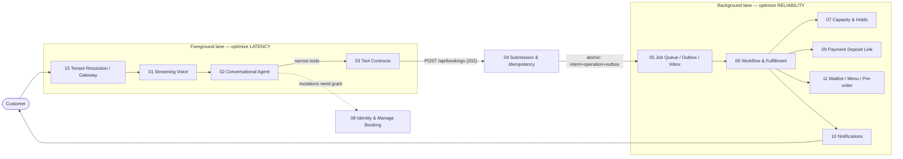

# Cordia Booking Platform — Component Specifications

Status: Proposed · Derived from [`../booking-agent-reliability-design.md`](../booking-agent-reliability-design.md)

This directory decomposes the booking-agent reliability design into **15 component
specifications**, each independently readable and implementation-grounded. The design doc
states *what* and *why*; these specs state *how each component is built* — with workflow
diagrams, concrete contracts/schemas, the reliability mechanisms mapped to the design's
release-blocking invariants, and a latency budget.

The whole set serves one principle: **the agent proposes; the platform disposes.** Work
splits into two lanes — a **foreground** conversational lane optimized for *latency* and a
**background** fulfillment lane optimized for *correctness and recovery*.



---

## How to read this set

1. New to the system → read this index, then **04** (submission contract) and **06**
   (workflow state machine): they are the spine everything else hangs off.
2. Working the agent lane → **15 → 01 → 02 → 03**.
3. Working the platform lane → **04 → 05 → 06 → 07**, then **08/09/10/11** as needed.
4. Touching the database → **12** is the single DDL owner; never invent a table or enum
   value that isn't ratified there.
5. Every spec follows the same 13-section template (purpose → position/lane → component
   design → contracts → **workflows** → reliability → latency → failure/recovery → sibling
   interfaces → implementation mapping → tests → open decisions).

---

## Component map

| # | Spec | Lane | Primary axis | Owns (in code) | Design §§ |
|---|------|------|--------------|----------------|-----------|
| [15](15-tenant-resolution-and-gateway.md) | Tenant Resolution & Channel Gateway | Foreground (ingress) | Reliability | gateway · `TenantContext` mint/sign · `correlation_id` origin | §7, §5 |
| [01](01-streaming-voice-pipeline.md) | Streaming Voice Pipeline | Foreground | **Latency** | STT/TTS streaming · barge-in · DTMF · reconnect | §6.2–6.4, §8.10 |
| [02](02-foreground-conversational-agent.md) | Foreground Conversational Agent | Foreground | **Latency** | LangGraph graph · slot capture · read-back · confirmation · recovery | §8, §6.5–6.6 |
| [03](03-agent-tool-contracts.md) | Agent Tool Contracts | Foreground ↔ API | Balanced | tool schemas · status codes · shared-schemas mapping | §23, §9.4.6–7 |
| [04](04-submission-and-idempotency.md) | Submission Contract & Idempotency | API | **Reliability** | operation identity · canonical hash · atomic acceptance | §10, §13 |
| [05](05-job-queue-outbox-inbox.md) | Job Queue, Outbox & Inbox | API | **Reliability** | queue topology · outbox publisher · inbox dedup · leases · DLQ | §12, §17 |
| [06](06-booking-workflow-and-fulfillment.md) | Booking Workflow & Fulfillment | Background | **Reliability** | state machine · worker protocol · retries · reconciliation | §11, §12.6–7, §15–16 |
| [07](07-capacity-and-holds.md) | Atomic Capacity & Holds | Background | **Reliability** | conditional capacity write · hold expiry · availability modes | §14, §2.5 |
| [08](08-identity-and-manage-booking.md) | Identity, Authorization & Manage Booking | API | **Reliability** | step-up verification · modify/cancel/owner ops | §9 |
| [09](09-payment-deposit-link.md) | Payment Deposit Link | Background | Simplicity | Stripe payment link · deposit toggle · webhook | §19 |
| [10](10-notifications.md) | Notifications | Background | **Reliability** | independent delivery · dedup · delivery states | §18 |
| [11](11-waitlist-menu-preorder.md) | Waitlist, Menu Ingestion & Pre-order | Background | Balanced | waitlist offers · isolated menu extraction · pre-order saga | §20, §21 |
| [12](12-data-model-and-persistence.md) | Data Model & Persistence | API | **Reliability** | **all 24 tables · all pg-enums · constraints · migrations** | §22 |
| [13](13-observability-and-slos.md) | Observability & SLOs | Cross-cutting | Balanced | correlation · metrics · alerts · **binding SLOs** | §25, §26 |
| [14](14-security-and-privacy.md) | Security, Privacy & Compliance | Cross-cutting | **Reliability** | consent · minimization · secrets · authz · `audit_events` write path | §24 |

---

## Single-ownership registry

Several mechanisms are *described* in many specs (so each reads standalone) but must be
**defined once**. When implementing, treat the owner as authoritative; every other mention
is a reference. This table is the tie-breaker.

| Shared contract / mechanism | Sole owner | Referenced by |
|---|---|---|
| `operation_status` domain enum (16 values) | 06 | 03 (normalized only), 12 (pg-enum), 13 |
| `NormalizedOperationStatus` (cross-service projection) | 06 | 03 (`get_operation_status`), 13 |
| Canonical request hashing rules | 04 | 02, 03, 06, 08, 09, 10, 11 |
| Idempotency disposition (same-key/same-hash, conflict, election) | 04 | 03, 08, 12 |
| `idempotency_status` enum | 04 (contract) / 12 (DDL) | — |
| Transactional outbox + consumer inbox (admitted≠completed, sweeper) | 05 | 06, 09, 10, 11, 12 |
| `consumer_inbox` / `scheduled_jobs` / `dead_letter_messages` / `workflow_steps` DDL | 12 | 05, 06 (protocol) |
| Worker staged transaction boundary + §16.2 reconciliation ladder | 06 | 07, 09, 11 |
| Crash-window matrix (§12.8) | design §12.8 | 05, 06, 07, 09, 10, 12 (per-lane rows) |
| `AvailabilityMode` enum + agent wording | 07 | 01, 02, 03 |
| Atomic capacity reservation + hold deadline | 07 | 02, 06, 09, 11 |
| `verification_action` enum (6 values) | 08 | 03, 09 |
| `VerificationGrant` contract | 08 | 02, 03, 09 |
| Deposit→workflow event contract (`deposit_paid` / `deposit_expired`) | 09 | 06 |
| `IdempotencyConflictException` type | 04 (defines) | 03, 08 (reference) |
| `vendor_catalogs` lifecycle (9 states) | 11 (lifecycle) / 12 (pg-enum) | — |
| Acceptance endpoint `POST /api/bookings` + `SubmitConfirmedIntentCommand` | 04 | 02, 03 |
| Binding latency SLOs (incl. durable-acceptance p95 < 300 ms) | 13 | 02, 03, 04 |
| `audit_events` write-path contract | 14 | 12, 13 (telemetry appends only) |
| `conversation_sessions` row (gateway creates, agent updates consent — via API) | 02 (table) / 15 (creator) | 01, 14 |
| `TenantContext` mint/sign/verify + `correlation_id` origin | 15 | all |
| `deposit_sessions` DDL/EF mapping | 12 | 09 (lifecycle) |
| `waitlist_enrollments` / `waitlist_offers` / `preorder_sagas` DDL/EF mapping | 12 | 11 (lifecycle) |
| `tenant_channel_endpoints` DDL/EF mapping (+ partial-unique active-signal index) | 12 | 15 (registry contract) |

---

## Release-blocking invariant → spec coverage

All 16 invariants from design §30 are enforced. Primary owner in **bold**.

| # | Invariant (abbrev.) | Enforced by |
|---|---|---|
| 1 | No side effect from transcript text alone | **02**, 01, 03, 04, 14 |
| 2 | Stable operation_id + idempotency key | **04**, 02, 03, 05, 06, 08, 09, 12 |
| 3 | Key bound to one canonical request hash | **04**, 03, 08, 09, 12 |
| 4 | Acceptance + operation + outbox atomic | **04**, 05, 06, 07, 09, 12 |
| 5 | Every consumer safe under duplicate delivery | **05**, 06, 09, 10, 11, 12 |
| 6 | Capacity reservation atomic & separate from idempotency | **07**, 04, 06, 09, 11, 12 |
| 7 | Ambiguous outcomes reconcile before repeat create/charge | **06**, 07, 09, 11, 03, 13 |
| 8 | Booking persisted before notification | **10**, 06, 07, 09, 11, 13 |
| 9 | Notification delivery independently deduplicated | **10**, 06, 09, 11, 12 |
| 10 | Material change ⇒ new revision + confirmation | **02**, 04, 08, 09, 10, 11, 12 |
| 11 | Mutations require server-verified authorization | **08**, 14, 02, 03, 09 |
| 12 | Card data never in agent/transcript/queue/logs | **14**, 09, 01, 02, 03, 10, 13, 12 |
| 13 | Tenant scope established before data access | **15**, 14, 01, 02, 03, 04, 08, 12 |
| 14 | DLQ never replaces customer-visible state/SLA | **05**, 06, 09, 10, 11, 12, 13 |
| 15 | Human retries use typed commands, preserve history | **06**, 05, 04, 09, 12, 14 |
| 16 | Agent states only authoritative outcomes | **02**, 06, 01, 03, 07, 09, 10, 13 |

> The critic flagged Inv-5/11/13/15 as "partial" only because their enforcement is
> distributed across many specs rather than concentrated; after the reconciliation pass
> (ratifying `workflow_steps`, `consumer_inbox.outcome`, `dead_letter_messages`, and the
> single verification-action enum) the mechanism each depends on now has a ratified home.

---

## Critical-path latency budget (foreground turn)

Owned by **13**; restated here for orientation. Targets are proposed defaults pending
measured baselines (design §26, §31).

| Stage | Spec | p95 target |
|---|---|---|
| Tenant resolve + `TenantContext` verify (once per session) | 15 | < 40 ms |
| STT final transcript | 01 | per voice SLO |
| Agent decision start | 02 | < 100 ms |
| Local policy validation (`validate_booking_draft`) | 03/02 | < 150 ms |
| Batched candidate availability (`check_candidate_availability`) | 03/07 | < 800 ms (short provider timeout; degraded ⇒ advisory) |
| Deterministic read-back render | 02 | < 30 ms |
| **Durable acceptance (`POST /api/bookings` → 202)** | **04 / 13** | **< 300 ms (p99 < 500 ms); ~80 ms inner DB txn** |
| First TTS audio | 01 | per voice SLO |

Tool-latency conversational behavior (continue / brief transition / "checking…" / offer
async confirmation) is defined in 01 §6.4 and 02.

---

## Reliability stack (effectively-once, not exactly-once)

Layered idempotency at every side-effect boundary (design §13.2), each owned by a spec:

```
agent → API           client idempotency key + canonical request hash        (04)
API acceptance        unique (tenant_id, idempotency_key)                     (04, 12)
outbox → broker       message_id                                             (05)
broker → consumer     unique (consumer_name, tenant_id, message_id)           (05, 12)
state transition      operation_id + expected status + version (optimistic)   (06, 12)
capacity              conditional atomic write + unique active hold/op        (07, 12)
booking provider      stable provider operation key + reconcile-on-ambiguous  (06, 09)
payment provider      stable payment key + webhook dedup                      (09)
notification          notification_id + provider idempotency key              (10)
manual replay         original op + control-message id, preserve attempts     (05, 06)
```

Ambiguous provider outcomes are a first-class workflow state (`reconciling`), never a blind
retry (Inv-7, owned by 06).

---

## Delivery sequencing (maps to design §29)

| Phase | Specs in play | Exit criteria |
|---|---|---|
| **1 — Contract & durable acceptance** | 15, 02 (subset), 03 (subset), 04, 12 (intent/operation/idempotency/outbox tables) | `POST /api/bookings` accepts atomically; `GET /api/booking-operations/{id}` returns normalized status; idempotency + canonical hashing pass §27.2 tests |
| **2 — Reliable worker foundation** | 05, 06, 12 (inbox/outbox/scheduled/workflow_steps), 13 | outbox publisher + inbox dedup live; optimistic-concurrency transitions; durable retry; fault-injection duplicate-delivery tests green (§27.4) |
| **3 — Capacity & provider booking** | 07, 06 (provider adapter), 10 | first-party atomic holds **or** one provider adapter with idempotency + reconciliation; hold-expiry/cancellation races (§27.3); truthful notifications |
| **4 — Verification & payment** | 08, 09, 14 | step-up verification for mutations; payment-link saga + webhook dedup; compensation/refund/void |
| **5 — Waitlist, menu & pre-order** | 11 | expiring waitlist offers; isolated menu extraction + owner approval; pre-order saga + revalidation |
| **6 — Scale & optimization** | 13, cross-cutting | provider circuits/rate controls; model tiering; ops automation; retention/compliance reporting |

---

## Known deferred items (tracked, not yet owned by a spec)

These are out of the agent→API→queue→fulfillment core and intentionally deferred:

- **apps/web operations console UI** — the human-facing manual-recovery surface (§28.4). The
  *typed backend commands* exist (05/06/08); the web view does not yet have a spec.
- **Owner / operator role & permission taxonomy** — flagged as an open decision by 08 and 14.
- **Model tiering & cost controls** (design §29 Phase 6 / §6.6).
- **Channel-callback transport mechanics** — one of the four customer-status transport options
  in §31; the chosen transport (polling / SSE / WebSocket / channel callback) needs a home.
- **Backup / restore / failover (DR) mechanics** — 13 proposes RPO ≤ 5 min / RTO ≤ 30 min but
  no spec owns the mechanism.
- **Menu artifact object-storage lifecycle table** — 11 + 14 cover behavior and the security
  boundary; the artifact metadata table/retention is not yet in 12.

---

## Frozen canonical decisions (reconciliation reference)

The reconciliation pass froze these shared value sets so independent specs agree. They
override any stale mention; if you find a spec disagreeing, the spec is wrong.

| ID | Decision |
|---|---|
| D1 | `operation_status` = `accepted, validating, awaiting_user_action, reserving_capacity, held, awaiting_payment, finalizing, booked, alternatives_required, reconciling, compensation_required, manual_review, rejected, expired, waitlisted, failed_final` |
| D2 | `NormalizedOperationStatus` = `accepted, in_progress, awaiting_user_action, alternatives_required, booked, waitlisted, rejected, expired, failed` (internal substates collapse before crossing the service boundary) |
| D3 | `idempotency_status` = `in_progress, completed, failed` |
| D4 | `catalog_status` = `uploaded, scanning, quarantined, extracting, draft_ready, in_review, approved, published, superseded` |
| D5 | `verification_action` = `read_sensitive, modify, cancel, use_payment_method, refund, owner_override` |
| D6 | Durable-acceptance SLO = **p95 < 300 ms, p99 < 500 ms** (owned by 13; ~80 ms inner DB txn is a *component*) |
| D7 | Create = `POST /api/bookings` → 202 + operation_id; status = `GET /api/booking-operations/{operationId}`; command = `SubmitConfirmedIntentCommand` |
| D8 | `workflow_steps` ratified (durable unit the sweeper resumes; distinct from `workflow_attempts`) |
| D9 | `consumer_inbox` carries `outcome` ∈ `admitted/completed/rejected` (+ `admitted_at`/`completed_at`); sweeper recovers stuck-`admitted` rows |
| D10 | `dead_letter_messages` ratified as a transport-level store (not a business table) |
| D11 | `scheduled_jobs` uses `run_after` (+ `workflow_step_id`, `destination_queue`, `status`) |
| D12 | `conversation_sessions` writes go through the Booking API: gateway creates, consent gate updates consent_* |
| D13 | `audit_events`: 14 owns the write-path contract; 13 is a narrow telemetry appender |
| D14 | Deposit→workflow events (deposit-link model) = `deposit_paid` (→ `Finalizing`), `deposit_expired` (→ `Expired`); webhook ingress is `stripe.webhook.received` (transport). The prior `payment_authorized/captured/ambiguous` saga set is superseded by 09's deposit-link design. |
| D15 | Tenant resolution + `TenantContext` mint/sign/verify + `correlation_id` origin owned by 15 |
| D16 | Spec numbering is 01–15; there is no spec 17 |
| D17 | 12's table catalog ratified to **24** tables: the 19 originals + `deposit_sessions` (09), `waitlist_enrollments` / `waitlist_offers` / `preorder_sagas` (11), `tenant_channel_endpoints` (15). New pg-enums: `deposit_status`, `waitlist_offer_status`, `preorder_saga_state`, `channel`, `signal_type`, `endpoint_status`. Supersedes the prior "19 tables" wording; resolves 15 OD-2. |

---

## Open decisions still required (design §31)

Resolve before/while implementing; tracked across the specs that depend on them: broker vs
PostgreSQL job store (05/06/12); first booking provider hold/idempotency capabilities (07/06);
canonicalization spec + hash algorithm (04); idempotency/audit/transcript/audio retention by
jurisdiction (12/14/01); verification factors & risk policy (08); payment provider &
authorize/capture sequence (09); customer-status transport (01/13); owner/operator roles
(08/14); initial SLO values (13); first-party vs provider-owned capacity model (07).
